# General settings

**Settings > General settings...** opens one window with ten tabs: the audio device, the room, the metronome, MIDI, the mixer, voicing, combination sets, the console display, the language and the log. This page lists every control on every tab in the order the window shows them: what it does, its default, its range or options, when it takes effect and where it is stored. The topics behind the controls have pages of their own ([Audio, room and mixer](audio.md), [MIDI and consoles](midi.md), [Memory, loading and streaming](memory.md), [Playing](playing.md)); this page links to them for depth. The settings that decide how a loaded organ is read from disk are in [Organ settings](organ-settings.md).

## Opening the window

The **Settings** button in the top bar opens a menu with up to four entries.

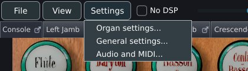

| Entry | What it does |
|---|---|
| **Organ settings...** | Opens [Organ settings](organ-settings.md). Available while an organ is loaded. |
| **Licence confirmed for this organ** | Appears only for an organ whose samples carry a publisher licence. Ticked once the licence has been confirmed for this organ; choosing it while ticked withdraws the confirmation, saves the organ's settings and loads the organ again. |
| **General settings...** | Opens the window described on this page. |
| **Audio and MIDI...** | Opens the same window on the **Audio** tab. Offered by the standalone application. |

The window is titled **General settings**, opens at 660 x 560 pixels and can be resized. The Esc key closes it. It has no OK or Cancel button: each control acts when it is changed, and the **Takes effect** column below says whether that is at once or later.

General settings hold the program and the player's console. Four tabs hold choices that belong to the organ that is loaded and are saved with it: **Room**, **Mixer** (the rank routing), **Voicing** and **Combination sets**. The **MIDI** tab keeps the keyboard channels and learned controls per organ and the rest for every organ. [Where settings are kept](#where-settings-are-kept) lists the files.

> [!NOTE]
> In the VST3, LV2 and AU plugins, **General settings...** opens this window without the **Audio** and **MIDI** tabs, because the host owns the audio device and the MIDI ports. **Organ settings...** opens Organ settings without its **MIDI** tab. **Audio and MIDI...** is absent. **Licence confirmed for this organ** works in both.

## Audio

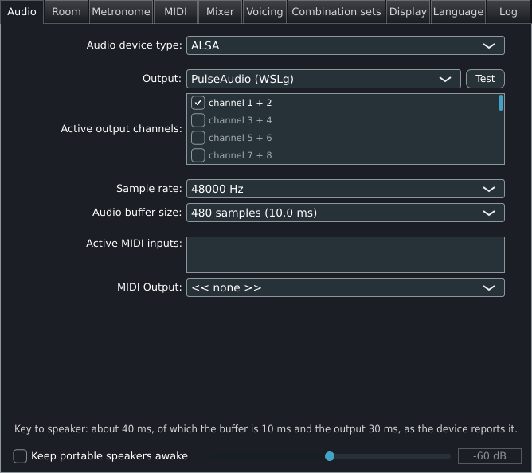

The upper part of the tab is the device selector of the audio library. It chooses where Masterpiece sends sound and which MIDI inputs are open. Its controls are described here generically; their labels and the choices offered depend on the system and the driver.

| Control | What it does | Default | Range or options | Takes effect |
|---|---|---|---|---|
| Device type | The driver family, on systems that offer more than one. | The system default | The families the system reports | At once |
| Output device | The sound device. | The system default output | The devices of that family | At once |
| Output channels | Which outputs of the device carry sound, listed as stereo pairs. | As the device opens | Up to 8 output channels | At once |
| Sample rate | The rate the device runs at. | The device's own rate on a first start; a saved setup keeps its rate | The rates the device reports | At once |
| Buffer size | The block the device processes at a time. It sets the delay between a key and its sound. | The size nearest 10 ms on a first start | The sizes the device reports | At once |
| Test | Plays a test tone through the selected channels. | | | At once |
| MIDI inputs | One tick for each MIDI input device. | | The inputs the system reports | At once |

Below the selector, a line reads **Key to speaker: about N ms, of which the buffer is N ms and the output N ms, as the device reports it.** It shows the whole delay from a key to the speaker for the open device.

| Control | What it does | Default | Range or options | Takes effect |
|---|---|---|---|---|
| **Keep portable speakers awake** | Plays a 20 Hz tone, too low and too quiet to hear under the organ, so that a battery speaker does not switch itself off during silence and swallow the first notes. | Off | On, off | At once |
| Level slider (beside the box) | The level of the tone. Raise it if the speaker still sleeps; lower it if the tone is audible. Active while the box is ticked. | -60 dB when first switched on | -80 to -40 dB in steps of 1 dB | At once |

**Stored.** The device, rate, buffer size and channel choices are written to `audio.xml` when Masterpiece quits. A saved setup that no longer matches the hardware, or that opens with no live output, is replaced by the defaults. A device that opens below 44.1 kHz is moved to 48 kHz, or to 44.1 kHz where 48 kHz is unavailable. The speaker setting is the key `speakerkeepalive` in the global file, written only while it is on.

[Audio, room and mixer](audio.md) explains choosing a buffer size and a driver.

## Room

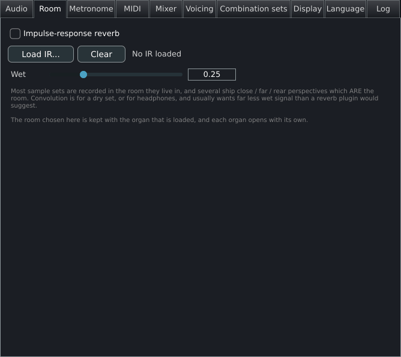

Impulse-response reverb for a dry set or for headphones. Many sample sets are recorded in the room they live in, and several ship close, far and rear perspectives that already contain the room; for those the wet level wants to be low.

| Control | What it does | Default | Range or options | Takes effect |
|---|---|---|---|---|
| **Impulse-response reverb** | Switches the convolution on or off. | Off | On, off | At once |
| **Load IR...** | Opens a file chooser for an impulse response and switches the reverb on once it has loaded. A file that cannot be read produces the message **The impulse response was not loaded**. | | WAV, AIFF and FLAC files | At once |
| **Clear** | Removes the loaded impulse response. The label beside the buttons returns to **No IR loaded**. | | | At once |
| Name label | Shows **IR:** and the file name of the loaded response. | **No IR loaded** | | |
| **Wet** | The share of the wet signal in the output. | 0.25 | 0 to 1 in steps of 0.01 | At once |

A one-channel response feeds both sides, a two-channel response is read as stereo, and a four-channel response is read as true stereo (left input to both outputs, then right input to both outputs). The response is normalised by its energy, so a room keeps the loudness of its whole tail. When the file name ends in `-<rate>Hz` and a sibling file with the device's rate in that place exists, the sibling is used.

**Stored.** In the organ file, as the key `reverb <on> <wet> <path>`. The path refers to the file where it lies: if the file has moved when the organ is loaded, the log records `reverb: the impulse response saved with this organ was not found` and the organ loads with no room. Each organ opens with its own room. The settings of the loaded organ are written shortly after a change.

## Metronome

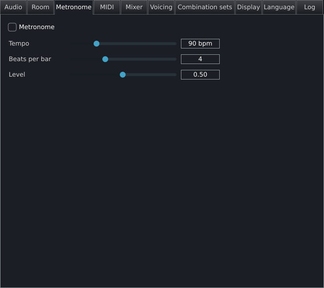

A click track for practice. It is generated inside the audio callback so that it stays in time with the organ. The click is a short 1000 Hz sine; the first beat of each bar is an octave and a half higher (1500 Hz) and louder. The click is added after the master fader and is left out of audio recordings made with the recorder.

| Control | What it does | Default | Range or options | Takes effect |
|---|---|---|---|---|
| **Metronome** | Starts and stops the click. | Off | On, off | At once |
| **Tempo** | Beats per minute. | 90 bpm | 20 to 300 bpm in steps of 1 | At once |
| **Beats per bar** | The bar length. The first beat of each bar is accented. 0 gives every beat the same click. | 4 | 0 to 12 | At once |
| **Level** | The loudness of the click. | 0.5 | 0 to 1 in steps of 0.01 | At once |
| Beat readout | Shows **Beat N** for the beat just played while the metronome runs. | Empty | | |

**Stored.** The tempo, the beats per bar and the level are the key `metronome <bpm> <beats> <level>` in the global file, written when the Metronome tab closes, and they return at the next start. The click starts silent at each start; the **Metronome** box shows whether it is running each time the tab opens.

## MIDI

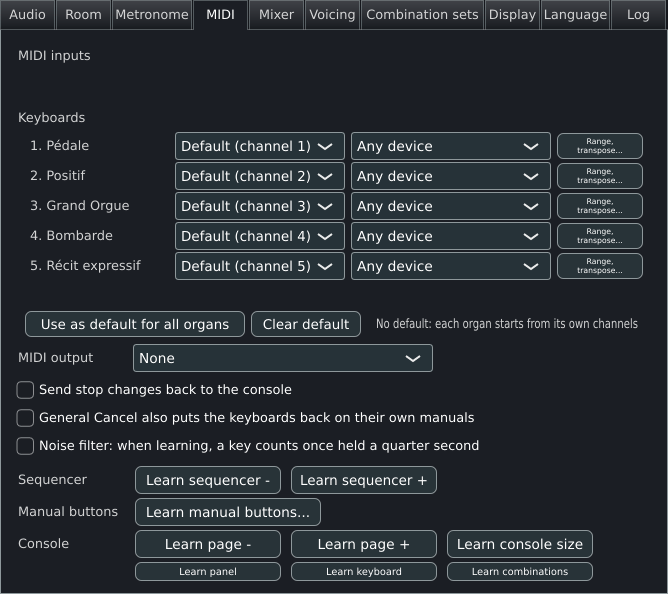

The same panel appears as the **MIDI** tab of [Organ settings](organ-settings.md); both edit the same mapping. This section lists every control. [MIDI and consoles](midi.md) explains the channel assignment, learning and the console actions in depth.

### Inputs, keyboards and defaults

| Control | What it does | Default | Range or options | Takes effect and storage |
|---|---|---|---|---|
| **MIDI inputs** | One tick box per MIDI input device, plus inputs Masterpiece opens itself (the JACK MIDI port on Linux, the port made by `--virtual-midi`). A device another program holds is shown as **NAME  -  in use by another program; opened when it is free** and stays ticked; Masterpiece opens it when it is released. | All inputs ticked | Each input on or off | At once. Unticked inputs are kept in the global file as `midiinputoff <name>`. |
| **Keyboards** heading, then one row for each playable keyboard of the loaded organ | The row holds the keyboard's name, a channel box, a device box and a button. | | | |
| Channel box | The MIDI channel that plays this keyboard. The channel decides which division sounds, and couplers work from it. | **Default (channel N)**, the organ's own assignment | **Default (channel N)**, **Channel 1** to **Channel 16** | At once. Saved with the organ's MIDI mapping. |
| Device box | Which console plays this keyboard, for the case of two consoles that send on the same channel. | **Any device** | **Any device**, or a device by its name | At once. Saved with the organ's MIDI mapping. |
| **Range, transpose...** | Opens the dialog of one manual: key range, transposition, velocity window, tracker action, short octave and debounce. | | | The dialog's own controls; see [MIDI and consoles](midi.md). |
| Shared line | When two keyboards answer one channel, a line **Shared -- Channel N: name, name** names them. One keyboard can play two divisions this way. | Empty | | |
| **Use as default for all organs** | Keeps the channel of each keyboard as the starting channels of every organ that has none saved. | | | At once. Written to the global file as `consolechannel <role> <channel>`, with role 0 for the pedal and 1 onward for the manuals. |
| **Clear default** | Removes that default. The line beside the buttons returns to **No default: each organ starts from its own channels**. | | | At once |

When a default exists, the line beside the buttons reads **Default for organs with no channels saved:** followed by entries such as `Pedal 1; Manual 1 2`.

### Output and behaviour

| Control | What it does | Default | Range or options | Takes effect and storage |
|---|---|---|---|---|
| **MIDI output** | The port that lights a console's drawstops and receives the console display. | **None** | **None** and each output port of the system | At once. Global file key `midioutput <name>`, written while a port is chosen; see the note below. |
| **Send stop changes back to the console** | Sends each stop change to the output so that a console with lit stops follows the screen. Off by default because a console that echoes what it just received can latch itself into a loop. | Off | On, off | At once. Global file key `midifeedback 1`, written only while on. |
| **General Cancel also puts the keyboards back on their own manuals** | After pistons have moved a keyboard to another manual, General Cancel returns every keyboard to the manual it started on. | Off | On, off | At once. Global file key `cancelresetskeyboards`, written only while on. |
| **Noise filter: when learning, a key counts once held a quarter second** | For a console whose contacts send stray notes: a shorter note is dropped. Controllers, program changes and system exclusive messages are learned at once. Leave it off for pistons that send only a short note. | Off | On, off | At once. Global file key `learnnoisefilter`, written only while on. |

> [!NOTE]
> The processor holds the MIDI output port, so lamps, key echo and the console display work with any window open or none. The port opens again at the next start. A port that is not plugged in keeps its name, and the box shows that name until the port is chosen again or **None** is chosen.

### Learning

The buttons below start a learn: click the button, then press or move the control on the console. Each assignment is a momentary binding. [MIDI and consoles](midi.md) covers right-click learning on the console itself.

| Row | Buttons | What each does |
|---|---|---|
| **Sequencer** | **Learn sequencer -**, **Learn sequencer +** | Bind the previous and next step of the player's combination sequencer. |
| **Manual buttons** | **Learn manual buttons...** | Opens a menu of the 16 channels, each with a submenu of the organ's manuals. Choosing a manual and then pressing a piston makes that piston send the keyboard on that channel to that manual. |
| **Console** | **Learn page -**, **Learn page +**, **Learn console size** | Previous console page, next console page, next console layout. |
| | **Learn panel**, **Learn keyboard**, **Learn combinations** | Show the stop-list panel, the on-screen keyboard and the combinations window. |
| | **Learn transpose -**, **Learn transpose +** | Transpose down and up. |
| | **Learn temperament -**, **Learn temperament +** | Previous and next temperament. |
| | **Save mapping**, **Clear mapping** | **Save mapping** writes the mapping to disk. **Clear mapping** removes every binding from the mapping in use. The empty mapping reaches disk with **Save mapping**, or with the next learned binding or channel change. |
| Status | **N binding(s)** | The number of bindings. While a learn waits it adds **LEARNING: move a control now**. |

**Stored.** The mapping is written to the user's data folder, and the sample set stays untouched. Bindings for one organ's stops, shoes, manuals and divisionals go to that organ's `.mpmidi` file. Bindings for the console's own actions (the sequencer, generals, page, layout, transpose and temperament buttons) go to `midi/console.mpmidi` and apply to every organ. The files are rewritten after each learned binding.

## Mixer

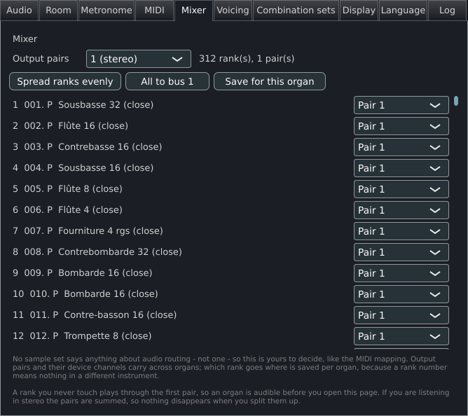

Routes each rank to a stereo pair of output channels. No sample set declares an audio routing, so the routing is the player's. A rank that is never touched plays through the first pair. Up to eight pairs can be set up, and they are mixed to the stereo output. [Audio, room and mixer](audio.md) explains the use of several pairs.

| Control | What it does | Default | Range or options | Takes effect |
|---|---|---|---|---|
| **Output pairs** | The number of stereo pairs, mixed to the stereo output. Pair N is assigned device channels 2N-1 and 2N. | **1 (stereo)** | **1 (stereo)**, **2 pairs** to **8 pairs** | At once |
| Status line | Reads **N rank(s), N pair(s)**, and **N unrouted, N stale** when a rank has no pair or points at a pair that no longer exists. | | | |
| **Spread ranks evenly** | Assigns the ranks to the pairs in turn, so the routing is audible at once. | | | At once |
| **All to pair 1** | Sends every rank to the first pair. | | | At once |
| **Save for this organ** | Writes the organ's settings file, including the routing. | | | At once |
| Rank list | One row per rank, labelled with the rank number and name, with a **Pair N** box. A rank that points at a pair removed by lowering **Output pairs** returns to **Pair 1**. | **Pair 1** | **Pair 1** to the chosen number of pairs | At once |

**Stored.** The number of pairs and their device channels are the key `buses` in the organ file, and in the global file when **Save as default** is used on the Loading tab. The rank routes are the keys `route <rank> bus <n>` in the organ file; they are written by **Save for this organ**, and by any other change that makes Masterpiece rewrite the organ file.

## Voicing

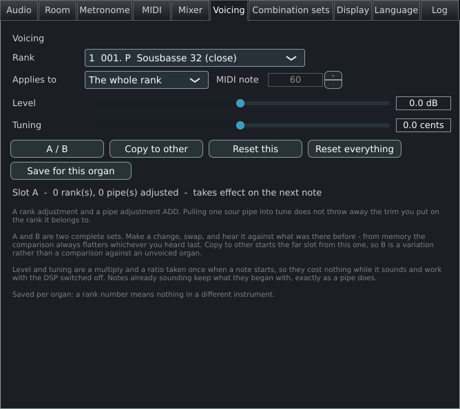

The player's adjustments of level and tuning, for a whole rank or for one pipe, in the way a voicer goes round an organ. A rank adjustment and a pipe adjustment add. Level and tuning are applied when a note starts, so they cost nothing while it sounds, and they work with the DSP switched off. Notes already sounding keep what they began with. The **Voicing** box on the Loading tab of [Organ settings](organ-settings.md#engine-switches) turns every adjustment off while it is cleared; the organ then plays as recorded.

| Control | What it does | Default | Range or options | Takes effect |
|---|---|---|---|---|
| **Rank** | The rank to adjust, listed as its number and name. | The first rank | The ranks of the loaded organ | At once |
| **Applies to** | Whether the sliders adjust the whole rank or one pipe of it. | **The whole rank** | **The whole rank**, **One pipe** | At once |
| **MIDI note** | The pipe, chosen by its note. Active when **One pipe** is selected. A rank without a pipe at that note reports **This rank has no pipe at that note**. | 60 | 0 to 127 | At once |
| **Level** | The level change. | 0 dB | -12 to +12 dB in steps of 0.1 | On the next note |
| **Tuning** | The pitch change. | 0 cents | -50 to +50 cents in steps of 0.1 | On the next note |
| **A / B** | Swaps between the two complete voicing sets A and B, so a change can be compared with what was there before. | Slot A | A, B | At once |
| **Copy to other** | Copies the live slot to the other, so that B starts as a variation of A. | | | At once |
| **Reset this** | Returns the selected rank or pipe to 0 dB and 0 cents. | | | On the next note |
| **Reset everything** | Clears every adjustment in the live slot. | | | On the next note |
| **Save for this organ** | Writes the organ's settings file. | | | At once |
| Status line | **Slot A  -  N rank(s), N pipe(s) adjusted  -  takes effect on the next note** | | | |

**Stored.** In the organ file, as `voicingadj` lines for both slots and `voicingslot b` when slot B is live, written by **Save for this organ** and by any other change that makes Masterpiece rewrite the organ file. A rank number has no meaning in another instrument, so adjustments never carry across organs.

## Combination sets

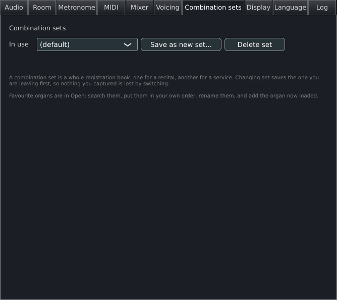

A combination set is a complete registration book: the organ's pistons and the player's own, kept in one file. A recital and a service can each have a set. Changing set saves the one being left first.

| Control | What it does | Default | Range or options | Takes effect |
|---|---|---|---|---|
| **In use** | The set in use for the loaded organ. | **(default)** | **(default)** and every set saved for this organ | At once |
| **Save as new set...** | Asks for a name (**A name for this registration set:**), copies the registrations in use to a new set of that name and switches to it. | | A name. Slash, backslash, colon, asterisk, question mark, quotation mark, angle brackets, the vertical bar and control characters become `_`; trailing dots and spaces are removed | At once |
| **Delete set** | Switches to the default set and deletes the file of the set that was in use. The default set cannot be deleted (**The default set cannot be deleted**). | | | At once |
| Status line | Reports **Now using NAME**, or **Deleted NAME, back on the default**. | | | |

The favourite organs are kept in the **Open** window.

**Stored.** The set in use is the key `combset <name>` in the organ file. Each set is a file in the `combinations` folder: `<organ key>.mpcomb` for the default set and `<organ key>.<name>.mpcomb` for a named one. [Playing](playing.md) describes how registrations are stored and recalled.

## Display

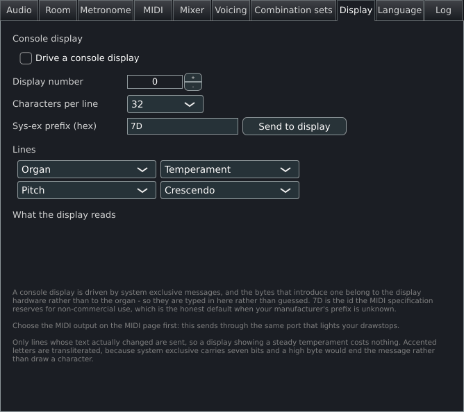

This tab drives the text display on a console's jamb, such as a 32-character panel, by system exclusive messages through the MIDI output. It drives external hardware only. The heading on the tab is **Console display**. The framing bytes belong to the display hardware, so they are typed in here. Choose the MIDI output on the **MIDI** tab first: the messages leave through the port that lights the drawstops.

| Control | What it does | Default | Range or options | Takes effect |
|---|---|---|---|---|
| **Drive a console display** | Switches the display on. | Off | On, off | At once |
| **Display number** | The number of the display on the console, sent as one byte. | 0 | 0 to 15 | At once |
| **Characters per line** | The width of the display. | 32 | 16, 20, 32, 40 | At once |
| **Sys-ex prefix (hex)** | The bytes that follow the opening system exclusive byte and introduce a message to this console. 7D is the identifier the MIDI specification reserves for non-commercial use. A prefix that cannot be read falls back to 7D. | 7D | One to eight bytes of 00 to 7F, in hexadecimal, separated by spaces; the field takes up to 23 characters | When the field loses focus or Return is pressed |
| **Send to display** | Sends every line again, for a console connected after the organ loaded. | | | At once |
| **Lines** (four boxes) | The content of line 1 to line 4. | **Organ**, **Temperament**, **Pitch**, **Crescendo** | **(blank)**, **Organ**, **Temperament**, **Pitch**, **Transpose**, **Stops drawn**, **Crescendo**, **Combination set** | At once |
| **What the display reads** | A preview of the lines as the hardware shows them, between bars that mark where the panel ends. A value longer than the width is cut and a shorter one is padded with spaces. | | | Twice a second |

The fields show: the organ's name; the temperament's name; the pitch as `A=440.0 Hz`; the transposition as `+2`, `0` or `-3`; the number of stops drawn; the crescendo step (0 with the shoe closed); and the name of the combination set (`(default)` for the default set). A message is `F0`, the prefix, the display number, the line number (0 to 3), the text as 7-bit ASCII, `F7`. Accented Latin letters lose their accents; other characters above 7F become `?`. Only lines whose text changed since the last send go out, checked four times a second.

**Stored.** In the global file as `lcd <on> <display> <width> <line1> <line2> <line3> <line4> <prefix>`: `<on>` is 1 or 0, `<display>` the display number, `<width>` the characters per line, each `<line>` the number of the choice in its box (1 for **(blank)** to 8 for **Combination set**, in the order of the table above) and `<prefix>` the hexadecimal bytes, which run to the end of the line. The setup is read again at the next start. The main window sends the display four times a second whether or not this tab is open, so the display follows the organ with any window open or none. The **MIDI output** must be chosen.

## Language

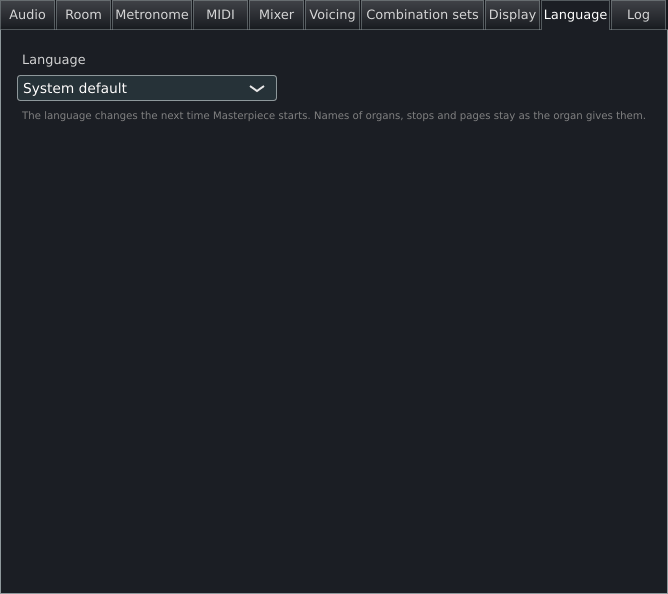

| Control | What it does | Default | Range or options | Takes effect |
|---|---|---|---|---|
| Language box | The language of the program's own words. Each language is named in itself, so a player who cannot read the current language can find theirs. Names of organs, stops and pages stay as the organ gives them. | **System default** | **System default** (the language of the system when a translation exists, otherwise English), **English**, then the translations in this version: **Čeština**, **Deutsch**, **Español**, **Français**, **Italiano**, **Nederlands**, **Polski** | At the next start |

A string that a translation lacks appears in English.

**Stored.** In the global file as `language <code>` (`en`, `cs`, `de`, `es`, `fr`, `it`, `nl` or `pl`). The key is absent for **System default**.

## Log

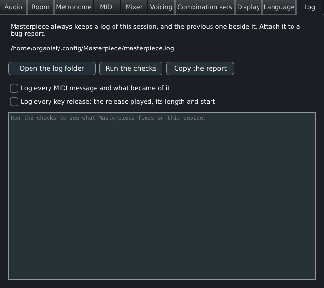

Masterpiece always keeps a log of the session and the previous one beside it. The log and the report on this tab are what a bug report needs. The text at the top of the tab gives the log's path, or **No log is being written.**

| Control | What it does | Default | Takes effect |
|---|---|---|---|
| **Open the log folder** | Shows the log file in the system's file manager. Absent on phones and tablets. | | At once |
| **Run the checks** | Tests the machine and the organ and prints the result in the box below. | | At once |
| **Copy the report** | Copies the checks (run first if the box is empty) and the last 200 lines of the log to the clipboard. | | At once |
| **Send the report and the log** | Shares the report, the log and the previous log through the share sheet. Present only on phones and tablets. | | At once |
| **Log every MIDI message and what became of it** | The same as `--log-midi`: which manual, stop or control each message reached and, when nothing sounded, why. | Off | At once; lasts until Masterpiece closes |
| **Log every key release: the release played, its length and start** | The same as `--log-releases`: the release chosen for each key release, its length and where it started. | Off | At once; lasts until Masterpiece closes |
| **Check once a day for a newer version** | Reads the newest version's number from masterpieceorgan.com, a few bytes, once a day, and offers the download page when it is newer. See [Files and folders](files.md#privacy). | On | At the next start; `updatecheck` in the global file |

The report box is read-only and shows **Run the checks to see what Masterpiece finds on this device.** until the checks have run. See [Command line](command-line.md) for the log and its options.

### What the checks test

Each line of the report starts with `ok` for a passed test, `FAILED` for a failed one, or spaces for a fact with nothing to pass.

| Line | What it tests |
|---|---|
| Header | The Masterpiece version, the operating system and the device; the number of processors and the memory in MB; the time of the check. Facts only. |
| **Settings folder** | The user's data folder. The check creates it if it is missing, writes a small file `.masterpiece-check`, reads it back and deletes it. It reports the path, whether it can be written and the free space in GB. |
| **Sample cache** | The same write test for the cache folder in use, with the free space. |
| Cache folder chosen in Loading | Appears as `FAILED` when the folder chosen on the Loading tab cannot be used and the usual one is in use instead. |
| **Temporary folder** | The same write test for the system's temporary folder. |
| **Cache files** | The number and total size of the `.mpcache` files in the cache folder. A fact. |
| **Organs unpacked from their archives** | The number of folders in `Packaged`, where package archives are unpacked. A fact. |
| **Log** | Passes when the log file exists; reports its path and size in KB. Fails when no log is being written. |
| **Audio** | Passes when the audio device runs; reports its rate and block size in frames. Fails with **Audio: not running**. |
| **MIDI inputs** | The names of the MIDI inputs the system lists, or `none`. A fact. |
| **Organ** | When an organ is loaded: passes when its definition file still exists. Without an organ the line reads **No organ is loaded**. |
| The organ's definition | Passes when the definition file can be read. |
| **Organ folder** | Passes when the folder that holds the organ's installation packages exists. |
| Organ counts | The number of ranks, stops and console pages. A fact. |
| **Samples kept as** | The resident format, the memory limit (**not set** for the default) and the number of stream underruns. A fact. |
| **Impulse response** | The name of the loaded impulse response, or `none`. A fact. |
| Documents lent by the Files app | On iPhone and iPad: the number of documents the Files app has lent, with a pass or fail for each according to whether it can be read now. |

**Stored.** The log is `masterpiece.log` in the data folder, and the run before it is `masterpiece.previous.log`. The two logging switches return to off at every start.

## Back up and restore

The **Settings** menu has a **Back up and restore** submenu, with four items.

| Item | What it does |
|---|---|
| **Export this organ's settings...** | Writes a zip file holding the loaded organ's own settings: its MIDI map, its combinations, its split keyboard and its organ settings. |
| **Export all settings...** | Writes a zip file holding every setting, the program's own and each organ's. The audio device stays with the computer. |
| **Import settings...** | Reads a zip file written by one of the export items and puts the settings back. A file that is not one of ours is refused, and nothing changes. |
| **Copy settings from another organ...** | Takes the MIDI map, the combinations, or the mixer and voicing from another organ, each on its own toggle. |

Every import and every copy saves what was there first, in the `backups` folder, and says where.

The mixer and voicing of one organ mean something only between versions of the same organ, a demo and the full set: the ids of stops, ranks and pipes must be the same. The dialog says how many of the ranks and pipes the other organ names are in this one.

## Where settings are kept

Masterpiece keeps everything in text files in its data folder.

| System | Data folder |
|---|---|
| Windows | `%APPDATA%\Masterpiece` |
| macOS | `~/Library/Masterpiece` |
| Linux | `~/.config/Masterpiece` |

The sample sets are left untouched. [Files and folders](files.md) lists the whole folder.

### The global file

The global file is `settings.mpglobal` in the data folder. It holds what belongs to the program and the machine, and the defaults an organ starts from before its own file is applied. The file is plain text. The first line is the comment `# Masterpiece defaults for organs that have no settings of their own`; every other line is a key, a space and a value, and the value is taken whole so that a path may contain spaces. Lines that start with `#` are ignored. Masterpiece rewrites the whole file at each change, so edit it only while Masterpiece is closed.

| Key | Value | Written by |
|---|---|---|
| `reopenlastorgan` | `1` or `0`. Always written. | **Reopen the last organ when Masterpiece starts** on the Loading tab |
| `updatecheck` | `0` when the update check is off; absent while it is on. | **Check once a day for a newer version** on the Log tab |
| `updatecheckedat` | Seconds since 1970 of the last update check. | The update check |
| `speakerkeepalive` | The level in dB, -80 to -40. Written only while on. | **Keep portable speakers awake** |
| `memlimit` | The sample memory limit in MB. Written only when set. | **Memory limit for samples** on the Loading tab |
| `polyphony` | The voice limit. Written only when set. | **Polyphony limit** on the Loading tab |
| `running` | The path of the organ being loaded or played. Removed at a clean exit; one still present at the next start means the last session ended unexpectedly, which the log records. | The crash guard |
| `language` | The language code. Written only when a language is chosen. | **Language** |
| `loadticks` | `1` or `0`. Always written. | **Tap at each 10% while loading an organ** on the Loading tab |
| `cancelresetskeyboards` | `1`. Written only while on. | **General Cancel also puts the keyboards back on their own manuals** |
| `learnnoisefilter` | `1`. Written only while on. | **Noise filter: when learning, a key counts once held a quarter second** |
| `combinationsontop` | `1`. Written only while on. | **Always on top** in the combinations window |
| `cachewhileplaying` | `1`. Written only while on. | **Save the sample cache** on the Loading tab, set to **In silence, while it plays** |
| `setoffafterstore` | `1`. Written only while on. | **Set turns off after storing** in the combinations window |
| `showkeys` | `0`. Written only while off. | **View > Show played keys** |
| `fasterengine` | `1` or `0`. Always written. | **Faster audio engine** on the Loading tab |
| `realtimethreads` | `1`. Written only while on. | **Real-time render threads (trial)** on the Loading tab |
| `midiinputoff` | A device name. One line per unticked input. | **MIDI inputs** |
| `consolechannel` | A role (0 for the pedal, 1 onward for the manuals) and a channel 1 to 16. | **Use as default for all organs** |
| `midioutput` | The name of the MIDI output port. Written only while a port is chosen; a port that is not plugged in keeps its name. | **MIDI output** |
| `midifeedback` | `1`. Written only while on. | **Send stop changes back to the console** |
| `metronome` | `<bpm> <beats> <level>`: the tempo, the beats per bar and the level. Written when the Metronome tab closes. | The **Metronome** tab |
| `lcd` | `<on> <display> <width> <line1> <line2> <line3> <line4> <prefix>`. The prefix is the hexadecimal bytes, separated by spaces. | The **Display** tab |
| `defaulteq` | `<on> <gain> <band 1> ... <band 10>`. Written only while the default EQ is on or not flat. | **Save as default** on the **Voicing EQ** tab of Organ settings |
| `library` | A folder holding a sample library (an `OrganInstallationPackages` folder beside it). Added when an organ is loaded from such a folder, and for the standard library folder of a Hauptwerk-format installation when it exists. | Opening organs |
| `cachedir` | The cache folder. Absent for the default. | **Cache folder** on the Loading tab |
| `packagedir` | The package folder. Absent for none. | **Package folder** on the Loading tab |
| `lastorgan` | The definition of the organ opened last. | Opening an organ |
| `openfolder` | The folder the last organ was chosen from. | The **Open** window |
| `dialogfolder` | A kind and a folder: `ir`, `midi`, `recording` or `scala`, then the folder where that kind of file dialog was last used. | The file dialogs of **Load IR...**, the recorder and the tuning panel |
| `favourite` | `<kind> <slot> <name> \| <target>`: the kind is `organ`, `temperament` or `combinationset`. | The favourites in the **Open** window and the tuning panel |

**Save as default** on the Loading tab adds the organ-level keys below to the global file as well, so that an organ without a file of its own starts from them: `storage`, `mono`, `releases`, `releaselength`, `releasecutoff`, `reverb`, `rate`, `cache`, `stream`, `streamhead`, `streamheadpct`, `preload`, `root`, `simple`, `wind`, `tremulant`, `enclosure`, `voicing`, `originalpitch`, `gain`, `buses`, `busir` and `groups`. These are described under [Where the organ's settings are kept](organ-settings.md#where-the-organs-settings-are-kept). An organ that has a file of its own takes the values from that file. The obsolete key `reopenlast` is ignored when read.

### Other files

| File | Content |
|---|---|
| `organs/<organ key>.mporgan` | The settings of one organ: [Organ settings](organ-settings.md). |
| `midi/<organ key>.mpmidi` | The MIDI mapping of one organ. |
| `midi/console.mpmidi` | The console's own actions, valid for every organ. |
| `combinations/<organ key>.mpcomb` and `combinations/<organ key>.<set>.mpcomb` | The combination sets of one organ. |
| `split/<organ key>.mpsplit` | The split keyboard of one organ ([Split keyboard](split-keyboard.md)). |
| `audio.xml` | The audio device setup, written when Masterpiece quits. |
| `window.txt` | The place and size of the main window. |
| `cache/` | The sample cache, unless **Cache folder** names another. |
| `masterpiece.log`, `masterpiece.previous.log` | The logs of this session and the one before. |

The organ key names a file after the organ and keeps the file when the sample set moves or is renamed. It is the organ's name reduced to letters and digits (spaces, hyphens and underscores become hyphens, at most 48 characters), a hyphen, and the unique organ identifier of the definition. A definition without an identifier uses `p` and 16 hexadecimal digits that are a hash of its path.
