# Settings

The **Settings** window holds the program and the player's console: the display mode and the folders, the audio device and the output dynamics, MIDI, the performance of the audio engine, the reverb, the metronome, combination sets, the console display, the language, remote control and diagnostics. This page lists every control on every tab in the order the window shows them: what it does, its default, its range or options, when it takes effect and where it is stored. The topics behind the controls have pages of their own ([Audio, room and mixer](audio.md), [MIDI and consoles](midi.md), [Memory, loading and streaming](memory.md), [Playing](playing.md), [Remote control](remote.md)); this page links to them for depth. The settings that belong to one organ (how it is read from disk, which stops load, its outputs, voicing and equaliser) are in [Organ settings](organ-settings.md).

## Opening the window

The **Settings** button in the top bar opens a menu with one entry for each tab of the window. Each entry opens the window on that tab.

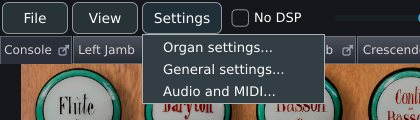

| Application | Entries |
|---|---|
| Standalone | **General...**, **Audio...**, **MIDI...**, **Performance...**, **Reverb...**, **Metronome...**, **Combination sets...**, **Console display...**, **Language...**, **Remote control...** |
| VST3, LV2 and AU plugins | **General...**, **Performance...**, **Reverb...**, **Metronome...**, **Combination sets...**, **Console display...**, **Language...** |

The **Diagnostics** tab opens from **Help > Diagnostics...**. **Organ settings...** is in the **Organ** menu, with **Temperament and tuning...**, **Combinations**, **Extra couplers**, **Reload organ**, **Copy settings from another organ...**, **Licence accepted** (only for an organ whose samples carry a publisher licence) and **All notes off**.

The window is titled **Settings**, opens at 960 x 560 pixels and can be resized. Its tabs, in order: **General**, **Audio**, **MIDI**, **Performance**, **Reverb**, **Metronome**, **Combination sets**, **Console display**, **Language**, **Remote control**, **Diagnostics**. Opened from the top bar's button with no tab named, it shows the tab it was last closed on. In a narrow window each tab name keeps its words whole and a two-word name takes two lines. The Esc key closes the window. It has no OK or Cancel button: each control acts when it is changed, and the **Takes effect** column below says whether that is at once or later.

Two tabs hold choices that belong to the organ that is loaded and are saved with it: **Reverb** and **Combination sets**. The **MIDI** tab keeps the learned controls of the organ with that organ and the console's own for every organ. [Where settings are kept](#where-settings-are-kept) lists the files.

> [!NOTE]
> In the VST3, LV2 and AU plugins the window has no **Audio**, **MIDI** or **Remote control** tab: the host owns the audio device and the MIDI ports. The output limiter and compressor of the **Audio** tab are a standalone feature; in a plugin the host's own effects shape the output.

### Display mode

**Display mode** on the **General** tab chooses how much the window shows. **Simple** shows the main settings, with the **Quality** and **Performance** presets; **Advanced** shows every setting. The tables below mark the rows that only **Advanced** shows. In **Simple**, **Custom** is greyed in both preset boxes: a preset is chosen whole, and the settings under it are set one by one in **Advanced**.

## General

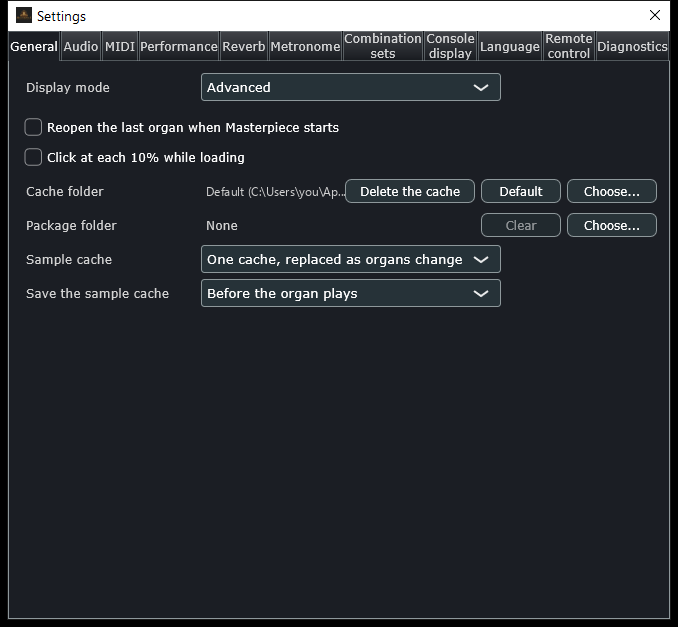

| Control | What it does | Default | Range or options | Takes effect | Shown in |
|---|---|---|---|---|---|
| **Display mode** | How much the Settings and Organ settings windows show. | **Simple** | **Simple**, **Advanced** | At once | Both |
| **Reopen the last organ when Masterpiece starts** | Loads, at start, the organ that last loaded completely, after an unexpected close too. | Off | On, off | At the next start | Both |
| **Click at each 10% while loading** | Plays a short click at each 10% of a load, so a large set can be followed by ear. | Off | On, off | At the next load | Advanced |
| **Cache folder** | Where the sample cache is written. A folder that cannot be created is replaced by the default for that load. | **Default**, the `cache` folder in the data folder | **Choose...** opens a folder chooser; **Default** returns to the default folder | At the next load | Advanced |
| **Delete the cache** | Deletes the sample cache in the folder shown. Each organ then reads its samples again at its next load. Greyed when the folder holds no cache. | | | At once | Advanced |
| **Package folder** | Where the player keeps packages. A composite organ looks here, and in the folders directly in it, for the organs it plays. | **None** | **Choose...** opens a folder chooser; **Clear** removes it | At the next load | Advanced |
| **Sample cache** | How many caches are kept. The cache keeps the decoded samples on disk, so the next load of the same organ is a read. | **One cache, replaced as organs change** | **One cache, replaced as organs change**, **One cache per organ (uses more disk)**, **Off** | At the next load | Both |
| **Save the sample cache** | When the cache of a new load is written. **Before the organ plays**: the first load takes longer and nothing competes with the sound. **In silence, while it plays**: the organ plays at once and the samples are saved whenever nothing sounds; until they are, the next load reads them again. | **Before the organ plays** | **Before the organ plays**, **In silence, while it plays** | At the next load | Both |

**Stored.** In the global file: `displaymode`, `reopenlastorgan`, `loadticks`, `cachedir`, `packagedir`, `samplecache` and `cachewhileplaying`. The sample cache choice holds for every organ.

## Audio

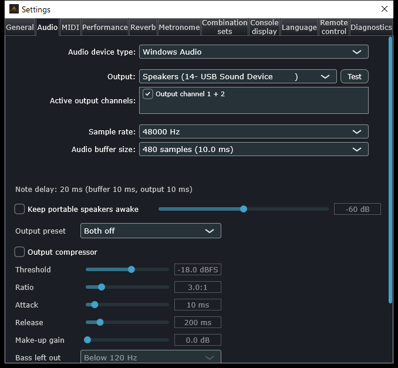

The upper part of the tab is the device selector of the audio library. It chooses where Masterpiece sends sound. Its controls are described here generically; their labels and the choices offered depend on the system and the driver. The MIDI inputs and the MIDI output are on the [MIDI](#midi) tab.

| Control | What it does | Default | Range or options | Takes effect |
|---|---|---|---|---|
| Device type | The driver family, on systems that offer more than one. | The system default | The families the system reports | At once |
| Output device | The sound device. | The system default output | The devices of that family | At once |
| Output channels | Which outputs of the device carry sound, listed as stereo pairs. | As the device opens | Up to 8 output channels | At once |
| Sample rate | The rate the device runs at. | The device's own rate on a first start; a saved setup keeps its rate | The rates the device reports | At once |
| Buffer size | The block the device processes at a time. It sets the delay between a key and its sound. | The size nearest 10 ms on a first start | The sizes the device reports | At once |
| Test | Plays a test tone through the selected channels. | | | At once |

Below the selector, a line reads **Note delay: N ms (buffer N ms, output N ms)**. It shows the whole delay from a key to the speaker for the open device.

| Control | What it does | Default | Range or options | Takes effect |
|---|---|---|---|---|
| **Keep portable speakers awake** | Plays a 20 Hz tone, too low and too quiet to hear under the organ, so that a battery speaker does not switch itself off during silence and swallow the first notes. | Off | On, off | At once |
| Level slider (beside the box) | The level of the tone. Raise it if the speaker still sleeps; lower it if the tone is audible. Active while the box is ticked. | -60 dB when first switched on | -80 to -40 dB in steps of 1 dB | At once |

### Output dynamics

Under them, the compressor and the peak limiter on the output, after the master fader. Both are off until they are switched on, and while off the engine does not call them. [Audio, room and mixer](audio.md#output-compressor-and-limiter) describes how they work.

| Control | What it does | Default | Range or options | Takes effect |
|---|---|---|---|---|
| **Output preset** | Sets the compressor and the limiter together. Reads **Own settings** when the controls match no preset. | **Both off** | **Both off**, **Limiter only**, **Gentle**, **Small speakers**, **Laptop speakers**, **Headphones, quiet practice** | At once |
| **Output compressor** | Brings the loud passages towards the quiet ones; the make-up gain lifts the whole. It works ahead of the limiter. | Off | On, off | At once |
| **Threshold** | The level the compression begins at. | -18 dBFS | -40 to 0 dBFS in steps of 0.5 | At once |
| **Ratio** | How much a level over the threshold is held down: at 3:1, 3 dB over comes out 1 dB over. | 3:1 | 1.5:1 to 10:1 in steps of 0.1 | At once |
| **Attack** | How long the gain takes to come down. A longer one lets the speech of the pipes through. | 10 ms | 1 to 100 ms | At once |
| **Release** | How long the gain takes to come back. | 200 ms | 50 to 1000 ms in steps of 10 | At once |
| **Make-up gain** | Lifts the whole output after the compression. | 0 dB | 0 to 18 dB in steps of 0.5 | At once |
| **Bass left out** | The compressor does not hear the bass below this pitch, so a 32' or a full pedal leaves the manuals at their level. The bass itself sounds in full. | **Below 120 Hz** | **None**, **Below 80 Hz**, **Below 120 Hz**, **Below 200 Hz** | At once |
| Reduction readout | **Reduction N dB**: how far the compressor holds the level down now, before the make-up gain. Shown while the compressor is on. | | | Ten times a second |
| **Output limiter** | Holds the output below the ceiling. It adds no delay. | Off | On, off | At once |
| **Ceiling** | The level the output is held under. | -1 dBFS | -12 to -0.1 dBFS in steps of 0.1 | At once |
| **Release** | How long the limiter's gain takes to come back after a peak. | 100 ms | 50 to 1000 ms in steps of 10 | At once |

The sliders and the boxes under the compressor are greyed while it is off. The presets:

| Preset | Compressor | Threshold | Ratio | Attack | Release | Make-up | Bass left out | Limiter | Ceiling | Limiter release |
|---|---|---|---|---|---|---|---|---|---|---|
| **Both off** | Off | | | | | | | Off | | |
| **Limiter only** | Off | | | | | | | On | -1 dBFS | 100 ms |
| **Gentle** | On | -18 dBFS | 2:1 | 20 ms | 400 ms | 4 dB | Below 120 Hz | On | -1 dBFS | 100 ms |
| **Small speakers** | On | -24 dBFS | 3:1 | 10 ms | 250 ms | 8 dB | Below 120 Hz | On | -1 dBFS | 100 ms |
| **Laptop speakers** | On | -30 dBFS | 4:1 | 5 ms | 200 ms | 12 dB | Below 200 Hz | On | -1 dBFS | 80 ms |
| **Headphones, quiet practice** | On | -30 dBFS | 2.5:1 | 10 ms | 300 ms | 10 dB | Below 80 Hz | On | -3 dBFS | 150 ms |

**Stored.** The device, rate, buffer size and channel choices are written to `audio.xml` when Masterpiece quits. A saved setup that no longer matches the hardware, or that opens with no live output, is replaced by the defaults. A device that opens below 44.1 kHz is moved to 48 kHz, or to 44.1 kHz where 48 kHz is unavailable. The speaker setting is the key `speakerkeepalive` in the global file, written only while it is on. The limiter is the key `limiter <on> <ceiling> <release>` and the compressor the key `compressor <on> <threshold> <ratio> <attack> <release> <make-up> <Hz>`, both in the global file.

[Audio, room and mixer](audio.md) explains choosing a buffer size and a driver.

## MIDI

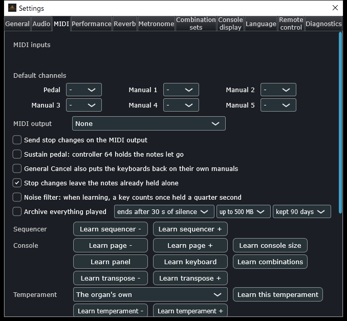

The console's MIDI: the inputs and the output, the default channels, the console's own actions and the messages Masterpiece sends. The keyboards of the loaded organ are on the **MIDI** tab of [Organ settings](organ-settings.md#midi). [MIDI and consoles](midi.md) explains the channel assignment, learning and the console actions in depth.

### Inputs, channels and output

| Control | What it does | Default | Range or options | Takes effect and storage | Shown in |
|---|---|---|---|---|---|
| **MIDI inputs** | One tick box per MIDI input device, plus inputs Masterpiece opens itself (the JACK MIDI port on Linux, the port made by `--virtual-midi`). A device another program holds is shown as **NAME  -  in use by another program; opened when it is free** and stays ticked; Masterpiece opens it when it is released. | All inputs ticked | Each input on or off | At once. Unticked inputs are kept in the global file as `midiinputoff <name>`. | Both |
| **Bluetooth MIDI...** | Opens the system's pairing dialog for a Bluetooth MIDI device. Shown where the system offers it. | | | At once | Both |
| **Default channels** | One box for the pedal and one for each of manuals 1 to 5: the channel each keyboard of an organ comes in on, for organs with no channels saved for them. An organ's own choice keeps it. | **-** (none) | **-**, 1 to 16 | At the next organ load. Global file key `consolechannel <role> <channel>`, with role 0 for the pedal and 1 onward for the manuals. | Both |
| **MIDI output** | The port that lights a console's drawstops and receives the console display and the messages below. | **None** | **None** and each output port of the system | At once. Global file key `midioutput <name>`, written while a port is chosen; see the note below. | Both |
| **Send stop changes on the MIDI output** | Sends each stop change on the MIDI output, on the message the stop was learned on, so that lit drawstops or a pad controller follow the screen. Off by default because a console that echoes what it just received can latch itself into a loop. | Off | On, off | At once. Global file key `midifeedback 1`, written only while on. | Both |
| **Sustain pedal: controller 64 holds the notes let go** | For directing a choir. While controller 64 is held down, the keys you let go keep sounding, and they stop when it is lifted. The controller works on any channel. A controller 64 learned for something else keeps doing this. | Off | On, off | At once. Global file key `sustainpedal`, written only while on. | Both |
| **General Cancel also puts the keyboards back on their own manuals** | After pistons have moved a keyboard to another manual, General Cancel returns every keyboard to the manual it started on. | Off | On, off | At once. Global file key `cancelresetskeyboards`, written only while on. | Advanced |
| **Stop changes leave the notes already held alone** | Off, a stop or coupler moved while keys are held sounds or stops on those notes at once, as on a console with electric action. On, the held notes keep the pipes they started with until their keys are let go, and only keys pressed afterwards play the new registration. | Off | On, off | At once. Global file key `stopsleaveheldnotes`, written only while on. | Advanced |
| **Noise filter: when learning, a key counts once held a quarter second** | For a console whose contacts send stray notes: a shorter note is dropped. Controllers, program changes and system exclusive messages are learned at once. Leave it off for pistons that send only a short note. | Off | On, off | At once. Global file key `learnnoisefilter`, written only while on. | Advanced |
| **Archive everything played** | Records every MIDI message played into files of their own, one for each stretch of playing. Three boxes beside it: **ends after 10 s of silence**, **30 s**, **1 min**, **2 min**, **5 min** or **10 min** (default 30 s); **up to 100 MB**, **250 MB**, **500 MB**, **1 GB**, **2 GB** or **5 GB** (default 500 MB); **kept 7 days**, **30**, **90** or **365 days** (default 90). Each stretch is a standard MIDI file, `Documents/Masterpiece/Recordings/Archive/<date>/<time> <organ>.mid`. The oldest files go first when the folder passes its size or age. | Off | On, off | At once. Global file keys `archive`, `archivesilence`, `archivemb`, `archivedays`. | Advanced |

> [!NOTE]
> The processor holds the MIDI output port, so lamps, key echo and the console display work with any window open or none. The port opens again at the next start. A port that is not plugged in keeps its name, and the box shows that name until the port is chosen again or **None** is chosen.

### Learning

The rows below are shown in **Advanced**. Each learn button opens a menu: the mapping it has (or **Not mapped**), **Learn**, **Clear** and **MIDI window...**. After **Learn**, press or move the control on the console. The button is orange while it waits and green once it is mapped. [MIDI and consoles](midi.md) covers right-click learning on the console itself.

| Row | Buttons | What each does |
|---|---|---|
| **Sequencer** | **Learn sequencer -**, **Learn sequencer +** | The previous and next step of the player's combination sequencer. |
| **Console** | **Learn page -**, **Learn page +**, **Learn console size** | Previous console page, next console page, next console layout. |
| | **Learn panel**, **Learn keyboard**, **Learn combinations** | Show the stop-list panel, the on-screen keyboard and the combinations window. |
| | **Learn transpose -**, **Learn transpose +** | Transpose down and up. |
| **Temperament** | A temperament box (**The organ's own** and the library), **Learn this temperament** | A button that chooses the temperament in the box. |
| | **Learn temperament -**, **Learn temperament +** | Previous and next temperament. |
| **Recorder** | **Learn record or stop**, **Learn play or stop** | The recorder's Record and Play. See [Recorder](playing.md#recorder). |
| **Power** | **Learn quit**, **Learn power off** | Quit Masterpiece, or quit and shut the computer down. Obeyed only 2 minutes after the organ loads, and only on a button held for 3 seconds, or pressed twice within 2 seconds for a button that sends no release. |
| **Score app** | **Learn score page -**, **Learn score page +**, then **Sends**: message, channel and two numbers | A piston learned here turns the page in a score app on a tablet or another program: it sends the message chosen (**Note**, **Controller** or **Program change**) on the MIDI output, the first number for the next page and the second for the page before. Default: notes 127 and 126 on channel 16. Teach the same message to the score app. |
| | **Save mappings**, **Clear all mappings** | **Save mappings** writes the mapping to disk. **Clear all mappings** removes every binding from the mapping in use. The empty mapping reaches disk with **Save mappings**, or with the next learned binding or channel change. |
| Status | **MIDI mappings: N** | The number of bindings. While a learn waits it adds **LEARNING: move a control now**. |

### Messages to the console

Shown in **Advanced**. Each sends on the **MIDI output**.

| Control | What it sends | Default | Global file key |
|---|---|---|---|
| **Ready lamp** | A note or a controller that lights a lamp on the console while an organ is loaded and ready to play: **Off**, **Note** or **Controller**, a channel 1 to 16 and a number 0 to 127. | **Off** | `readylamp note\|cc <channel> <number>` |
| **Lit**, **Dark** | Messages in hexadecimal sent when the lamp lights and when it goes dark, for a console that needs system exclusive messages. | Empty | `readylamplit`, `readylampdark` |
| **On organ load** | Messages in hexadecimal sent once an organ has loaded. | Empty | `loadmessage` |
| **On organ unload** | Messages in hexadecimal sent when the organ is unloaded. | Empty | `unloadmessage` |

The lamp is lit while an organ is ready and dark with none. It blinks once a second while an organ loads, and four times a second while a quit or power-off button is held.

**Stored.** The mapping is written to the user's data folder, and the sample set stays untouched. Bindings for one organ's stops, shoes, manuals and divisionals go to that organ's `.mpmidi` file. Bindings for the console's own actions (the sequencer, generals, page, layout, transpose, temperament, recorder and power buttons) go to `midi/console.mpmidi` and apply to every organ. The files are rewritten after each learned binding. The score app's message is the key `scorepage <kind> <channel> <next> <before>` in the global file.

## Performance

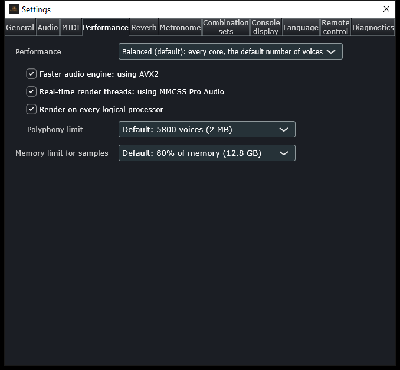

How the audio engine uses the processor, and how many pipes sound at once. Every setting on this tab holds for every organ.

| Control | What it does | Default | Range or options | Takes effect | Shown in |
|---|---|---|---|---|---|
| **Performance** | Sets the audio engine's threads and the number of voices together. Start with **Balanced**. If the sound crackles in a full chord, move down the list until it plays clean. **Steady** helps when other programs run beside the organ. Reads **Custom** when the four settings below match no preset. | **Balanced (default): every core, the default number of voices** | The presets below, and **Custom** | At once | Both |
| **Faster audio engine** | Renders several samples at a time with the processor's vector unit. The sound is the same, with more polyphony to spare. The label reads **Faster audio engine: using AVX2** (or SSE2, NEON) when the unit is found, and **Faster audio engine: not available on this processor** when it is missing. | On | On, off | At once | Advanced |
| **Real-time render threads** | Makes the threads that render the organ real-time threads, so the system runs them first, on the fastest cores. The label says what it found: **Real-time render threads: using SCHED_FIFO** (or MMCSS Pro Audio, rtkit, the realtime portal, Mach time constraint), or **Real-time render threads: no real-time rights on this system**. Hidden on Android. | On | On, off | At once | Advanced |
| **Render on every logical processor** | Renders the organ on every logical processor, with none kept for the interface, disk streaming and the system: more polyphony on a machine doing nothing else. Off: every processor but one, eight at most. | On | On, off | At once | Advanced |
| **Polyphony limit** | The most pipes that sound at once. Past it, a new pipe takes the place of one that is dying away, or of the quietest. Each choice shows the memory its voices take, which is larger with release streaming on. A lower number keeps a small computer from falling behind on a full organ. A number can be typed in the box: the first number typed is used. | **Default (N voices, N MB)**: 725 voices for each logical processor, at least 1,536, at most 16,384; 1,536 while releases stream | 256, 512, 768, 1024, 2048, 3072, 4096, 6144, 8192, 10240 voices, or a number typed, from 64 to 16,384 | At once | Advanced |
| **Memory limit for samples** | A load that would take more than this stops and says so, and loads nothing. The voice pool counts toward the figure. | **Default: 80% of memory (N GB)**, with at least 512 MB | **Default: 80% of memory**, **50%**, **60%**, **70%** and **90% of memory**, each with its size; a size set in the file shows as itself | At the next load | Advanced |

The presets:

| Preset | Faster audio engine | Real-time render threads | Every logical processor | Polyphony limit |
|---|---|---|---|---|
| **Most voices: every processor core, 8192 voices** | On | On | On | 8192 |
| **Balanced (default): every core, the default number of voices** | On | On | On | Default |
| **Steady: one core left free for the system and other programs** | On | On | Off | Default |
| **Fewer voices: 1024** | On | On | Off | 1024 |
| **Fewest voices: 512, for a Raspberry Pi or a tablet** | On | On | Off | 512 |

**Stored.** In the global file: `fasterengine`, `realtimethreads` and `everyprocessor`, each always written as `1` or `0`; `polyphony` and `memlimit`, written only when set. [Audio, room and mixer](audio.md#the-audio-engine) describes the engine and the threads.

## Reverb

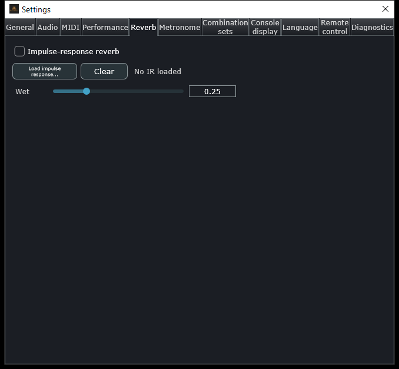

Impulse-response reverb for a dry set or for headphones. Many sample sets are recorded in the room they live in, and several ship close, far and rear perspectives that already contain the room; for those the wet level wants to be low.

| Control | What it does | Default | Range or options | Takes effect |
|---|---|---|---|---|
| **Impulse-response reverb** | Switches the convolution on or off. | Off | On, off | At once |
| **Load impulse response...** | Opens a file chooser for an impulse response and switches the reverb on once it has loaded. A file that cannot be read produces the message **The impulse response was not loaded**. | | WAV, AIFF and FLAC files | At once |
| **Clear** | Removes the loaded impulse response. The label beside the buttons returns to **No IR loaded**. | | | At once |
| Name label | Shows **IR:** and the file name of the loaded response. | **No IR loaded** | | |
| **Wet** | The share of the wet signal in the output. At the default the room's tail follows each release; at 1 the room alone plays, at about the organ's own level. | 0.25 | 0 to 1 in steps of 0.01 | At once |

A one-channel response feeds both sides, a two-channel response is read as stereo, and a four-channel response is read as true stereo (left input to both outputs, then right input to both outputs). The response is scaled by its power where the organ sounds, octave by octave, with one gain for all channels, so at full wet a pipe's tone comes out of the room at about the level it went in. When the file name ends in `-<rate>Hz` and a sibling file with the device's rate in that place exists, the sibling is used.

**Stored.** In the organ file, as the key `reverb <on> <wet> <path>`. The path refers to the file where it lies: if the file has moved when the organ is loaded, the log records `reverb: the impulse response saved with this organ was not found` and the organ loads with no room. Each organ opens with its own room. The settings of the loaded organ are written shortly after a change.

## Metronome

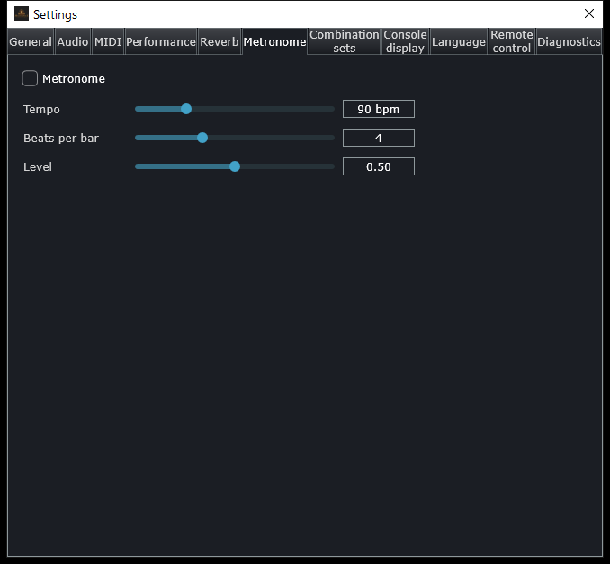

A click track for practice. It is generated inside the audio callback so that it stays in time with the organ. The click is a short 1000 Hz sine; the first beat of each bar is an octave and a half higher (1500 Hz) and louder. The click is added after the master fader and is left out of audio recordings made with the recorder.

| Control | What it does | Default | Range or options | Takes effect |
|---|---|---|---|---|
| **Metronome** | Starts and stops the click. | Off | On, off | At once |
| **Tempo** | Beats per minute. | 90 bpm | 20 to 300 bpm in steps of 1 | At once |
| **Beats per bar** | The bar length. The first beat of each bar is accented. 0 gives every beat the same click. | 4 | 0 to 12 | At once |
| **Level** | The loudness of the click. | 0.5 | 0 to 1 in steps of 0.01 | At once |
| Beat readout | Shows **Beat N** for the beat just played while the metronome runs. | Empty | | |

**Stored.** The tempo, the beats per bar and the level are the key `metronome <bpm> <beats> <level>` in the global file, written when the Metronome tab closes, and they return at the next start. The click starts silent at each start; the **Metronome** box shows whether it is running each time the tab opens.

## Combination sets

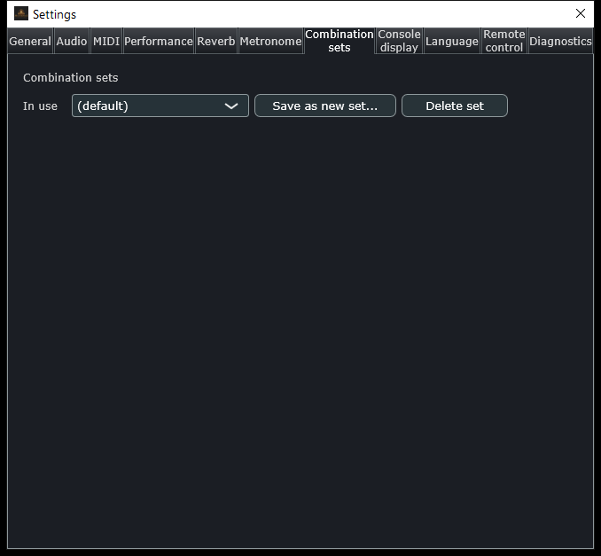

A combination set is a complete registration book: the organ's pistons and the player's own, kept in one file. A recital and a service can each have a set. Changing set saves the one being left first.

| Control | What it does | Default | Range or options | Takes effect |
|---|---|---|---|---|
| **In use** | The set in use for the loaded organ. | **(default)** | **(default)** and every set saved for this organ | At once |
| **Save as new set...** | Asks for a name (**A name for this registration set:**), copies the registrations in use to a new set of that name and switches to it. | | A name. Slash, backslash, colon, asterisk, question mark, quotation mark, angle brackets, the vertical bar and control characters become `_`; trailing dots and spaces are removed | At once |
| **Delete set** | Switches to the default set and deletes the file of the set that was in use. The default set cannot be deleted (**The default set cannot be deleted**). | | | At once |
| Status line | Reports **Now using NAME**, or **Deleted NAME, back on the default**. | | | |

The favourite organs are kept in the **Open** window.

**Stored.** The set in use is the key `combset <name>` in the organ file. Each set is a file in the `combinations` folder: `<organ key>.mpcomb` for the default set and `<organ key>.<name>.mpcomb` for a named one. [Playing](playing.md) describes how registrations are stored and recalled.

## Console display

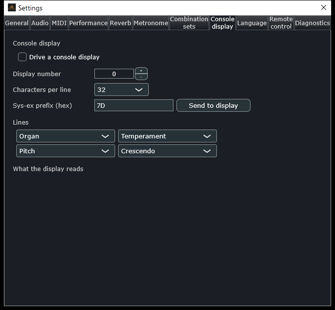

This tab drives the text display on a console's jamb, such as a 32-character panel, by system exclusive messages through the MIDI output. It drives external hardware only. The framing bytes belong to the display hardware, so they are typed in here. Choose the MIDI output on the **MIDI** tab first: the messages leave through the port that lights the drawstops.

| Control | What it does | Default | Range or options | Takes effect |
|---|---|---|---|---|
| **Drive a console display** | Switches the display on. | Off | On, off | At once |
| **Display number** | The number of the display on the console, sent as one byte. | 0 | 0 to 15 | At once |
| **Characters per line** | The width of the display. | 32 | 16, 20, 32, 40 | At once |
| **Sys-ex prefix (hex)** | The bytes that follow the opening system exclusive byte and introduce a message to this console. 7D is the identifier the MIDI specification reserves for non-commercial use. A prefix that cannot be read falls back to 7D. | 7D | One to eight bytes of 00 to 7F, in hexadecimal, separated by spaces; the field takes up to 23 characters | When the field loses focus or Return is pressed |
| **Send to display** | Sends every line again, for a console connected after the organ loaded. | | | At once |
| **Lines** (four boxes) | The content of line 1 to line 4. | **Organ**, **Temperament**, **Pitch**, **Crescendo** | **(blank)**, **Organ**, **Temperament**, **Pitch**, **Transpose**, **Stops drawn**, **Crescendo**, **Combination set** | At once |
| **What the display reads** | A preview of the lines as the hardware shows them, between bars that mark where the panel ends. A value longer than the width is cut and a shorter one is padded with spaces. | | | Twice a second |

The fields show: the organ's name; the temperament's name; the pitch as `A=440.0 Hz`; the transposition as `+2`, `0` or `-3`; the number of stops drawn; the crescendo step (0 with the shoe closed); and the name of the combination set (`(default)` for the default set). A message is `F0`, the prefix, the display number, the line number (0 to 3), the text as 7-bit ASCII, `F7`. Accented Latin letters lose their accents; other characters above 7F become `?`. Only lines whose text changed since the last send go out, checked four times a second.

**Stored.** In the global file as `lcd <on> <display> <width> <line1> <line2> <line3> <line4> <prefix>`: `<on>` is 1 or 0, `<display>` the display number, `<width>` the characters per line, each `<line>` the number of the choice in its box (1 for **(blank)** to 8 for **Combination set**, in the order of the table above) and `<prefix>` the hexadecimal bytes, which run to the end of the line. The setup is read again at the next start. The main window sends the display four times a second whether or not this tab is open, so the display follows the organ with any window open or none. The **MIDI output** must be chosen.

## Language

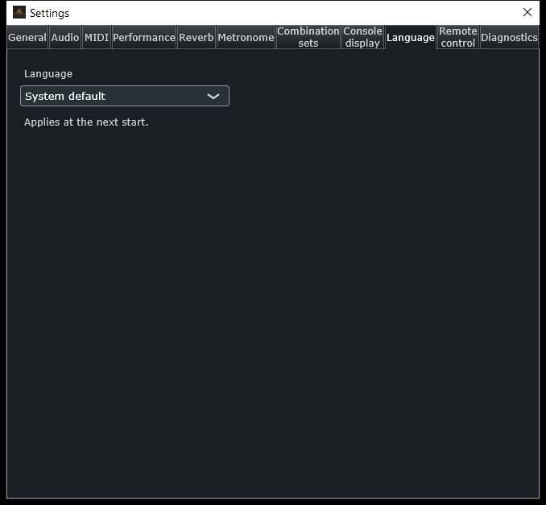

| Control | What it does | Default | Range or options | Takes effect |
|---|---|---|---|---|
| Language box | The language of the program's own words. Each language is named in itself, so a player who cannot read the current language can find theirs. Names of organs, stops and pages stay as the organ gives them. The note beside it reads **Applies at the next start.** | **System default** | **System default** (the language of the system when a translation exists, otherwise English), **English**, then the translations in this version: **Čeština**, **Deutsch**, **Español**, **Français**, **Italiano**, **Nederlands**, **Polski** | At the next start |

A string that a translation lacks appears in English.

**Stored.** In the global file as `language <code>` (`en`, `cs`, `de`, `es`, `fr`, `it`, `nl` or `pl`). The key is absent for **System default**.

## Remote control

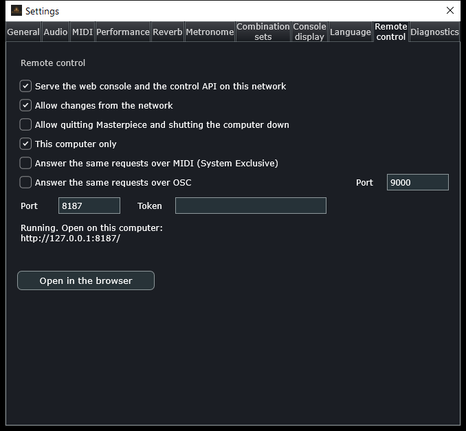

The web console and the control API, for a tablet or another program on the same network. Present in the standalone application. [Remote control](remote.md) describes the web console, the API, SysEx and OSC in depth.

| Control | What it does | Default | Range or options | Takes effect |
|---|---|---|---|---|
| **Serve the web console and the control API on this network** | Starts the web server. | Off | On, off | At once |
| **Port** | The HTTP port of the web console and the API. | 8080 | A port number | At once |
| **Token** | A word every request that changes something must carry. | Empty | Text | At once |
| **Allow changes from the network** | Lets the network draw stops and move controls. Off, the network can only read: the stops drawn, the levels, the organ loaded. | On | On, off | At once |
| **Allow quitting Masterpiece and shutting the computer down** | Lets the API quit the program and power the computer off. | Off | On, off | At once |
| **This computer only** | Serves the page, the API and OSC on 127.0.0.1 only. | Off | On, off | At once |
| **Answer the same requests over MIDI (System Exclusive)** | The same protocol over system exclusive messages, on the MIDI inputs and the MIDI output, under a unit number. | Off, unit 0 | On, off; unit 0 to 126 | At once |
| **Answer the same requests over OSC** | The same protocol over OSC, on a UDP port. | Off, port 9000 | On, off; a port number | At once |
| **Open in the browser** | Opens the web console in the system's browser. | | | At once |

**Stored.** In the global file: `api`, `apiport`, `apiwrite` (`0` while changes are refused), `apitoken`, `apipoweroff`, `apilocal`, `apisysex`, `apisysexunit`, `apiosc`, `apioscport`.

## Diagnostics

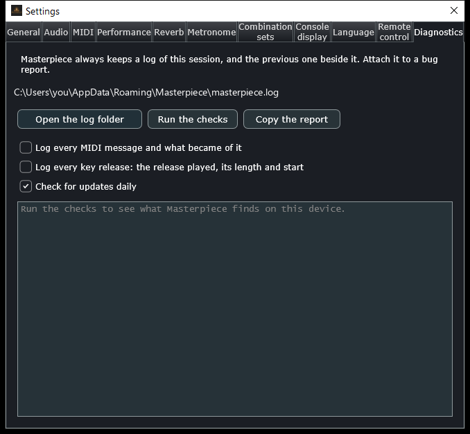

Masterpiece always keeps a log of the session and the previous one beside it. The log and the report on this tab are what a bug report needs. The text at the top of the tab gives the log's path, or **No log is being written.**

| Control | What it does | Default | Takes effect |
|---|---|---|---|
| **Open the log folder** | Shows the log file in the system's file manager. Absent on phones and tablets. | | At once |
| **Run the checks** | Tests the machine and the organ and prints the result in the box below. | | At once |
| **Copy the report** | Copies the checks (run first if the box is empty) and the last 200 lines of the log to the clipboard. | | At once |
| **Send the report and the log** | Shares the report, the log and the previous log through the share sheet. Present only on phones and tablets. | | At once |
| **Log every MIDI message and what became of it** | The same as `--log-midi`: which manual, stop or control each message reached and, when nothing sounded, why. | Off | At once; lasts until Masterpiece closes |
| **Log every key release: the release played, its length and start** | The same as `--log-releases`: the release chosen for each key release, its length and where it started. | Off | At once; lasts until Masterpiece closes |
| **Check for updates daily** | Reads the newest version's number from masterpieceorgan.com, a few bytes, once a day, and offers the download page when it is newer. **Help > Check for updates...** checks at once. See [Files and folders](files.md#privacy). | On | At the next start; `updatecheck` in the global file |

The report box is read-only and shows **Run the checks to see what Masterpiece finds on this device.** until the checks have run. See [Command line](command-line.md) for the log and its options.

### What the checks test

Each line of the report starts with `ok` for a passed test, `FAILED` for a failed one, or spaces for a fact with nothing to pass.

| Line | What it tests |
|---|---|
| Header | The Masterpiece version, the operating system and the device; the number of processors and the memory in MB; the time of the check. Facts only. |
| **Settings folder** | The user's data folder. The check creates it if it is missing, writes a small file `.masterpiece-check`, reads it back and deletes it. It reports the path, whether it can be written and the free space in GB. |
| **Sample cache** | The same write test for the cache folder in use, with the free space. |
| Cache folder chosen | Appears as `FAILED` when the folder chosen under **Cache folder** cannot be used and the usual one is in use instead. |
| **Temporary folder** | The same write test for the system's temporary folder. |
| **Cache files** | The number and total size of the `.mpcache` files in the cache folder. A fact. |
| **Organs unpacked from their archives** | The number of folders in `Packaged`, where package archives are unpacked. A fact. |
| **Log** | Passes when the log file exists; reports its path and size in KB. Fails when no log is being written. |
| **Audio** | Passes when the audio device runs; reports its rate and block size in frames. Fails with **Audio: not running**. |
| **MIDI inputs** | The names of the MIDI inputs the system lists, or `none`. A fact. |
| **Organ** | When an organ is loaded: passes when its definition file still exists. Without an organ the line reads **No organ is loaded**. |
| The organ's definition | Passes when the definition file can be read. |
| **Organ folder** | Passes when the folder that holds the organ's installation packages exists. |
| Organ counts | The number of ranks, stops and console pages. A fact. |
| **Samples kept as** | The resident format, the memory limit (**not set** for the default) and the number of stream underruns. A fact. |
| **Impulse response** | The name of the loaded impulse response, or `none`. A fact. |
| Documents lent by the Files app | On iPhone and iPad: the number of documents the Files app has lent, with a pass or fail for each according to whether it can be read now. |

**Stored.** The log is `masterpiece.log` in the data folder, and the run before it is `masterpiece.previous.log`. The two logging switches return to off at every start.

## Back up and restore

The **File** menu holds three items for the settings, on computers. **Organ > Copy settings from another organ...** holds the fourth.

| Item | What it does |
|---|---|
| **Export organ settings...** | Writes a zip file holding the loaded organ's own settings: its MIDI map, its combinations, its split keyboard and its organ settings. |
| **Export settings...** | Writes a zip file holding every setting, the program's own and each organ's. The audio device stays with the computer. |
| **Import settings...** | Reads a zip file written by one of the export items and puts the settings back. A file that is not one of ours is refused, and nothing changes. |
| **Copy settings from another organ...** | Takes the MIDI map, the combinations, or the mixer and voicing from another organ, each on its own toggle. |

Every import and every copy saves what was there first, in the `backups` folder, and says where.

The mixer and voicing of one organ mean something only between versions of the same organ, a demo and the full set: the ids of stops, ranks and pipes must be the same. The dialog says how many of the ranks and pipes the other organ names are in this one.

## Where settings are kept

Masterpiece keeps everything in text files in its data folder.

| System | Data folder |
|---|---|
| Windows | `%APPDATA%\Masterpiece` |
| macOS | `~/Library/Masterpiece` |
| Linux | `~/.config/Masterpiece` |

The sample sets are left untouched. [Files and folders](files.md) lists the whole folder.

### The global file

The global file is `settings.mpglobal` in the data folder. It holds what belongs to the program and the machine, and the defaults an organ starts from before its own file is applied. The file is plain text. The first line is the comment `# Masterpiece defaults for organs that have no settings of their own`; every other line is a key, a space and a value, and the value is taken whole so that a path may contain spaces. Lines that start with `#` are ignored. Masterpiece rewrites the whole file at each change, so edit it only while Masterpiece is closed.

| Key | Value | Written by |
|---|---|---|
| `reopenlastorgan` | `1` or `0`. Always written. | **Reopen the last organ when Masterpiece starts** on the General tab |
| `updatecheck` | `0` when the update check is off; absent while it is on. | **Check for updates daily** on the Diagnostics tab |
| `updatecheckedat` | Seconds since 1970 of the last update check. | The update check |
| `api`, `apiport`, `apiwrite`, `apitoken`, `apipoweroff`, `apilocal`, `apisysex`, `apisysexunit`, `apiosc`, `apioscport` | The remote control settings. | The **Remote control** tab |
| `readylamp`, `readylamplit`, `readylampdark`, `loadmessage`, `unloadmessage` | The messages to the console. | The **MIDI** tab |
| `speakerkeepalive` | The level in dB, -80 to -40. Written only while on. | **Keep portable speakers awake** |
| `memlimit` | The sample memory limit in MB. Written only when set. | **Memory limit for samples** on the Performance tab |
| `defaulteq` | `<on> <gain> <band 1> ... <band 10>`. Written only while the default EQ is on or not flat. | **Save as default** on the **Equalizer** tab of Organ settings |
| `polyphony` | The voice limit. Written only when set. | **Polyphony limit** on the Performance tab |
| `running` | The path of the organ being loaded or played. Removed at a clean exit; one still present at the next start means the last session ended unexpectedly, which the log records. | The crash guard |
| `language` | The language code. Written only when a language is chosen. | **Language** |
| `metronome` | `<bpm> <beats> <level>`: the tempo, the beats per bar and the level. Written when the Metronome tab closes. | The **Metronome** tab |
| `limiter` | `<on> <ceilingDb> <releaseMs>`. | **Output limiter** on the **Audio** tab |
| `compressor` | `<on> <thresholdDb> <ratio> <attackMs> <releaseMs> <makeupDb> <Hz>`. | **Output compressor** on the **Audio** tab |
| `loadticks` | `1` or `0`. Always written. | **Click at each 10% while loading** on the General tab |
| `cancelresetskeyboards` | `1`. Written only while on. | **General Cancel also puts the keyboards back on their own manuals** |
| `stopsleaveheldnotes` | `1`. Written only while on. | **Stop changes leave the notes already held alone** |
| `sustainpedal` | `1`. Written only while on. | **Sustain pedal: controller 64 holds the notes let go** |
| `pedalcombinationscoupled` | `1`. Written only while on. | **Pedal with %1** in the combinations window, named after the manual it ties |
| `learnnoisefilter` | `1`. Written only while on. | **Noise filter: when learning, a key counts once held a quarter second** |
| `archive`, `archivesilence`, `archivemb`, `archivedays` | The archive switch, and its silence in seconds, size in MB and age in days, each written when it differs from the default. | **Archive everything played** |
| `combinationsontop` | `1`. Written only while on. | **Always on top** in the combinations window |
| `cachewhileplaying` | `1`. Written only while on. | **Save the sample cache** set to **In silence, while it plays** |
| `samplecache` | `0` off, `1` one cache, `2` one per organ. Always written. | **Sample cache** on the General tab |
| `setoffafterstore` | `1`. Written only while on. | **Set turns off after storing** in the combinations window |
| `pistonsleavebass` | `1`. Written only while on. | **Pistons leave the bass coupler** in the combinations window |
| `showkeys` | `0`. Written only while off. | **View > Highlight played keys** |
| `smallpagesfill` | `1`. Written only while on. | **View > Scale small pages to fit** |
| `displaymode` | `simple` or `professional`. Always written. | **Display mode** on the General tab (`professional` is **Advanced**) |
| `fasterengine`, `realtimethreads`, `everyprocessor` | `1` or `0`. Always written. | The Performance tab |
| `midiinputoff` | A device name. One line per unticked input. | **MIDI inputs** |
| `midioutput` | The name of the MIDI output port. Written only while a port is chosen; a port that is not plugged in keeps its name. | **MIDI output** |
| `scorepage` | `<kind> <channel> <next> <before>`. | **Score app** on the MIDI tab |
| `midifeedback` | `1`. Written only while on. | **Send stop changes on the MIDI output** |
| `consolechannel` | A role (0 for the pedal, 1 onward for the manuals) and a channel 1 to 16. | **Default channels** on the MIDI tab, and **Use as default for all organs** in Organ settings |
| `eqpreset`, `eqpresetnext` | The player's EQ presets. | **Save as preset...** on the **Equalizer** tab of Organ settings |
| `library` | A folder holding a sample library (an `OrganInstallationPackages` folder beside it). Added when an organ is loaded from such a folder, and for the standard library folder of a Hauptwerk-format installation when it exists. | Opening organs |
| `lcd` | `<on> <display> <width> <line1> <line2> <line3> <line4> <prefix>`. The prefix is the hexadecimal bytes, separated by spaces. | The **Console display** tab |
| `cachedir` | The cache folder. Absent for the default. | **Cache folder** on the General tab |
| `packagedir` | The package folder. Absent for none. | **Package folder** on the General tab |
| `lastorgan` | The definition of the organ opened last. | Opening an organ |
| `openfolder` | The folder the last organ was chosen from. | The **Open** window |
| `dialogfolder` | A kind and a folder: `ir`, `midi`, `recording` or `scala`, then the folder where that kind of file dialog was last used. | The file dialogs of **Load impulse response...**, the recorder and the tuning panel |
| `favourite` | `<kind> <slot> <name> \| <target>`: the kind is `organ`, `temperament` or `combinationset`. | The favourites in the **Open** window and the tuning panel |

**Save as default** on the Loading tab of Organ settings adds the organ-level keys to the global file as well, so that an organ without a file of its own starts from them: `storage`, `mono`, `compress`, `programcouplers`, `releases`, `releaselength`, `releasecutoff`, `reverb`, `rate`, `stream`, `streamhead`, `streamheadpct`, `releasebuffer`, `preload`, `root`, the engine switches (`simple`, `wind`, `tremulant`, `enclosure`, `voicing`, `originalpitch`), `gain`, `buses`, `busir`, `busbass` and `groups`. These are described under [Where the organ's settings are kept](organ-settings.md#where-the-organs-settings-are-kept). An organ that has a file of its own takes the values from that file. The obsolete keys `reopenlast`, and `cache` in an organ file, are ignored when read.

### Other files

| File | Content |
|---|---|
| `organs/<organ key>.mporgan` | The settings of one organ: [Organ settings](organ-settings.md). |
| `midi/<organ key>.mpmidi` | The MIDI mapping of one organ. |
| `midi/console.mpmidi` | The console's own actions, valid for every organ. |
| `combinations/<organ key>.mpcomb` and `combinations/<organ key>.<set>.mpcomb` | The combination sets of one organ. |
| `split/<organ key>.mpsplit` | The split keyboard of one organ ([Split keyboard](split-keyboard.md)). |
| `audio.xml` | The audio device setup, written when Masterpiece quits. |
| `window.txt` | The place and size of the main window. |
| `cache/` | The sample cache, unless **Cache folder** names another. |
| `masterpiece.log`, `masterpiece.previous.log` | The logs of this session and the one before. |

The organ key names a file after the organ and keeps the file when the sample set moves or is renamed. It is the organ's name reduced to letters and digits (spaces, hyphens and underscores become hyphens, at most 48 characters), a hyphen, and the unique organ identifier of the definition. A definition without an identifier uses `p` and 16 hexadecimal digits that are a hash of its path.
