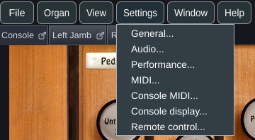
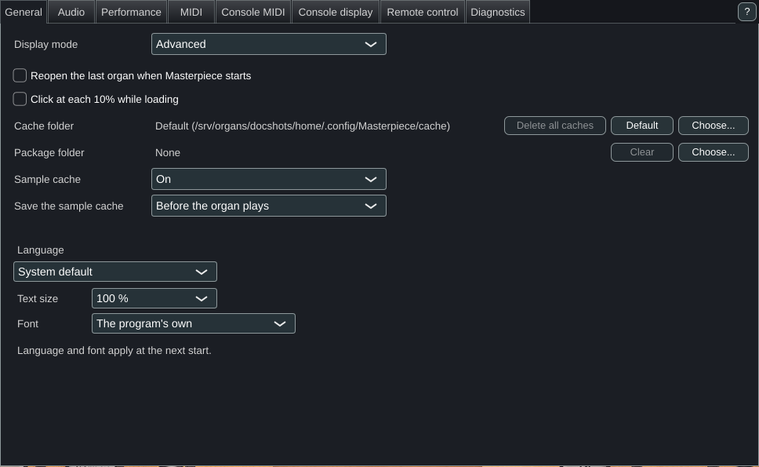
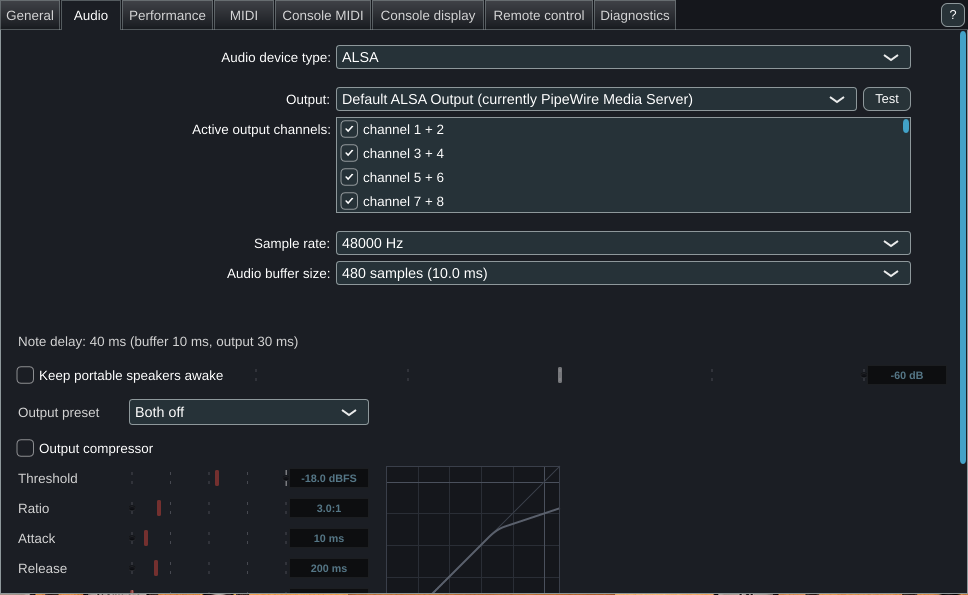
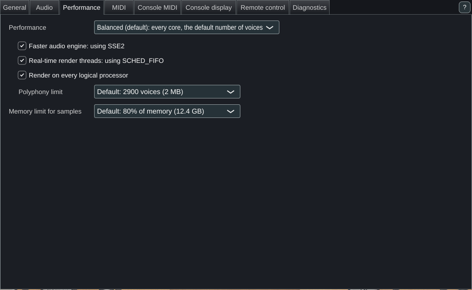
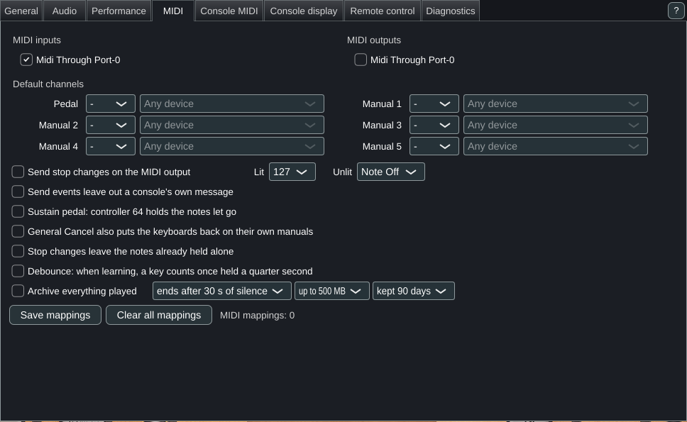
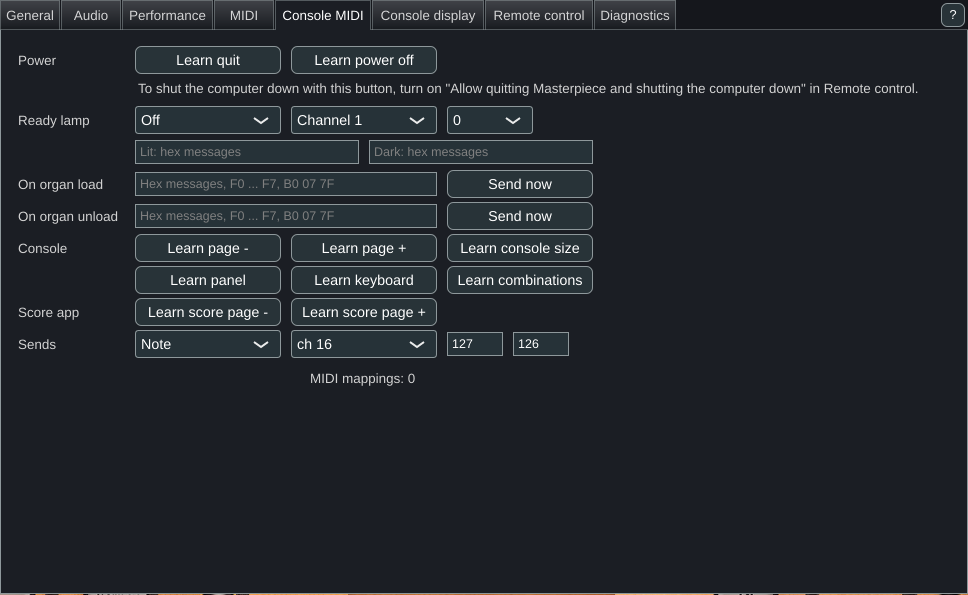
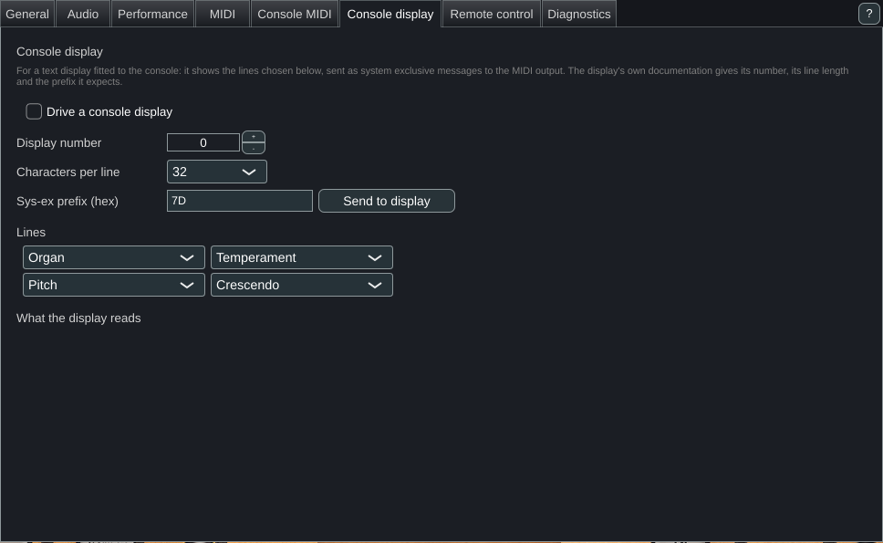
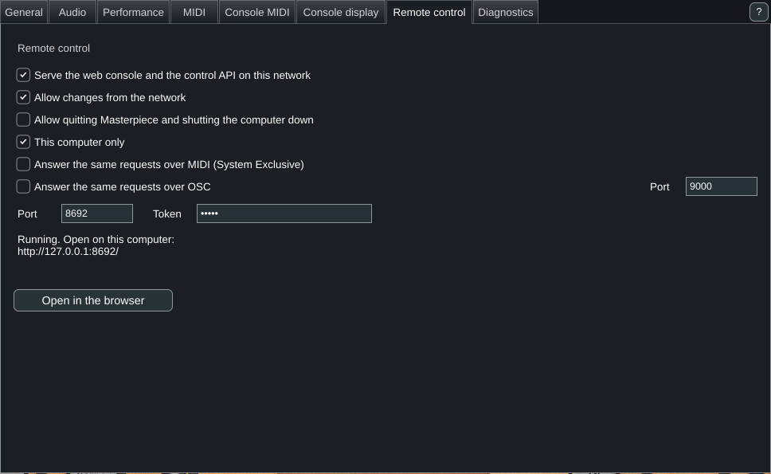
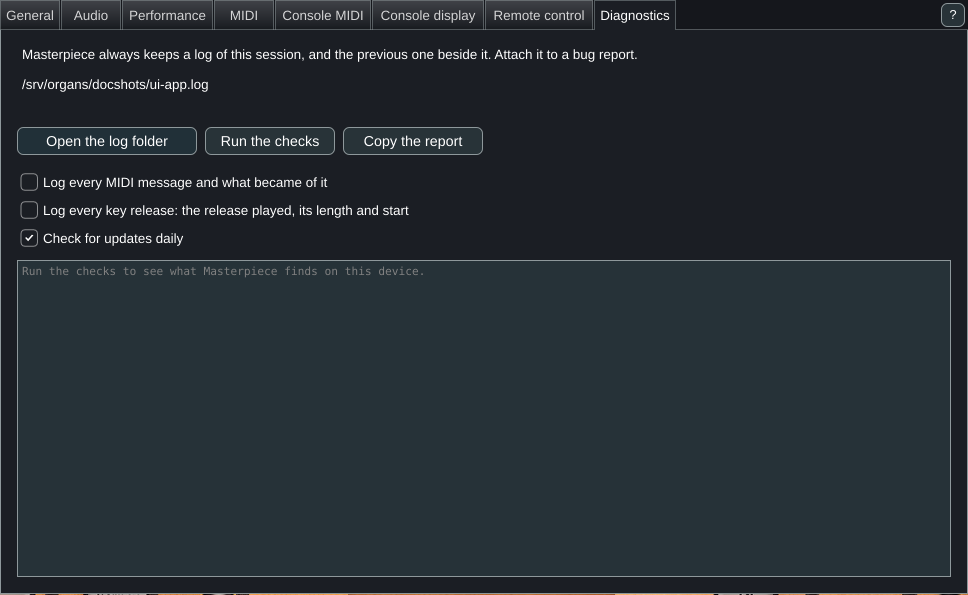

# Settings

The **Settings** window holds the program and the player's console: the display mode, the folders, the sample cache and the language, the audio device and the output dynamics, the performance of the audio engine, MIDI, the console's own messages and buttons, the console display, remote control and diagnostics. This page lists every control on every tab in the order the window shows them: what it does, its default, its range or options, when it takes effect and where it is stored. The topics behind the controls have pages of their own ([Audio, room and mixer](audio.md), [MIDI and consoles](midi.md), [Memory, loading and streaming](memory.md), [Playing](playing.md), [Remote control](remote.md)); this page links to them for depth. The settings that belong to one organ (how it is read from disk, which stops load, its outputs, voicing, equaliser and room) are in [Organ settings](organ-settings.md).

## Opening the window

The **Settings** button in the top bar opens a menu with one entry for each tab of the window. Each entry opens the window on that tab.

| Application | Entries |
|---|---|
| Standalone | **General...**, **Audio...**, **Performance...**, **MIDI...**, **Console MIDI...**, **Console display...**, **Remote control...** |
| VST3, LV2 and AU plugins | **General...**, **Performance...**, **Console display...** |

The **Diagnostics** tab opens from **Help > Diagnostics...**. The organ's own settings are in the **Organ** menu; the metronome, the tuner, the recorder, the couplers and the split keyboard are in the **Window** menu; the combination sets are in the Combinations window. See [A tour of the window](window.md#the-top-bar).

The window is titled **Settings**, opens at 960 x 560 pixels and can be resized. Its tabs, in order: **General**, **Audio**, **Performance**, **MIDI**, **Console MIDI**, **Console display**, **Remote control**, **Diagnostics**. Opened from the top bar's button with no tab named, it shows the tab it was last closed on. In a narrow window each tab name keeps its words whole and a two-word name takes two lines. The **?** button at the right end of the tab bar opens this manual at the section of the tab in front. The Esc key closes the window. It has no OK or Cancel button: each control acts when it is changed, and the **Takes effect** column below says whether that is at once or later.

> [!NOTE]
> In the VST3, LV2 and AU plugins the window has no **Audio**, **MIDI**, **Console MIDI** or **Remote control** tab: the host owns the audio device and the MIDI ports. The output limiter and compressor of the **Audio** tab are a standalone feature; in a plugin the host's own effects shape the output.

### Display mode

**Display mode** on the **General** tab chooses how much the window shows. **Simple** shows the main settings, with the **Quality** and **Performance** presets; **Advanced** shows every setting. The tables below mark the rows that only **Advanced** shows. In **Simple**, **Custom** is greyed in both preset boxes: a preset is chosen whole, and the settings under it are set one by one in **Advanced**.

## General

| Control | What it does | Default | Range or options | Takes effect | Shown in |
|---|---|---|---|---|---|
| **Display mode** | How much the Settings and Organ settings windows show. | **Simple** | **Simple**, **Advanced** | At once | Both |
| **Reopen the last organ when Masterpiece starts** | Loads, at start, the organ that last loaded completely, after an unexpected close too. | Off | On, off | At the next start | Both |
| **Click at each 10% while loading** | Plays a short tap at each 10% of a load, so a large set can be followed by ear. | Off | On, off | At the next load | Advanced |
| **Cache folder** | Where the sample cache is written, and where organs unpacked from their archives are kept (`Packaged/`). A folder that cannot be created is replaced by the default for that load. | **Default**, the `cache` folder in the data folder | **Choose...** opens a folder chooser; **Default** returns to the default folder | At the next load | Advanced |
| **Delete all caches** | Deletes the sample cache in the folder shown. Each organ then reads its samples again at its next load. The tooltip gives the size, or **No sample cache in this folder**. | | | At once | Advanced |
| **Package folder** | Where the player keeps packages. A composite organ looks here, and in the folders directly in it, for the organs it plays. | **None** | **Choose...** opens a folder chooser; **Clear** removes it | At the next load | Advanced |
| **Sample cache** | Whether organs keep a cache of their decoded samples on disk, so the next load of the same organ is a read. **On**: each organ keeps one cache, rebuilt in place when its loading settings change. An organ's own setting, **Sample cache for this organ** on [Organ settings > Loading](organ-settings.md#organ), can turn its cache on or off. | **On** | **On**, **Off** | At the next load | Both |
| **Save the sample cache** | When the cache of a new load is written. **Before the organ plays**: the first load takes longer and nothing competes with the sound. **In silence, while it plays**: the organ plays at once and the samples are saved whenever nothing sounds; until they are, the next load reads them again. | **Before the organ plays** | **Before the organ plays**, **In silence, while it plays** | At the next load | Both |

Under them, the language and the look of the text:

| Control | What it does | Default | Range or options | Takes effect |
|---|---|---|---|---|
| **Language** | The language of the program's own words. Each language is named in itself, so a player who cannot read the current language can find theirs. Names of organs, stops and pages stay as the organ gives them. | **System default** | **System default** (the language of the system when a translation exists, otherwise English), **English**, then the translations in this version: **Čeština**, **Deutsch**, **Español**, **Français**, **Italiano**, **Nederlands**, **Polski** | At the next start |
| **Text size** | Scales the text and the controls of every window. | 100 % | 100 %, 115 %, 130 %, 150 %, 175 %, 200 % | At once on computers |
| **Font** | The font of the program's words. | **The program's own** | **The program's own** and every font of the system | At the next start |

The note under them reads **Language and font apply at the next start.** A string that a translation lacks appears in English.

**Stored.** In the global file: `displaymode`, `reopenlastorgan`, `loadticks`, `cachedir`, `packagedir`, `samplecache` and `cachewhileplaying`; `language <code>` (`en`, `cs`, `de`, `es`, `fr`, `it`, `nl` or `pl`; absent for **System default**), `textsize` (absent at 100) and `textfont` (absent for the program's own).

## Audio

The upper part of the tab is the device selector of the audio library. It chooses where Masterpiece sends sound. Its controls are described here generically; their labels and the choices offered depend on the system and the driver. The MIDI inputs and outputs are on the [MIDI](#midi) tab.

| Control | What it does | Default | Range or options | Takes effect |
|---|---|---|---|---|
| Device type | The driver family, on systems that offer more than one. | The system default | The families the system reports | At once |
| Output device | The sound device. | The system default output | The devices of that family | At once |
| Output channels | Which outputs of the device carry sound. | As the device opens | Up to 64 output channels | At once |
| Sample rate | The rate the device runs at. | The device's own rate on a first start; a saved setup keeps its rate | The rates the device reports | At once |
| Buffer size | The block the device processes at a time. It sets the delay between a key and its sound. | The size nearest 10 ms on a first start | The sizes the device reports | At once |
| Test | Plays a test tone through the selected channels. | | | At once |

Below the selector, a line reads **Note delay: N ms (buffer N ms, output N ms)**. It shows the whole delay from a key to the speaker for the open device.

| Control | What it does | Default | Range or options | Takes effect |
|---|---|---|---|---|
| **Keep portable speakers awake** | Plays a 20 Hz tone, too low and too quiet to hear under the organ, so that a battery speaker does not switch itself off during silence and swallow the first notes. | Off | On, off | At once |
| Level slider (beside the box) | The level of the tone. Raise it if the speaker still sleeps; lower it if the tone is audible. Active while the box is ticked. | -60 dB when first switched on | -80 to -40 dB in steps of 1 dB | At once |

Which device channels each output of the organ plays on is set in [Organ settings > Outputs](organ-settings.md#outputs).

### Output dynamics

Under them, the compressor and the peak limiter on the output, after the master fader. Both are off until they are switched on, and while off the engine does not call them. A graph beside the compressor draws its transfer curve: input level across, output level up, in dBFS. [Audio, room and mixer](audio.md#output-compressor-and-limiter) describes how they work.

| Control | What it does | Default | Range or options | Takes effect |
|---|---|---|---|---|
| **Output preset** | Sets the compressor and the limiter together. Reads **Own settings** when the controls match no preset. | **Both off** | **Both off**, **Limiter only**, **Gentle**, **Small speakers**, **Laptop speakers**, **Headphones, quiet practice** | At once |
| **Output compressor** | Brings the loud passages towards the quiet ones; the make-up gain lifts the whole. It works ahead of the limiter. | Off | On, off | At once |
| **Threshold** | The level the compression begins at. | -18 dBFS | -40 to 0 dBFS in steps of 0.5 | At once |
| **Ratio** | How much a level over the threshold is held down: at 3:1, 3 dB over comes out 1 dB over. | 3:1 | 1.5:1 to 10:1 in steps of 0.1 | At once |
| **Attack** | How long the gain takes to come down. A longer one lets the speech of the pipes through. | 10 ms | 1 to 100 ms | At once |
| **Release** | How long the gain takes to come back. | 200 ms | 50 to 1000 ms in steps of 10 | At once |
| **Make-up gain** | Lifts the whole output after the compression. | 0 dB | 0 to 18 dB in steps of 0.5 | At once |
| **Bass left out** | The compressor does not hear the bass below this pitch, so a 32' or a full pedal leaves the manuals at their level. The bass itself sounds in full. | **Below 120 Hz** | **None**, **Below 80 Hz**, **Below 120 Hz**, **Below 200 Hz** | At once |
| Reduction readout | **Reduction N dB**: how far the compressor holds the level down now, before the make-up gain. Shown while the compressor is on. | | | Ten times a second |
| **Output limiter** | Holds the output below the ceiling. It adds no delay. | Off | On, off | At once |
| **Ceiling** | The level the output is held under. | -1 dBFS | -12 to -0.1 dBFS in steps of 0.1 | At once |
| **Release** | How long the limiter's gain takes to come back after a peak. | 100 ms | 50 to 1000 ms in steps of 10 | At once |

The sliders and the boxes under the compressor are greyed while it is off. The presets:

| Preset | Compressor | Threshold | Ratio | Attack | Release | Make-up | Bass left out | Limiter | Ceiling | Limiter release |
|---|---|---|---|---|---|---|---|---|---|---|
| **Both off** | Off | | | | | | | Off | | |
| **Limiter only** | Off | | | | | | | On | -1 dBFS | 100 ms |
| **Gentle** | On | -18 dBFS | 2:1 | 20 ms | 400 ms | 4 dB | Below 120 Hz | On | -1 dBFS | 100 ms |
| **Small speakers** | On | -24 dBFS | 3:1 | 10 ms | 250 ms | 8 dB | Below 120 Hz | On | -1 dBFS | 100 ms |
| **Laptop speakers** | On | -30 dBFS | 4:1 | 5 ms | 200 ms | 12 dB | Below 200 Hz | On | -1 dBFS | 80 ms |
| **Headphones, quiet practice** | On | -30 dBFS | 2.5:1 | 10 ms | 300 ms | 10 dB | Below 80 Hz | On | -3 dBFS | 150 ms |

**Stored.** The device, rate, buffer size and channel choices are written to `audio.xml` when Masterpiece quits. A saved setup that no longer matches the hardware, or that opens with no live output, is replaced by the defaults. A device that opens below 44.1 kHz is moved to 48 kHz, or to 44.1 kHz where 48 kHz is unavailable. The speaker setting is the key `speakerkeepalive` in the global file, written only while it is on. The limiter is the key `limiter <on> <ceiling> <release>` and the compressor the key `compressor <on> <threshold> <ratio> <attack> <release> <make-up> <Hz>`, both in the global file.

[Audio, room and mixer](audio.md) explains choosing a buffer size and a driver.

## Performance

How the audio engine uses the processor, and how many pipes sound at once. Every setting on this tab holds for every organ.

| Control | What it does | Default | Range or options | Takes effect | Shown in |
|---|---|---|---|---|---|
| **Performance** | Sets the audio engine's threads and the number of voices together. Start with **Balanced**. If the sound crackles in a full chord, move down the list until it plays clean. **Steady** helps when other programs run beside the organ. Reads **Custom** when the four settings below match no preset. | **Balanced (default): every core, the default number of voices** | The presets below, and **Custom** | At once | Both |
| **Faster audio engine** | Renders several samples at a time with the processor's vector unit. The sound is the same, with more polyphony to spare. The label reads **Faster audio engine: using AVX2** (or SSE2, NEON) when the unit is found. | On | On, off | At once | Advanced |
| **Real-time render threads** | Makes the threads that render the organ real-time threads, so the system runs them first, on the fastest cores: MMCSS on Windows, SCHED_FIFO or rtkit on Linux, the audio workgroup on macOS. The label says what it found: **Real-time render threads: using ...**. Hidden where the system offers none. | On | On, off | At once | Advanced |
| **Render on every logical processor** | Renders the organ on every logical processor, with none kept for the interface, disk streaming and the system: more polyphony on a machine doing nothing else. Off: every processor but one, eight at most. | On | On, off | At once | Advanced |
| **Polyphony limit** | The most pipes that sound at once. Past it, a new pipe takes the place of one that is dying away, or of the quietest. Each choice shows the memory its voices take, which is larger with release streaming on. A lower number keeps a small computer from falling behind on a full organ. A number can be typed in the box. | **Default: N voices (N MB)**: 725 voices for each logical processor, at least 1,536, at most 16,384; 1,536 while releases stream | 256, 512, 768, 1024, 2048, 3072, 4096, 6144, 8192, 10240 voices, or a number typed, from 64 to 16,384 | At once | Advanced |
| **Memory limit for samples** | A load that would take more than this stops and says so, and loads nothing. The voice pool counts toward the figure. | **Default: 80% of memory (N GB)**, with at least 512 MB | **Default: 80% of memory**, **50%**, **60%**, **70%** and **90% of memory**, each with its size; a size set in the file shows as itself | At the next load | Advanced |

The presets:

| Preset | Faster audio engine | Real-time render threads | Every logical processor | Polyphony limit |
|---|---|---|---|---|
| **Most voices: every processor core, 8192 voices** | On | On | On | 8192 |
| **Balanced (default): every core, the default number of voices** | On | On | On | Default |
| **Steady: one core left free for the system and other programs** | On | On | Off | Default |
| **Fewer voices: 1024** | On | On | Off | 1024 |
| **Fewest voices: 512, for a Raspberry Pi or a tablet** | On | On | Off | 512 |

**Stored.** In the global file: `fasterengine`, `realtimethreads` and `everyprocessor`, each always written as `1` or `0`; `polyphony` and `memlimit`, written only when set. [Audio, room and mixer](audio.md#the-audio-engine) describes the engine and the threads.

## MIDI

The console's MIDI: the inputs and the outputs, the default channels and devices, and how stops and keys answer and echo. The keyboards of the loaded organ are on the **MIDI** tab of [Organ settings](organ-settings.md#midi); the console's own buttons and messages are on the [Console MIDI](#messages-to-the-console) tab. [MIDI and consoles](midi.md) explains the channel assignment and learning in depth.

### Inputs, channels and outputs

| Control | What it does | Default | Range or options | Takes effect and storage | Shown in |
|---|---|---|---|---|---|
| **MIDI inputs** | One tick box per MIDI input device, plus inputs Masterpiece opens itself (the JACK MIDI port on Linux, the port made by `--virtual-midi`). A device another program holds is shown as **NAME  -  in use by another program; opened when it is free** and stays ticked; Masterpiece opens it when it is released. | All inputs ticked | Each input on or off | At once. Unticked inputs are kept in the global file as `midiinputoff <name>`. | Both |
| **Bluetooth MIDI...** | Opens the system's pairing dialog for a Bluetooth MIDI device. Shown where the system offers it. | | | At once | Both |
| **MIDI outputs** | A tick box per output port, beside the inputs (under them in a narrow window): the ports that light a console's drawstops and receive the console display and the messages of the Console MIDI tab. Ticked ports stay listed while disconnected. Reads **None** when the system has no output. | None ticked | Each output port of the system | At once. Global file key `midioutput <name>`, a line per ticked port. | Both |
| **Default channels** | One box for the pedal and one for each of manuals 1 to 5: the channel each keyboard of an organ comes in on, for organs with no channels saved for them, each with a box for the device it comes from (**Any device**: every device sending on the channel plays it). An organ's own choice keeps it. | **-** (none), **Any device** | **-**, 1 to 16; **Any device** and each device known | At the next organ load. Global file key `consolechannel <role> <channel> [<device>]`, with role 0 for the pedal and 1 onward for the manuals. | Both |

> [!NOTE]
> The processor holds the MIDI output ports, so lamps, key echo and the console display work with any window open or none. The ports open again at the next start. A port that is not plugged in keeps its name and its tick.

### Answering and echoing

| Control | What it does | Default | Range or options | Takes effect and storage | Shown in |
|---|---|---|---|---|---|
| **Send stop changes on the MIDI output** | Sends each stop change on the MIDI outputs, on the message the stop was learned on, so that lit drawstops or a pad controller follow the screen. Off by default because a console that echoes what it just received can latch itself into a loop. | Off | On, off | At once. Global file key `midifeedback 1`, written only while on. | Both |
| **Lit**, **Unlit** | The velocity sent to a button when its stop comes on (on a pad grid it picks the colour), and what it is sent when the stop goes off: a Note Off, or a velocity for a dimmer colour. | 127; **Note Off** | 1 to 127; **Note Off**, 0 to 127 | At once. Global file key `midifeedbackvalues <lit> <unlit>`, `-1` for Note Off, written when not the defaults. | Both |
| **Send events leave out a console's own message** | For a console that lights its own lamps: a stop moved from the console leaves out the Send event that repeats the same message. | Off | On, off | At once. Global file key `midisendsholdecho 1`. | Both |
| **Sustain pedal: controller 64 holds the notes let go** | For directing a choir. While controller 64 is held down, the keys you let go keep sounding, and they stop when it is lifted. The controller works on any channel. A controller 64 learned for something else keeps doing this. | Off | On, off | At once. Global file key `sustainpedal`, written only while on. | Both |
| **General Cancel also puts the keyboards back on their own manuals** | After controls have moved a keyboard to another manual, General Cancel returns every keyboard to the manual it started on. | Off | On, off | At once. Global file key `cancelresetskeyboards`, written only while on. | Advanced |
| **Stop changes leave the notes already held alone** | Off, a stop or coupler moved while keys are held sounds or stops on those notes at once, as on a console with electric action. On, the held notes keep the pipes they started with until their keys are let go, and only keys pressed afterwards play the new registration. | Off | On, off | At once. Global file key `stopsleaveheldnotes`, written only while on. | Advanced |
| **Debounce: when learning, a key counts once held a quarter second** | For a console whose contacts send stray notes: a shorter note is not learned. Controllers and program changes are learned at once. Leave it off for pistons that send only a short note. | Off | On, off | At once. Global file key `learnnoisefilter`, written only while on. | Advanced |
| **Archive everything played** | Records every MIDI message played into files of their own, one for each stretch of playing. Three boxes beside it: **ends after 10 s of silence**, **30 s**, **1 min**, **2 min**, **5 min** or **10 min** (default 30 s); **up to 100 MB**, **250 MB**, **500 MB**, **1 GB**, **2 GB** or **5 GB** (default 500 MB); **kept 7 days**, **30**, **90** or **365 days** (default 90). Each stretch is a standard MIDI file in `Documents/Masterpiece/Recordings/Archive`, by date. The oldest files go first when the folder passes its size or age. | Off | On, off | At once. Global file keys `archive`, `archivesilence`, `archivemb`, `archivedays`. | Advanced |

Under them, **Save mappings** writes the mapping to disk and **Clear all mappings** removes every binding of the mapping in use; the empty mapping reaches disk with **Save mappings**, or with the next learned binding or channel change. The status reads **MIDI mappings: N**, and adds **LEARNING: move a control now** while a learn waits. Both buttons are shown in **Advanced**.

**Stored.** The mapping is written to the user's data folder, and the sample set stays untouched. Bindings for one organ's stops, shoes, manuals and divisionals go to that organ's `.mpmidi` file. Bindings for the console's own actions (the sequencer, generals, page, layout, transpose, temperament, recorder and power buttons) go to `midi/console.mpmidi` and apply to every organ. The files are rewritten after each learned binding.

## Console MIDI {#messages-to-the-console}

The console's own buttons, which the organ file never mentions, and the messages Masterpiece sends to the console. Each message goes out on the ports ticked under **MIDI outputs**. Each learn button opens a menu: the mapping it has (or **Not mapped**), **Learn**, **Clear** and **MIDI window...**. After **Learn**, press or move the control on the console. The button is orange while it waits and green once it is mapped. [MIDI and consoles](midi.md) covers right-click learning on the console itself; the sequencer and the pistons are learned in the [Combinations window](playing.md#mapping-the-pistons-to-a-console), the temperament and transposer buttons in the [tuning panel](playing.md#temperament), and the recorder's buttons in the [Recorder](playing.md#record-and-play-on-the-console).

| Row | Controls | What each does | Shown in |
|---|---|---|---|
| **Power** | **Learn quit**, **Learn power off** | Quit Masterpiece, or quit and shut the computer down, for a console with no screen. Obeyed once Masterpiece has run two minutes, and only on a button held for three seconds; a button whose message has no release is pressed twice within two seconds. Masterpiece saves before it quits. Power off also needs **Allow quitting Masterpiece and shutting the computer down** on the Remote control tab; while it is off a line under the row says so. | Both |
| **Ready lamp** | **Off**, **Note** or **Controller**; a channel 1 to 16; a number 0 to 127 | A message that lights a lamp once the organ is ready, blinks once a second while one loads and four times a second while a quit or power-off button is held, and goes out with no organ. | Both |
| | **Lit: hex messages**, **Dark: hex messages** | MIDI messages in hex sent when the lamp lights and when it goes dark, as well as the one above; several are separated by commas (`90 3C 7F, B0 14 7F`). | Both |
| **On organ load** | Hex messages, **Send now** | Sent each time an organ loads, before any stop moves or lamp lights: for a controller that needs a mode set first, such as a pad grid's programmer layout. Empty sends nothing. **Send now** sends them at once, to try them. | Both |
| **On organ unload** | Hex messages, **Send now** | Sent when an organ unloads: before the next organ loads, and when the program quits. For a relay that turns the speakers off. | Both |
| **Console** | **Learn page -**, **Learn page +**, **Learn console size** | Previous console page, next console page, next console layout. | Advanced |
| | **Learn panel**, **Learn keyboard**, **Learn combinations** | Show the stop-list panel, the on-screen keyboard and the combinations window. | Advanced |
| **Score app** | **Learn score page -**, **Learn score page +**, then **Sends**: message, channel and two numbers | A piston learned here turns the page in a score app on a tablet or another program: it sends the message chosen (**Note**, **Controller** or **Program change**) on the MIDI outputs, the first number for the next page and the second for the page before. Default: notes 127 and 126 on channel 16. Teach the same message to the score app. The same buttons turn the page of the program's own score panel. | Both |

A message field that does not read is outlined in red and keeps its last good value.

**Stored.** In the global file: `readylamp note|cc <channel> <number>`, `readylamplit`, `readylampdark`, `loadmessage`, `unloadmessage` and `scorepage <kind> <channel> <next> <before>`. The learned buttons go to `midi/console.mpmidi`.

## Console display

This tab drives the text display on a console's jamb, such as a 32-character panel, by system exclusive messages through the MIDI outputs. It drives external hardware only. The framing bytes belong to the display hardware, so they are typed in here. Tick a port under **MIDI outputs** on the **MIDI** tab first: the messages leave through the ports that light the drawstops.

| Control | What it does | Default | Range or options | Takes effect |
|---|---|---|---|---|
| **Drive a console display** | Switches the display on. | Off | On, off | At once |
| **Display number** | The number of the display on the console, sent as one byte. | 0 | 0 to 15 | At once |
| **Characters per line** | The width of the display. | 32 | 16, 20, 32, 40 | At once |
| **Sys-ex prefix (hex)** | The bytes that follow the opening system exclusive byte and introduce a message to this console. 7D is the identifier the MIDI specification reserves for non-commercial use. A prefix that cannot be read falls back to 7D. | 7D | One to eight bytes of 00 to 7F, in hexadecimal, separated by spaces; the field takes up to 23 characters | When the field loses focus or Return is pressed |
| **Send to display** | Sends every line again, for a console connected after the organ loaded. | | | At once |
| **Lines** (four boxes) | The content of line 1 to line 4. | **Organ**, **Temperament**, **Pitch**, **Crescendo** | **(blank)**, **Organ**, **Temperament**, **Pitch**, **Transpose**, **Stops drawn**, **Crescendo**, **Combination set** | At once |
| **What the display reads** | A preview of the lines as the hardware shows them, between bars that mark where the panel ends. A value longer than the width is cut and a shorter one is padded with spaces. | | | Twice a second |

The fields show: the organ's name; the temperament's name; the pitch as `A=440.0 Hz`; the transposition as `+2`, `0` or `-3`; the number of stops drawn; the crescendo step (0 with the shoe closed); and the name of the combination set (`(default)` for the default set). A message is `F0`, the prefix, the display number, the line number (0 to 3), the text as 7-bit ASCII, `F7`. Accented Latin letters lose their accents; other characters above 7F become `?`. Only lines whose text changed since the last send go out, checked four times a second.

**Stored.** In the global file as `lcd <on> <display> <width> <line1> <line2> <line3> <line4> <prefix>`: `<on>` is 1 or 0, `<display>` the display number, `<width>` the characters per line, each `<line>` the number of the choice in its box (1 for **(blank)** to 8 for **Combination set**, in the order of the table above) and `<prefix>` the hexadecimal bytes, which run to the end of the line. The setup is read again at the next start. The main window sends the display four times a second whether or not this tab is open, so the display follows the organ with any window open or none.

## Remote control

The web console and the control API, for a tablet or another program on the same network. Present in the standalone application. [Remote control](remote.md) describes the web console, the API, SysEx and OSC in depth.

| Control | What it does | Default | Range or options | Takes effect |
|---|---|---|---|---|
| **Serve the web console and the control API on this network** | Starts the web server. | Off | On, off | At once |
| **Port** | The HTTP port of the web console and the API. | 8080 | A port number | At once |
| **Token** | A word every request that changes something must carry. | Empty | Text | At once |
| **Allow changes from the network** | Lets the network draw stops and move controls. Off, the network can only read: the stops drawn, the levels, the organ loaded. | On | On, off | At once |
| **Allow quitting Masterpiece and shutting the computer down** | Lets the API quit the program and power the computer off, and the power-off button of the Console MIDI tab work. | Off | On, off | At once |
| **This computer only** | Serves the page, the API and OSC on 127.0.0.1 only. | Off | On, off | At once |
| **Answer the same requests over MIDI (System Exclusive)** | The same protocol over system exclusive messages, on the MIDI inputs and the MIDI outputs, under a unit number. | Off, unit 0 | On, off; unit 0 to 126 | At once |
| **Answer the same requests over OSC** | The same protocol over OSC, on a UDP port. | Off, port 9000 | On, off; a port number | At once |
| **Open in the browser** | Opens the web console in the system's browser. | | | At once |

**Stored.** In the global file: `api`, `apiport`, `apiwrite` (`0` while changes are refused), `apitoken`, `apipoweroff`, `apilocal`, `apisysex`, `apisysexunit`, `apiosc`, `apioscport`.

## Diagnostics

Masterpiece always keeps a log of the session and the previous one beside it. The log and the report on this tab are what a bug report needs. The tab opens from **Help > Diagnostics...**. The text at the top of the tab gives the log's path, or **No log is being written.**

| Control | What it does | Default | Takes effect |
|---|---|---|---|
| **Open the log folder** | Shows the log file in the system's file manager. Absent on phones and tablets. | | At once |
| **Run the checks** | Tests the folders Masterpiece writes to, the audio, the organ and its files, and prints the result in the box below. | | At once |
| **Copy the report** | Copies the checks (run first if the box is empty) and the last 200 lines of the log to the clipboard, to paste into a bug report. | | At once |
| **Send the report and the log** | Shares the report, the log and the previous log through the share sheet. Present only on phones and tablets. | | At once |
| **Log every MIDI message and what became of it** | The same as `--log-midi`: which manual, stop or control each message reached and, when nothing sounded, why. For keys or pedals that do nothing, or the wrong thing. | Off | At once; lasts until Masterpiece closes |
| **Log every key release: the release played, its length and start** | The same as `--log-releases`: the release chosen for each key release, its length and where it started. | Off | At once; lasts until Masterpiece closes |
| **Check for updates daily** | Reads the newest version's number from GitHub, a few bytes, once a day, and offers the download page when it is newer. **Help > Check for updates...** checks at once. See [Files and folders](files.md#privacy). | On | At the next start; `updatecheck` in the global file |

The report box is read-only and shows **Run the checks to see what Masterpiece finds on this device.** until the checks have run. See [Command line](command-line.md) for the log and its options.

### What the checks test

Each line of the report starts with `ok` for a passed test, `FAILED` for a failed one, or spaces for a fact with nothing to pass.

| Line | What it tests |
|---|---|
| Header | The Masterpiece version, the operating system and the device; the number of processors and the memory in MB; the time of the check. Facts only. |
| **Settings folder** | The user's data folder. The check creates it if it is missing, writes a small file `.masterpiece-check`, reads it back and deletes it. It reports the path, whether it can be written and the free space in GB. |
| **Sample cache** | The same write test for the cache folder in use, with the free space. |
| Cache folder chosen | Appears as `FAILED` when the folder chosen under **Cache folder** cannot be used and the usual one is in use instead. |
| **Temporary folder** | The same write test for the system's temporary folder. |
| **Cache files** | The number and total size of the `.mpcache` files in the cache folder. A fact. |
| **Organs unpacked from their archives** | The number of folders in `Packaged`, where package archives are unpacked. A fact. |
| **Log** | Passes when the log file exists; reports its path and size in KB. Fails when no log is being written. |
| **Audio** | Passes when the audio device runs; reports its rate and block size in frames. Fails with **Audio: not running**. |
| **MIDI inputs** | The names of the MIDI inputs the system lists, or `none`. A fact. |
| **Organ** | When an organ is loaded: passes when its definition file still exists. Without an organ the line reads **No organ is loaded**. |
| The organ's definition | Passes when the definition file can be read. |
| **Organ folder** | Passes when the folder that holds the organ's installation packages exists. |
| Organ counts | The number of ranks, stops and console pages. A fact. |
| **Samples kept as** | The resident format, the memory limit (**not set** for the default) and the number of stream underruns. A fact. |
| **Impulse response** | The name of the loaded impulse response, or `none`. A fact. |
| Wind and tremulants | The state of the wind model and the tremulants of the loaded organ. |
| Documents lent by the Files app | On iPhone and iPad: the number of documents the Files app has lent, with a pass or fail for each according to whether it can be read now. |

**Stored.** The log is `masterpiece.log` in the data folder, and the run before it is `masterpiece.previous.log`. The two logging switches return to off at every start.

## Back up and restore

The **File** menu holds three items for the settings, on computers. **Organ > Copy settings from another organ...** holds the fourth.

| Item | What it does |
|---|---|
| **Export organ settings...** | Writes a zip file holding the loaded organ's own settings: its MIDI map, its combinations, its split keyboard and its organ settings. |
| **Export settings...** | Writes a zip file holding every setting, the program's own and each organ's. The audio device stays with the computer. |
| **Import settings...** | Reads a zip file written by one of the export items and puts the settings back. A file that is not one of ours is refused, and nothing changes. |
| **Copy settings from another organ...** | Takes the MIDI map, the combinations, or the mixer and voicing from another organ, each on its own toggle. |

Every import and every copy saves what was there first, in the `backups` folder, and says where. The export and import dialogs start in the folder used last.

The mixer and voicing of one organ mean something only between versions of the same organ, a demo and the full set: the ids of stops, ranks and pipes must be the same. The dialog says how many of the ranks and pipes the other organ names are in this one.

## Where settings are kept

Masterpiece keeps everything in text files in its data folder.

| System | Data folder |
|---|---|
| Windows | `%APPDATA%\Masterpiece` |
| macOS | `~/Library/Masterpiece` |
| Linux | `~/.config/Masterpiece` |

The sample sets are left untouched. [Files and folders](files.md) lists the whole folder.

### The global file

The global file is `settings.mpglobal` in the data folder. It holds what belongs to the program and the machine, and the defaults an organ starts from before its own file is applied. The file is plain text. The first line is the comment `# Masterpiece defaults for organs that have no settings of their own`; every other line is a key, a space and a value, and the value is taken whole so that a path may contain spaces. Lines that start with `#` are ignored. Masterpiece rewrites the whole file at each change, so edit it only while Masterpiece is closed.

| Key | Value | Written by |
|---|---|---|
| `reopenlastorgan` | `1` or `0`. Always written. | **Reopen the last organ when Masterpiece starts** on the General tab |
| `updatecheck` | `0` when the update check is off; absent while it is on. | **Check for updates daily** on the Diagnostics tab |
| `updatecheckedat` | Seconds since 1970 of the last update check. | The update check |
| `api`, `apiport`, `apiwrite`, `apitoken`, `apipoweroff`, `apilocal`, `apisysex`, `apisysexunit`, `apiosc`, `apioscport` | The remote control settings. | The **Remote control** tab |
| `readylamp`, `readylamplit`, `readylampdark`, `loadmessage`, `unloadmessage` | The messages to the console. | The **Console MIDI** tab |
| `speakerkeepalive` | The level in dB, -80 to -40. Written only while on. | **Keep portable speakers awake** |
| `memlimit` | The sample memory limit in MB. Written only when set. | **Memory limit for samples** on the Performance tab |
| `defaulteq` | `<on> <gain> <band 1> ... <band 10>`, and the frequencies and widths when a band has moved. Written only while the default EQ is on or not flat. | **Save as default** on the **Organ EQ** tab of Organ settings |
| `polyphony` | The voice limit. Written only when set. | **Polyphony limit** on the Performance tab |
| `running` | The path of the organ being loaded or played. Removed at a clean exit; one still present at the next start means the last session ended unexpectedly, which the log records. | The crash guard |
| `language`, `textsize`, `textfont` | The language code, the text size in percent and the font. Written only when not the default. | The General tab |
| `metronome` | `<bpm> <beats> <level>`, then the sound: the tempo, the beats per bar, the level. | The **Metronome** window |
| `limiter` | `<on> <ceilingDb> <releaseMs>`. | **Output limiter** on the **Audio** tab |
| `compressor` | `<on> <thresholdDb> <ratio> <attackMs> <releaseMs> <makeupDb> <Hz>`. | **Output compressor** on the **Audio** tab |
| `loadticks` | `1` or `0`. Always written. | **Click at each 10% while loading** on the General tab |
| `cancelresetskeyboards` | `1`. Written only while on. | **General Cancel also puts the keyboards back on their own manuals** |
| `stopsleaveheldnotes` | `1`. Written only while on. | **Stop changes leave the notes already held alone** |
| `sustainpedal` | `1`. Written only while on. | **Sustain pedal: controller 64 holds the notes let go** |
| `pedalcombinationscoupled` | `1`. Written only while on. | **Pedal with** in the combinations window |
| `learnnoisefilter` | `1`. Written only while on. | **Debounce: when learning, a key counts once held a quarter second** |
| `archive`, `archivesilence`, `archivemb`, `archivedays` | The archive switch, and its silence in seconds, size in MB and age in days, each written when it differs from the default. | **Archive everything played** |
| `combinationsontop`, `combinationsview` | `1` while on top; the view, `1` combinations only, `2` sequencer only. Written only when not the default. | **Always on top** and the view box in the combinations window |
| `cachewhileplaying` | `1`. Written only while on. | **Save the sample cache** set to **In silence, while it plays** |
| `samplecache` | `0` off; on otherwise. Always written. | **Sample cache** on the General tab |
| `setoffafterstore` | `1`. Written only while on. | **Set turns off after storing** in the combinations window |
| `pistonsleavebass` | `1`. Written only while on. | **Pistons leave the bass coupler** in the combinations window |
| `pistonsstaylit` | `1`. Written only while on. | **Pistons stay lit until another is pressed** in the combinations window |
| `stepperlevels`, `levelsize`, `levelsfromzero` | The sequencer as levels of generals, the generals in a level, and levels numbered from 0. Written only when not the default. | The sequencer's box in the combinations window |
| `showkeys` | `0`. Written only while off. | **View > Highlight played keys** |
| `smallpagesfill` | `1`. Written only while on. | **View > Scale small pages to fit** |
| `rememberwindows` | `0`. Written only while off. | **View > Remember window positions** |
| `stoplistsize`, `pistonsize`, `bigframenumber` | The sizes of the stop list and the pistons, `1` Large or `2` Larger, and the large frame number. Written only when not the default. | **View > Stop list size**, **Piston size**, **Large frame number** |
| `narrowstrips` | `1`. Written only while on. | **Narrow strips** on the Outputs tab of Organ settings |
| `displaymode` | `simple` or `professional`. Always written. | **Display mode** on the General tab (`professional` is **Advanced**) |
| `fasterengine`, `realtimethreads`, `everyprocessor` | `1` or `0`. Always written. | The Performance tab |
| `midiinputoff` | A device name. One line per unticked input. | **MIDI inputs** |
| `midioutput` | The name of a ticked MIDI output port, a line each. A port that is not plugged in keeps its name. | **MIDI outputs** |
| `scorepage` | `<kind> <channel> <next> <before>`. | **Score app** on the Console MIDI tab |
| `midifeedback`, `midifeedbackvalues`, `midisendsholdecho` | The echo switch, its lit and unlit values, and the leave-out switch. | The MIDI tab |
| `learnalsosends` | `1`. Written only while on. | The learn option of an object's MIDI window |
| `consolechannel` | A role (0 for the pedal, 1 onward for the manuals), a channel 1 to 16 and, when one is chosen, a device. | **Default channels** on the MIDI tab, and **Use as default for all organs** in Organ settings |
| `eqpreset`, `eqpresetnext` | The player's EQ presets. | **Save as preset...** on the **Organ EQ** tab of Organ settings |
| `library` | A folder holding a sample library (an `OrganInstallationPackages` folder beside it). Added when an organ is loaded from such a folder, and for the standard library folder of a Hauptwerk-format installation when it exists. | Opening organs |
| `lcd` | `<on> <display> <width> <line1> <line2> <line3> <line4> <prefix>`. The prefix is the hexadecimal bytes, separated by spaces. | The **Console display** tab |
| `cachedir` | The cache folder, which also holds `Packaged/`. Absent for the default. | **Cache folder** on the General tab |
| `organsfolder`, `organsfolderconfirmed` | The folder organ packages are installed into, and whether the player has confirmed it. | **File > Install organ package...** |
| `packagedir` | The package folder. Absent for none. | **Package folder** on the General tab |
| `backupdir` | The folder the settings exports and imports last used. | **Export settings...**, **Import settings...** |
| `lastorgan` | The definition of the organ opened last. | Opening an organ |
| `openfolder` | The folder the last organ was chosen from. | The **Open** window |
| `dialogfolder` | A kind and a folder: `ir`, `midi`, `recording` or `scala`, then the folder where that kind of file dialog was last used. | The file dialogs of **Load impulse response...**, the recorder and the tuning panel |
| `favourite`, `favouriteuse`, `favouritesort` | `<kind> <slot> <name> \| <target>`: the kind is `organ`, `temperament` or `combinationset`; how often and when each was used; the order of the list. | The favourites in the **Open** window and the tuning panel |
| `favouriteoffered` | An organ's definition, offered once as a favourite on Quit. | The question **Add to the favourites?** |
| `lasttab` | `<tab> \| <definition>`: the page, panel or score tab last chosen on that organ. | The page tabs |
| `buses`, `busname`, `defaultroute`, `busir`, `buseq`, `busfilt`, `livepair`, `groups` | The outputs, the same for every organ: their device channels and sends, names, the default destination, rooms, EQ, crossovers, faders and speaker groups. | [Organ settings > Outputs](organ-settings.md#outputs), at once |

**Save as default** on the Loading tab of Organ settings adds the organ-level keys to the global file as well, so that an organ without a file of its own starts from them: `storage`, `mono`, `compress`, `programcouplers`, `releases`, `releaselength`, `releasecutoff`, `reverb`, `rate`, `stream`, `streamhead`, `streamheadpct`, `releasebuffer`, `preload`, `root`, the engine switches (`simple`, `wind`, `bellows`, `tremulant`, `enclosure`, `voicing`, `originalpitch`) and `gain`. These are described under [Where the organ's settings are kept](organ-settings.md#where-the-organs-settings-are-kept). The outputs are always in the global file and need no **Save as default**. An organ that has a file of its own takes the values from that file. The obsolete keys `reopenlast`, and `cache` in an organ file, are ignored when read.

### Other files

| File | Content |
|---|---|
| `organs/<organ key>.mporgan` | The settings of one organ: [Organ settings](organ-settings.md). |
| `midi/<organ key>.mpmidi` | The MIDI mapping of one organ. |
| `midi/console.mpmidi` | The console's own actions, valid for every organ. |
| `combinations/<organ key>.mpcomb` and `combinations/<organ key>.<set>.mpcomb` | The combination sets of one organ. |
| `split/<organ key>.mpsplit` | The split keyboard of one organ ([Split keyboard](split-keyboard.md)). |
| `audio.xml` | The audio device setup, written when Masterpiece quits. |
| `window.txt` | The place and size of the main window. |
| `cache/` | The sample cache, unless **Cache folder** names another. |
| `masterpiece.log`, `masterpiece.previous.log` | The logs of this session and the one before. |

The organ key names a file after the organ and keeps the file when the sample set moves or is renamed. It is the organ's name reduced to letters and digits (spaces, hyphens and underscores become hyphens, at most 48 characters), a hyphen, and the unique organ identifier of the definition. A definition without an identifier uses `p` and 16 hexadecimal digits that are a hash of its path.
