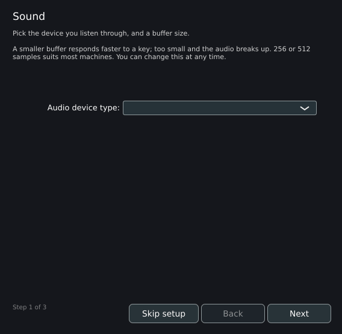
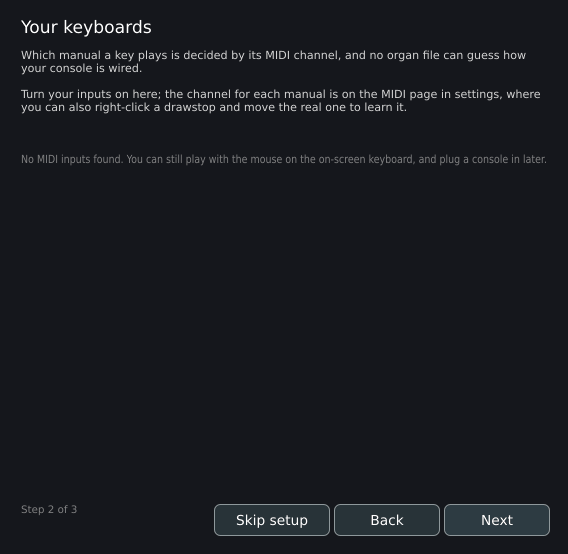
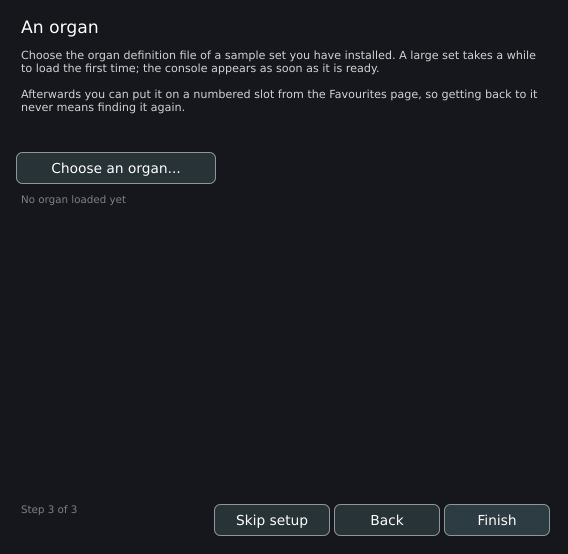

# Installing Masterpiece

This page lists every file a Masterpiece release offers, the systems each file runs on, what it installs and where, what happens at the first start, and how to update and remove the program. Use it to pick the right file for a computer, phone or tablet, to install it, and to find the plugins and the program's data afterwards.

## Release files

Each release on [github.com/bonninr/masterpiece/releases](https://github.com/bonninr/masterpiece/releases) carries the files below. `<version>` is the release number, for example `0.9.0`. Every file name starts with `masterpiece-<version>-`.

| File | System | What it holds |
|---|---|---|
| `masterpiece-<version>-windows-setup.exe` | Windows, 64-bit | Installer for the standalone program |
| `masterpiece-<version>-windows.zip` | Windows, 64-bit | A `Masterpiece` folder with the program |
| `masterpiece-<version>-plugins-windows.zip` | Windows, 64-bit | A `Masterpiece-plugins` folder: the VST3 and LV2 plugins |
| `masterpiece-<version>-macos-arm64.zip` | macOS, Apple silicon | A `Masterpiece` folder with `Masterpiece.app` |
| `masterpiece-<version>-macos-x86_64.zip` | macOS, Intel | A `Masterpiece` folder with `Masterpiece.app` |
| `masterpiece-<version>-plugins-macos-arm64.zip` | macOS, Apple silicon | A `Masterpiece-plugins` folder: the Audio Unit and VST3 plugins |
| `masterpiece-<version>-plugins-macos-x86_64.zip` | macOS, Intel | A `Masterpiece-plugins` folder: the Audio Unit and VST3 plugins |
| `masterpiece-<version>-linux-x86_64.flatpak` | Linux, x86-64 | Flatpak bundle of the standalone program |
| `masterpiece-<version>-linux-amd64.deb` | Debian, Ubuntu and relatives, x86-64 | The program, the menu entry and the file types |
| `masterpiece-<version>-linux-x86_64.tar.gz` | Linux, x86-64 | A `Masterpiece` folder with the program |
| `masterpiece-<version>-plugins-linux-x86_64.tar.gz` | Linux, x86-64 | A `Masterpiece-plugins` folder: the VST3 and LV2 plugins |
| `masterpiece-<version>-linux-arm64.deb` | Raspberry Pi OS, 64-bit | The program, the menu entry and the file types |
| `masterpiece-<version>-linux-armhf.deb` | Raspberry Pi OS, 32-bit | The program, the menu entry and the file types |
| `masterpiece-<version>-linux-arm64.tar.gz` | Raspberry Pi OS, 64-bit | A `Masterpiece` folder with the program |
| `masterpiece-<version>-linux-armhf.tar.gz` | Raspberry Pi OS, 32-bit | A `Masterpiece` folder with the program |
| `masterpiece-<version>-android.apk` | Android | The app |
| `masterpiece-<version>-ios.ipa` | iPhone and iPad | The app, unsigned |

The plugins come in the `plugins` archives, for Windows, macOS and Linux x86-64. Up to 0.8.1 they came inside the program's zips and tarballs and the amd64 `.deb`.

### Download addresses

The addresses below on masterpieceorgan.com send the browser to the matching file of the latest release. When the latest release lacks the file, the address leads to the release page.

| Address | File |
|---|---|
| `masterpieceorgan.com/download/windows` | `windows-setup.exe` |
| `masterpieceorgan.com/download/windows-zip` | `windows.zip` |
| `masterpieceorgan.com/download/macos` | `macos-arm64.zip` |
| `masterpieceorgan.com/download/macos-intel` | `macos-x86_64.zip` |
| `masterpieceorgan.com/download/linux` | `linux-x86_64.flatpak` |
| `masterpieceorgan.com/download/linux-deb` | `linux-amd64.deb` |
| `masterpieceorgan.com/download/linux-tar` | `linux-x86_64.tar.gz` |
| `masterpieceorgan.com/download/raspberry-pi` | `linux-arm64.deb` |
| `masterpieceorgan.com/download/raspberry-pi-32` | `linux-armhf.deb` |
| `masterpieceorgan.com/download/android` | `android.apk` |
| `masterpieceorgan.com/download/ios` | `ios.ipa` |

The two ARM `.tar.gz` archives have no short address. They are on the release page.

## System requirements

| System | Processor | Operating system |
|---|---|---|
| Windows | x64 | 64-bit Windows |
| macOS, Apple silicon | Apple silicon | macOS 11.0 or later |
| macOS, Intel | x86-64 | macOS 10.15 or later; the build also runs under Rosetta on Apple silicon |
| Linux, `.deb` and `.tar.gz` | x86-64 | A distribution whose C library is at least as new as Ubuntu 22.04's, the build host; the packages are installed and checked in Debian 12 and Ubuntu 24.04 containers |
| Linux, Flatpak | x86-64 | Any distribution with Flatpak; the bundle uses the freedesktop 24.08 runtime, which Flatpak installs when it is missing |
| Raspberry Pi, 64-bit | ARMv8-A (Pi 3 to Pi 5) | Raspberry Pi OS, 64-bit |
| Raspberry Pi, 32-bit | ARMv7-A with NEON and VFPv4, hard-float | Raspberry Pi OS, 32-bit |
| Android | 64-bit ARM (`arm64-v8a`); x86-64 (`x86_64`) for the emulator | Android 8.0 (API level 26) or later |
| iPhone and iPad | 64-bit ARM | iOS 15.0 or later |

Notes:

- The Windows program links the Visual C++ runtime statically. No redistributable package needs installing.
- The `.deb` packages were tested in CI by installing them in Debian 12 and Ubuntu 24.04 containers, for all three architectures.
- Android builds exist for 64-bit processors only. The build file gives the reason: a 32-bit device cannot hold a sample set worth playing.
- Memory is set by the sample sets. The default limit for the samples of one organ is 80% of the computer's memory, with a floor of 512 MB. See [Memory, loading and streaming](memory.md) and [Small, medium and large organs](sizing.md).

### Processor features and the vector engine

The audio engine renders several samples at a time with the processor's vector unit. It picks the unit once, when the program starts.

| Processor | Vector unit used |
|---|---|
| x86-64 with AVX2 | AVX2 |
| x86-64 lacking AVX2 | SSE2, present on every x86-64 processor; it renders four frames at a time |
| x86-64 build under Rosetta on Apple silicon | SSE2, whatever the processor check reports |
| Apple silicon, Raspberry Pi (64- and 32-bit), Android and iOS on ARM | NEON |
| Any other processor | The per-frame engine |

The release builds target the baseline x86-64 instruction set and choose AVX2 at run time. A processor that lacks AVX2 runs the same program on the SSE2 path.

The box **Faster audio engine** on **Settings > Organ settings... > Loading** turns the vector engine on and off. It is on by default and takes effect at once. When on, the box reads **Faster audio engine: using AVX2** (or SSE2, or NEON); on a processor that has none of them it reads **Faster audio engine: not available on this processor**. Setting the environment variable `MASTERPIECE_SIMD=0` before starting the program forces the per-frame engine.

## Windows

### Installer

Run `masterpiece-<version>-windows-setup.exe`. The installer puts `bin\Masterpiece.exe` and `Uninstall.exe` into an install folder whose default name is `Masterpiece`, adds a Start menu entry in a folder that defaults to `Masterpiece`, adds an entry in Windows **Apps & features**, and registers the file types listed under [File associations](#file-associations).

The installer installs `Masterpiece.exe` only. The plugins are in `masterpiece-<version>-plugins-windows.zip`.

The release workflow adds no code signature to the Windows files.

A silent installation, as used in the project's own tests:

```
masterpiece-<version>-windows-setup.exe /S /D=C:\Path\To\Masterpiece
```

`/D=` has to be the last argument and takes no quotes. The silent uninstaller is `Uninstall.exe /S` in the install folder.

### Zip

`masterpiece-<version>-windows.zip` runs from any folder and installs nothing. It holds one folder, `Masterpiece`, with `Masterpiece.exe`. Extract it and start `Masterpiece.exe`. The plugins are in `masterpiece-<version>-plugins-windows.zip` (see [Plugins](#plugins)). In 0.8.1 the zip also holds the plugins, in its `VST3` and `LV2` folders. In 0.8.0 and earlier the zip holds the build folders, and the plugin is in `MasterpiecePlugin\MasterpiecePlugin_artefacts\Release\VST3\Masterpiece.vst3`.

## macOS

Download the zip for the processor: `macos-arm64` for Apple silicon, `macos-x86_64` for Intel. The zip unpacks to a folder `Masterpiece` that holds `Masterpiece.app`. Move `Masterpiece.app` to **Applications**. The Audio Unit and VST3 plugins are in `plugins-macos-arm64.zip` and `plugins-macos-x86_64.zip` (see [Plugins](#plugins)).

The macOS builds are unsigned. At the first start macOS may report that Masterpiece "is damaged and can't be opened". Remove the quarantine flag and open the app from its context menu:

```
xattr -cr /Applications/Masterpiece.app
```

Then right-click `Masterpiece.app` and choose **Open**.

The Intel build runs on Apple silicon through Rosetta; it uses the SSE2 vector path there.

## Linux

### Flatpak

```
flatpak install --user ./masterpiece-<version>-linux-x86_64.flatpak
flatpak run io.github.bonninr.Masterpiece
```

The bundle runs on the freedesktop 24.08 runtime. Its permissions:

| Permission | Purpose |
|---|---|
| `--socket=x11`, `--share=ipc` | The window; a Wayland session runs it through XWayland |
| `--socket=pulseaudio`, `--filesystem=xdg-run/pipewire-0` | Sound through PulseAudio and PipeWire, and JACK through PipeWire's socket |
| `--device=all` | ALSA audio and MIDI devices, such as USB MIDI consoles |
| `--filesystem=home`, `/media`, `/run/media`, `/mnt` | Sample sets in the home folder, on a second disk or on a USB drive |

A sample set elsewhere (for example under `/data`) needs the folder granted:

```
flatpak override --user --filesystem=/data io.github.bonninr.Masterpiece
```

The Flatpak contains no plugins.

### Debian, Ubuntu and relatives (.deb)

```
sudo apt install ./masterpiece-<version>-linux-amd64.deb
```

The package is named `masterpiece` and installs:

| Path | Content |
|---|---|
| `/usr/bin/masterpiece` | The program |
| `/usr/share/applications/masterpiece.desktop` | The menu entry |
| `/usr/share/icons/hicolor/256x256/apps/masterpiece.png` | The icon |
| `/usr/share/mime/packages/masterpiece.xml` | The organ file types |

The package depends on `libasound2` (or `libasound2t64`), `libfreetype6`, `libfontconfig1`, `libx11-6`, `libxext6`, `libxrandr2`, `libxinerama1`, `libxcursor1` and `libgl1`, plus the C library version the binary needs. `apt` installs them. JACK is optional: Masterpiece opens `libjack` at run time when it exists and then lists JACK as an audio device type.

Remove it with `sudo apt remove masterpiece`.

### Tar archive

`masterpiece-<version>-linux-x86_64.tar.gz` holds one folder, `Masterpiece`, with the program. The files are packed from build artifacts, which carry no executable bit; the build's own launch check runs `chmod +x` on the binary. Set the bit on the `Masterpiece` file before the first start:

```
tar -xzf masterpiece-<version>-linux-x86_64.tar.gz
chmod +x Masterpiece/Masterpiece
```

The libraries listed for the `.deb` have to be present on the system.

## Raspberry Pi

Pick the package for the installed operating system, 64-bit or 32-bit:

```
sudo apt install ./masterpiece-<version>-linux-arm64.deb     # Raspberry Pi OS, 64-bit
sudo apt install ./masterpiece-<version>-linux-armhf.deb     # Raspberry Pi OS, 32-bit
```

Both install the program as `masterpiece`, with the menu entry and the file types. They contain no plugins. The tarballs `linux-arm64.tar.gz` and `linux-armhf.tar.gz` hold the same program in a `Masterpiece` folder, with the same `chmod +x` step as above.

The 64-bit build targets plain ARMv8-A, which covers the Raspberry Pi 3 to the Raspberry Pi 5. The 32-bit build is compiled for ARMv7-A with NEON and VFPv4 (`-march=armv7-a -mfpu=neon-vfpv4`, hard-float) and needs a processor with those.

Both builds use the NEON vector engine. Audio on the Pi goes through ALSA, or through JACK when `libjack` is installed. See [Audio, room and mixer](audio.md).

## Android

Download `masterpiece-<version>-android.apk` on the device and open it, or install it from a computer with `adb`:

```
adb install -r masterpiece-<version>-android.apk
```

| Property | Value |
|---|---|
| Package name | `org.masterpiece.player` |
| Minimum Android | 8.0 (API level 26); API 23 supplies the MIDI interface and API 26 the low-latency audio interface |
| Target | API level 35 |
| Processors | `arm64-v8a`, `x86_64` |
| Signature | One release key for every version |

All versions share one signing key, so a newer APK installs over the older one and keeps the organs and settings.

The manifest asks for:

| Permission | Why |
|---|---|
| `READ_EXTERNAL_STORAGE` (up to Android 12L, API 32) | Sample sets on shared storage, on the Android versions that still allow reading by path |
| `BLUETOOTH_CONNECT`, `BLUETOOTH_SCAN` (flagged `neverForLocation`) | Bluetooth MIDI consoles |
| `BLUETOOTH`, `BLUETOOTH_ADMIN` (up to API 30), `ACCESS_FINE_LOCATION` (up to API 30) | The same, on older Android versions |

USB host, MIDI and Bluetooth LE are declared as optional features; the app installs on devices that lack them. [Phones and tablets](mobile.md) covers the app itself.

## iPhone and iPad

`masterpiece-<version>-ios.ipa` is unsigned, and iOS runs only signed apps. Sign and install it with a sideloading tool and an Apple ID of your own; AltStore and Sideloadly are the tools the project's build notes name. No Apple developer account is needed. The steps for each tool are in the [0.7.0 release notes](https://github.com/bonninr/masterpiece/releases/tag/v0.7.0).

| Property | Value |
|---|---|
| Bundle identifier | `org.masterpiece.player` |
| Minimum iOS | 15.0 |
| Devices | iPhone and iPad (device families 1 and 2) |
| Processor | 64-bit ARM |

[Phones and tablets](mobile.md) covers the app itself.

## Plugins

The plugin formats are VST3 (Windows, macOS, Linux), Audio Unit (macOS) and LV2 (Windows, Linux). The plugin shares its settings folder with the standalone program. See [Plugins in a DAW](plugins.md).

| Format | Windows | macOS | Linux |
|---|---|---|---|
| VST3 | `VST3\Masterpiece.vst3` in `plugins-windows.zip` | `Masterpiece.vst3` in `plugins-macos-arm64.zip` and `plugins-macos-x86_64.zip` | `VST3/Masterpiece.vst3` in `plugins-linux-x86_64.tar.gz` |
| Audio Unit | none | `Masterpiece.component` in `plugins-macos-arm64.zip` and `plugins-macos-x86_64.zip` | none |
| LV2 | `LV2\Masterpiece.lv2` in `plugins-windows.zip` | none | `LV2/Masterpiece.lv2` in `plugins-linux-x86_64.tar.gz` |

Each archive unpacks to a folder `Masterpiece-plugins`. Copy the bundles into a folder that the host scans; [Plugins in a DAW](plugins.md) lists them. The amd64 `.deb` of 0.8.1 and earlier installed the plugins to `/usr/lib/vst3` and `/usr/lib/lv2`; from 0.9.0 it holds the program.

## File associations

Windows, macOS and Linux register the same five file types: `.Organ_Hauptwerk_xml`, `.CustomOrgan_Hauptwerk_xml`, `.organ`, `.orgue` and `.rar`. Double-clicking or **Open with** passes the file to the program, which opens it as **File > Open...** does. See [Opening an organ](opening.md).

| System | How it is registered |
|---|---|
| Windows | The installer writes the program under **Open with** for the five extensions (`HKCR\Applications\Masterpiece.exe` and an `OpenWithList` key per extension). Masterpiece is offered in the list and never made the default, so `.rar` files keep the program that opens them. The command is `"<install folder>\bin\Masterpiece.exe" "%1"`. The uninstaller removes the keys. |
| macOS | `Masterpiece.app` declares the five document extensions, so Finder offers **Open With**. A running program receives the file and opens it in the existing window. |
| Linux (`.deb`) | `masterpiece-mime.xml` defines `application/x-hauptwerk-organ` (`*.Organ_Hauptwerk_xml`, `*.CustomOrgan_Hauptwerk_xml`), `application/x-grandorgue-organ` (`*.organ`) and `application/x-grandorgue-package` (`*.orgue`). `masterpiece.desktop` (`Exec=masterpiece %f`) lists those types and the RAR types `application/vnd.rar` and `application/x-rar`. The desktop's file manager then offers Masterpiece under **Open with**. |
| Flatpak | The same type definitions, exported under the application's own name. |
| Android, iOS | The app opens packages (`.rar`, `.orgue`) chosen inside it; see [Phones and tablets](mobile.md). |

## First start

### Settings folder

Masterpiece keeps its settings, logs and caches in a folder named `Masterpiece` inside the user's application-data folder:

| System | Folder |
|---|---|
| Windows | `%APPDATA%\Masterpiece` |
| macOS | `~/Library/Masterpiece` |
| Linux | `~/.config/Masterpiece` |
| Android, iPhone, iPad | The `Masterpiece` folder in the app's application-data folder |

[Files and folders](files.md) lists the contents. Two files decide the first start:

| File | Role |
|---|---|
| `settings.mpglobal` | The general settings. While it is missing, the program shows the first-run wizard. Removing or renaming it shows the wizard again. |
| `audio.xml` | The audio device, sample rate and buffer size. It is written when the program quits. |

### Audio device defaults

Before the window opens, the program starts the system's default audio device with two output channels and no input. A device that opens at a rate below 44.1 kHz is moved to 48 kHz, or to 44.1 kHz when 48 kHz is unavailable. On a first start, or when a saved setup could not be used, the buffer size is the available size nearest to about 10 ms. A saved setup that names missing hardware, or that opens with no live output, is replaced by the defaults.

### MIDI inputs

At the start every MIDI input is opened, except those switched off earlier. A console plugged in for the first time plays at once. An input that another program holds is tried again every 3 seconds.

### The first-run wizard

On a first start the window opens with a dialog titled **Welcome to Masterpiece**. It has three steps, shown as **Step 1 of 3** and so on. **Back** and **Next** move between steps, **Next** becomes **Finish** on the last one, and **Skip setup** ends the wizard at any step. **Finish** and **Skip setup** both write `settings.mpglobal` with the current defaults, which ends the first-run state.



| Step | Title | What it asks | Takes effect |
|---|---|---|---|
| 1 | **Sound** | The audio device and the buffer size, in the system's device selector (device type, output device, active output channels, sample rate, audio buffer size). The text suggests 256 or 512 samples for most machines: a smaller buffer answers a key faster and breaks up when it is too small. | At once; stored in `audio.xml` when the program quits |
| 2 | **Your keyboards** | A box per MIDI input, headed **Tick the keyboards you play from:**. All inputs start on. When the system reports no input, the step reads **No MIDI inputs found. You can still play with the mouse on the on-screen keyboard, and plug a console in later.** The channel of each manual is set on **Settings > General settings... > MIDI**; a drawstop is learned with a right-click. | At once |
| 3 | **An organ** | The button **Choose an organ...** opens the file dialog. The status line reads **No organ loaded yet** or **Loaded: &lt;name&gt;**. | The organ loads when chosen |





The wizard is a dialog of the standalone program. The plugins and the `--gui-only` mode skip it. It appears while `settings.mpglobal` is missing, and any write of that file ends the first-run state. **Finish** and **Skip setup** write it.

To see the wizard again, close Masterpiece and remove or rename `settings.mpglobal`. The general settings start from their defaults at the next start.

### The first organ

The first load of each organ opens **Organ settings** on the **Loading** tab before the samples are read, so the memory profile can be chosen. **Keep changes** starts the load. The organ's console is on screen in seconds, ahead of the samples. See [Opening an organ](opening.md) and [Memory, loading and streaming](memory.md).

## Updating

The program has no update check. Install a newer release the same way as the first one; settings, favourites and caches stay in the settings folder.

| System | Procedure |
|---|---|
| Windows installer | Run the new installer. It installs over the old version. |
| Windows zip | Extract the new zip over the old folder, or into a new one. |
| macOS | Replace `Masterpiece.app` in **Applications** with the new one. |
| Debian, Ubuntu, Raspberry Pi OS | `sudo apt install ./masterpiece-<version>-linux-<arch>.deb` |
| Flatpak | Run the `flatpak install --user` command with the new bundle. |
| tar.gz | Extract the new archive and set the executable bit. |
| Android | Install the new APK. The shared signing key makes it an update that keeps the data. |
| iPhone and iPad | Sign and install the new `.ipa` with the sideloading tool. |

## Uninstalling

The settings folder holds the saved organ settings, favourites, MIDI maps and the sample cache. The program creates it at run time; the installers and packages place no files in it, and the routes below leave it in place. Delete the folder by hand to remove that data. The sample cache is as large as the decoded samples of an organ and can fill several gigabytes; **Cache folder** on **Settings > Organ settings... > Loading** shows where it is.

| System | Procedure |
|---|---|
| Windows installer | **Apps & features**, or `Uninstall.exe` in the install folder. Both remove the program, the Start menu entry, the registry entries and the file-type registrations. |
| Windows zip | Delete the folder. |
| macOS | Delete `Masterpiece.app`, and any plugin bundles copied to the plug-in folders. |
| Debian, Ubuntu, Raspberry Pi OS | `sudo apt remove masterpiece` |
| Flatpak | `flatpak uninstall io.github.bonninr.Masterpiece` |
| tar.gz | Delete the extracted folder. |
| Android, iPhone, iPad | Remove the app in the system. Its private storage goes with it. |
