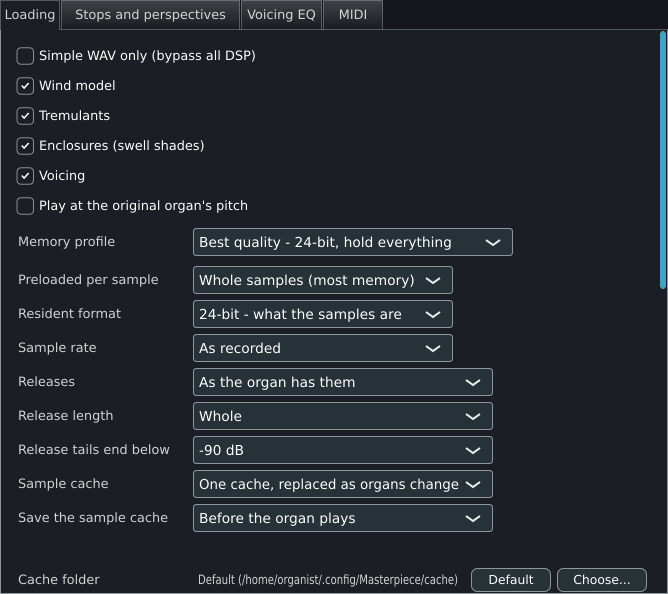
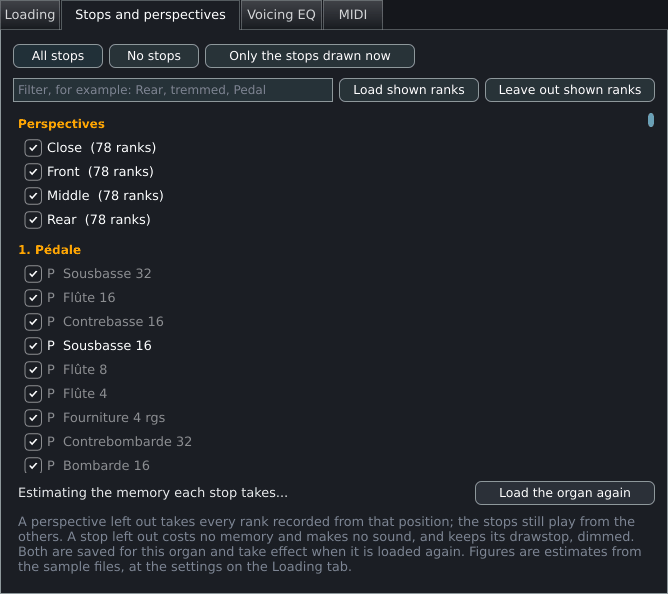
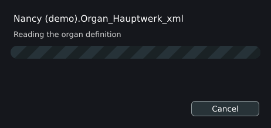

# Memory, loading and streaming

This page explains how Masterpiece holds an organ in memory, what each loading choice costs and saves, and how loading, the sample cache, release streaming, the memory limit and the voice pool fit together. Use it to decide the settings on **Settings > Organ settings > Loading** and **Settings > Organ settings > Stops and perspectives**, to read the memory figures Masterpiece shows, and to understand a load that stops at the memory limit or a stream that falls behind. [Small, medium and large organs](sizing.md) turns these mechanisms into recommended settings per computer.

## Where the settings are

Every setting on this page is on the **Loading** tab of **Settings > Organ settings** (the entry is available while an organ is loaded). The tab holds the resident format, mono folding, the sample rate, the release choices, release streaming, the sample cache and its folder, the memory limit and the polyphony limit. The **Stops and perspectives** tab holds the choice of which stops, perspectives and ranks are loaded, with a memory estimate per entry. **General settings** holds none of them; its **Log** tab reports the cache folder and the cache files.

The Loading tab applies its choices in three ways.

| Group | Takes effect |
|---|---|
| Resident format, **Preloaded per sample**, **Sample rate**, **Releases**, **Release length**, release streaming and its hold, **Load in mono**, stops, perspectives and ranks left out | At the next organ load. The button **Load the organ again to apply** loads the organ at once. |
| **Release tails end below**, **Polyphony limit**, **Faster audio engine** | At once. |
| **Memory limit for samples** | Written at once to the general settings file; checked at every load. |
| **Sample cache**, **Save the sample cache**, **Cache folder** | Used at the next load. The cache folder and the time of saving are general settings; the cache mode is saved with the organ. |

A change to the loading choices stays live for the session. **Revert changes** puts back the values the window opened with. **Keep changes** closes the window. **Save for this organ** writes the choices to the organ's settings file (`organs/<organ>.mporgan` in the settings folder). **Save as default** writes them to `settings.mpglobal`, where an organ without settings of its own starts. An organ that has settings of its own keeps them.

When a change decides what the sample cache holds and the window closes before the organ is loaded again, Masterpiece asks **Rebuild the sample cache?** with the buttons **Rebuild and load again** and **Back to settings**. The choices that trigger the question are the resident format, mono, release streaming and its hold, **Preloaded per sample**, the sample rate, the cache mode, **Releases** and **Release length**.

## What an organ costs in memory

A sample set is the audio of every pipe: an attack with a sustain loop, and one or more releases, for each pipe of each rank, in some sets for several microphone positions. Masterpiece reads the files once, converts them, and holds the result in memory. Drawing a stop changes nothing in memory: every loaded rank is resident whether its stop is drawn or not. A rank whose samples are nowhere (not on disk, not in the archive, not held from the cache) counts as having no pipes, and its stops are shown as not available. In the measurement on Friesach with Masterpiece 0.3.3, peak process memory with one stop drawn and with all 44 stops drawn differed by 2 MB at 24-bit and by 12 MB at 16-bit, both with streamed releases.

The memory an organ takes follows from these choices, in this order of effect:

1. The resident format: 32-bit float, 24-bit or 16-bit.
2. Whether release tails are streamed from disk.
3. Mono folding.
4. Which stops, perspectives and ranks are loaded.
5. The sample rate and the release choices.
6. The voice pool, which counts against the memory limit together with the samples.

### Resident format

The **Resident format** box chooses what one held frame costs.

| Option | Bytes per sample | What it holds |
|---|---|---|
| **24-bit - what the samples are** | 3 | The integers of a 24-bit file unchanged. The audio in memory is bit-for-bit what the file holds. |
| **16-bit - two thirds of that, inaudible** | 2 | Each sample requantised to 16 bits against its own file's peak, so a stop recorded 20 dB down keeps all sixteen bits. The scale folds into the voice gain and costs nothing while playing. |
| **32-bit float - larger than the source** | 4 | The decoder's floating-point result. One third larger than 24-bit. |

**Default:** 24-bit. **Takes effect:** at the next load. The settings file stores the width (`storage 16`, `storage 24` or `storage 32`).

Measured on 60 files chosen at random from Friesach, 24-bit is bit-for-bit identical to the source file, and 16-bit has a signal to quantisation noise ratio of 78.1 dB (median) and 75.2 dB (lowest). Processing runs in 32-bit float whatever the resident format is.

> [!NOTE]
> Resident format changes only what is held. A streamed release tail is read from its file at the file's own precision and joined to the resident head, which is held in the chosen format.

> [!TIP]
> Advice: 16-bit is the usual choice when the organ does not fit at 24-bit. 32-bit float costs a third more than 24-bit and adds no content to a 24-bit set; keep it for a set whose files are floating point.

### Memory profile

The **Memory profile** box sets four choices at once: the resident format, mono, release streaming and **Preloaded per sample**.

| Profile | Resident format | Mono | Release streaming |
|---|---|---|---|
| **Best quality - 24-bit, hold everything** | 24-bit | Off | Off |
| **Recommended - 16-bit, stream releases** | 16-bit | Off | On |
| **Smallest - 16-bit mono, stream releases** | 16-bit | On | On |
| **Custom** | Any other combination | | |

Each profile also sets **Preloaded per sample** to **Whole samples (most memory)**. The box shows **Custom** whenever the four choices match none of the three profiles. The profile box does not change the sample rate, the release choices, the cache or the limits.

### Preloaded per sample

**Preloaded per sample** limits how much of each attack is resident. **Whole samples (most memory)** holds the file from its start to its end. **Up to the loop (less memory)** holds each attack from its start to the end of its sustain loop plus a margin of 8,192 frames for the loop crossfade, which is all a held note plays.

**Default:** **Whole samples (most memory)**. **Takes effect:** at the next load.

The setting has a small effect. In an organ sample the loop runs nearly to the end of the file, so the part after the loop is short. A sample whose release is in the same file (marked by a cue point) is always held whole, and a release in a file of its own is held whole or streamed as described below. Earlier versions offered **Loop + 1 s** and **Loop + 2 s**; the box shows them as **Loop + 1 s (earlier choice)** and **Loop + 2 s (earlier choice)** while a saved organ still uses them.

### Mono folding

The toggle **Load in mono (halves memory, gives up the stereo image)** folds every stereo file to one channel as it is read. The channels are averaged, which avoids the clipping a sum of two correlated channels can cause. A streamed tail is folded the same way, so the join from the resident head to the tail does not step from a downmix to one bare channel.

**Default:** off. **Takes effect:** at the next load.

Mono halves the memory of stereo files and has no effect on files that are already mono. It does not reduce the disk reads of streamed tails, because both channels are read to make the average.

> [!CAUTION]
> Mono folding gives up the recorded stereo image. For a set recorded in a building the image is part of the sound, and folding it changes the character of the room. Use mono when the choice is between mono and an organ that does not load.

### Sample rate

The **Sample rate** box converts every sample to one rate as it is read, with a Lagrange interpolator. Conversion happens once, at load, where nobody listens.

| Option | Effect |
|---|---|
| **As recorded** | Each file keeps its own rate. |
| **48 kHz** | Every file is converted to 48,000 Hz. |
| **44.1 kHz** | Every file is converted to 44,100 Hz. |

**Default:** **As recorded**. **Takes effect:** at the next load. The settings file stores the rate in Hz (`rate 48000`); `--load-rate <Hz>` accepts any rate.

Memory is in exact proportion to the load rate. A 96 kHz set converted to 48 kHz takes half the memory. Verified on five Friesach ranks converted from their native 48 kHz:

| Load rate | Held in memory |
|---|---|
| 48 kHz, as recorded | 1,599.7 MB |
| 44.1 kHz | 1,469.8 MB |
| 24 kHz | 799.9 MB |

Pitch and level are unchanged at every rate. Nothing above half of the chosen rate survives the conversion. Conversion goes both ways: a file whose rate differs from the chosen one by more than 1 Hz is converted up or down. Memory changes by the ratio of the rates, so a conversion that raises the rate (44.1 kHz material at **48 kHz**) increases the memory by 8.8% and adds no content, and a conversion that lowers it (48 kHz material at **44.1 kHz**) reduces the memory by 8.1%.

Playback also converts the rate of any voice whose sample rate differs from the audio device's rate, so pitch is correct at every setting, and the setting saves memory and processor time.

### Releases

A release is the sound of a pipe after its key is let go. Many sets record several releases per pipe, chosen by how long the key was held. Three settings control which releases are loaded and how much of each.

**Releases** chooses which of each pipe's releases are loaded.

| Option | What it loads |
|---|---|
| **As the organ has them** | All releases. |
| **The longest only** | The release written for the longest hold time. It answers a key held for any time. |
| **The shortest only** | The release written for the shortest hold time. It answers every key. |
| **None: notes fade when let go** | No release samples. A note fades from where it is. |

**Default:** **As the organ has them**. **Takes effect:** at the next load. The settings file stores the choice as a number from 0 (all) to 3 (none) in the key `releases`.

**Release length** keeps each release up to a given length after its start and fades it out over its last quarter with a raised-cosine curve.

| Option | Kept |
|---|---|
| **Whole** | The whole release. |
| **Up to 0.5 s**, **Up to 1 s**, **Up to 1.5 s**, **Up to 2 s**, **Up to 3 s**, **Up to 4 s** | The first 0.5, 1, 1.5, 2, 3 or 4 seconds. |

**Default:** **Whole**. **Takes effect:** at the next load. A release shortened this way is always held in memory. A **Release length** other than **Whole** therefore turns off release streaming for the releases it shortens, and the memory estimate follows the shortened length.

**Release tails end below** stops a release tail once it has stayed below a level for a twentieth of a second.

| Option | Level |
|---|---|
| **Never: every tail plays out** | No cutoff. |
| **-80 dB** | |
| **-90 dB** | Default. |
| **-100 dB** | |

**Default:** -90 dB. **Takes effect:** at once, and is saved with the organ. A tail only fades, so one that is far down stays there. A fast passage on many stops leaves hundreds of tails sounding far below hearing, each costing as much processor time as a note. Each tail is judged on its own level, measured from sixteen of the frames the voice is about to play. With many stops drawn, -80 dB can end the last decay of a full chord audibly early, which is why -90 dB is the default. The cutoff applies to release samples; a note that fades because no release is loaded is not cut.

> [!TIP]
> Advice: a set recorded in a reverberant room carries the room in its releases. A shorter **Release length** or **The shortest only** removes part of that reverberation. Use them with an impulse-response reverb, or when memory leaves no other choice.

## Memory figures before a load

The **Stops and perspectives** tab estimates what the organ will take before it is loaded, at the settings on the Loading tab. The estimate reads the sizes and the WAV or WavPack headers of the sample files and decodes nothing. It runs on a worker thread while the tab shows **Estimating the memory each stop takes...**.

For each sample the estimate takes the frame count, the channels and the rate from the file header, and applies the current settings: the resident format (2, 3 or 4 bytes per sample), mono, the load rate, the length of **Release length**, and, for a release played only as a release, the streamed head. It does not apply **Preloaded per sample**, so **Up to the loop** is not reflected. A file that exists only inside an archive has no header to read and is taken to be 24-bit stereo; a WavPack file without a readable header is taken to be 55% of its uncompressed size.

The footer shows **About 5.6 GB for this choice (the limit is 12.7 GB)**, in the form **About %1 for this choice (the limit is %2)**. The figure turns red when it exceeds the limit. Each stop, perspective and rank shows its own figure. A sample used by a stop that stays loaded is counted once and stays in the total even when another stop that uses it is left out.

The figure covers the samples. The load itself is checked against the memory limit minus the memory of the voice pool (see [The memory limit](#the-memory-limit)), so a total just under the limit can still stop a load.

## Release streaming

A release tail is several seconds of room sound, played once from its start to its end and never looped. Masterpiece can hold only the first part of each such release in memory and read the rest from the file on disk while the release sounds. An attack cannot be treated the same way: its sustain loop has to be resident, and the loop is most of the file.

### The settings

The toggle **Stream release tails from disk** turns streaming on. **Default:** off. **Takes effect:** at the next load.

The box beside it, enabled while streaming is on, chooses how much of each release stays resident.

| Option | Resident part of each release |
|---|---|
| **Hold the first second** | The first 48,000 frames (one second at 48 kHz). |
| **Hold 25% of each release** | A quarter of its length, and at least the first 48,000 frames. |
| **Hold 50% of each release** | Half. |
| **Hold 75% of each release** | Three quarters. |

**Default:** **Hold the first second**. **Takes effect:** at the next load. The fixed head is the floor for every option: the resident part of a release is the larger of 48,000 frames and the chosen share. A release no longer than its head is held whole and has nothing to stream.

### What is held and what is read

| Part | Where it is while playing |
|---|---|
| Attacks and their sustain loops | In memory, always. |
| The resident head of a release | In memory, in the resident format. |
| The rest of a release | In the sample file on disk. |
| A release that is also used as an attack | In memory, whole. One buffer serves both uses. |
| A release inside the same file as its attack | In memory, whole. |
| A release shortened by **Release length** | In memory, shortened. |
| A sample read out of an archive (a RAR or `.orgue` package) | In memory, whole. There is no file to stream from. |

Every sounding voice has a ring buffer holding the next two seconds of its streamed release. When a key is let go, the voice plays the resident head while one streaming thread reads the rest of the release, 16,384 frames at a time, into the ring. It passes over all streaming voices about every 10 milliseconds. A plain 16-bit or 24-bit PCM WAV is read straight from the file into the ring. Any other file, a WavPack file for example, goes through its decoder on the streaming thread. A voice that reaches material the thread has not delivered plays silence for the shortfall and adds one to the underrun count. Only a streamed release can underrun.

The ring is part of the voice pool, not of the samples. Its size is two seconds of stereo 32-bit float at the audio device's rate: 768,000 bytes at 48 kHz for each voice in the pool. At the default 1,536 voices the rings take about 1.1 GB. The **Polyphony limit** box shows the exact figure for each choice. This memory is counted against the memory limit, and it is why a streamed organ at its default polyphony takes more process memory than the sample figure alone. In the Friesach measurement with Masterpiece 0.3.3, process memory exceeded the sample memory by about 1.29 GB in both streamed runs (8,270 MB against 6,976 MB, and 5,939 MB against 4,651 MB).

Streamed tails open their files on first use and keep them open while they are played. The number of tail files open at once is half of the process's file limit, between 96 and 4,096; when the limit is reached the tail read longest ago is closed and reopens when it is needed again.

### The disk it needs

A streamed release is read at the rate of its source file, whatever the resident format and whether the set is folded to mono.

| Source file | Read while one release plays, at 48 kHz |
|---|---|
| 24-bit stereo | 288,000 bytes per second |
| 16-bit stereo | 192,000 bytes per second |
| 24-bit mono | 144,000 bytes per second |
| 16-bit mono | 96,000 bytes per second |

A chord of 100 pipes let go together is 100 releases in 100 different files. At 24-bit stereo that is about 29 MB per second sustained, and the first 16,384-frame read of every one of them has to arrive before the resident head ends, one second at the default. The load is many small reads from many files. These figures are worked from the constants above (a two-second ring, reads of 16,384 frames, a pass about every 10 ms); Masterpiece does not measure the disk. Advice: use a solid-state drive. A hard disk, an SD card or a network drive may not keep up, and the underrun messages below report it.

A larger share (**Hold 25%**, **50%**, **75%**) gives a slow disk longer before a release reaches the end of its resident part, and costs memory in proportion. **Hold 75%** leaves a quarter of each release on disk.

The two places Masterpiece reports a disk that falls behind:

- The Loading tab's readout line shows **DISK TOO SLOW: %1 underrun(s)**.
- The status line shows **streamed releases fell behind %1x: turn off "Stream release tails" in Organ settings**.

> [!WARNING]
> A streamed release that underruns goes quiet partway. When either message appears, raise the hold share, move the sample files to a faster drive, or turn streaming off.

### Savings

Streaming is the largest single saving. On Friesach it leaves 56% of the sample data on disk. The Loading tab's readout shows how many samples stream and how much stays on disk: **%1 streamed, %2 MB left on disk**.

The note on the Loading tab states that on the Nancy demo streaming takes the memory from 12.2 GB to 5.6 GB, with the rendered audio identical sample for sample.

## Memory by configuration

Measured on Friesach: 44 stops, three manuals and pedal, 17.0 GB and 12,148 WAV files on disk, 24-bit, 48 kHz, stereo. Machine with 15.9 GB of RAM, Windows. Masterpiece 0.3.3. The figures are the sample library's own accounting at the end of each load (the log line `memory: resident ...`).

| Configuration | Held in memory | Left on disk | Time to open |
|---|---:|---:|---:|
| 32-bit float, resident | 21,606.5 MB | | 77.1 s |
| 24-bit, resident | 16,204.9 MB | | 55.8 s |
| 24-bit, streamed | 6,976.0 MB | 8,891.9 MB | 28.9 s |
| 16-bit, streamed | 4,650.7 MB | 5,927.9 MB | 28.0 s |
| 16-bit mono, streamed | 2,325.3 MB | 2,964.0 MB | 25.9 s |

The settings multiply, and each step is an exact ratio of the one before.

| Step | Before | After | Ratio |
|---|---:|---:|---:|
| 32-bit float to 24-bit | 21,606.5 MB | 16,204.9 MB | 0.750 |
| 24-bit to 16-bit, streamed | 6,976.0 MB | 4,650.7 MB | 0.667 |
| Stereo to mono | 4,650.7 MB | 2,325.3 MB | 0.500 |

Relative to 24-bit resident, which equals about the size of the WAV files on disk, the other configurations take 1.33 (32-bit float), 0.43 (24-bit streamed), 0.29 (16-bit streamed) and 0.14 (16-bit mono streamed). These ratios depend on how much of a set is release data. [Small, medium and large organs](sizing.md) uses them to estimate organs of other sizes. The figures in this section were measured with Masterpiece 0.3.3.

The files of a WavPack set are about 55% of their uncompressed size (the estimate's assumption for a file without a readable header), so such a set takes about twice its disk size in memory at 24-bit resident.

## The sample cache

Loading decodes every file and converts it. The result depends only on the files and the settings, so Masterpiece can keep it. The sample cache is a decoded, converted copy of the organ's samples in one file. The next load of the same organ with the same settings reads that file in one sequential pass, and skips the file opens, the WavPack decoding, the archive reading and the conversion.

### What the file holds

The cache holds the resident form of every sample: the audio in the chosen resident format, the channels, the rate, the loop points, the release marker, the pitch the file declares, and a checksum of each sample's audio. For a streamed release it holds the resident head and, beside it, the path of the source file and the rates needed to reopen the tail when a note asks for it. The cache therefore has about the size of the resident memory. On Friesach, 16-bit mono with streaming gives a cache file of 2,439 MB that stands in for about 7 GB of source files. On a five-rank load the cache files were 291.8 MB at 16-bit, 437.7 MB at 24-bit and 146.0 MB at 16-bit mono.

Time saved on Friesach at 16-bit mono with streaming:

| | Decoded from the files | Read from the cache | Speed-up |
|---|---:|---:|---:|
| Sample loading | 13.0 s | 2.6 s | 5.0x |
| Whole organ | 25.9 s | 18.9 s | 1.4x |

The rest of a load (reading the definition, building the wind model, wiring the console, building the console artwork) takes the same time whether or not a cache is read, which is why the whole organ gains less than the sample loading.

### Settings

**Sample cache** chooses how many caches Masterpiece keeps.

| Option | What it does |
|---|---|
| **One cache, replaced as organs change** | One file, `samples.mpcache`. Loading a different organ, or the same organ with different settings, replaces it. This keeps the disk use at the size of one organ. |
| **One cache per organ (uses more disk)** | One file for each organ, `samples-<organ name>-<organ id>.mpcache`, replaced when that organ's settings change. Several organs stay fast. |
| **Off** | No cache is read or written. |

**Default:** **One cache, replaced as organs change**. **Takes effect:** at the next load. The settings file stores the mode as the number in `cache` (0 off, 1 single, 2 per organ); the command line option is `--cache <off | single | per-organ>`.

**Save the sample cache** chooses when a new cache is written.

| Option | What it does |
|---|---|
| **Before the organ plays** | The load writes the cache before the organ can be played. The first load of an organ takes longer, and nothing competes with the sound. The loading dialog shows **Saving the samples for the next load** with the bytes written, the rate and the time left. The button **Skip saving** opens the organ at once and stops the write; the next load reads the samples again. |
| **In silence, while it plays** | The organ plays at once. The write runs on its own thread at the system's lowest scheduling class and waits while any voice sounds. The status line shows **saving the samples for the next load: N%** with the time left. Until the write finishes, the next load reads the samples again. |

**Default:** **Before the organ plays**. **Takes effect:** at the next load. General setting, stored as `cachewhileplaying` in `settings.mpglobal`.

**Cache folder** shows the folder that holds the cache files. **Default** (the button) returns to the usual place, shown in the box as **Default (&lt;path&gt;)**. **Choose...** opens a folder chooser titled **Where should the sample cache be written?**. The choice is written at once to `settings.mpglobal` as `cachedir`.

The usual place is the `cache` folder inside the `Masterpiece` folder of the user's application data: `%APPDATA%\Masterpiece\cache` on Windows. On the other systems the parent is the system's user application data folder. The **Log** tab of **Settings > General settings** shows the folder in use, whether it can be written, the free space, and the cache files in it with their total size.

On iPhone and iPad, **Choose...** opens the system folder picker, which is the Files app. The folder it returns is lent to Masterpiece, held for the session and lent again at the next start, so the choice persists across restarts.

### How the cache is keyed

A cache is read only when its stored fingerprint equals the fingerprint of the load that wants it. The fingerprint is one string built from everything that changes the bytes in memory:

- The organ's stamp, `loadedStamp`: the definition's path, its size and its modification time. For a GrandOrgue organ the stamp also holds a hash of the converted sample table, so a cache made by an older importer has a different fingerprint. For an organ opened from its kept copy (see below) the stamp is the original's.
- The resident format, mono, the load rate and **Preloaded per sample**.
- The loop selection.
- Release streaming, the fixed head, the hold share, **Releases** and **Release length**.
- Whether the publisher's licence was confirmed for the organ.
- The packages a composite organ found with other organs.
- The set of ranks loaded. Each distinct set of ranks left out is its own fingerprint.

The cache file also carries a format version. The memory limit, the polyphony, **Release tails end below** and the cache mode are outside the fingerprint and do not rebuild the cache.

### When the cache is rebuilt

Any difference in the fingerprint is a miss. The load decodes the files and writes a new cache over the old one. Every mismatch rebuilds, so a stale cache is never played. Verified on a five-rank load: a 16-bit cache is reused at 16-bit and rebuilt at 24-bit and at 16-bit mono. Because one file holds one fingerprint, switching back to the earlier settings rebuilds again.

A cache is also rebuilt when:

- the definition file changes (size or modification time);
- a sample inside the cache fails its checksum. Masterpiece logs `cache: sample N is damaged on the disk; the samples are read instead and the cache written again`;
- the cache file is truncated or has another format version.

A cache is written only after a complete load: one that was not cancelled, did not stop at the memory limit, read at least one sample and had no file fail to read. A partial or damaged installation is therefore cached only as what it is, and only a complete one is trusted on later loads. The write goes to a file with the extension `.part` and is moved into place when finished, so an interrupted write, including one cut short by quitting, leaves the earlier cache as it was. The next load then reads the samples again.

### Size, disk space and clearing

A cache has about the size of the resident memory of the organ. A cache per organ for several large organs fills a disk. The one-cache default keeps the use to a single organ's size. The Log tab of General settings shows the free space of the cache folder and the sum of the `.mpcache` files in it.

To clear the cache, close Masterpiece and delete the `.mpcache` files in the cache folder. The next load of each organ rebuilds its cache. **Off** stops reading and writing caches and leaves existing files in place.

### Failures

A problem with the cache does not fail a load.

- A cache folder that cannot be created, for example on a drive that is unplugged, falls back to the usual folder. The Log tab reports **The cache folder chosen in Loading cannot be used, so the usual one is: ...**.
- A cache that cannot be written logs `cache: could not be written to <path>`.
- A cache of the wrong fingerprint, version or size is ignored, and the samples are read.
- A cache larger than the memory limit stops the load before reading it, like any other load.

### Playing an organ when its drive is unplugged

The toggle **Keep this organ playable without its installation files** gives the organ a cache of its own, whatever **Sample cache** says, and keeps a copy of the organ's definition and console pictures. With its cache, the organ opens without its installation files: unplug the drive that holds the sample set and open the organ from its usual place or from **File > Open...**. Masterpiece opens the kept copy.

**Default:** off. **Takes effect:** at the next complete load. The copy is made only after a load that read every sample and was not incomplete. It holds everything under the organ's folder except the audio and archive files (`.wav`, `.wv`, `.aif`, `.aiff`, `.flac`, `.hbw`, `.hbx`, `.rar`, `.zip`, `.orgue`), in the `Portable` folder of the Masterpiece settings folder. It costs the size of the cache on that disk.

> [!WARNING]
> Streamed release tails still read the installation files. Turn release streaming off for an organ that must play without them. With streaming on, the notes sound and the releases go quiet after their resident part.

## The memory limit

The box **Memory limit for samples** is the most memory the samples of one load may take. A load that would take more stops and says so, which keeps the computer from running out of memory.

| Option | Limit |
|---|---|
| **Default: 80% of memory (%1)** | 80% of the computer's RAM, and at least 512 MB. |
| **50% of memory**, **60%**, **70%**, **90%** | That share of the RAM, with the figure in GB beside each. |
| A size from the file | A `memlimit` value in megabytes in `settings.mpglobal` that matches none of the above is shown as itself. |

**Default:** 80% of RAM (`defaultMemoryLimitMB`). **Takes effect:** at the next load; the choice is written at once to `settings.mpglobal` as `memlimit`.

The budget of a load is the limit minus the memory of the voice pool, because both come from the same memory. The loader charges every sample against the budget as it lands. A cached load charges the size of the cache file before it reads it.

When the budget is exceeded the load stops at the sample that crosses it.

- If some samples were read, the organ is kept as it stands. The status line ends with **INCOMPLETE (memory limit)** and a window titled **Only part of this organ fits** states how many of the samples (and what percentage) were loaded. The window lists the ways to load all of it and ends by naming the limit: raise it on the same tab, the Loading tab of Organ settings, if the computer has the memory to spare. The organ plays, and some stops or notes are silent. No cache is written for it.
- If no sample was read, the load fails. A window titled **Not enough memory for this organ** names the limit. The console is drawn without sound so that **Settings > Organ settings** can be opened from it.

The ways to make an organ fit, in order of cost to the sound: leave out perspectives, stops or ranks on the Stops and perspectives tab; stream release tails; load 16-bit; load in mono; raise **Memory limit for samples**, on the Loading tab of **Settings > Organ settings**, when the computer has the memory.

> [!CAUTION]
> The limit is a ceiling for the samples and the voice pool. The program, the console artwork, the audio system and other programs use memory of their own. A limit above the default leaves less room for them; the 90% choice can slow a computer that starts to swap.

## The voice pool and polyphony

Each sounding pipe, attack or release, uses one voice. The pool of voices is built when audio starts and when the polyphony limit grows. It is allocated once, because the audio thread allocates nothing.

**Polyphony limit** sets the number of voices in the pool, which is the most pipes that sound at once.

| Option | Voices |
|---|---|
| **Default: %1 voices (%2 MB)** | Chosen from the computer, see below. |
| 256, 512, 768, 1024, 2048, 3072, 4096, 6144, 8192, 10240 | That number, each with the memory of the pool in MB. |
| A number from the file | Any value from 64 to 16,384 in `polyphony` of `settings.mpglobal`; one that matches none of the choices is shown as itself. |

**Default:** 725 voices for each processor thread, at least 1,536 and at most 16,384; 1,536 when release streaming is on. On a computer with 4 threads without streaming that is 2,900. A value equal to the default is stored as the default. **Takes effect:** at once. A smaller number limits the pool that exists. A larger number builds a new pool at once with the organ staying loaded; the voices sounding at that moment stop. The choice is stored in `settings.mpglobal`.

The memory shown with each choice is the memory the voices take. With release streaming on it includes the rings described above, 768,000 bytes a voice at 48 kHz, so a pool of 4,096 voices takes about 3 GB.

When a pipe starts and the pool (or the limit) is full, a voice is taken over, in this order:

1. A voice that is already dying away in its release: the one released longest ago, which is the most decayed.
2. If none is releasing, the quietest sounding voice, the oldest first among equals.

A voice that started in the current audio block is left alone. If nothing can be taken, the new pipe is dropped, and the status line shows **dropped %1**. A passage with more simultaneous pipes than the limit therefore loses its oldest and quietest pipes first. A fuller tutti with couplers needs several hundred voices to over a thousand.

> [!NOTE]
> Fewer voices make a thinner tutti on a full organ. More voices than the computer can render make the audio fall behind: the status line shows **late blocks %1**. Lower the limit, raise the audio buffer or turn on **Faster audio engine**, which renders several samples at a time with the processor's vector unit (AVX2 on a PC, NEON on ARM) and is on by default. The panel shows which unit it found: **Faster audio engine: using %1**.

Release tails that end below the **Release tails end below** level free their voices early. A cutoff that ends a tail before its natural end can be heard as a decay that stops short, most easily on the last chord of a piece with many stops drawn; -90 dB is the default for that reason.

## Loading only some ranks or stops

The **Stops and perspectives** tab chooses what is loaded. The choices are saved for the organ and take effect at the next load, with the button **Load the organ again** on the tab (marked when the choice differs from what is loaded).

| Entry | What leaving it out does |
|---|---|
| **Perspectives** (**Windchest groups** for a GrandOrgue organ) | Leaves out every rank recorded from that microphone position, or in that windchest group. The stops still play from the others. At least one position stays. |
| A stop under its division heading | Leaves out the ranks that only left-out stops use, including the alternate ranks a tremulant swaps in. The stop keeps its drawstop, dimmed, and makes no sound. A rank shared with a stop that stays loaded, a noise and a rank wired to the pallets always load. |
| **Effects and noises** | Stops nobody draws: key-action noises, coupler and tremulant effects. They keep their own choice. |
| **Ranks** | Leaves out one rank, whichever stop plays it. This is the finest choice, for the rear ranks of a few stops or a set's tremmed copies. |

The buttons **All stops**, **No stops** and **Only the stops drawn now** set the stop ticks; the filter box and the buttons **Load shown ranks** and **Leave out shown ranks** act on the ranks that match the filter. Clicking a division heading selects or clears its stops, and a drag over the ticks sets several at once.

A set recorded from three or four places holds the whole organ that many times over, so leaving out a perspective can decide whether the organ fits. Each entry shows its estimated memory. A left-out perspective or stop costs no memory; a stop shown dimmed was left out of the load, not broken.

A partial load is a different set of samples from a full one and has its own cache fingerprint. Leaving a stop out is therefore a cache miss the first time.

## Load time

The loading dialog names each phase and shows its progress.

| Phase | What happens |
|---|---|
| **Opening the archive**, **Reading the archive**, **Extracting definitions and artwork** | Only for an organ opened from a RAR or `.orgue` package: the archive is indexed and the definitions and artwork are unpacked once. |
| **Reading the organ definition** | The definition is parsed. |
| **Building the wind model** | The wind system is solved. On a large set this is about ten seconds. |
| **Wiring the console** | Linkages, couplers and the key-flow walk. |
| **Finding the samples** | The previous organ's audio is released, then the samples the pipework plays are listed and looked for on disk and in the cache. |
| **Loading samples** | The long phase, with a count of samples and an estimate of the time left. |
| **Saving the samples for the next load** | The cache is written, when **Before the organ plays** is chosen and no valid cache existed. |
| **Preparing to play** | The audio graph, MIDI map and combinations. |
| **Building the console** | The console artwork is decoded. |

The log, `masterpiece.log` in the settings folder, records a `stage:` line with the seconds spent in each phase and a `load: TOTAL` line, and for a cache the line `cache: read ... MB, samples not decoded`. The toggle **Tap at each 10% while loading an organ** plays a short tap at every tenth of the sample loading, so a long load can be followed by ear. It is a general setting, off by default.

### What makes a load slow

- **Number of files.** A large set is ten thousand files or more. Each is opened, read and converted.
- **Archives.** Samples inside a RAR or `.orgue` package are read in one pass per archive, front to back, with one reading thread per archive, and decompressed in memory. Nothing is written out. These samples are always resident.
- **WavPack decoding.** WavPack files cost processor time. The loader uses twice as many threads as the computer has processor threads, between 4 and 32, because loading waits on disk as much as on the processor.
- **The disk.** A hard disk or a network drive is much slower than a solid-state drive for many small files. On Linux and Android the pages of every file read whole are released from the system's file cache after reading, so a cold load does not push the program's own code out of memory.
- **The cache write.** On the first load of an organ, **Before the organ plays** adds the time of writing the cache.

### How the cache and streaming change it

Streaming leaves unread the part of each release that stays on disk, which is more than half the data on Friesach, and so shortens the load: 55.8 s at 24-bit resident became 28.9 s at 24-bit streamed. A cache replaces the file reads with one sequential read: sample loading fell from 13.0 s to 2.6 s on Friesach. The time of the other phases remains. These times were measured with Masterpiece 0.3.3 on a Windows computer with 15.9 GB of RAM.

## Caveats

- **Streaming on slow disks.** A hard disk, an SD card and a network drive are unsuited to release streaming, as the derivation above shows. The status line and the Loading tab report underruns; turn streaming off, or raise the hold share, when they appear.
- **Streaming and WavPack.** A streamed tail in a file that is not a plain 16-bit or 24-bit PCM WAV, a WavPack file for example, is read through its decoder on the one streaming thread while playing.
- **Streaming and the installation files.** A streamed organ needs its sample files on disk while it plays, even when its cache is present. Samples read from archives are always resident.
- **Mono folding.** Mono loses the stereo image of a stereo set, and saves nothing on a set that is already mono.
- **16-bit.** The quantisation step is set by the file's peak, so the signal to noise ratio of a passage falls with its level. The measured ratios (78.1 dB median, 75.2 dB lowest, over 60 files) are for whole files.
- **Release length and the cutoff.** A shortened release and a release cutoff end a tail before the recording does, and can be heard as a decay that stops short.
- **Cache disk space.** The cache has the size of the resident memory. A cache per organ for several large organs fills a disk; keep the cache folder on a drive with the room.
- **Plugins.** Each plugin instance holds its own copy of the organ's samples. In the plugin editor, **Settings > Organ settings...** opens Organ settings without its **MIDI** tab, so the Loading tab is there. A plugin loads an organ with the settings files in the same folder as the standalone application, so choose the loading settings in either and save them for the organ.
- **Phones and tablets.** The memory limit follows the device's RAM, 80% by default, and the **Memory limit for samples** box offers 50%, 60%, 70% and 90% as well. The sample files are read where they are, from the Files app on iPhone and iPad. [Phones and tablets](mobile.md) covers the platform details.
- **Process memory.** The memory figures are those of the sample library. The process takes more: the voice pool and its rings, the console artwork and the program itself.

Related pages: [Audio, room and mixer](audio.md), [Organ settings](organ-settings.md), [Files and folders](files.md), [Troubleshooting and caveats](troubleshooting.md).
