# MIDI and consoles

This page covers connecting a keyboard, a pedalboard or a full console to Masterpiece: which MIDI inputs are open, which MIDI channel plays which manual, the window that sets the range, transposition and velocity of one manual, MIDI learn for stops, couplers, pistons and swell shoes, learning a whole console in one pass, console profiles, bringing an organ's settings over from GrandOrgue, what Masterpiece sends back to a console (lamps, motorised faders, key echo, text displays), and where the mapping is stored. Playing a whole organ from one keyboard is covered on [Split keyboard](split-keyboard.md).

<div class="video"><iframe src="https://www.youtube-nocookie.com/embed/Bf9FXpoKYus?list=PLEi774VY3MkM&rel=0" title="Video tutorial 05 MIDI and consoles" loading="lazy" allow="accelerometer; encrypted-media; gyroscope; picture-in-picture; fullscreen" referrerpolicy="strict-origin-when-cross-origin" allowfullscreen></iframe></div>

## How a message reaches the organ

Every MIDI input that Masterpiece opens delivers its messages tagged with the input's name. A mapping can match a message on four things: the input (**Any device** or one named device), the channel (any, or 1 to 16), the message type and its number.

- **Notes on a channel that a manual claims** play that manual. A manual claims a channel through its entries in the manual's MIDI window. A note on a channel that no manual claims reaches the manual the organ itself assigns to that channel, so a partly mapped console plays every manual.
- **Notes, controllers, program changes, RPN, NRPN and system exclusive messages that a control claims** operate that control: a stop, coupler, piston, shoe or one of the program's own buttons. One message can claim several stops, couplers or shoes; see [Message types](#message-types).
- **A controller that no control claims** does nothing to the organ. A controller moves only what it was learned for. All Notes Off, All Sound Off and the other channel-mode messages (controllers 120 to 127) release the keys of their channel whether or not anything claims them.
- **A second Note On for a key that is still held** changes nothing: the pipe keeps sounding, and the Note Off that follows releases it.

When several mappings could take the same message, the most specific one wins: device and channel named, then device only, then channel only, then neither.

Messages from a plug-in host, from a MIDI file played back, and from the on-screen keyboard and the clicks on drawn keys carry no input. Only mappings set to **Any device** match them.

A Universal Real Time master volume message (`F0 7F <device> 04 01 <lsb> <msb> F7`) sets the master volume with no mapping. A system exclusive message is accepted up to 256 bytes.

## MIDI inputs and outputs

MIDI is set in three places:

| Place | Holds |
|---|---|
| **Settings > MIDI...**, the **MIDI** tab of the Settings window | What belongs to the player's console on every organ: the inputs and the outputs, the default channels, the echo and learn options, and the archive of everything played. |
| **Settings > Console MIDI...**, the **Console MIDI** tab | The console's own buttons, the ready lamp, the messages on organ load and unload, and the score page turns. See [Settings](general-settings.md#messages-to-the-console). |
| **Organ > MIDI...**, the **MIDI** tab of Organ settings | What belongs to the organ loaded: the **Keyboards** rows, the default console, **Learn manual buttons...** and **From GrandOrgue...**. |

The three tabs exist in the standalone program; in a plug-in the host owns the MIDI devices. In the **Simple** display mode (**Settings > General...**, **Display mode**) the MIDI tab shows the inputs, the outputs, **Send stop changes on the MIDI output**, the sustain pedal, the default channels and **Bluetooth MIDI...**; **Advanced** shows every row described on this page. The organ's tab shows the **Keyboards** rows in both modes. The tabs scroll when the window is shorter than their rows.

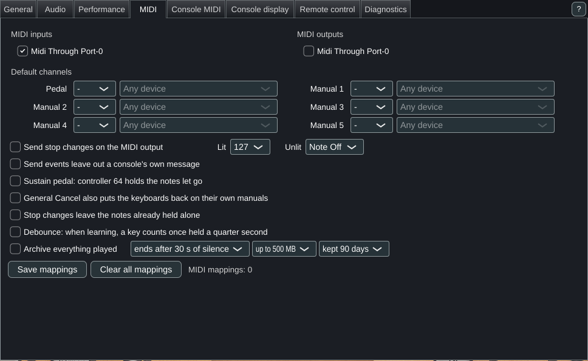

### MIDI inputs

The **MIDI inputs** list has one tick box per input: the inputs the system reports (ALSA ports on Linux), then the inputs Masterpiece opens itself (see [Inputs that Masterpiece creates](#inputs-that-masterpiece-creates)). A ticked input plays; an unticked input is closed and its messages are dropped.

| Name | What it does | Default | Options | Takes effect |
|---|---|---|---|---|
| Input tick box | Opens or closes one input. | Ticked for every input. A console plugged in for the first time plays at once. | Ticked, unticked | At once. The unticked inputs are saved by name in `settings.mpglobal` as `midiinputoff` lines. |

Masterpiece opens its inputs at start, and looks for new ones every 3 seconds while it runs. A console plugged in or switched on later is opened when it appears, unless it was unticked before, and plays at once; the log records `midi: <name> appeared and has been opened`. On Android a USB keyboard appears once the player has allowed it.

**Panic** in the top bar also closes and opens again every ticked input, as unticking and ticking it would, so a keyboard that stopped sending comes back without a restart. The log names each input opened again.

**Bluetooth MIDI...** on **Settings > MIDI...**, shown on macOS, iPhone and iPad and Android, opens the system's pairing window. On Windows and Linux a Bluetooth MIDI device is paired in the system's own settings. While the pairing window is open, a further press does nothing; once it closes, the next press opens it again.

#### When another program holds an input

Windows gives a MIDI port to one program at a time, so an input that another program has open cannot be opened by Masterpiece. Masterpiece keeps the input ticked and shows it as `<name>  -  in use by another program; opened when it is free`. Ticking such an input opens a message box titled `<name> could not be opened`. A timer checks every 3 seconds, and the input opens as soon as the other program lets it go; the log then records `midi: <name> is free now and has been opened`. At startup the same case is logged as `midi: <name> could not be opened (another program may be using it); it is tried again every few seconds`.

### How a console is identified

A mapping refers to an input by name, and by an identifier where the system supplies one that lasts:

| System | Identifier |
|---|---|
| Windows | The device's interface path, which includes the USB socket |
| macOS | The CoreMIDI persistent id |
| Linux | The USB socket of the card behind the ALSA port |
| Android | None; the system numbers its devices afresh at each start |

Two consoles of one model keep separate mappings. The second is stored as `<name>-1` and shown as `<name> (USB 1.1.2)` with its USB socket, or as `<name> #2` where the system gives no socket. A console that moves to another USB socket keeps its mapping when its name is unique.

### Inputs that Masterpiece creates

| Input name | Where it exists | What feeds it |
|---|---|---|
| `Split keyboard` | Every system | The [split keyboard](split-keyboard.md). It is listed in the device menus of the mapping dialogs and has no tick box. |
| `JACK MIDI` | Linux, when a JACK server is running at startup | The JACK port described below. |
| `Masterpiece` (or the name given) | macOS and Linux, when started with `--virtual-midi [name]` | A MIDI port that other programs can send to. See [Command line](command-line.md). |

On Windows no program can publish a MIDI port. A loopback MIDI driver (loopMIDI, for example) provides one; Masterpiece lists it with the other inputs.

### MIDI with JACK on Linux

Masterpiece opens a JACK client named `Masterpiece MIDI` with one input port, `midi_in` (full name `Masterpiece MIDI:midi_in`), for programs that send MIDI only through JACK. The client opens at startup when `libjack.so.0` loads and a JACK server is already running. Masterpiece never starts a server. The port appears in the **MIDI inputs** list as `JACK MIDI`.

- Messages of up to three bytes pass. System exclusive messages do not arrive through this port.
- The connections made to the port are saved when Masterpiece closes, one JACK source port per line, in `jack-connections.txt` in the data folder. At the next start Masterpiece reconnects each source; a source whose program is not running yet is retried every 2 seconds until its port appears. A connection taken away by hand stays away once it has been restored.

### MIDI outputs

| Name | What it does | Default | Options | Takes effect |
|---|---|---|---|---|
| **MIDI outputs** | A tick box per port Masterpiece sends to, beside **MIDI inputs** (under them in a narrow window): lamp and fader messages, key echo to a sound module, text displays, the ready lamp, the messages on organ load and unload, and score page turns. Ticked ports stay listed while disconnected. Reads **None** when the system has no output. | None ticked | Every output the system reports | At once; kept as `midioutput <name>` in `settings.mpglobal`, a line per port. |

The processor holds the output ports, so lamps, motorised faders, key echo and console displays work with any window open or none. The ports open again at the next start. A port that is not plugged in keeps its name and its tick, and opens when it appears. A send event can go to one port or to **Every MIDI output**; see [Send tab](#send-tab).

### Echo, playing and learn options

| Name | What it does | Default | Options | Takes effect |
|---|---|---|---|---|
| **Send stop changes on the MIDI output** | For a stop, coupler or piston that has no event on its **Send** tab, sends the stop's state back on the message that operates it, however the stop moved: from the console, a click on screen, a piston, the crescendo or the control API. A console that echoes the message lights the lamp. A note binding sends note on at the **Lit** velocity, and note off or the **Unlit** velocity; a controller binding sends the same values. The channel is the binding's, or 1 when the binding listens on any channel. | Off | On, off | At once; saved in `settings.mpglobal` (`midifeedback 1`, written only while on) and restored at the next start. A console that echoes what it receives can latch itself into a loop, which is why the option is off until it is switched on. |
| **Lit**, **Unlit** | The velocity or value sent when a stop comes on (on a pad grid it picks the colour), and what is sent when it goes off: **Note Off**, or a velocity for a dimmer colour. | 127; **Note Off** | 1 to 127; **Note Off**, 0 to 127 | At once; `midifeedbackvalues <lit> <unlit>` in `settings.mpglobal`, `-1` for Note Off. |
| **Send events leave out a console's own message** | For a console that lights its own lamps: a stop moved from the console leaves out the Send event that repeats the same message. | Off | On, off | At once; `midisendsholdecho 1`. |
| **Sustain pedal: controller 64 holds the notes let go** | While a sustain pedal (controller 64, on any channel) is down, the keys let go keep sounding until it is lifted: for directing a choir from the bench. A controller 64 learned for something else keeps doing that. | Off | On, off | At once; saved in `settings.mpglobal` (`sustainpedal 1`). |
| **General Cancel also puts the keyboards back on their own manuals** | After manual buttons have moved a keyboard to another manual (see [Controls tab](#controls-tab)), General Cancel restores the keyboards to the assignment the player set by hand. | Off | On, off | At once; saved in `settings.mpglobal` (`cancelresetskeyboards 1`). |
| **Stop changes leave the notes already held alone** | A stop or coupler moved while keys are held leaves those notes as they are; only keys pressed afterwards play the new registration. Off, held notes gain and lose pipes at once, as on a console with electric action. | Off | On, off | At once; saved in `settings.mpglobal` (`stopsleaveheldnotes 1`). |
| **Debounce: when learning, a key counts once held a quarter second** | While learning, a note counts only after it has been held 250 ms; a shorter note is dropped. Controllers, program changes and system exclusive messages have no length and count at once. | Off | On, off | At once; saved in `settings.mpglobal` (`learnnoisefilter 1`). Switch it on for a console whose contacts send stray short notes. Leave it off for pistons that send only a brief note. |

**Archive everything played** and its three boxes are on the same tab; see [Everything played](playing.md#everything-played).

### Default channels

**Default channels** sets the channel each keyboard comes in on for an organ that has no channels saved for it, and while no organ is loaded. It has six rows: **Pedal** and **Manual 1** to **Manual 5**, each with a channel box, **-** (none) or 1 to 16, and a device box, **Any device** or one device. An organ's own saved choice keeps it. The boxes and **Use as default for all organs** on the organ's MIDI tab (see [Default console](#default-console)) edit the same default, kept in `settings.mpglobal` as `consolechannel <role> <channel> [<device>]` lines, role 0 for the pedal and 1 to 5 for the manuals.

## One MIDI channel per manual

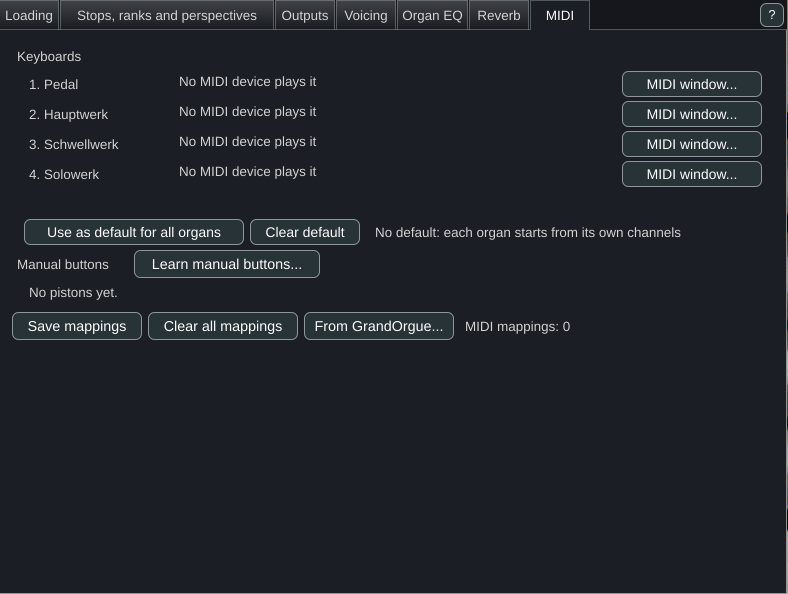

The **Keyboards** heading of the **MIDI** tab of Organ settings lists every playable manual of the loaded organ, one row each:

| Control | What it does |
|---|---|
| Manual name | The manual of the row. |
| Summary | What plays the manual, one line per entry: the device, the channel and the keys, as in its MIDI window, or **No MIDI device plays it**. |
| **MIDI window...** | Opens the [MIDI window of the manual](#the-dialog-for-one-manual), where the channel, the device, the range and the transposition are set. |

A change takes effect at once and is saved with the organ.

- A manual moved to a channel of its own leaves its default channel, so that channel no longer plays it.
- Manuals may share a channel. A line under the rows lists them (`Shared -- Channel 2: Great, Swell`). One keyboard that plays two divisions is a coupler a player can build in this way.
- A manual left on its default channel after another manual was put on that channel is named in the same line: `Channel 2 plays Swell; choose Channel 2 for Great to play both.`

Channels decide which division sounds, and the couplers work from that. A wrong channel makes a manual sound like another one. With the pointer at rest on a drawn manual, a tooltip names the keyboard, its MIDI device and its channel.

### Default console

| Name | What it does | Default | Takes effect |
|---|---|---|---|
| **Use as default for all organs** | Stores the loaded organ's channels and devices by role (pedal, first manual, second manual and so on) as the player's console. An organ with no channels saved starts from them. | No default: each organ starts from its own channels | At once; saved in `settings.mpglobal` (`consolechannel` lines) |
| **Clear default** | Removes the stored console. | | At once |

A line beside the buttons reads `Default for organs with no channels saved: Pedal 1; Manual 1 2; ...` or `No default: each organ starts from its own channels`.

Under them, **Manual buttons** with **Learn manual buttons...** (see [Controls tab](#controls-tab)), then **Save mappings**, **Clear all mappings** and **From GrandOrgue...** (see [Bringing an organ over from GrandOrgue](#bringing-an-organ-over-from-grandorgue)).

## The dialog for one manual

Right-click a drawn manual on the console, or press **MIDI window...** in the manual's row of the **MIDI** tab of Organ settings. The window is titled `<manual> - MIDI` and has three tabs: **Keys**, **Controls** and **Send**.

### Keys tab

The tab is headed `What plays <manual>` and lists the entries that feed the manual, one row each, described as `Any device  ch any  keys C2 (36) to C7 (96)` with any transposition, `no velocity`, `short octave` and `debounce` appended, or **No MIDI device plays it**. A manual can have several entries. A keyboard split across two manuals is two entries (one on each manual), and a manual played from two consoles is two entries.

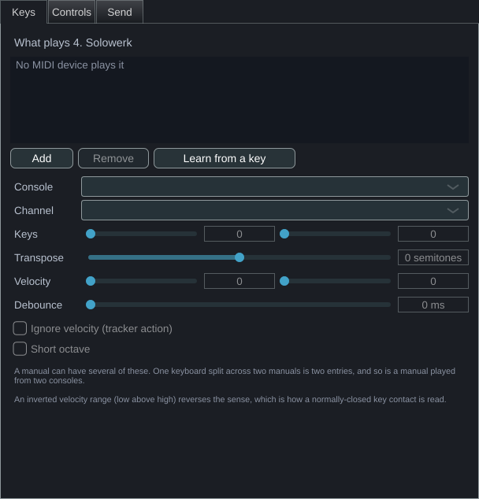

Every edit takes effect at once and is saved with the organ. A new entry listens on every device and every channel until narrowed, so set **Console** and **Channel** at once.

| Name | What it does | Default | Range or options |
|---|---|---|---|
| **Add** | Adds an entry that covers the manual's own compass, as the organ states it, and the whole of MIDI (notes 0 to 127) when the organ does not state one. | | |
| **Remove** | Removes the selected entry. | | |
| **Learn from a key** | Press the lowest key and then the highest key of the range. The first press supplies the device and the channel; the two presses supply the range, in either order; the transposition is set so that the lowest key plays the first note of the manual's compass. The pressed keys do not sound. The button reads `Press the lowest key...` and then `Now press the highest key...`. Learning replaces every other entry of the manual with the one it creates. | | |
| **Console** | The input the entry listens to. | **Any device** | **Any device** and every input known to the mapping |
| **Channel** | The channel the entry listens to. | **Any channel** | **Any channel**, 1 to 16 |
| **Keys** | The lowest and highest incoming note the entry accepts, shown as a name with the note number, for example `C4 (60)`. | 0 to 127 | 0 to 127 each |
| **Transpose** | Moves every accepted note before it reaches the manual. A note moved outside 0 to 127 is dropped. Use it to bring the upper part of a keyboard that serves a short manual back into range, or to match a compass that starts somewhere other than the keyboard's. | 0 | -48 to 48 semitones |
| **Velocity** | The lowest and highest note velocity the entry accepts. When low is below high, the velocities between them scale to 0 to 127, so a keyboard that tops out at 100 reaches full velocity. When low is above high, the sense reverses: the entry accepts every velocity outside the window, which is how a normally-closed key contact is read. When both are equal, only that velocity is accepted, and it passes unchanged. | 1 to 127 | 0 to 127 each |
| **Debounce** | Ignores a repeat of the same key within this time. Old contacts chatter and retrigger the pipe. | 0 ms (off) | 0 to 200 ms |
| **Ignore velocity (tracker action)** | Reports every key as velocity 127 when down. A velocity-switched sample set would pick the wrong layer from a velocity the keyboard never sent. | Off | On, off |
| **Short octave** | Applies a short-octave layout to the range: the lowest four keys of the range are silent, and the keys at positions 5, 7 and 9 (counting from the low key) sound 4 semitones lower. The transposition is applied afterwards. | Off | On, off |

### Controls tab

The tab is headed `Controls that bring the <manual> to one of your keyboards`. A control added here (a piston, a button, a drawstop or a tab) makes the keyboard on one MIDI channel play this manual. A console with fewer keyboards than the organ has manuals reaches every manual this way.

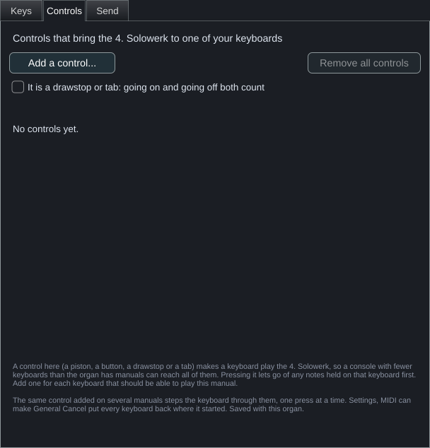

To add one, press **Add a control...**, play any key on the keyboard that should play this manual (the prompt reads `Play any key on the keyboard that should play the <manual>...`), then press the control (`Now press the control (keyboard on channel N)...`). The list shows each control as `Note 36 on channel 1  brings the <manual> to the keyboard on channel 2`, or **No controls yet.**

- Pressing the control lets go of any notes held on that keyboard first, and keys still down sound on the new manual.
- The same control added on several manuals steps the keyboard through them, one press at a time, in the organ's own manual order. One control can move several keyboards at once when it was learned for several channels.
- The controls are saved with the organ. The assignment they change is kept for the piece; the next load starts from the assignment the player set by hand.

| Name | What it does | Default | Options |
|---|---|---|---|
| **Add a control...** | Starts the two-step learn. | | |
| **Cancel** | Appears during the learn and ends it. | | |
| **Remove all controls** | Removes every control of this manual. | | |
| **It is a drawstop or tab: going on and going off both count** | For a spare drawstop or tab that sends one message going on and another going off. Each of the two counts as a press. | Off: only the press counts and the release is ignored | On, off |

The tick box is read when **Add a control...** starts the learn, so set it first. **General Cancel also puts the keyboards back on their own manuals** (**Settings > MIDI...**) restores the keyboards on General Cancel.

A control for the manual a keyboard already plays leaves it alone, and one press moves the keyboard on every organ, including those whose console draws its manuals as keyboards of their own.

**Learn manual buttons...**, under **Manual buttons** on the organ's MIDI tab, opens a menu of the manuals; choosing one opens its MIDI window to learn a control there. The lines under it list the controls of every manual.

### Send tab

The **Send** tab of a manual sends every key played on the manual as a note on the MIDI outputs, for a sound module or a second program. One event sends to one channel.

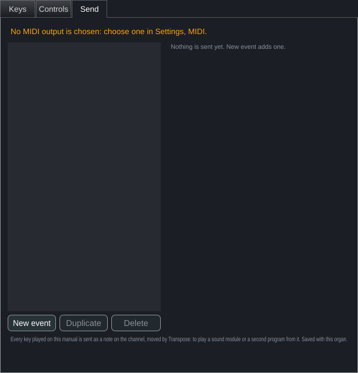

The line at the top reads `Sent to <output>` or `No MIDI output is chosen: choose one in Settings, MIDI.` The events are listed on the left: **New event** adds one, **Duplicate** copies the chosen one and **Delete** removes it. The form on the right sets the chosen event.

| Name | What it does | Default | Range |
|---|---|---|---|
| **Channel** | The channel the notes go out on. | 1 | 1 to 16 |
| **Transpose** | Moves the notes by this many semitones. A note outside 0 to 127 is not sent. | 0 | -48 to 48 |
| **Velocity** | The note-on velocity: the played velocity, at least 1, or a fixed one. | **as played** | **as played**, 1 to 127 |
| **Sends** | The bytes middle C sends, and its release. | | |
| **Send middle C**, **Release it** | Send them now, to check the module. | | |

The note off goes out as a note-off message on the same channel.

## MIDI learn for stops, couplers, pistons and shoes

### Right-click menus

Right-click a drawn stop, coupler, tremulant or piston on the console. The same menu opens on a stop, coupler, tremulant, piston, shoe or slider of a panel, and on a stop in the stop list; there it works the drawstop a player pulls for that stop, also on sets that pair two knobs by name. On a touch screen a long press opens it. The menu's section header names the object; the next lines list its current mappings, for example `Note 36 ch 3  (toggle)`, what it sends and its computer key, or **Not mapped**.

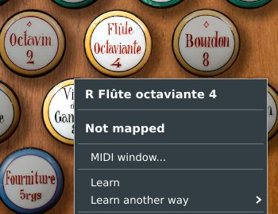

| Item | What it does |
|---|---|
| **Learn** | Arms a learn; the next message from a console is mapped. For a latching switch (a stop or coupler) it learns **Toggle**. For a switch the organ declares as a momentary button (a piston) it learns **While held**, and the item reads **Learn (while held)**. |
| **Learn on and off (two messages)...** | For a tab that sends one message going on and another going off: move the tab on, then off (**Move it on...**, **Now move it off...**), and the rows are filled from the two messages. A tick box offers **Also light the console's lamp with the same messages**. |
| **Learn one message as** | **Toggle**, **While held**, **Draw only**, **Cancel only** (see [What a stop does with each message](#what-a-stop-does-with-each-message)). |
| **MIDI window...** | Opens the [MIDI window](#the-midi-window-for-one-object): several messages, what the console is sent, a key. |
| **Clear mapping** | Removes every mapping of the object and saves. |

Right-click a swell shoe, wheel or slider to see **MIDI window...**, **Learn: move a pedal, knob or fader**, **Closed position: where the pedal is now**, **Open position: where the pedal is now**, **Use the pedal's whole travel** and **Clear mapping**. The two position items set the ends of the pedal's travel from the pedal's last position, so move the pedal to the position first. A box reading **Move the pedal first** appears when Masterpiece has no position yet or both ends would be equal.

Right-click a piston in the Combinations window (generals, divisionals, cancels, **Pedal with**, the setter and every sequencer button, the digits **0** to **9** among them) to map it: **Learn**, **MIDI window...** and **Clear mapping**. The setter and **Pedal with** offer **Learn: while held** and **Learn: toggle** in place of **Learn**. A general and a divisional also have **Name...** and **Empty**; see [Names for generals and divisionals](playing.md#names-for-generals-and-divisionals). Right-clicking again while a learn is armed cancels it.

The program's own buttons have no object on the console to right-click. Their learn buttons are in three places. A click on one opens the same kind of menu: its mappings (or **Not mapped**), **Learn**, **Clear** and **MIDI window...**. A button is orange while it learns and green once it is mapped, and its tooltip names each message it is mapped to.

| Place | Buttons | What they work |
|---|---|---|
| **Console MIDI** tab, **Console** | **Learn page -**, **Learn page +** | The previous and next console page |
| | **Learn console size** | The next console layout |
| | **Learn panel**, **Learn keyboard**, **Learn combinations** | The stop-list panel, the on-screen keyboard and the Combinations window, on and off |
| **Console MIDI** tab, **Power** | **Learn quit**, **Learn power off** | Quits Masterpiece, or shuts the computer down; see [A console with no screen](#a-console-with-no-screen) |
| **Console MIDI** tab, **Score app** | **Learn score page -**, **Learn score page +** | A page back or forward in a score app, sent on the MIDI outputs as the message chosen under **Sends** (see below), and in the program's own score panel |
| The tuning panel's **MIDI** button | **Temperament: \<name\>**, **Temperament -**, **Temperament +**, **Transpose -**, **Transpose +** | The temperament chosen in the panel, directly; the previous and next temperament; the transposer, one semitone down or up. See [Temperament](playing.md#temperament). |
| The Recorder's **MIDI...** | **Record**, **Play** | A press starts, the next press stops (see [Record and Play on the console](playing.md#record-and-play-on-the-console)) |

Each of these learns a button that fires on the press and ignores the release. A console may have several buttons for one action (two + and two - thumb pistons): each further learn adds a button. The sequencer, its digits, the generals and the setter are mapped from the Combinations window.

**Score app.** Score apps on a tablet or another computer turn pages on a MIDI message they have learned. The **Sends** row under the score-page buttons sets the message Masterpiece sends: **Note** (struck and let go), **Controller** (127, then 0) or **Program change**, on one channel, with one number for the next page and one for the page before. The default is notes 127 and 126 on channel 16, where no keyboard plays. Connect a MIDI output to the device running the app, then let the app learn each page turn. The control API sends the same turns with the commands `scorePageForward` and `scorePageBack`. The message is kept in the global settings as `scorepage <kind> <channel> <forward> <back>`.

The line at the bottom of the MIDI tabs reads `MIDI mappings: N`, followed by `LEARNING: move a control now` while a learn is armed. **Save mappings** writes the mapping files, and **Clear all mappings** removes every mapping; both are shown in the **Advanced** display mode.

### Learning the tabs in turn

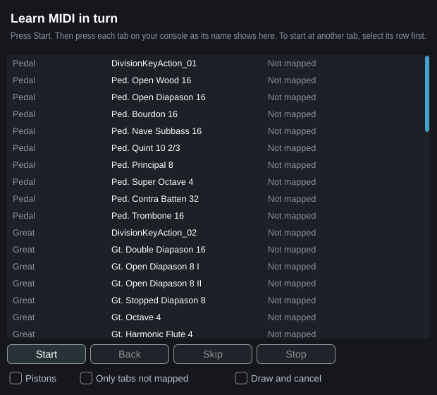

**Organ > Learn MIDI in turn...** maps a console's tabs in one pass. The window lists the organ's stops, couplers and tremulants in the order of the stop list, with their division and their mapping. Press **Start**, then press each tab on the console as its name shows (**Press the tab for \<stop\>**); the window moves on by itself after each press (**N of M. The window moves on after each press.**).

| Control | What it does |
|---|---|
| **Start** | Starts at the first row, or at the row selected; reads **Restart here** while running. |
| **Back**, **Skip** | The row before; the next row, leaving this one as it was. |
| **Stop** | Ends the run. The status reads **N tabs learned**. |
| **Pistons** | The organ's pistons follow its tabs in the list. |
| **Only tabs not mapped** | Tabs that already have a MIDI mapping are passed over. |
| **Draw and cancel** | Each tab learned in two steps: the message that draws it (**Draw the tab for \<stop\>**), then the one that cancels it (**Cancel the tab for \<stop\>**). |

A tab already learned in this run for another row is refused, **That tab is \<stop\>.**, and the row asks again, so a tab pressed twice to put it back up does not map the next stop.

### Console profiles

A console profile is the player's console written down once: each tab's printed name, the keyboard it sits on and the MIDI it sends. **Organ > Console profile...** opens it.

| Control | What it does |
|---|---|
| **Console profile** | The profile in use, or **None**. |
| **New...**, **Rename...**, **Delete** | A new profile, made the one in use; its name; its removal. |
| A row per tab | The tab's name, its kind (**Speaking stop**, **Coupler**, **Tremulant** or **Piston**), its keyboard (**Any keyboard**, **Pedal** or a manual; for a coupler, the keyboard it couples onto and the one it brings in), its message with **Learn**, and **x** to remove it. |
| **Add tab** | A new row, **New tab**. |
| **Add this organ's mappings** | Each stop, coupler, tremulant and piston mapped on the loaded organ becomes a tab, with its message. |
| **Map this organ...** | Opens **Map from console profile** for the loaded organ. |

When an organ opens and a profile is in use, its stops, couplers, tremulants and pistons that have no mapping of their own are matched to the profile's tabs by name and keyboard. The strong matches are mapped at once, and a window says which: **N mapped from the profile: ...**. The other matches are listed in **Organ > Map from console profile...**, each **Strong**, **Related** or **Weak**, with a tick box: **Tick all** and **Map ticked** map them. The player's own mappings are never changed. A profile is offered to an organ once, and again after the profile changes.

The profiles are files in the `consoles` folder of the data folder, one per profile; `consoles/active.txt` names the one in use.

### Message types

| Message | Number | Counts as a press when | Release |
|---|---|---|---|
| Note | 0 to 127; for a shoe also **Any note** | Velocity 64 or more | Note off, or note on with velocity 63 or less |
| Controller | 0 to 127 | Value 64 or more | Value 63 or less |
| Controller, one value | 0 to 127, with the value for on and the value for off | The **On at** value, and no other | The **Off at** value; every other value is for another object |
| Controller, one bit | 0 to 127, with the bit, 0 for the lowest | The switch follows its bit on every message | |
| RPN, NRPN | A parameter number, 0 to 16383 | As a controller, on the data entry value | As a controller |
| Program change | Shown from 1; a shoe also takes **Range of programs**, one program a step | Every time it arrives | None |
| System exclusive | Identified by all of its bytes; shown as **Learned message** | Every time it arrives | None |

The press threshold is the middle of the binding's value window (above 63 for the default window of 0 to 127). A console that sends 64 for a press registers. Each distinct system exclusive message is one button; a console that sends its pistons this way maps each piston by learning it.

**Controller, one value** lets one controller work many objects, a value each: a console that sends controller 20 with a value per tab, or a notation or sequencer program that sends a value per combination. It is offered for stops and switches, and for the generals, divisionals, cancels and sequencer buttons. **Controller, one bit** is for a console that reports a group of tabs as one value, bit 0 for the first tab.

One message can work several objects of the same kind:

- **Stops, couplers and tremulants.** Learning a message for a second stop keeps the first: one tab draws both. Each keeps its own behaviour (**Toggle**, **Draw only**, and so on), and **Clear mapping** on one leaves the others mapped.
- **Shoes, faders and levels.** One pedal can move several swell boxes; learning the same controller for a second shoe keeps the first.
- **Manual buttons.** One message steps a keyboard through several manuals.

Learning a message that an object of another kind uses moves it to the new object. A shoe learns only from controllers; a key pressed while a shoe's learn is armed plays as usual.

### What a stop does with each message

The MIDI window's **What it does** and the right-click **Learn one message as** use the same words.

| Label | What happens |
|---|---|
| **Toggle** | A press flips the switch from its state at that moment. The release is ignored. After a cancel or a click has moved the stop, the next press flips it from its actual state. A piston toggled this way is pressed and released on each press. |
| **Press and release toggle** | The on value flips the switch, and so does the off value: for a tab that sends one message going down and another coming up, each a change. Offered in the MIDI window. |
| **While held** | The switch is on while the button is down and off on the release. This is a piston's behaviour. On a latching stop, a program change or system exclusive message (which have no release) leaves the stop drawn. |
| **Draw only** | The press draws the switch; the release is ignored. |
| **Cancel only** | The press cancels the switch; the release is ignored. |

A rocker tab, or a console with separate draw and cancel buttons per stop, is two rows: one **Draw only** and one **Cancel only**. **Learn on and off (two messages)...** fills both at once. Learning **Draw only** leaves an existing **Cancel only** alone, and the reverse, so both can be taught in turn. Any other learn replaces what the object had. The mapping lines at the top of the right-click menu end in the same word: `Note 36 ch 1  (toggle)`, `CC 20  (while held)`.

A new row in the MIDI window starts as **Toggle** for a latching switch and **While held** for a momentary one. Pistons and program buttons other than switches start as **Fires when pressed**. Learning is saved within a moment of the message arriving.

### Shoes, wheels and sliders

A shoe is operated by a controller value, or by the velocity of a note (a sequencer can write the swell into the velocities of the notes it plays; the note-off does nothing). The binding maps the incoming range onto the control's whole travel.

| Name | What it does | Default | Range |
|---|---|---|---|
| **Closed at** | The incoming value at which the shoe is closed. | 0 | 0 to 127 |
| **Open at** | The incoming value at which the shoe is open. | 127 | 0 to 127 |
| **Invert** | Reverses the sense, for a pedal wired backwards. | Off | On, off |

A console's shoe seldom sends the whole 0 to 127, so set the two ends to the values the pedal actually sends. Values outside the window clamp to its ends. Only the span matters; the order in which the two values are entered has no effect, and **Invert** reverses the sense. **Closed position: where the pedal is now** and **Open position: where the pedal is now** in the right-click menu fill in the values from the pedal's last position and set **Invert** when the closed end is the larger value. A program change or system exclusive message arrives with the value 127 and drives the shoe fully open.

## The MIDI window for one object

**MIDI window...** opens a window titled `<object> - MIDI` with the tabs **Receive**, **Send** and **Shortcut**. Every edit takes effect at once and is saved with the organ; the program's own buttons are saved in the console file (see [The MIDI map files](#the-midi-map-files)).

### Receive tab

One row per message that operates the object. **New event** adds a row and starts listening at once. A row whose message is not set yet is skipped.

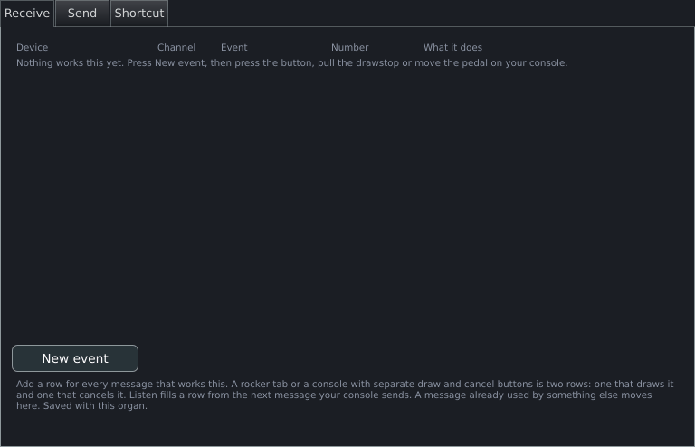

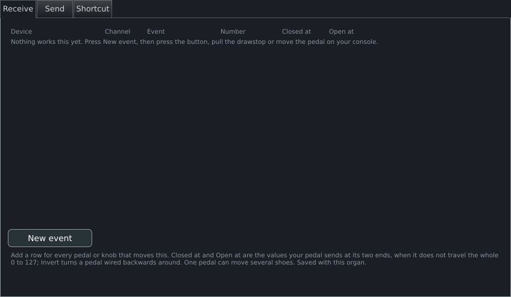

| Column | What it does | Default | Options |
|---|---|---|---|
| **Device** | The input the message must come from. | **Any console** | **Any console** and every input known to the mapping |
| **Channel** | The channel of the message. | **Any** | **Any**, 1 to 16 |
| **Event** | The message type. Shows **Listen...** until a message is set. **Controller, one value** is offered for stops and switches, and for the generals, divisionals, cancels and sequencer buttons; **Controller, one bit** for stops and switches. See [Message types](#message-types). | | **Note**, **Controller**, **Controller, one value**, **Controller, one bit**, **Program change**, **System exclusive**, **RPN**, **NRPN** |
| **Number** | The note (shown as a name with its number), controller number (0 to 127), program number (1 to 128) or parameter number. For **System exclusive** it shows **Learned message**, which only **Listen** can set. For a shoe with **Note** it offers **Any note**, which takes the velocity of every note on the channel, and with **Program change** a **Range of programs**. | | |
| **On at**, **Off at** | **Controller, one value**: the value your console sends for on, and for off. | | 0 to 127 |
| **What it does** | The behaviour (see the table above). For a stop, coupler, tremulant or switch: **Toggle**, **Press and release toggle**, **While held**, **Draw only**, **Cancel only**. For the program's pistons and cancels: **Fires when pressed**. For the setter: **Fires when pressed** and **Toggle**. | Follows the switch, see above | |
| **Debounce ms** | A press within this time of the last one this row took is contact chatter, and is dropped. A release is never dropped. | 0 (off) | |
| **Closed at**, **Open at**, **Invert** | Shoes only; see above. These replace **What it does**. | | |
| **Listen** | Takes the next press from a console and fills the row with it. The button reads **Listening...** until a message arrives; press it again to cancel. The press is taken, not acted on, and its release is swallowed. | | |
| **X** | Removes the row. | | |

Add a row for every message that operates the object. A message that another stop, coupler or shoe already uses works both; one used by an object of another kind moves here, and the row says **Moved here from \<object\>, which no longer answers it.**

### Send tab

The messages Masterpiece sends to the MIDI outputs when the object changes, one event each. The line at the top reads `Sent to <output>` or `No MIDI output is chosen: choose one in Settings, MIDI.`

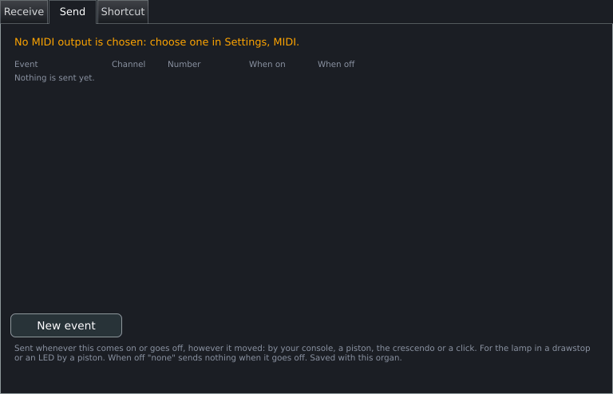

The tab is there for every object with a state a console can show: stops, couplers, tremulants, shoes, the player's generals and divisionals, **Set**, **Pedal with** *manual* and the recorder's buttons. For a stop, coupler or piston, the message goes out whenever the object comes on or goes off, however it moved: the console, a piston, the crescendo, a click or the control API. For a lamp in a drawstop or an LED by a piston. A general or divisional is on while it is the piston last pressed. For a shoe, the message goes out whenever the shoe moves. When the list changes, and each time an organ has loaded, Masterpiece sends the present state of every lamp, so the console's lamps match the drawn stops. A piston with no event of its own lights as the message it is learned on: note on at velocity 127, or controller 127, and 0 when it goes out.

The events are listed on the left: **New event** adds one, **Duplicate** copies the chosen one (the same state to a second lamp or device) and **Delete** removes it. A new event starts from the object's first receive row (type, number and channel), because a lamp usually answers on the message that operates the stop; a shoe's starts as a controller. The form on the right sets the chosen event, and shows only the fields its type uses.

| Field | What it does | Default | Options |
|---|---|---|---|
| **Device** | The MIDI output this event goes to: one console, or every MIDI output. | **Every MIDI output** | **Every MIDI output** and each output port |
| **Event** | The message type. | The type of the receive row, else **Note** | **Note**, **Note, off as a Note Off (8n)**, **Controller**, **Program change**, **RPN (registered parameter)**, **NRPN (non-registered parameter)**, **Hex messages, SysEx or any other**; for a stop or a shoe also **Display, 32 characters** and **Display, 16 characters** |
| **Channel** | The channel it goes out on. | The receive row's channel, else 1 | 1 to 16 |
| **Note**, **Controller**, **Parameter** | The note, controller or parameter number. | The receive row's number, else 0 | 0 to 127; a parameter 0 to 16383 |
| **When on** (stop, piston) | The velocity (note) or value (controller, parameter) sent when it comes on. On a pad grid, the velocity is the colour. | 127 | 0 to 127 |
| **When off** (stop, piston) | The velocity or value sent when it goes off. Note on at velocity 0 is the usual lamp off. | 0 | **none**, 0 to 127 |
| **Program when on**, **When off** (program change) | The program sent when it comes on, and the one sent when it goes off. | 1 and **none** | 1 to 128; **none** |
| **Closed**, **Open** (shoe) | The values sent at the two ends of the shoe's travel. A shoe is sent across them, so a fader that wants 0 to 100 gets 0 to 100. | 0 and 127 | 0 to 127 |
| **When on**, **When off** (hex) | Whole MIDI messages in hex, one or several separated by commas: `F0 7D 01 F7, B0 14 7F`. A message that does not read is outlined in red, and the one before it is kept. | Empty: nothing | Any messages |
| **Sends** | The bytes the event sends in each state, as they will go out. | | |
| **Copy the received event** | Takes the type, channel and number of the object's first receive row. | | |
| **Send on**, **Send off** (**Send open**, **Send closed** for a shoe) | Send the bytes now, to check a lamp's colour or a fader. | | |

With **none** in **When off**, nothing goes out when the stop goes off. **Note, off as a Note Off (8n)** sends the off state as a note-off message at the **When off** velocity, for a console whose lamps go out only on a note off. An RPN or NRPN event sends three controllers: the parameter number on 101 and 100 (RPN) or 99 and 98 (NRPN), then the value on data entry, controller 6. For a shoe, **Program change** sends the scaled value as the program number. Hex messages go out again after each load, so a controller's mode message (a pad grid's programmer layout) reaches it every time. The display events send the object's name, or a control's value, to a console's text display, in the format GrandOrgue uses for its displays.

### Shortcut tab

A key of the computer keyboard that operates the object.

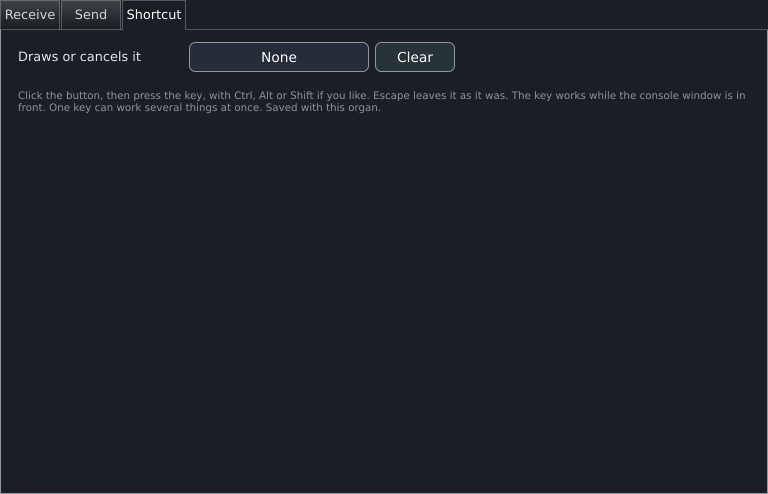

Click the key button (it reads **None** or the current key), then press the key, with Ctrl, Alt or Shift if wanted. The button reads **Press a key...** while it waits; Escape leaves the setting as it was. **Clear** removes the key. The key works while the console window is in front. One key can operate several objects at once. Saved with the organ.

| Name | What it does | Default | Range |
|---|---|---|---|
| **Draws or cancels it** (stops) | Flips a latching switch; fires a piston as one click would. | **None** | Any key |
| **Opens it** (shoes) | Moves the shoe up by the step. | **None** | Any key |
| **Closes it** (shoes) | Moves the shoe down by the step. | **None** | Any key |
| **Each press moves it by** (shoes) | The size of one step on the 0 to 127 travel. | 8 | 1 to 64 |

A stored key operates organ switches (stops, couplers, tremulants and the organ's own pistons) and shoes, and the player's generals, divisionals, cancels, setter and sequencer buttons, as their MIDI message does: a console whose pistons are wired to a computer-keyboard encoder plays them this way.

## Sending to a console

These send to the MIDI outputs: the events of the **Send** tabs (lamps, faders, key echo), the echo option of the MIDI tab, the text displays, the ready lamp, the messages on organ load and unload, and the score page turns. All of them need a port ticked under **MIDI outputs**.

### Console displays

Many consoles have text displays on the jamb that a system exclusive message drives. The **Console display** tab of the settings window (**Settings > Console display...**) describes one display and what it shows.

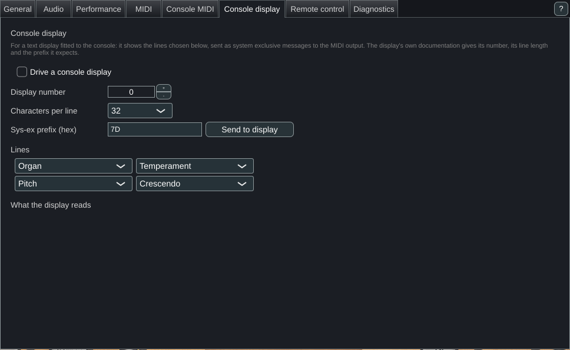

Each message is `F0 <prefix> <display number> <line number> <text> F7`: the prefix bytes, one byte for the display, one byte for the line (counting from 0), and the line's text as ASCII padded with spaces to the line width. The prefix, display number and line width belong to the console hardware, so the tab asks for them.

| Name | What it does | Default | Range or options |
|---|---|---|---|
| **Drive a console display** | Switches the display on. | Off | On, off |
| **Display number** | The display's number on the console, sent as one byte. | 0 | 0 to 15 |
| **Characters per line** | The line width. Longer text is cut, and shorter text is padded so it overwrites the previous tail. | 32 | 16, 20, 32, 40 |
| **Sys-ex prefix (hex)** | The bytes after `F0`, in hexadecimal, separated by spaces. | `7D` | 1 to 8 bytes, each 00 to 7F. An invalid entry falls back to `7D`. |
| **Lines** | Four boxes, one per line, choosing what the line shows. | **Organ**, **Temperament**, **Pitch**, **Crescendo** | **(blank)**, **Organ**, **Temperament**, **Pitch** (`A=440.0 Hz`), **Transpose** (`+2`, `0`, `-3`), **Stops drawn** (a count), **Crescendo** (the step; 0 when the shoe is closed), **Combination set** |
| **Send to display** | Sends all four lines again, changed or not. Use it after connecting a console during a session. | | |
| **What the display reads** | A preview of the four lines, with bars at the line width so a cut is visible. | | |

`7D` is the manufacturer id that the MIDI specification reserves for non-commercial use; it is the default because a console's own prefix is not known. Only lines whose text changed are sent, checked four times a second. Letters with accents are written with the accent removed (`ä` as `ae`, `ß` as `ss`, `Kraków` as `Krakow`), because system exclusive carries seven bits per byte and a byte above 7F would end the message. Characters with no Latin equivalent become `?`.

Changes in this tab take effect at once. The setup is kept in `settings.mpglobal` as `lcd <on> <display> <width> <line1> <line2> <line3> <line4> <prefix>` and is read again at the next start. The main window sends the display four times a second whether or not the tab is open, so the display follows the organ with any window open or none; a port must be ticked under **MIDI outputs**. The **Transpose** line shows the transposition as `+2`, `0` or `-3`, and the **Combination set** line shows the name of the combination set in use (`(default)` for the default set).

### A console with no screen

The **Console MIDI** tab of the Settings window has these rows for a console that is turned on and played without a monitor.

- **Ready lamp**: **Off**, **Note** or **Controller**, a channel and a number, sent to the ports ticked under **MIDI outputs**. The lamp is lit (note on at velocity 127, or the controller at 127) once an organ is loaded and playable, blinks once a second while an organ loads, blinks four times a second while a quit or power-off button is held, and is dark with no organ (note off, or the controller at 0). Kept in `settings.mpglobal` as `readylamp <note|cc> <channel> <number>`.
- **Lit: hex messages** and **Dark: hex messages**, beside the ready lamp: further MIDI messages in hexadecimal, sent as the lamp lights and as it goes dark, several separated by commas (`90 3C 7F, B0 14 7F`). Kept as `readylamplit` and `readylampdark` lines.
- **Learn quit** and **Learn power off**, under **Power**: buttons that save and quit Masterpiece, or save, quit and shut the computer down. So that a noisy input learned for one cannot turn a console off at every start, a button is obeyed only once Masterpiece has run two minutes, and only when it is held three seconds; letting go sooner does nothing. A button whose message has no release (a program change or a system exclusive message) is pressed twice within two seconds. A press before the two minutes is written to the log with the time left. The power-off button also needs **Allow quitting Masterpiece and shutting the computer down** on the **Remote control** tab, as the control API's power-off does; without it the hold is written to the log and nothing happens. Quitting needs no permission.
- A button for one temperament: **Temperament: \<name\>** under the **MIDI** button of the tuning panel.

### Messages on organ load and unload

| Name | What it sends | Kept as |
|---|---|---|
| **On organ load** | MIDI messages in hexadecimal, sent each time an organ loads, in the new organ's first audio block, before any stop moves or lamp lights: for a controller that needs a mode set first, such as a pad grid's programmer layout. | `loadmessage` in `settings.mpglobal` |
| **On organ unload** | MIDI messages in hexadecimal, sent when an organ unloads: before the next organ loads, and when the program quits. For a relay that turns the speakers off. | `unloadmessage` in `settings.mpglobal` |

Several messages are separated by commas (`F0 ... F7, B0 07 7F`); empty sends nothing. A message takes effect when Enter is pressed or the box loses focus. A text that does not read as whole MIDI messages is outlined in red and the messages before it are kept. **Send now** beside each box sends its messages at once, to try them.

## Bringing an organ over from GrandOrgue

**From GrandOrgue...** on the **MIDI** tab of Organ settings reads GrandOrgue's settings file for the organ that is loaded and brings over what Masterpiece can use. The organ must be loaded from its GrandOrgue `.organ` file. GrandOrgue keeps the settings file in its Data folder as `<hash>-0.cmb`, compressed or plain; Masterpiece reads both.

The import replaces what it brings: the MIDI mappings of the objects the file names, the pistons it holds, and the voicing of each rank it holds. Everything else stays as it was. A window titled **From GrandOrgue** then lists what came over and what was left out, one line each.

| From GrandOrgue | In Masterpiece |
|---|---|
| Each object's MIDI events, its lamps and display messages, its computer keys | The object's MIDI window, and the **Console MIDI** tab for the ready lamp |
| The organ's generals and divisionals, as the player set them | The organ's own pistons |
| The setter's generals 1 to 100 (banks A and B) | The player's generals 1 to 100 |
| The setter's sequencer frames 1 to 999 | The sequencer's steps 1 to 999 |
| The setter's divisionals 1 to 20 of each manual (banks A and B) | The player's divisionals 1 to 20 of that manual's division |
| The crescendo's bank A, steps 1 to 32 | The steps of [the player's crescendo](playing.md#the-players-crescendo) |
| Amplitude and UserGain, at the organ, windchest group, rank and pipe | **Level** on the Voicing tab, for the rank and the pipe |
| ManualTuning and AutoTuningCorrection | **Tuning** |
| ToneBalance | **Brightness** for a negative value, **Bass** for a positive one |
| AudioGroup | The rank's route, to the output of the same name |
| The organ's volume | The master volume, as a change from GrandOrgue's default of -15 dB |
| The temperament | The temperament of the same name |
| Each swell's position, each drawstop's state | The swell, and the drawstop, as GrandOrgue left them |
| The metronome's tempo and bar | The metronome's **Tempo** and **Beats per bar** |

Levels and tuning add up over the four levels, as in GrandOrgue: the organ's and the windchest group's change goes to every rank on them. A value beyond Masterpiece's range (a level from -24 to +12 dB, tuning of 50 cents either way, a shelf of 12 dB) is taken to the edge of the range, and the window counts them.

ToneBalance is a one-pole filter in GrandOrgue, a low-pass for a negative value and a high-pass for a positive one. Masterpiece takes it as the cut that filter gives at 6 kHz (**Brightness**) or at 100 Hz (**Bass**).

A player's piston in Masterpiece holds every element: what a GrandOrgue registration does not name is stored as retired. The organ's own pistons keep GrandOrgue's way, and move only what the registration names.

Left out, and counted in the window:

- the setter's generals past 100, divisionals past 20 and frames past 999;
- the crescendo's banks B to D;
- divisional couplers, and registration entries that name nothing in this organ;
- each pipe's Delay and ReleaseTail;
- a temperament Masterpiece does not have.

Not read: the sample loading options (bits per sample, channels, loops, compression, attack and release loading), window places and sizes, and the setter's own buttons (Regular, Scope, Insert, Delete, the banks).

## The MIDI map files

A mapping is stored in the player's data folder, never inside a sample set:

| System | Data folder |
|---|---|
| Windows | `%APPDATA%\Masterpiece` |
| macOS | `~/Library/Masterpiece` |
| Linux | `~/.config/Masterpiece` |

Two files in the `midi` folder of the data folder hold it:

| File | Holds |
|---|---|
| `midi/<organ>.mpmidi` | What belongs to this organ: the mappings of its stops, couplers, tremulants and shoes, the entries of its manuals, the manual buttons, the divisionals, and the sends and shortcuts of those objects. |
| `midi/console.mpmidi` | What belongs to the player's console on every organ: the sequencer and its digits, the generals and general cancel, the setter, **Pedal with**, the page, layout, panel, keyboard, combinations, transpose and temperament buttons, the voicing EQ preset buttons, the recorder's Record and Play, quit and power off, the score page turns and the level faders, and their sends and shortcuts. |

`<organ>` is the organ's name followed by its unique organ id, for example `Nancy-12345`. An organ that declares no id uses its name and a hash of its path. Renaming or moving the sample set keeps the file.

Every change in a MIDI dialog is saved at once, and a learn is saved within a moment of the message arriving. **Save mappings** on the MIDI tab writes both files. **Clear all mappings** removes every binding, send and shortcut from memory and keeps the manual entries; the files change at the next save. Both buttons are shown in the **Advanced** display mode.

When an organ loads, its `.mpmidi` file is read, then `console.mpmidi`. An organ with no file starts from the default console and the organ's own channels. A mapping carries over to another organ or computer by copying the file to the `midi` folder under the other organ's file name; devices travel by name.

When an organ loads, Masterpiece repairs a file that names a manual the organ lacks, or lists an identical manual entry twice. It logs `midi: repaired the saved mapping` and keeps the original beside the new file as `<organ>.mpmidi.before-repair`.

The files are plain text, one record per line, with `#` for comments. A binding line has these fields:

```
<kind> <channel> <number> <target> <id> <latching> <invert> <trigger> <closed> <open> <device> [<identifier>]
```

| Field | Values |
|---|---|
| `kind` | `note`, `cc`, `pgm`, `sysex`, `rpn`, `nrpn` |
| `channel` | 0 for any, else 1 to 16 |
| `trigger` | `toggle`, `toggle-both` (press and release toggle), `momentary` (while held), `on` (draw only), `off` (cancel only) |
| `device` | `any`, or the input's name with each space written as `_` |

Other lines start with `manual` (a manual entry: manual id, channel, low key, high key, transpose, low velocity, high velocity, ignore velocity, short octave, debounce, device), `send` (target, id, kind, channel, number, low, high, then the hex messages of a system exclusive row or the off program of a program change row) or `shortcut` (target, id, step, key). Edit through the dialogs; a line that cannot be read is skipped and the rest loads.
