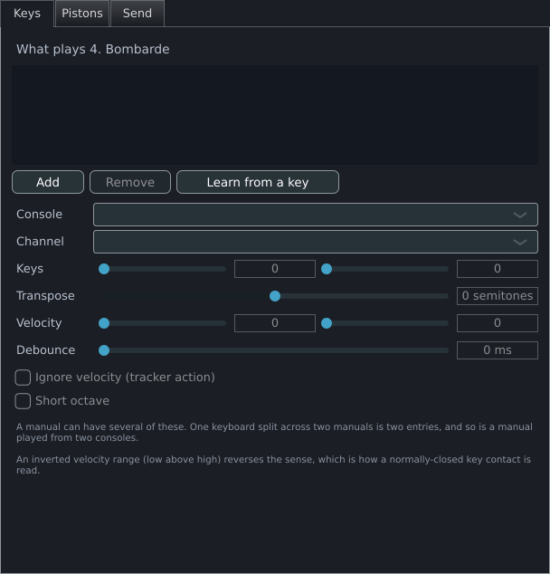
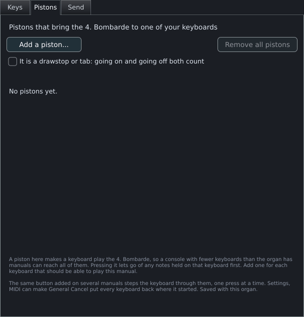
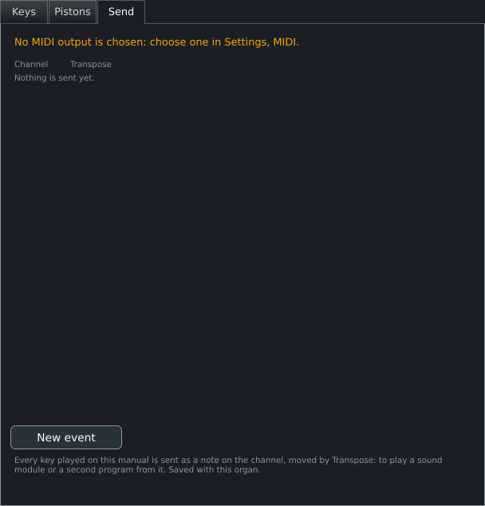
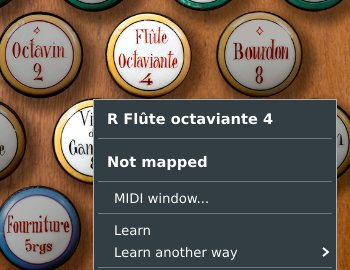
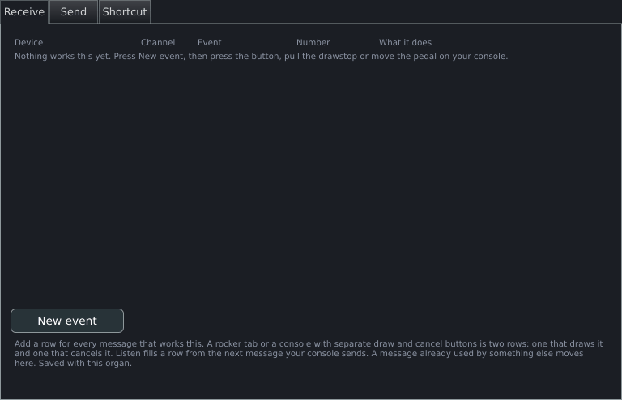
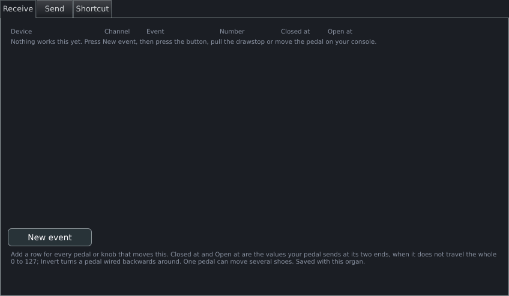
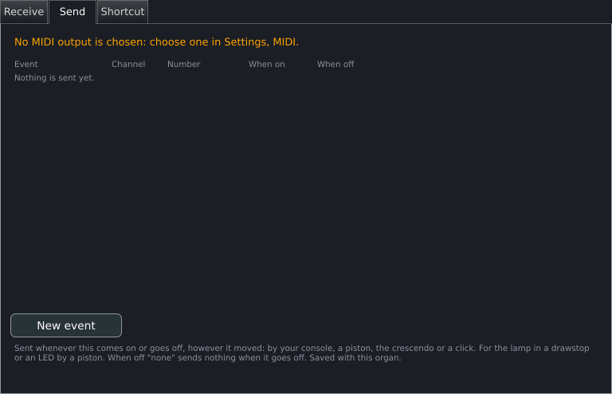
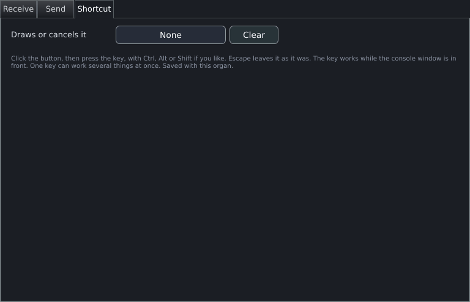

# MIDI and consoles

This page covers connecting a keyboard, a pedalboard or a full console to Masterpiece: which MIDI inputs are open, which MIDI channel plays which manual, the dialog that sets the range, transposition and velocity of one manual, MIDI learn for stops, couplers, pistons and swell shoes, what Masterpiece sends back to a console (lamps, motorised faders, key echo, text displays), and where the mapping is stored. Playing a whole organ from one keyboard is covered on [Split keyboard](split-keyboard.md).

## How a message reaches the organ

Every MIDI input that Masterpiece opens delivers its messages tagged with the input's name. A mapping can match a message on four things: the input (**Any device** or one named device), the channel (any, or 1 to 16), the message type and its number.

- **Notes on a channel that a manual claims** play that manual. A manual claims a channel through its entries in the manual dialog or through the **Keyboards** rows of the MIDI tab. A note on a channel that no manual claims reaches the manual the organ itself assigns to that channel, so a partly mapped console plays every manual.
- **Notes, controllers, program changes and system exclusive messages that a control claims** operate that control: a stop, coupler, piston, shoe or one of the program's own buttons. A claimed message operates only that control.

When several mappings could take the same message, the most specific one wins: device and channel named, then device only, then channel only, then neither.

Messages from a plug-in host, from a MIDI file played back, and from the on-screen keyboard and the clicks on drawn keys carry no input. Only mappings set to **Any device** match them.

A Universal Real Time master volume message (`F0 7F <device> 04 01 <lsb> <msb> F7`) sets the master volume with no mapping. A system exclusive message is accepted up to 256 bytes.

## MIDI inputs and outputs

The MIDI tab of General settings (**Settings > General settings > MIDI**) holds the input and output choices. The same tab is also in **Settings > Organ settings > MIDI**; both edit the same mapping.


### MIDI inputs

The **MIDI inputs** list has one tick box per input: the inputs the system reports (ALSA ports on Linux), then the inputs Masterpiece opens itself (see [Inputs that Masterpiece creates](#inputs-that-masterpiece-creates)). A ticked input plays; an unticked input is closed and its messages are dropped.

| Name | What it does | Default | Options | Takes effect |
|---|---|---|---|---|
| Input tick box | Opens or closes one input. | Ticked for every input. A console plugged in for the first time plays at once. | Ticked, unticked | At once. The unticked inputs are saved by name in `settings.mpglobal` as `midiinputoff` lines. |

Masterpiece opens its inputs at start. Connect and switch on every console before starting Masterpiece; a console connected later does not play until the next start.

#### When another program holds an input

Windows gives a MIDI port to one program at a time, so an input that another program has open cannot be opened by Masterpiece. Masterpiece keeps the input ticked and shows it as `<name>  -  in use by another program; opened when it is free`. Ticking such an input opens a message box titled `<name> could not be opened`. A timer checks every 3 seconds, and the input opens as soon as the other program lets it go; the log then records `midi: <name> is free now and has been opened`. At startup the same case is logged as `midi: <name> could not be opened (another program may be using it); it is tried again every few seconds`.

### How a console is identified

A mapping refers to an input by name, and by an identifier where the system supplies one that lasts:

| System | Identifier |
|---|---|
| Windows | The device's interface path, which includes the USB socket |
| macOS | The CoreMIDI persistent id |
| Linux | The USB socket of the card behind the ALSA port |
| Android | None; the system numbers its devices afresh at each start |

Two consoles of one model keep separate mappings. The second is stored as `<name>-1` and shown as `<name> (USB 1.1.2)` with its USB socket, or as `<name> #2` where the system gives no socket. A console that moves to another USB socket keeps its mapping when its name is unique.

### Inputs that Masterpiece creates

| Input name | Where it exists | What feeds it |
|---|---|---|
| `Split keyboard` | Every system | The [split keyboard](split-keyboard.md). It is listed in the device menus of the mapping dialogs and has no tick box. |
| `JACK MIDI` | Linux, when a JACK server is running at startup | The JACK port described below. |
| `Masterpiece` (or the name given) | macOS and Linux, when started with `--virtual-midi [name]` | A MIDI port that other programs can send to. See [Command line](command-line.md). |

On Windows no program can publish a MIDI port. A loopback MIDI driver (loopMIDI, for example) provides one; Masterpiece lists it with the other inputs.

### MIDI with JACK on Linux

Masterpiece opens a JACK client named `Masterpiece MIDI` with one input port, `midi_in` (full name `Masterpiece MIDI:midi_in`), for programs that send MIDI only through JACK. The client opens at startup when `libjack.so.0` loads and a JACK server is already running. Masterpiece never starts a server. The port appears in the **MIDI inputs** list as `JACK MIDI`.

- Messages of up to three bytes pass. System exclusive messages do not arrive through this port.
- The connections made to the port are saved when Masterpiece closes, one JACK source port per line, in `jack-connections.txt` in the data folder. At the next start Masterpiece reconnects each source; a source whose program is not running yet is retried every 2 seconds until its port appears. A connection taken away by hand stays away once it has been restored.

### MIDI output

| Name | What it does | Default | Options | Takes effect |
|---|---|---|---|---|
| **MIDI output** | The port Masterpiece sends to: lamp and fader messages, key echo to a sound module, and text displays. | **None** | **None** and every output the system reports. | At once; kept as `midioutput <name>` in `settings.mpglobal`. |

The processor holds the output port, so lamps, motorised faders, key echo and console displays work with any window open or none. The choice is kept in the general settings and the port opens again at the next start. A port that is not plugged in keeps its name and the box shows that name; the log records `midi: the output <name> is not connected; choose it again in Settings, MIDI once it is`.

### Feedback and learn options

| Name | What it does | Default | Options | Takes effect |
|---|---|---|---|---|
| **Send stop changes back to the console** | For a stop, coupler or piston that has no row on its **Send** tab, sends the stop's state back on the message that operates it, so a console that echoes the message lights the lamp. A note binding sends note on at velocity 127 and note off; a controller binding sends 127 and 0. The channel is the binding's, or 1 when the binding listens on any channel. | Off | On, off | At once; saved in `settings.mpglobal` (`midifeedback 1`, written only while on) and restored at the next start. A console that echoes what it receives can latch itself into a loop, which is why the option is off until it is switched on. |
| **General Cancel also puts the keyboards back on their own manuals** | After manual buttons have moved a keyboard to another manual (see [Pistons tab](#pistons-tab)), General Cancel restores the keyboards to the assignment the player set by hand. | Off | On, off | At once; saved in `settings.mpglobal` (`cancelresetskeyboards`). |
| **Noise filter: when learning, a key counts once held a quarter second** | While learning, a note counts only after it has been held 250 ms; a shorter note is dropped. Controllers, program changes and system exclusive messages have no length and count at once. | Off | On, off | At once; saved in `settings.mpglobal` (`learnnoisefilter`). Switch it on for a console whose contacts send stray short notes. Leave it off for pistons that send only a brief note. |

## One MIDI channel per manual

The **Keyboards** heading of the MIDI tab lists every playable manual of the loaded organ, one row each:

| Control | What it does | Default | Options |
|---|---|---|---|
| Manual name | The manual of the row. | | |
| Channel box | The channel that plays this manual. | `Default (channel N)`, the channel the organ itself assigns | `Default (channel N)`, `Channel 1` to `Channel 16` |
| Device box | The input the manual listens to. | **Any device** | **Any device** and every input known to the mapping |
| **Range, transpose...** | Opens the [dialog for the manual](#the-dialog-for-one-manual). | | |

A choice takes effect at once and is saved with the organ. Two behaviours are worth knowing:

- Choosing a channel replaces all the manual's entries in its dialog with one entry that covers the whole compass on that channel. Choosing a device replaces them in the same way, and removes the channel from any other manual mapped to the same device.
- Manuals may share a channel. A line under the rows lists them (`Shared -- Channel 2: Great, Swell`) after a change. One keyboard that plays two divisions is a coupler a player can build in this way.

Channels decide which division sounds, and the couplers work from that. A wrong channel makes a manual sound like another one.

### Default console

| Name | What it does | Default | Takes effect |
|---|---|---|---|
| **Use as default for all organs** | Stores the loaded organ's channels by role (pedal, first manual, second manual and so on) as the player's console. An organ with no channels saved starts from them. | No default: each organ starts from its own channels | At once; saved in `settings.mpglobal` (`consolechannel` lines) |
| **Clear default** | Removes the stored console. | | At once |

A line beside the buttons reads `Default for organs with no channels saved: Pedal 1; Manual 1 2; ...` or `No default: each organ starts from its own channels`.

## The dialog for one manual

Right-click a drawn manual on the console, or press **Range, transpose...** in the MIDI tab. The window is titled `<manual> - MIDI` and has three tabs: **Keys**, **Pistons** and **Send**.

### Keys tab

The tab is headed `What plays <manual>` and lists the entries that feed the manual, one row each, described as `Any device  ch any  keys C2 (36) to C7 (96)` with any transposition, `no velocity`, `short octave` and `debounce` appended. A manual can have several entries. A keyboard split across two manuals is two entries (one on each manual), and a manual played from two consoles is two entries.



Every edit takes effect at once and is saved with the organ. A new entry listens on every device and every channel until narrowed, so set **Console** and **Channel** at once.

| Name | What it does | Default | Range or options |
|---|---|---|---|
| **Add** | Adds an entry that covers the manual's own compass, as the organ states it, and the whole of MIDI (notes 0 to 127) when the organ does not state one. | | |
| **Remove** | Removes the selected entry. | | |
| **Learn from a key** | Press the lowest key and then the highest key of the range. The first press supplies the device and the channel; the two presses supply the range, in either order; the transposition is set so that the lowest key plays the first note of the manual's compass. The pressed keys do not sound. The button reads `Press the lowest key...` and then `Now press the highest key...`. Learning replaces every other entry of the manual with the one it creates. | | |
| **Console** | The input the entry listens to. | **Any device** | **Any device** and every input known to the mapping |
| **Channel** | The channel the entry listens to. | **Any channel** | **Any channel**, 1 to 16 |
| **Keys** | The lowest and highest incoming note the entry accepts, shown as a name with the note number, for example `C4 (60)`. | 0 to 127 | 0 to 127 each |
| **Transpose** | Moves every accepted note before it reaches the manual. A note moved outside 0 to 127 is dropped. Use it to bring the upper part of a keyboard that serves a short manual back into range, or to match a compass that starts somewhere other than the keyboard's. | 0 | -48 to 48 semitones |
| **Velocity** | The lowest and highest note velocity the entry accepts. When low is below high, the velocities between them scale to 0 to 127, so a keyboard that tops out at 100 reaches full velocity. When low is above high, the sense reverses: the entry accepts every velocity outside the window, which is how a normally-closed key contact is read. When both are equal, only that velocity is accepted, and it passes unchanged. | 1 to 127 | 0 to 127 each |
| **Ignore velocity (tracker action)** | Reports every key as velocity 127 when down. A velocity-switched sample set would pick the wrong layer from a velocity the keyboard never sent. | Off | On, off |
| **Short octave** | Applies a short-octave layout to the range: the lowest four keys of the range are silent, and the keys at positions 5, 7 and 9 (counting from the low key) sound 4 semitones lower. The transposition is applied afterwards. | Off | On, off |
| **Debounce** | Ignores a repeat of the same key within this time. Old contacts chatter and retrigger the pipe. | 0 ms (off) | 0 to 200 ms |


### Pistons tab

The tab is headed `Pistons that bring the <manual> to one of your keyboards`. A piston added here makes the keyboard on one MIDI channel play this manual. A console with fewer keyboards than the organ has manuals reaches every manual this way.



To add one, press **Add a piston...**, play any key on the keyboard that should play this manual (the prompt reads `Play any key on the keyboard that should play the <manual>...`), then press the piston (`Now press the piston (keyboard on channel N)...`). The list shows each piston as `Note 36 on channel 1  brings the <manual> to the keyboard on channel 2`, or `No pistons yet.`

- Pressing the piston lets go of any notes held on that keyboard first, and keys still down sound on the new manual.
- The same button added on several manuals steps the keyboard through them, one press at a time, in the organ's own manual order. One button can move several keyboards at once when it was learned for several channels.
- The pistons are saved with the organ. The assignment they change is kept for the piece; the next load starts from the assignment the player set by hand.

| Name | What it does | Default | Options |
|---|---|---|---|
| **Add a piston...** | Starts the two-step learn. | | |
| **Cancel** | Appears during the learn and ends it. | | |
| **Remove all pistons** | Removes every piston of this manual. | | |
| **It is a drawstop or tab: going on and going off both count** | For a spare drawstop or tab that sends one message going on and another going off. Each of the two counts as a press. | Off: only the press counts and the release is ignored | On, off |

The tick box is read when **Add a piston...** starts the learn, so set it first. **General Cancel also puts the keyboards back on their own manuals** (MIDI tab) restores the keyboards on General Cancel.

### Send tab

The **Send** tab of a manual sends every key played on the manual as a note to the MIDI output, for a sound module or a second program. One row sends to one channel.



The line at the top reads `Sent to <output>` or `No MIDI output is chosen: choose one in Settings, MIDI.` **New event** adds a row; the **X** button removes it.

| Name | What it does | Default | Range |
|---|---|---|---|
| **Channel** | The channel the notes go out on. | 1 | 1 to 16 |
| **Transpose** | Moves the notes by this many semitones. A note outside 0 to 127 is not sent. | 0 | -48 to 48 |

Note-on velocity is the played velocity, at least 1; the note off goes out as a note-off message on the same channel.

## MIDI learn for stops, couplers, pistons and shoes

### Right-click menus

Right-click a drawn stop, coupler, tremulant or piston on the console. The menu's section header names the object; the next lines list its current mappings, for example `Note 36 ch 3  (toggles)`.



| Item | What it does |
|---|---|
| **MIDI window...** | Opens the [MIDI window](#the-midi-window-for-one-object). |
| **Learn** | Arms a learn; the next message from a console is mapped. For a latching switch (a stop or coupler) it learns **Each press toggles**. For a switch the organ declares as a momentary button (a piston) it learns **Held while pressed**, and the item reads **Learn (held while pressed)**. |
| **Learn another way** | **Toggle: each press draws or cancels**, **Held while pressed**, **Draws it only**, **Cancels it only**. |
| **Clear mapping** | Removes every mapping of the object and saves. |

Right-click a swell shoe, wheel or slider to see **MIDI window...**, **Learn: move a pedal, knob or fader**, **Closed position: where the pedal is now**, **Open position: where the pedal is now**, **Use the pedal's whole travel** and **Clear mapping**. The two position items set the ends of the pedal's travel from the pedal's last position, so move the pedal to the position first. A box reading **Move the pedal first** appears when Masterpiece has no position yet or both ends would be equal.

Right-click a piston in the Combinations window (generals, divisionals, cancels, the setter and the sequencer buttons) to map it: **Learn**, **MIDI window...** and **Clear mapping**. The setter offers **Learn: held while pressed** and **Learn: toggles** in place of **Learn**. Right-clicking again while a learn is armed cancels it.

The program's own buttons have no object on the console to right-click. Use the learn buttons of the MIDI tab:

| Button | What it works |
|---|---|
| **Learn sequencer -**, **Learn sequencer +** | Previous and next frame of the registration sequencer |
| **Learn manual buttons...** | Opens a menu of the 16 channels, each with the manuals; choosing one starts a learn for a piston that brings that manual to the keyboard on that channel (see [Pistons tab](#pistons-tab)) |
| **Learn page -**, **Learn page +** | The previous and next console page |
| **Learn console size** | The next console layout |
| **Learn panel** | The stop-list panel on and off |
| **Learn keyboard** | The on-screen keyboard on and off |
| **Learn combinations** | The Combinations window on and off |
| **Learn transpose -**, **Learn transpose +** | The transposer, one semitone down or up |
| **Learn temperament -**, **Learn temperament +** | The previous and next temperament |
| **Temperament** with **Learn** | The temperament chosen in the box beside it, directly |
| **Learn quit**, **Learn power off** | Quits Masterpiece, or shuts the computer down; see [A console with no screen](#a-console-with-no-screen) |

Each of these learns a button that fires on the press and ignores the release. A console may have several buttons for one action (two + and two - thumb pistons): each further learn adds a button. The sequencer's first, last, ten-back and ten-forward moves, the generals and the setter are mapped from the Combinations window.

The line at the bottom of the MIDI tab reads `N binding(s)`, followed by `LEARNING: move a control now` while a learn is armed.

### Message types

| Message | Number | Counts as a press when | Release |
|---|---|---|---|
| Note | 0 to 127; for a shoe also **Any note** | Velocity 64 or more | Note off, or note on with velocity 63 or less |
| Controller | 0 to 127 | Value 64 or more | Value 63 or less |
| Program change | Shown from 1 | Every time it arrives | None |
| System exclusive | Identified by all of its bytes; shown as **Learned message** | Every time it arrives | None |

The press threshold is the middle of the binding's value window (above 63 for the default window of 0 to 127). A console that sends 64 for a press registers. Each distinct system exclusive message is one button; a console that sends its pistons this way maps each piston by learning it.

One message operates one object. Learning a message that another object already uses moves it to the new object. The exceptions are shoes, which share a controller (one pedal can move several swell boxes, and learning the same controller for a second shoe keeps the first), and manual buttons, which share a message to step a keyboard through several manuals. A shoe learns only from controllers; a key pressed while a shoe's learn is armed plays as usual.

### What a stop does with each message

| Behaviour | MIDI window label | Right-click label | What happens |
|---|---|---|---|
| Toggle | **Each press toggles** | **Toggle: each press draws or cancels** | A press flips the switch from its state at that moment. The release is ignored. After a cancel or a click has moved the stop, the next press flips it from its actual state. A piston toggled this way is pressed and released on each press. |
| Momentary | **Held while pressed** | **Held while pressed** | The switch is on while the button is down and off on the release. This is a piston's behaviour. On a latching stop, a program change or system exclusive message (which have no release) leaves the stop drawn. |
| Engage only | **Draws it** | **Draws it only** | The press draws the switch; the release is ignored. |
| Disengage only | **Cancels it** | **Cancels it only** | The press cancels the switch; the release is ignored. |

A rocker tab, or a console with separate draw and cancel buttons per stop, is two rows: one **Draws it** and one **Cancels it**. Learning **Draws it only** leaves an existing **Cancels it only** alone, and the reverse, so both can be taught in turn. Any other learn replaces what the object had.

A new row in the MIDI window starts as **Each press toggles** for a latching switch and **Held while pressed** for a momentary one. Pistons and program buttons other than switches start as **Fires when pressed**. Learning is saved within a moment of the message arriving.

### Shoes, wheels and sliders

A shoe is operated by a controller value, or by the velocity of a note (a sequencer can write the swell into the velocities of the notes it plays; the note-off does nothing). The binding maps the incoming range onto the control's whole travel.

| Name | What it does | Default | Range |
|---|---|---|---|
| **Closed at** | The incoming value at which the shoe is closed. | 0 | 0 to 127 |
| **Open at** | The incoming value at which the shoe is open. | 127 | 0 to 127 |
| **Invert** | Reverses the sense, for a pedal wired backwards. | Off | On, off |

A console's shoe seldom sends the whole 0 to 127, so set the two ends to the values the pedal actually sends. Values outside the window clamp to its ends. Only the span matters; the order in which the two values are entered has no effect, and **Invert** reverses the sense. **Closed position: where the pedal is now** and **Open position: where the pedal is now** in the right-click menu fill in the values from the pedal's last position and set **Invert** when the closed end is the larger value. A program change or system exclusive message arrives with the value 127 and drives the shoe fully open.

## The MIDI window for one object

**MIDI window...** opens a window titled `<object> - MIDI` with the tabs **Receive**, **Send** and **Shortcut**. The program's own buttons (the player's generals, divisionals, cancels, the setter, the sequencer) have no **Send** tab, because they light nothing on a console. Every edit takes effect at once and is saved with the organ; the program's own buttons are saved in the console file (see [The MIDI map files](#the-midi-map-files)).

### Receive tab

One row per message that operates the object. **New event** adds a row and starts listening at once. A row whose message is not set yet is skipped.





| Column | What it does | Default | Options |
|---|---|---|---|
| **Device** | The input the message must come from. | **Any console** | **Any console** and every input known to the mapping |
| **Channel** | The channel of the message. | **Any** | **Any**, 1 to 16 |
| **Event** | The message type. Shows **Listen...** until a message is set. | | **Note**, **Controller**, **Program change**, **System exclusive** |
| **Number** | The note (shown as a name with its number), controller number (0 to 127) or program number (1 to 128). For **System exclusive** it shows **Learned message**, which only **Listen** can set. For a shoe with **Note** it offers **Any note**, which takes the velocity of every note on the channel. | | |
| **What it does** | The behaviour (see the table above). For a stop, coupler, tremulant or switch: **Each press toggles**, **Held while pressed**, **Draws it**, **Cancels it**. For the program's pistons and cancels: **Fires when pressed**. For the setter: **Fires when pressed** and **Each press toggles**. | Follows the switch, see above | |
| **Closed at**, **Open at**, **Invert** | Shoes only; see above. These replace **What it does**. | | |
| **Listen** | Takes the next press from a console and fills the row with it. The button reads **Listening...** until a message arrives; press it again to cancel. The press is taken, not acted on, and its release is swallowed. | | |
| **X** | Removes the row. | | |

Add a row for every message that operates the object. A message already used by something else moves here.

### Send tab

One row per message that Masterpiece sends to the MIDI output when the object changes. The line at the top reads `Sent to <output>` or `No MIDI output is chosen: choose one in Settings, MIDI.`



For a stop, coupler or piston, the message goes out whenever the object comes on or goes off, however it moved: the console, a piston, the crescendo or a click. For a lamp in a drawstop or an LED by a piston. For a shoe, the message goes out whenever the shoe moves. When the list changes, Masterpiece sends the present state of every lamp, which a console needs when it is set up.

**New event** adds a row. A new row starts from the object's first receive row (type, number and channel), because a lamp usually answers on the message that operates the stop; a shoe row starts as a controller.

| Column | What it does | Default | Options |
|---|---|---|---|
| **Event** | The message type. | The type of the receive row, else **Note** | **Note**, **Controller**, **Program change**, **System exclusive** |
| **Channel** | The channel it goes out on. | The receive row's channel, else 1 | 1 to 16 |
| **Number** | The note, controller or program number. | The receive row's number, else 0 | As for **Number** above |
| **When on** (stop) | The velocity (note) or value (controller) sent when the stop comes on. | 127 | 0 to 127 |
| **When off** (stop) | The velocity or value sent when it goes off. Note on at velocity 0 is the usual lamp off. | 0 | **none**, 0 to 127 |
| **Closed**, **Open** (shoe) | The values sent at the two ends of the shoe's travel. A shoe is sent across them, so a fader that wants 0 to 100 gets 0 to 100. | 0 and 127 | 0 to 127 |

With **none** in **When off**, nothing goes out when the stop goes off. A program change has no off: it sends its number when the stop comes on and nothing when it goes off. For a shoe, **Program change** sends the scaled value as the program number. **System exclusive** is listed but is received only; a row of that type sends nothing.

### Shortcut tab

A key of the computer keyboard that operates the object.



Click the key button (it reads **None** or the current key), then press the key, with Ctrl, Alt or Shift if wanted. The button reads **Press a key...** while it waits; Escape leaves the setting as it was. **Clear** removes the key. The key works while the console window is in front. One key can operate several objects at once. Saved with the organ.

| Name | What it does | Default | Range |
|---|---|---|---|
| **Draws or cancels it** (stops) | Flips a latching switch; fires a piston as one click would. | **None** | Any key |
| **Opens it** (shoes) | Moves the shoe up by the step. | **None** | Any key |
| **Closes it** (shoes) | Moves the shoe down by the step. | **None** | Any key |
| **Each press moves it by** (shoes) | The size of one step on the 0 to 127 travel. | 8 | 1 to 64 |

A stored key operates organ switches (stops, couplers, tremulants and the organ's own pistons) and shoes. The tab also appears for the player's generals, divisionals, cancels, setter and sequencer buttons; a key stored there has no effect.

## Sending to a console

Three things send to the MIDI output: the rows of the **Send** tabs (lamps, faders, key echo), the echo option of the MIDI tab, and the text displays. All of them need a **MIDI output**.

### Console displays

Many consoles have text displays on the jamb that a system exclusive message drives. The **Display** tab of General settings (**Settings > General settings > Display**, heading **Console display**) describes one display and what it shows.


Each message is `F0 <prefix> <display number> <line number> <text> F7`: the prefix bytes, one byte for the display, one byte for the line (counting from 0), and the line's text as ASCII padded with spaces to the line width. The prefix, display number and line width belong to the console hardware, so the tab asks for them.

| Name | What it does | Default | Range or options |
|---|---|---|---|
| **Drive a console display** | Switches the display on. | Off | On, off |
| **Display number** | The display's number on the console, sent as one byte. | 0 | 0 to 15 |
| **Characters per line** | The line width. Longer text is cut, and shorter text is padded so it overwrites the previous tail. | 32 | 16, 20, 32, 40 |
| **Sys-ex prefix (hex)** | The bytes after `F0`, in hexadecimal, separated by spaces. | `7D` | 1 to 8 bytes, each 00 to 7F. An invalid entry falls back to `7D`. |
| **Lines** | Four boxes, one per line, choosing what the line shows. | **Organ**, **Temperament**, **Pitch**, **Crescendo** | **(blank)**, **Organ**, **Temperament**, **Pitch** (`A=440.0 Hz`), **Transpose** (`+2`, `0`, `-3`), **Stops drawn** (a count), **Crescendo** (the step; 0 when the shoe is closed), **Combination set** |
| **Send to display** | Sends all four lines again, changed or not. Use it after connecting a console during a session. | | |
| **What the display reads** | A preview of the four lines, with bars at the line width so a cut is visible. | | |

`7D` is the manufacturer id that the MIDI specification reserves for non-commercial use; it is the default because a console's own prefix is not known. Only lines whose text changed are sent, checked four times a second. Letters with accents are written with the accent removed (`ä` as `ae`, `ß` as `ss`, `Kraków` as `Krakow`), because system exclusive carries seven bits per byte and a byte above 7F would end the message. Characters with no Latin equivalent become `?`.

Changes in this tab take effect at once. The setup is kept in `settings.mpglobal` as `lcd <on> <display> <width> <line1> <line2> <line3> <line4> <prefix>` and is read again at the next start. The main window sends the display four times a second whether or not the tab is open, so the display follows the organ with any window open or none; the **MIDI output** must be chosen. The **Transpose** line shows the transposition as `+2`, `0` or `-3`, and the **Combination set** line shows the name of the combination set in use (`(default)` for the default set).

### A console with no screen

The MIDI tab has three things for a console that is turned on and played without a monitor.

- **Ready lamp**: a note or a controller, on a channel, sent to the **MIDI output**. The lamp is lit (note on at velocity 127, or the controller at 127) once an organ is loaded and playable, blinks once a second while an organ loads, blinks four times a second while a quit or power-off button is held, and is dark with no organ (note off, or the controller at 0). Kept in `settings.mpglobal` as `readylamp <note|cc> <channel> <number>`.
- **Learn quit** and **Learn power off**: buttons that save and quit Masterpiece, or save, quit and shut the computer down. So that a noisy input learned for one cannot turn a console off at every start, a button is obeyed only once Masterpiece has run two minutes, and only when it is held three seconds; letting go sooner does nothing. A button whose message has no release (a program change or a system exclusive message) is pressed twice within two seconds. A press before the two minutes is written to the log with the time left.
- **Temperament** with **Learn**: a button for one temperament of the list.

## The MIDI map files

A mapping is stored in the player's data folder, never inside a sample set:

| System | Data folder |
|---|---|
| Windows | `%APPDATA%\Masterpiece` |
| macOS | `~/Library/Masterpiece` |
| Linux | `~/.config/Masterpiece` |

Two files in the `midi` folder of the data folder hold it:

| File | Holds |
|---|---|
| `midi/<organ>.mpmidi` | What belongs to this organ: the mappings of its stops, couplers, tremulants and shoes, the entries of its manuals, the manual buttons, the divisionals, and the sends and shortcuts of those objects. |
| `midi/console.mpmidi` | What belongs to the player's console on every organ: the sequencer, the generals and general cancel, the setter, the page, layout, panel, keyboard, combinations, transpose and temperament buttons, and their sends and shortcuts. |

`<organ>` is the organ's name followed by its unique organ id, for example `Nancy-12345`. An organ that declares no id uses its name and a hash of its path. Renaming or moving the sample set keeps the file.

Every change in a MIDI dialog is saved at once, and a learn is saved within a moment of the message arriving. **Save mapping** in the MIDI tab writes both files. **Clear mapping** removes every binding, send and shortcut from memory and keeps the manual entries; the files change at the next save.

When an organ loads, its `.mpmidi` file is read, then `console.mpmidi`. An organ with no file starts from the default console and the organ's own channels. A mapping carries over to another organ or computer by copying the file to the `midi` folder under the other organ's file name; devices travel by name.

When an organ loads, Masterpiece repairs a file that names a manual the organ lacks, or lists an identical manual entry twice. It logs `midi: repaired the saved mapping` and keeps the original beside the new file as `<organ>.mpmidi.before-repair`.

The files are plain text, one record per line, with `#` for comments. A binding line has these fields:

```
<kind> <channel> <number> <target> <id> <latching> <invert> <trigger> <closed> <open> <device> [<identifier>]
```

| Field | Values |
|---|---|
| `kind` | `note`, `cc`, `pgm`, `sysex` |
| `channel` | 0 for any, else 1 to 16 |
| `trigger` | `toggle`, `momentary`, `on` (draws it), `off` (cancels it) |
| `device` | `any`, or the input's name with each space written as `_` |

Other lines start with `manual` (a manual entry: manual id, channel, low key, high key, transpose, low velocity, high velocity, ignore velocity, short octave, debounce, device), `send` (target, id, kind, channel, number, low, high) or `shortcut` (target, id, step, key). Edit through the dialogs; a line that cannot be read is skipped and the rest loads.
