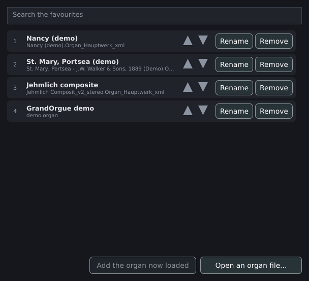

# Phones and tablets

This page describes Masterpiece on Android, iPhone and iPad: how the window is laid out for a touch screen, how a sample set reaches the device, how audio and MIDI work there, what the device's memory allows, and where the app differs from the desktop program. For the files and the installation procedure, see [Installing Masterpiece](installing.md).

The mobile app is the standalone program, built from the same source as the desktop one. It plays the same Hauptwerk-format sample sets and GrandOrgue organs through the same engine. The plugin formats, the command line and the test tools have no mobile build.

## The window

### Screen and orientation

The console fills the screen with no title bar and no resize border. The window has a fixed size and keeps no remembered place.

| System | Screen handling |
|---|---|
| Android | Full-screen mode. The system bars are hidden until a swipe from the screen edge brings them back. |
| iPhone and iPad | The window covers the whole scene, and the console sits inside the display's safe area, clear of rounded corners, the home indicator and, since iPadOS 26, the window controls drawn over the top-left corner. The area is recalculated when the iPad turns or its window changes size. The status bar is hidden and the app requires full screen. |

The iPhone and iPad builds are landscape only (left and right). The Android manifest sets no orientation.

The console picks its layout from the shape of the room it has. In a window taller than wide it shows the organ's portrait layout, when the set ships one; in a wider window it shows the main layout. A layout chosen by hand holds until the shape changes. The **layout** box in the top bar appears only when the organ has more than one layout, and names a portrait layout as such.

### Touch sizes

Controls are enlarged for a finger. The code states the target as about 48 logical pixels, the size both platforms recommend.

| Element | Phone or tablet | Desktop |
|---|---|---|
| Title bar of a panel or dialog | 48 | native |
| Row of a popup menu | at least 48, font 20 | system default |
| **File** and **View** buttons | 84 wide | 70 |
| **Settings** button | 98 wide | 84 |
| Sequencer step buttons (previous, next) | 44 wide | 30 |
| **Set** button | 64 wide | 56 |
| **Panic** and **Save state** buttons | 46 wide | 38 |
| Favourites row | 56 high | 46 |
| **Rename** and **Remove** buttons in the favourites | 86 wide | 74 |
| Search field and bottom bar of the favourites window | 44 high | 34 |
| Toolbar of a panel | 44 high | 34 |
| Stop cell in a panel | 64 high, columns at least 150 wide | 58 high, 170 wide |

The top bar gives the menus and the volume fader a row of their own when the width left after the buttons on the right is below 350 pixels.

### Panels and dialogs

Every panel and dialog opens inside the main window, in a layer over the console. One window is on screen at a time, filling the screen, with a 48-pixel title bar and a close button within reach. Dialogs have a fixed size, and a dialog keeps no remembered size. The windows that float over the console on a desktop (**Recorder**, **Combinations**, **Split keyboard**, and a page opened in its own window) open the same way, as full-screen panels.

The pop-out button of a panel is hidden, and panels cannot be detached into windows of their own.

Menus and alerts keep windows of their own. On Android, the back button closes the front panel as Escape does on a desktop. The load progress dialog stays open; back does nothing while it shows.

### Playing on the screen

The drawn console takes touches: drawstops, pistons, shoes and keys. **View > Keyboard** shows the on-screen keyboard, with a selector for the manual it plays when the organ has several. See [Playing](playing.md) and [A tour of the window](window.md).

### First start

The first-run wizard appears on a phone or tablet as on a desktop, as a panel. See [Installing Masterpiece](installing.md#first-start).

## Getting sample sets onto the device

### What opens

A phone or tablet opens an organ from one package: a RAR archive (`.rar`, RAR 4 or 5, including solid and multi-part sets) or a GrandOrgue `.orgue` package. The file chooser is titled **Choose an organ package** and filters `*.rar` and `*.orgue`. A loose installation of thousands of files is slow to bring onto the device and slow to read through the system's document layer, so loose definitions (`.Organ_Hauptwerk_xml`, `.organ`) stay out of the chooser. Masterpiece reads the samples from the package where it is. See [Opening an organ](opening.md).

The favourites window (**File > Open...**) works as on a desktop. Its button **Open an organ file...** opens the chooser. The last organ and the favourites reopen at the next start when their access is still granted.

### Android

Android hands the app a document, which has no path. Masterpiece handles it in one of two ways.

| Case | What happens | Disk space used |
|---|---|---|
| The document is a regular, seekable file on the device's storage | It is read where it is. The system opens a file descriptor for it, and a link named like the package, in the `Linked` folder of the app's data folder, points at that descriptor. The archive reader asks the system for a fresh descriptor each time it opens the package. | none |
| The provider streams the document (a cloud drive) and cannot seek | The package is copied into the `Organs` folder of the app's data folder. A progress window titled **Copying the organ** shows the bytes copied of the total and has a **Cancel** button. A copy with the same name and size that is already there is reused. | the size of the package |

During a copy the file carries the suffix `.part` and is renamed at the end, so a cancelled or failed copy never looks finished.

For a package read in place, Masterpiece asks the system for read access that survives restarts and keeps the list of documents in `Linked/documents.txt`. At the next start it makes the links again, so the last organ and the favourites reopen. A document that has gone, or whose access was withdrawn, is dropped from the list.

The picker cannot always filter by extension, so the choice is checked after it. Alerts titled **Organ not copied** report a failed import:

| Message | Cause |
|---|---|
| **This document has no name.** | The provider gave no file name. |
| **Masterpiece opens an organ from its package: a .rar or .orgue file.** | The chosen file has another extension. |
| **The document could not be read.** | The system gave no input stream. |
| **There is no room to copy it.** | The target file could not be opened for writing. |
| **The copy stopped: the device may be full.** | A write failed. |
| **The copy could not be finished.** | The final rename failed. |

The app declares `READ_EXTERNAL_STORAGE` up to Android 12L (API level 32) for reading shared storage by path.

Android picks one document at a time and reads or copies that document alone. The question for the folder of a multi-volume set exists on iPhone and iPad only.

### iPhone and iPad

The Files app lends a picked document through a security-scoped URL. Masterpiece starts that access and holds it until the program ends, and the package is read where it is. Nothing is copied, so a package of many gigabytes takes no extra space. The loans are remembered in `held-documents.txt` in the app's data folder, and lent again at the next start with no new pick. A document that has gone, or whose loan was withdrawn, is dropped.

The build enables file sharing and the document browser, so a package can also be copied into the app's own `Documents` folder through the Files app.

| Message | Cause |
|---|---|
| **Could not open the organ**: **The Files app did not lend this document to Masterpiece.** | The system refused the loan. |
| **The rest of &lt;file&gt;**, with **Choose the folder** and **Cancel** | The package is one volume of a multi-volume set. **Choose the folder** opens a chooser titled **Choose the folder that holds the set**; the folder and everything in it are lent, and the set loads from there. |

The **Log** tab of **General settings** lists the loans under **Documents lent by the Files app**, with a mark for each one that cannot be read now.

## Audio and MIDI

### Audio

Audio goes through the device's audio system. On Android the low-latency interface needs Android 8.0 (API level 26), the minimum of the app. The iPhone and iPad app declares background audio: the organ keeps sounding when the screen locks or another app comes to the front.

The first start picks the default output, a rate of at least 44.1 kHz and a buffer of about 10 ms; see [Installing Masterpiece](installing.md#first-start). **Settings > Audio and MIDI...** opens the **Audio** tab of the general settings. See [Audio, room and mixer](audio.md).

The engine renders with the NEON vector unit on 64-bit ARM, so the **Faster audio engine** box applies on a phone as on a Raspberry Pi. The Android emulator (`x86_64`) uses AVX2 or SSE2.

### MIDI

At the start the app opens every MIDI input the system reports, except those switched off earlier, and tries again every 3 seconds for an input that failed to open. The wizard's **Your keyboards** step lists them.

| System | Inputs |
|---|---|
| Android | The system's MIDI interface (Android 6.0 and later; the app needs 8.0). The manifest declares USB host and Bluetooth LE as optional features and requests the Bluetooth permissions. The app lists the inputs the system reports and has no pairing dialog of its own. |
| iPhone and iPad | The inputs CoreMIDI reports. The app has no pairing dialog of its own. |

The program remembers an input between sessions by a lasting identifier. On iOS it is the CoreMIDI identifier. Android numbers its devices afresh at each start, so there Masterpiece knows an input by its name, and two keyboards of the same model look alike.

A virtual MIDI input of Masterpiece's own (`--virtual-midi`) exists on macOS and Linux only. The JACK audio and MIDI connections exist on Linux only.

MIDI learn is described in [MIDI and consoles](midi.md).

## Memory

Phones and tablets have no memory setting of their own. The same limit and the same loading choices apply as on a desktop, with values that make a small device workable.

### The limit

**Memory limit for samples** on **Settings > Organ settings... > Loading** is the most memory the samples and the voice pool of one organ may take. Its default is **Default: 80% of memory**, computed from the device's total memory with a floor of 512 MB. The other choices are 50%, 60%, 70% and 90% of memory. It takes effect at the next load.

A load that would pass the limit stops with an alert titled **Not enough memory for this organ** and shows the console without sound, so that **Organ settings** can be opened. A load that reaches the limit part-way plays with some stops or notes silent and says so in an alert titled **Only part of this organ fits**. **Stops and perspectives** shows **About &lt;size&gt; for this choice (the limit is &lt;size&gt;)** for the stops kept, in red when the choice passes the limit.

The limit is measured against the device's total memory. A phone or tablet ends a backgrounded app whenever it needs the memory, and the program treats a backgrounded session as ended cleanly, so the crash guard reads the end as a normal quit. With **Reopen the last organ when Masterpiece starts** on, the organ reopens at the next start.

### What fits

The code gives no per-device figure. The measured sizes of a large organ are in [Memory, loading and streaming](memory.md); Friesach, a 44-stop set of 17 GB on disk, takes these amounts of sample memory:

| Memory profile (on **Loading**) | Samples in memory |
|---|---|
| **Best quality - 24-bit, hold everything** (24-bit) | 16.2 GB |
| **Recommended - 16-bit, stream releases** | 4.65 GB |
| **Smallest - 16-bit mono, stream releases** | 2.33 GB |

On a phone or tablet, start from **Smallest - 16-bit mono, stream releases**, and leave out the stops and perspectives that the repertoire leaves unused (**Stops and perspectives**). See [Small, medium and large organs](sizing.md).

The voice pool counts against the limit. With streamed release tails each voice holds a ring buffer of 2 seconds, 768 KB at 48 kHz, and the default pool is 1,536 voices, about 1.1 GB. With streaming off, the default pool is 725 voices per processor thread, at least 1,536. **Polyphony limit** on the same tab lists the memory of each pool size in its choices (256, 512, 768, 1,024 voices and more); a smaller pool leaves more of the limit to the samples, and thins a full registration. The code sets no separate pool default for phones.

### The sample cache

The sample cache stores the decoded samples so that the next load of the same organ reads one file. Its default folder is `cache` in the app's data folder; **Cache folder** on the **Loading** tab shows the path, **Choose...** picks another folder through the system chooser, and **Default** returns to the standard one. The cache is as large as the samples held in memory. **Sample cache** offers **One cache, replaced as organs change** (the default), **One cache per organ (uses more disk)** and **Off**; **Off** frees the storage and makes every load decode the package again. **Save the sample cache** chooses **Before the organ plays** or **In silence, while it plays**; the second writes the cache at the lowest background priority.

On Android, iPhone and iPad the `Masterpiece` folder lies in the app's own application-data folder. **Run the checks** on the **Log** tab lists the cache folder and the size of the cache files.

## Differences from the desktop program

| Area | Phone or tablet | Desktop |
|---|---|---|
| Formats opened | `.rar` and `.orgue` packages | Definitions, `.organ` files, `.rar` and `.orgue` packages |
| File chooser | **Choose an organ package** | **Choose an organ definition file** |
| Windows | One full-screen window; panels, dialogs and floating tools open in a layer over the console | Separate windows, resizable, positions remembered |
| Panels | Cannot be detached | Pop-out button and **A page in its own window** |
| Window title bar | None | Native title bar with the version and organ name |
| Plugins | None | VST3, LV2, Audio Unit |
| Command line | None | See [Command line](command-line.md) |
| Virtual MIDI input, JACK | None | macOS and Linux |
| Log tab | **Send the report and the log** opens the share sheet; no **Open the log folder** | **Open the log folder**; no share button |
| Load warnings | An alert with **OK** only | An alert with **Show the log** |
| Favourites search | The field takes no focus when the window opens | The field takes the keyboard focus |
| Folder of the last **Open...** | Forgotten | Remembered |

## Reporting a problem

**Settings > General settings... > Log** shows where the log is kept. **Run the checks** reports the folders Masterpiece writes to, the audio, the organ and its files, and on iOS the documents lent by the Files app. **Copy the report** puts the checks and the last 200 lines of the log on the clipboard. **Send the report and the log** opens the share sheet with `masterpiece-report.txt`, `masterpiece.log` and `masterpiece.previous.log`. See [Troubleshooting and caveats](troubleshooting.md).

