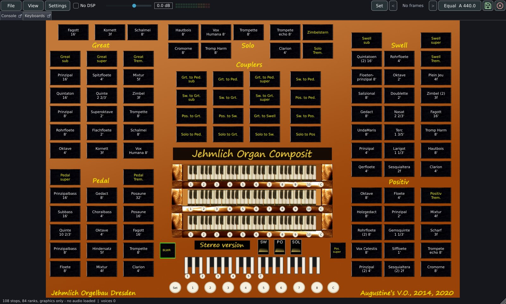
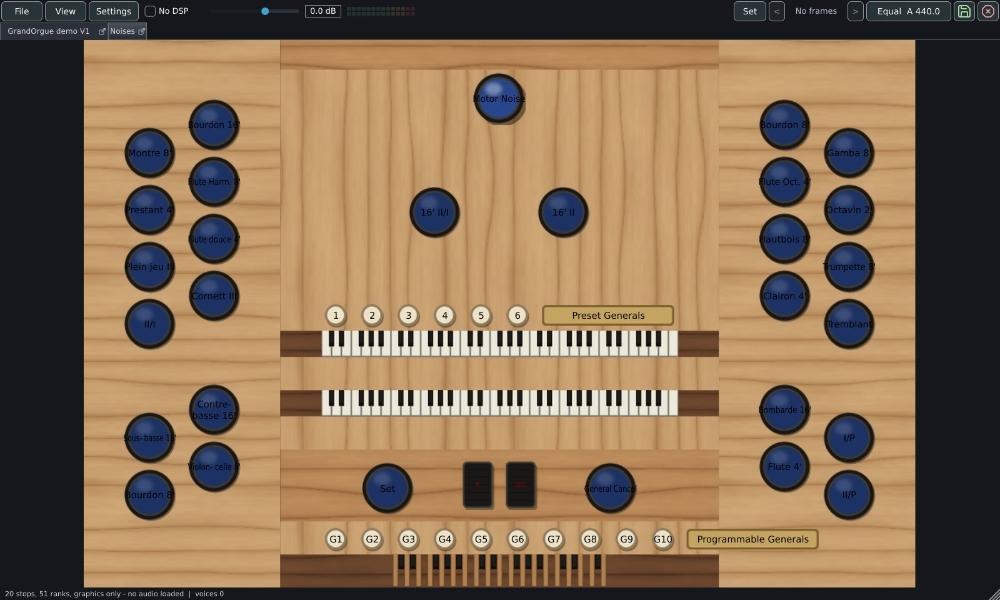

# Opening an organ

This page covers every way an organ reaches the console: the file formats Masterpiece reads, organs installed in folders, organs played straight from their packages, sample sets that live in several places, demo sets, licences, the favourites window, and the load itself with its progress dialog. It tells you which file to pick, where Masterpiece looks for the rest of a set, and what the log says when something is missing.

Settings that decide how much memory an organ takes, and whether release tails stream from disk, are chosen at load time and are described in [Memory, loading and streaming](memory.md).

## Formats

| Kind | Files | Notes |
|---|---|---|
| Hauptwerk-format organ, full | `.Organ_Hauptwerk_xml` | Read directly. |
| Hauptwerk-format organ, compact | `.CustomOrgan_Hauptwerk_xml` | Read directly. Compact files write whole numbers in scientific notation (`1.27e+2`); Masterpiece reads them as the whole numbers they stand for. |
| Hauptwerk-format organ, older spelling | `.Organ.Hauptwerk.xml`, `.CustomOrgan.Hauptwerk.xml` | Same contents as the files above, named with dots. |
| Composite organ | A Hauptwerk-format definition whose samples come from several sample sets | See [Composite organs](#composite-organs). |
| GrandOrgue organ definition | `.organ` | Converted in memory as it loads, console included. The converted definition is never written to disk. |
| GrandOrgue package | `.orgue` | Read in place. Packages that depend on other packages need those beside them. |
| Hauptwerk-format package | `.rar`, for example `Name.CompPkg.Hauptwerk.rar` | Read in place. See [Playing from packages](#playing-from-packages). |

GrandOrgue files may be encoded in UTF-8 or in the Western code page of their author; Masterpiece detects which. A GrandOrgue organ has no organ id, so Masterpiece derives one from a hash of the file: the same file is always the same organ and keeps its own settings.

### Sample files

| Format | Notes |
|---|---|
| WAV | Read with the file's own loop and release markers. |
| WavPack | Recognised by the content of the file, whatever its extension. GrandOrgue sets often name WavPack files `.wav`. The loop, cue and pitch chunks inside are read as they are in a WAV file. |
| `.hbw`, `.hbx` | Encrypted. Never decoded. See [Encrypted samples](#encrypted-samples). |

Samples may have any sample rate. They are held at the rate they were recorded in unless the **Sample rate** option on the **Loading** tab of Organ settings is set to **48 kHz** or **44.1 kHz**; a file whose rate differs from the chosen one is then converted at load time with Lagrange interpolation, and its loop points and release marker move with the audio. The option takes effect at the next load. See [Memory, loading and streaming](memory.md).

## Ways to open an organ

### File > Open...

**File > Open...** opens the [favourites window](#the-favourites-window). When the favourites list is empty, it opens the file dialog directly.


The **File** menu holds three items:

| Item | What it does |
|---|---|
| **Open...** | The favourites window, or the file dialog when there are no favourites. |
| **Other versions of this organ** | A submenu, present only when the loaded organ has more than one definition beside it. See [Other versions of an organ](#other-versions-of-an-organ). |
| **Recorder...** | Opens the recorder window. |

### The file dialog

The file dialog is titled **Choose an organ definition file** (**Choose an organ package** on phones and tablets). It lists these patterns:

`*.Organ_Hauptwerk_xml`, `*.CustomOrgan_Hauptwerk_xml`, `*.Organ.Hauptwerk.xml`, `*.CustomOrgan.Hauptwerk.xml`, `*.organ`, `*.rar`, `*.orgue`

On phones and tablets the list is `*.rar` and `*.orgue`, and any other file is ignored. The dialog starts in the folder the last organ was chosen from; that folder is stored as `openfolder` in `settings.mpglobal`. On macOS the dialog also lets you navigate into tagged folders from search results.

### Other ways

| Way | Platforms | Behaviour |
|---|---|---|
| Command line | Desktop | `Masterpiece <file>` or `Masterpiece --odf <file>` opens the file at start. A file named on the command line takes precedence over **Reopen the last organ when Masterpiece starts**. See [Command line](command-line.md). |
| Open with | Windows, Linux, macOS | The installer registers `.Organ_Hauptwerk_xml`, `.CustomOrgan_Hauptwerk_xml`, `.organ`, `.orgue` and `.rar` for the Open with list. On Windows Masterpiece appears in that list and is never made the default, so a `.rar` keeps the program that already opens it. On Linux the desktop file declares the same types. On macOS the application declares the same extensions. On macOS, a file chosen with Open With while Masterpiece is running loads in the running window. On Windows and Linux each launch starts a separate instance, which loads the file. |
| Reopen at start | Standalone application | See [Reopening the last organ](#reopening-the-last-organ). |
| First-run wizard | Standalone application | The last step has a **Choose an organ...** button that opens the file dialog. |

Masterpiece does not accept files dropped on its window.

The plugins have no startup reopen and store no organ in the host's project state.

## Organs installed in folders

An installed Hauptwerk-format organ has this layout:

```
<root>/OrganDefinitions/<name>.Organ_Hauptwerk_xml
<root>/OrganInstallationPackages/000123/...
```

The definition names its sample files relative to a package folder. The folder is `OrganInstallationPackages/` plus the package id padded to six digits (`000123`). Masterpiece takes the organ's root as the grandparent of the definition file. Names are matched without regard to case, and backslashes in definitions are read as folder separators on every platform.

When a set was reorganised with symbolic links, and the folder derived from the definition holds no `OrganInstallationPackages`, Masterpiece looks in the sample libraries it knows. A library is a folder that holds an `OrganInstallationPackages` folder. The library that holds the packages the definition names is used, and the log says `load: packages found in a known library`.

Libraries come from two places:

- `Hauptwerk/HauptwerkSampleSetsAndComponents` in the home folder, when it holds an `OrganInstallationPackages` folder.
- The root of every organ that has loaded with samples. Each is stored as a `library` line in `settings.mpglobal`.

Libraries are collected automatically. Masterpiece has no setting that lists them by hand.

For a layout that cannot be worked out from the path, the **Organ folder** row on the **Loading** tab of Organ settings names the folder that holds `OrganInstallationPackages`. It is stored with the organ, takes effect at the next load, and has **Choose...** and **Default** buttons. By default it reads `From the definition (<folder>)`.

## Playing from packages

A sample set is published as one or more RAR archives that hold the tree of an installed organ: `OrganDefinitions/` and `OrganInstallationPackages/<id>/`. Masterpiece reads these archives in place. It never needs the disk space of an unpacked set.

### What is unpacked and what stays

At the first open of a set of packages, Masterpiece reads the file lists and unpacks every file that is not audio into a folder of its own. Those files are the organ definitions, the console artwork and the package definitions. Image editor sources (`.psd`, `.psb`, `.xcf`) and encrypted files are skipped. The samples (`.wav`, `.wv`, `.flac`, `.aif`, `.aiff`, `.ogg`) are never written to disk. They are decompressed into memory during the load, one pass per archive, in archive order.

Because the samples have no file of their own, a packaged organ keeps them resident in memory. Release tails of such an organ do not stream from disk. See [Memory, loading and streaming](memory.md).

The unpacked files live in `Packaged/<identity>` inside the Masterpiece folder in the user's application data (see [Files and folders](files.md)). The identity is a hash of the archives' lower-case file names and sizes, so the same packages open the same folder wherever they are kept. The folder holds:

| File | Purpose |
|---|---|
| The unpacked tree | Definitions, artwork, package definitions. |
| `archive-index.txt` | The list of files in the archives, so a solid archive is walked once. |
| `masterpiece-archive.txt` | The path of the archive the organ came from. Written last; a folder without it is an unpack that did not finish. |
| `chosen-definition.txt` | The definition last chosen from this set of packages. |

A later open of the same packages logs `archive: already unpacked in <folder>` and skips the unpacking. A set copied or moved elsewhere is recognised by file name and size; its samples are read from the new place from then on, and the log says `archive: now read from <path> (was <path>)`.

> [!NOTE]
> Reading a RAR archive runs front to back. A solid archive has to be decompressed from the start to reach any file, so the first open of a large solid set takes the longest. The progress dialog shows **Reading the archive** and **Extracting definitions and artwork** during this step.

### Package names Masterpiece recognises

Open any one file of a set. Masterpiece finds the others in the same folder.

| Packaging | Example names | How it is read |
|---|---|---|
| One archive | `Name.CompPkg.Hauptwerk.rar` | Read alone. |
| Numbered parts | `01_Name...rar`, `02_Name...rar`, `03_Name...rar` | Each part is an archive of its own. Parts that start with the same organ word (three letters or more) and carry distinct numbers are joined as one set. |
| Parts by suffix | `Name_part01.rar`, `Name_part02.rar` | Archives of the same organ in the same folder are joined. |
| Multi-volume RAR | `Name.part1.rar`, `Name.part2.rar`; or `Name.rar`, `Name.r00`, `Name.r01` | The volumes form one archive. Every volume from the first to the last must be in the folder. A missing volume is named in the error message. |
| Definition in a package of its own | A definitions-only archive beside the archives that hold its samples | Archives beside it whose names share five letters with the organ's and carry a package the definition needs are joined. |
| GrandOrgue package | `.orgue` | Its `organindex.ini` lists dependencies by package id; a package whose file name contains that id must be in the same folder. |

Copies saved by a browser or a download manager, such as `Name (1).rar` or `Name.1.rar`, are ignored when the original is in the folder, and the log says which file was ignored. A copy with no original beside it produces a hint in the error message to rename it. A file with a partial-download companion beside it (`.crdownload`, `.part`, `.download` or `.opdownload`) is refused with the message that the download has not finished.

### Limits

| Archive | Result |
|---|---|
| RAR 4 and RAR 5, single archive, solid or not | Opened. A solid RAR 4 archive is read with its own reader. |
| RAR 4 and RAR 5, multi-volume | Opened, except a solid RAR 4 set. |
| Solid RAR 4 set split into volumes | Refused with the message that Masterpiece cannot read it directly yet. Extract it with an archiver and open the definition file inside (`OrganDefinitions/*.Organ_Hauptwerk_xml`). |
| Password-protected archive | Refused. Extract it with the password and open the definition file inside. |
| A volume of a set with the others missing | Refused with a message that names what is missing. |

Masterpiece reads RAR archives and `.orgue` packages. It does not read other archive formats as packages.

A file that fails to read inside an archive (a CRC error, a download cut short) is listed, and the rest is unpacked. The organ opens when its definition came out. A dialog titled **`<file>` is damaged** lists up to three files, advises testing the archive and downloading it again, and offers **Show the log**. The marker file is not written for a damaged set, so the next open unpacks again.

A package without a definition fails with `there is no organ definition file (.Organ_Hauptwerk_xml) in "<file>" or the packages beside it.`

### Several organs in one set of packages

When the unpacked folder holds more than one definition (perspectives, full and light versions, or two organs), the status line reads **These packages hold several organs: choose one** and a menu headed **Which organ?** lists the definitions by file name. The one opened last carries **(last opened)** and comes first. Escaping the menu leaves the status **No organ opened**.

### Phones and tablets

On phones and tablets an organ is opened as a package: a `.rar` or `.orgue`. On Android the chosen document is copied into the application's storage under `Masterpiece/Organs` before it opens; a copy of the same size is reused. On iPhone and iPad the Files app lends the document, and a volume of a multi-volume set asks for the folder that holds the rest (**The rest of `<file>`**). See [Phones and tablets](mobile.md).

## Packages found elsewhere

A definition may name packages that are not with the organ. Every definition checks this at load time. A package counts as present when any one of its samples is found under the organ's root, in the organ's archives, or in a place already found. One sample is enough because a demo's definition names the samples of the whole organ and ships only some of them.

For each package that is missing, Masterpiece searches in this order:

1. The folders it was pointed to before, from `package-folders.txt`.
2. The organ's home: the folder of the archive for a packaged organ, or the organ's root for an installed one. The folders directly inside it are searched too.
3. The folder set as **Package folder**, and the folders directly inside it.
4. The known sample libraries, for installed packages.
5. For archives: the archives named in `joined-packages.txt`; when that file is absent, every `.rar` and `.orgue` file in the folders of step 2 and 3 whose first package folder is one of those wanted. Only the first volume of a set is examined; later volumes and renamed copies are passed over. The archives found are written to `joined-packages.txt`.
6. The dialog described below.

The log records the search: `load: N package(s) not with the organ; looking in <folder> and the K folders in it, and in the package folder <folder>`. Each package then gets a line: `load: package 002374 (<name>) from <folder>`, `... from another organ's archives`, or `... is not in <folder>, a folder in it, nor the package folder: its pipes are silent`.

### The package folder setting

**Package folder** is on the **Loading** tab of Organ settings. It names a folder where you keep packages. The folder and the folders directly in it are searched. The default is **None**; **Choose...** sets it and **Clear** removes it. The setting is stored at once in `settings.mpglobal` (key `packagedir`) and applies to every organ at its next load.

### The missing-package dialog

When a package is still missing after the search, a dialog titled **A package this organ plays is missing** names the package id and name. Package 1, the format's standard components, is never asked for (see [Composite organs](#composite-organs)).

| Button | Effect |
|---|---|
| **Choose an archive...** | Opens a file dialog for the package's RAR archive. The archive is joined to the organ's and its path is appended to `joined-packages.txt`. |
| **Choose a folder...** | Opens a folder dialog. A folder that holds `OrganInstallationPackages/<id>` is recorded in `package-folders.txt`. A folder that holds archives has the matching archives joined and recorded in `joined-packages.txt`. |
| **Play without it** | The organ loads and the pipes of that package are silent. |

### package-folders.txt and joined-packages.txt

Both files are plain text, kept in the organ's root folder: the folder holding `OrganDefinitions` for an installed organ, and the `Packaged/<identity>` folder for a packaged one. A third file, `joined-<identity>.txt`, holds the saved file index of each joined archive.

| File | Line format | Use |
|---|---|---|
| `package-folders.txt` | `<package id>`, a tab, a folder path | The folder holding that package's `OrganInstallationPackages/<id>`. A line is used only while the folder still holds a sample of the package. |
| `joined-packages.txt` | One archive path per line | Archives joined to the organ. A line is used only while the file exists. |

To forget a choice, delete the file or the line.

## Composite organs

A composite organ is a definition assembled from several sample sets. Its sample table references packages that ship with other organs; for example, one composite plays the samples of two separate demonstration sets. It opens like any other definition from a folder or from packages, and the search described in [Packages found elsewhere](#packages-found-elsewhere) finds the sets it plays: kept beside the composite, in the package folder, in a sample library, or in archives.



A composite may also borrow the format's standard components (package 1) for its key, stop and blower noises. Those components come with no sample set, so Masterpiece generates stand-in noises, stores them in `Standard noises` in the Masterpiece folder, and loads them like samples. The log counts them: `samples: N standard noises played as generated ones`.

Sets found in archives are joined to the composite's own archives and read from them in the same pass as its other samples. The packages found with other organs are part of what the composite's sample cache holds.

## GrandOrgue organs

A GrandOrgue organ opens from its `.organ` file in a folder or from an `.orgue` package. The converter translates the organ's manuals, stops, ranks, couplers, tremulants, enclosures and panels into the model the loader reads. Sample and image paths stay relative to the folder of the `.organ` file. Where the two formats differ, the semantics are GrandOrgue's: a manual is a keyboard and a division at once, a pipe's release defaults to the tail of its own attack file found at the file's cue point, and an enclosure lowers the level of its windchest groups with no filter.



## Demo sets

A demonstration set ships the definition of the whole organ and the samples of some stops. The stops it leaves out are shown as not available and stay off.

- A stop counts as playing when its ranks have pipes in the definition, or when its switch leads, through the wiring, to the pallet of a pipe that a key opens.
- A rank whose pipes name samples that are nowhere counts as having no pipes: a sample is there when it is on disk under its package, in the organ's archive, or held from the organ's sample cache. Some demos list the pipes of every stop and ship the samples of a few; the others are not available. The log says `load: N rank(s) list pipes and ship no samples; their stops are not available`. A load with **--gui-only** reads no samples and leaves this check out. A demo keeps every stop's action noise, a pipe on a pallet that the stop's own switch opens with no key; those pipes do not count as playing.
- An organ that names no key switches keeps every pallet.
- Locked stops are drawn as the set draws them. A click on one is refused, and its tooltip reads **`<stop>` is not available**.
- Locked stops also stay in when anything else would draw them: a general, a piston, the crescendo, a tutti, a MIDI message or the organ's own wiring. The switch network holds their switches off. A switch that also draws a stop with pipes stays free, and so does a switch the organ starts engaged.
- Copies of a locked stop's knob on other console pages follow it.
- An organ in which no stop has pipes is not treated as a demo, and its stops are left as they are.
- In the stop list, a locked stop is greyed and its tooltip reads **This stop's ranks ship no pipes in this sample set**. In Organ settings, **Stops and perspectives**, its checkbox is disabled with the same tooltip.

A stop left out by your own choice in Organ settings is a different case. It is dimmed on the console, and its tooltip reads **`<stop>` is not loaded: chosen in Organ settings, Stops**.

## Licences and encrypted samples

### Licences

Some definitions mark their samples as requiring the publisher's licence (the definition's licence-serial-number flag on the sample). The files themselves are plain and readable. Masterpiece cannot check a licence. It asks once per organ whether you hold one that allows you to play the set in this program.

The question is asked on the loading thread, after the definition is read and before any sample. The box is titled **A licence is needed for these samples** and names the organ and, when the packages state one, the publisher. Its buttons are **Load the samples** and **Cancel**. Enter, Escape and closing the box all answer Cancel; only a click on **Load the samples** answers yes.

| Answer | Result |
|---|---|
| **Load the samples** | The licensed samples load. The answer is stored with the organ (`licenceconfirmed 1` in its settings file) and the question is not asked again. The log says `licence: the player confirmed a licence for this organ`. |
| **Cancel** | The licensed samples are left out. The status line gains **licensed samples not loaded**, and the count shows **N awaiting a licence**. The question is asked again at the next load. |

The **Settings** menu holds **Licence confirmed for this organ** when the loaded organ has licensed samples. A tick shows that the licence is confirmed. Choosing it while ticked withdraws the licence and loads the organ again without the licensed samples. Choosing it while unticked asks the question again, and a yes loads the organ again with the samples.

The sample cache is kept separately for the two states, so withdrawing and confirming does not mix them.

### Encrypted samples

Files with the extensions `.hbw` and `.hbx` are encrypted for another program. Masterpiece detects them by name, never decodes them, and counts them.

| Situation | Result |
|---|---|
| Some samples are encrypted | The other samples play. The status line shows **N encrypted**. |
| Every sample is encrypted | A dialog titled **This organ's samples are encrypted** says that the console loads and the organ makes no sound. |
| An archive entry is password-protected | Counted in the archive report, and not unpacked. A password-protected archive as a whole is refused. |

A licence confirmation has no effect on encrypted files.

## The favourites window

**File > Open...** shows the favourites window, titled **Open**. It is resizable and keeps up to 64 organs in numbered slots.


| Element | What it does |
|---|---|
| Search field | Placeholder **Search the favourites**. Filters the list by a case-insensitive part of the name or of the file name. **Return** opens the first organ shown. **Escape** closes the window. On computers the field has the keyboard focus when the window opens. |
| A row | Shows the slot number, the name, and the file name below it. A click anywhere on the row opens the organ. When two favourites have the same name, the file name is prefixed with the format of the file. |
| Up and down arrows | Swap the favourite with its neighbour in the list. The two slots swap numbers, so gaps left on purpose stay. The arrows are active only while the search field is empty. The status line reports `<name> is on slot N`. |
| **Rename** | Opens a dialog titled **Rename** with the text **The name this favourite shows.** An empty name is ignored. |
| **Remove** | Removes the favourite at once, with no confirmation. The organ's files stay where they are. |
| **Add the organ now loaded** | Adds the loaded organ under the organ's own name to the lowest free slot. The status line reads **Added on slot N**, or **All 64 slots are taken**. The button is disabled when no organ is loaded or the organ is already listed. |
| **Open an organ file...** | Closes the window and opens the [file dialog](#the-file-dialog). |

A favourite whose file is gone shows **not found: `<path>`** on its row. Clicking it shows **Not found: `<path>`** in the status line, and the favourite is kept, so a set on a drive that is not plugged in is still listed. When the organ has a kept copy (**Keep this organ playable without its installation files** on the **Loading** tab of Organ settings), a click opens the copy.

The list is stored in `settings.mpglobal` as `favourite organ <slot> <name> | <file>` lines and is written at once. The same file holds favourites of temperaments and combination sets. An organ is listed once: the list is matched by file path.

## Other versions of an organ

**File > Other versions of this organ** lists the definitions beside the loaded one: the other perspectives, or the full and light versions of a set. Each entry shows a file name without extension. The loaded organ is ticked and disabled. A choice loads that definition.

- For an organ opened from packages, the list holds every definition in the unpacked folder, searched through its subfolders.
- For an organ in a folder, the list holds the definitions in the folder of the loaded definition, without its subfolders. For an installed Hauptwerk-format organ that folder is `OrganDefinitions`, so it lists every organ installed there.

The patterns are `*.Organ_Hauptwerk_xml`, `*.CustomOrgan_Hauptwerk_xml`, `*.organ` (also spelled `.Organ` and `.ORGAN`), `*.Organ.Hauptwerk.xml` and `*.CustomOrgan.Hauptwerk.xml`. The submenu appears only when there is more than one entry.

## Reopening the last organ

**Reopen the last organ when Masterpiece starts** is on the **Loading** tab of Organ settings. It is off by default, applies to the standalone application, and is stored at once in `settings.mpglobal` (key `reopenlastorgan`). The last organ is recorded when a load completes; a cancelled or failed load leaves the record as it was. At start, a file named on the command line takes precedence. Otherwise the recorded organ opens, provided its file still exists; when it does not, nothing opens.

### The crash guard

The standalone application keeps a record of the organ being loaded. When a load starts, the organ's path is written to `settings.mpglobal` as a `running` line. A clean exit removes it. A system shutdown, logout or service stop (the termination and hang-up signals on Linux and macOS) counts as a clean exit. On phones and tablets the line is removed when the application goes to the background and written again when it returns, because the system may end a backgrounded application without notice.

At the next start Masterpiece reads the line and removes it. When it was present, the log records:

```
start: the last session did not end cleanly while <file> was loaded
```

with `; reopened` appended when that organ was opened again by **Reopen the last organ when Masterpiece starts**. The crash writes this log line and changes nothing else: no dialog is shown, and the setting reopens the last organ as after a clean exit.
## First load of an organ

The first time an organ loads (it has no settings file yet), Masterpiece reads the definition and draws the console without audio. Organ settings then opens on the organ, so you can choose the resident format, streaming, mono and which stops to load before any memory is spent. Closing Organ settings (**Keep changes**) loads the audio. Later loads of the same organ use the stored choices. See [Organ settings](organ-settings.md).

Organ settings and the other settings files are stored by the organ's identity (its name and unique id; for a definition with no id, its name and a hash of its path), so renaming or moving the set keeps its settings.

## The load


While a load runs, the **Loading** dialog stays in front. It shows the file name of the organ, the current phase, a progress bar, a line of detail and a button. The dialog has a native title bar and a fixed size (460 by 190 pixels). It ignores Escape and the title bar's close button; it closes when the load ends. The status line shows `Opening <file>...` for a package and `Loading <file>...` for a definition. The bar moves like a barber pole in a phase with nothing to count.

### Phases

| Phase text | Detail line |
|---|---|
| **Opening the archive** | Empty. Only for packages. |
| **Reading the archive** | `N% of archive scanned`, or **This may take a few minutes** when the amount is unknown. |
| **Extracting definitions and artwork** | `N% of files processed`. |
| **Reading the organ definition** | Empty. |
| **Building the wind model** | Empty. |
| **Wiring the console** | Empty. |
| **Finding the samples** | Empty. |
| **Loading samples** | `N of M samples`, followed after three seconds and 2% by the estimate `-   about N minutes left`, `about a minute left` or `less than a minute left`. The estimate is smoothed and is timed from the start of the phase. |
| **Saving the samples for the next load** | `N of M MB written   -   N MB/s   -   about N minutes left`. |
| **Preparing to play** | Empty. |
| **Ready**, **Cancelled**, **Failed** | The dialog closes. |

**Saving the samples for the next load** writes the sample cache and runs only when the cache has to be written and **Save the sample cache** is set to **Before the organ plays**. With **In silence, while it plays**, the organ opens first and the status line shows `saving the samples for the next load` with a percentage. See [Memory, loading and streaming](memory.md).

The log records the time in each phase after the load, as `stage: <phase name>  N s` lines, and ends with `load: TOTAL  N ms  (<file>)`.

### Cancelling

| Moment | Button | Result |
|---|---|---|
| Opening a package | **Cancel** | The archive work stops at a file boundary. The status line reads **Archive opening cancelled**. |
| Any other phase | **Cancel** | The button changes to **Cancelling...**, and the detail line reads **Finishing the file it is reading**. The load stops after the current file. |
| Saving the cache | **Skip saving** | The organ opens, and the detail line reads **The organ opens without saving its samples**. The next load reads the samples again. |

A cancelled load discards the partly loaded organ, because half an instrument that silently drops notes is worse than none. The status line reads **Load cancelled - no organ is loaded**. Masterpiece then loads the console of the same organ without audio, so Organ settings can be opened from the **Settings** menu. The same happens when a load stops at the memory limit, after the dialog **Not enough memory for this organ**.

### Failures

| Case | What Masterpiece does |
|---|---|
| The file is not there | If a kept copy exists for it, the copy opens and the log says `load: <file> is not there; opening its kept copy <copy>`. Otherwise the load fails with `no such file: <path>`, and the organ already loaded stays loaded. |
| The definition cannot be parsed | The status line reads **Failed to load `<file>`: `<reason>`**. The organ already loaded stays loaded. |
| A package cannot be opened | A dialog titled **Could not open `<file>`** gives the reason and offers **Show the log**. |
| Samples missing or unreadable | The organ plays. The status line shows **N missing (named in the log)** and **N unreadable (named in the log)**. A dialog titled **Some samples could not be read** shows the first three. |
| The memory limit is reached | The dialog **Only part of this organ fits** appears, the status line shows **INCOMPLETE (memory limit)**, and the organ plays with the samples that fit. |
| An exception in the load | Logged as `load: stopped: <message>` and treated as a failed load. |

The status line after a successful load reads `N stops, N ranks, N samples (N MB)`, followed by the counts above when they apply.

### The log

Every session writes `masterpiece.log` in the Masterpiece folder; the session before it is kept as `masterpiece.previous.log`. `--log <file>` writes it elsewhere. Dialogs that report a failure offer **Show the log**. These lines concern opening:

| Prefix | Content |
|---|---|
| `archive:` | Each step of opening a package: the archives found with their kind and size (`RAR 5, solid, 6.70 GB`), the file count, the unpacking, the damaged files, the time taken, and the definitions found. |
| `load:` | The organ root, packages found elsewhere, libraries, the licence state, perspectives left out, memory choices, and the totals. |
| `samples:` | `missing <file>`, `unreadable <file>`, and the stand-in noise count. |
| `stage:` | Time spent in each phase. |
| `cache:` | Cache reads and writes, and a skipped save. |
| `portable:` | The kept copy of an organ made with **Keep this organ playable without its installation files**. |
| `licence:` | A licence confirmed during the load. |
| `start:` | An unclean end of the previous session. |

Attach `masterpiece.log` to a bug report. See [Troubleshooting and caveats](troubleshooting.md).
