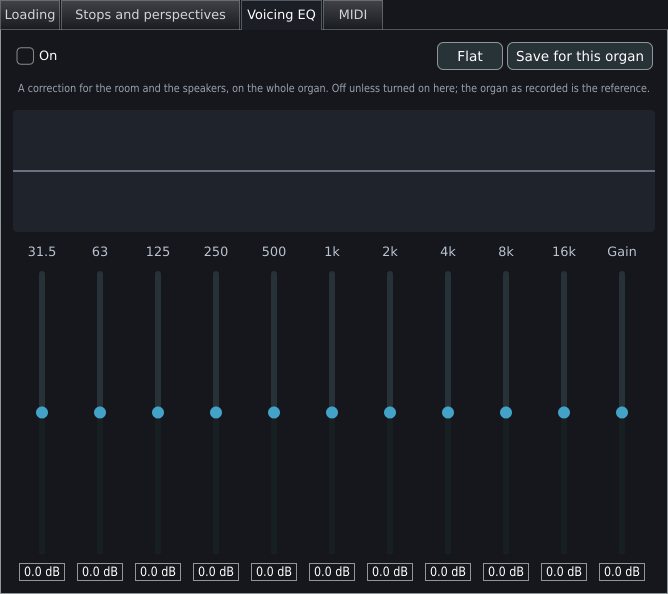
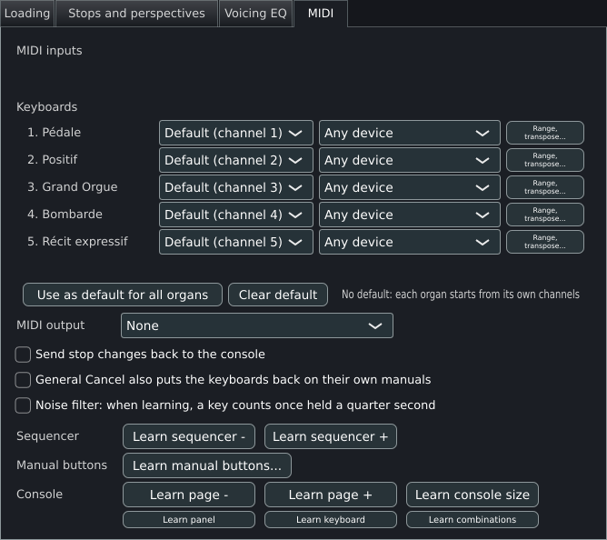

# Organ settings

**Settings > Organ settings...** opens the settings of the organ that is loaded: how its samples are held in memory, which stops, perspectives and ranks are loaded at all, an equaliser for the whole organ, and the MIDI channels of its keyboards. This page lists every control on every tab in the order the window shows them: what it does, its default, its range or options, when it takes effect and where it is stored. [Memory, loading and streaming](memory.md) explains the loading choices in depth, and [Small, medium and large organs](sizing.md) helps to pick them for a given computer. The settings of the program and of the player's console are in [General settings](general-settings.md).

## Opening the window

The entry **Organ settings...** in the **Settings** menu is available while an organ is loaded.

The window opens by itself the first time an organ is loaded, when no settings file exists for it yet. Masterpiece first reads the organ without its audio, so the console appears within seconds and the **Stops and perspectives** tab can show this organ's own stops with the memory each would take. Closing the window starts the load of the audio with the choices made. After that first time the window opens only from the menu.

The window is titled **Organ settings**, opens at 660 x 560 pixels and can be resized; the Esc key closes it. It has four tabs.

| Tab | Content |
|---|---|
| **Loading** | How the organ's samples are held in memory, the sample cache, the folders and the engine switches. |
| **Stops and perspectives** | Which perspectives, stops and ranks are loaded. |
| **Voicing EQ** | A ten-band equaliser for the whole organ. |
| **MIDI** | The channels and devices of the organ's keyboards. Present in the standalone application. |

The **MIDI** tab is present whenever the window is opened by the standalone application, which always passes its audio device manager to it. In the VST3, LV2 and AU plugins the menu entry opens the window with the three other tabs and without **MIDI**, because the host owns the MIDI ports.

## One organ, one set of settings

Settings belong to an organ definition. Many sample sets ship one organ as several definitions: a definition for each microphone perspective (near, far, surround), or a full and a light version. Each definition is an organ of its own with its own settings, MIDI mapping and combinations. **File > Other versions of this organ** lists the definitions beside the one loaded (in its package, or in its folder) and loads the one chosen. A package remembers which of its definitions was opened last.

Inside one definition, a set recorded from several microphone positions carries the whole organ once for each position, as separate ranks named for the position (for example `Principal 8 (close)` or `Principal 8 Rear`). The **Stops and perspectives** tab lists these positions as perspectives, and leaving one out removes its ranks from the load.

The settings file of an organ is named by the organ key: the organ's name reduced to letters and digits, a hyphen, and the unique organ identifier of the definition (`p` and a path hash when the definition has none). Two definitions with the same name and identifier share one file; renaming or moving a sample set keeps its file. [General settings](general-settings.md#where-settings-are-kept) gives the exact rules.

## Loading

The tab scrolls when the window is shorter than its contents. Changes here act on the engine as they are made, and nothing is written to disk until the player chooses. The footer holds the choices: [Footer](#footer).

### Engine switches

| Control | What it does | Default | Range or options | Takes effect |
|---|---|---|---|---|
| **Simple WAV only (bypass all DSP)** | Plays the samples with no wind model, tremulants, enclosures or voicing, for a slow computer. While it is on, the four switches below are greyed out. The same switch is on the top bar. | Off | On, off | At once |
| **Wind model** | Simulates the wind supply. Off uses the constant-volume fast path. | On | On, off | At once |
| **Tremulants** | Applies the organ's tremulants. | On | On, off | At once |
| **Enclosures (swell shades)** | Applies the organ's enclosures. | On | On, off | At once |
| **Voicing** | Applies the per-rank and per-pipe level and tuning of **Settings > General settings > Voicing**. With the box off the organ plays as recorded; the adjustments stay in the voicing sets and apply again when the box is ticked. | On | On, off | At once, for the notes that start afterwards |
| **Play at the original organ's pitch** | Plays each pipe at the pitch it had on the original instrument; with the box off, each pipe takes a tempered pitch derived from the keyboard. Pipes without that data always use the tempered pitch. | Off | On, off | At once, for the notes that start afterwards |

### Memory

**Memory profile** moves the four settings that follow it together. Choosing a profile sets **Resident format**, **Load in mono**, **Stream release tails from disk** and **Preloaded per sample**. The box shows **Custom** whenever the four match no profile.

| Profile | Resident format | Mono | Streaming | Preloaded |
|---|---|---|---|---|
| **Best quality - 24-bit, hold everything** (default) | 24-bit | Off | Off | Whole samples |
| **Recommended - 16-bit, stream releases** | 16-bit | Off | On | Whole samples |
| **Smallest - 16-bit mono, stream releases** | 16-bit | On | On | Whole samples |
| **Custom** | As set | As set | As set | As set |

| Control | What it does | Default | Range or options | Takes effect |
|---|---|---|---|---|
| **Preloaded per sample** | How much of each sample is held in memory. An attack is always held to the end of its sustain loop, which in an organ sample lies close to the end of the file. | **Whole samples (most memory)** | **Whole samples (most memory)**, **Up to the loop (less memory)**. A file written by an earlier version may show **Loop + 1 s (earlier choice)** or **Loop + 2 s (earlier choice)**, which stay as they are. A sample whose release is in the same file is always held whole. | Next load |
| **Resident format** | What a held frame costs in memory. 16-bit scales each sample by its own peak first, so a quiet stop keeps the full sixteen bits. | **24-bit - what the samples are** | **24-bit - what the samples are**, **16-bit - two thirds of that, inaudible**, **32-bit float - larger than the source** | Next load |
| **Sample rate** | Converts samples to this rate while loading. A 96 kHz set on a 48 kHz device is held at twice the size it needs otherwise. Only the two lower rates are offered. | **As recorded** | **As recorded**, **48 kHz**, **44.1 kHz** | Next load |
| **Stream release tails from disk** | Holds only the start of each release in memory and reads the rest from disk while it plays. Releases are the only samples worth streaming: they run several seconds and play once from the start, straight through. Needs a disk that keeps up. | Off | On, off | Next load |
| Stream box (beside the tick) | How much of each release stays in memory when streaming is on. A larger share gives a slow disk longer to catch up. Greyed out while streaming is off. | **Hold the first second** | **Hold the first second**, **Hold 25% of each release**, **Hold 50% of each release**, **Hold 75% of each release** | Next load |
| **Load in mono (halves memory, gives up the stereo image)** | Folds each stereo sample to one channel. | Off | On, off | Next load |
| **Memory limit for samples** | A load that would take more than this stops with a message and loads nothing. The voice pool counts toward the figure. | **Default: 80% of memory (N GB)**, with at least 512 MB | **Default: 80% of memory**, **50%**, **60%**, **70%** and **90% of memory**, each with its size; a size set in the file shows as itself | At the next load; global file |
| **Polyphony limit** | The most pipes that sound at once. Past it, a new pipe takes the place of one that is dying away, or of the quietest. Each choice shows the memory its voices take, which is larger with release streaming on. A lower number keeps a small computer from falling behind on a full organ. | **Default: N voices (N MB)**: 725 voices for each processor thread, at least 1,536, at most 16,384; 1,536 while releases stream | 256, 512, 768, 1024, 2048, 3072, 4096, 6144, 8192, 10240 voices; a number set in the file shows as itself. The file accepts 64 to 16,384. | At once; a larger pool is built at once while the organ stays loaded; global file |

### Releases

| Control | What it does | Default | Range or options | Takes effect |
|---|---|---|---|---|
| **Releases** | Which of each pipe's releases are loaded. Many organs record a short and a long release per pipe; keeping one uses less memory and loads faster. | **As the organ has them** | **As the organ has them**, **The longest only**, **The shortest only**, **None: notes fade when let go** | Next load |
| **Release length** | Each release is kept up to this length and fades out over its last quarter. A shortened release is always held in memory. Useful for an organ played in a room with its own reverberation or under an impulse response. | **Whole** | **Whole**, **Up to 0.5 s**, **Up to 1 s**, **Up to 1.5 s**, **Up to 2 s**, **Up to 3 s**, **Up to 4 s**; another length set in the file shows as itself | Next load |
| **Release tails end below** | A release tail stops once it has stayed below this level for a twentieth of a second. A fast passage on many stops leaves hundreds of tails sounding far below hearing, each costing as much as a note. Each tail is judged alone, so with many stops drawn -80 dB can end the last decay of a full chord audibly early. | **-90 dB** | **Never: every tail plays out**, **-80 dB**, **-90 dB**, **-100 dB** | At once; saved with the organ |

### Sample cache

The sample cache keeps the decoded samples on disk, so the next load of the same organ is a read. A change to a setting that decides what the cache holds (resident format, mono, streaming, preload, sample rate, releases, release length, cache mode) rebuilds it at the next load. While such a change is pending the tab shows **The cache is rebuilt when this window closes. It can take several minutes.**

| Control | What it does | Default | Range or options | Takes effect |
|---|---|---|---|---|
| **Sample cache** | How many caches are kept. | **One cache, replaced as organs change** | **One cache, replaced as organs change**, **One cache per organ (uses more disk)**, **Off** | Next load |
| **Save the sample cache** | When the cache of a new load is written. Before the organ plays, the first load takes longer and nothing competes with the sound. In silence, the organ plays at once and the samples are saved whenever nothing sounds; until they are, the next load reads them again. | **Before the organ plays** | **Before the organ plays**, **In silence, while it plays** | Next load; global file |
| **Cache folder** | Where the cache is written. A folder that cannot be created is replaced by the default for that load. | **Default (PATH)**, the `cache` folder in the data folder | **Choose...** opens a folder chooser; **Default** returns to the default folder | Next load; global file |

### Folders

| Control | What it does | Default | Range or options | Takes effect |
|---|---|---|---|---|
| **Package folder** | Where the player keeps packages. A composite organ looks here, and in the folders directly in it, for the organs it plays. | **None** | **Choose...** opens a folder chooser; **Clear** removes it | Next load; global file |
| **Organ folder** | The folder that holds this organ's `OrganInstallationPackages`. Normally derived from the definition's path. A set whose folders are linked in from another tree can leave that path pointing away from the audio, and then the folder is named here. | **From the definition (PATH)** | **Choose...** opens a folder chooser (the display then reads **PATH  -- loads next time**); **Default** returns to the derived folder | Next load; organ file |

### Options

| Control | What it does | Default | Range or options | Takes effect |
|---|---|---|---|---|
| **Tap at each 10% while loading an organ** | Plays a short tap at each 10% of a load, so a large set can be followed by ear. | Off | On, off | At the next load; global file |
| **Reopen the last organ when Masterpiece starts** | Loads, at start, the organ that last loaded completely, after an unexpected close too. | Off | On, off | At the next start; global file |
| **Keep this organ playable without its installation files** | Gives the organ a sample cache of its own whatever **Sample cache** says, and keeps a copy of its definition and console pictures in the `Portable` folder, so the organ opens with the drive that holds its installation files unplugged. Made at the next complete load and costing the cache's size on this disk. Streamed release tails still come from the installation files: turn streaming off for an organ that has to play without them. | Off | On, off | At the next complete load; organ file |
| **Faster audio engine** | Renders several samples at a time with the processor's vector unit (AVX2 on a PC, NEON on ARM). The sound is the same, with more polyphony to spare. The label reads **Faster audio engine: using AVX2** (or NEON) when the unit is found, and **Faster audio engine: not available on this processor** when it is missing. If anything sounds wrong with it on, switch it off. | On | On, off | At once; global file |

### Readout

A line under the controls reads **Resident samples: N MB (N samples, FORMAT, mono or stereo, RATE)**. When releases stream it adds **N streamed, N MB left on disk**. If the disk could not keep up it adds **DISK TOO SLOW: N underrun(s)**. It ends with **Voice pool: N voices, N MB**. The line updates twice a second.

### Footer

| Button | What it does | Takes effect |
|---|---|---|
| **Revert changes** | Returns every control on the tab to its state when the tab opened. | At once |
| **Keep changes** | Closes the window and keeps the choices for this session. | At once |
| **Load the organ again** | Appears while an organ is loaded. Reads **Load the organ again to apply** and is highlighted when a loading choice has changed since the tab opened. Closes the window and loads the organ again with the choices. | At once |
| **Save for this organ** | Writes the organ's settings file. The button reads **Saved** for two seconds. | At once |
| **Save as default** | Writes the current choices into the global file, as the starting point of every organ that has no file of its own. | At once |

Closing the window by any route keeps the format, mono, streaming, preload and engine-switch choices for the loads of this organ in this session; another organ's load drops them. If the window closes with a change that rebuilds the cache and the organ has not been loaded again, a question **Rebuild the sample cache?** offers **Rebuild and load again** and **Back to settings**.

## Stops and perspectives

Chooses what the load reads. A perspective, stop or rank that is left out costs no memory and makes no sound. A stop left out keeps its drawstop and its place in pistons, dimmed on the console, so that it is not taken for a broken one. The choice is saved with the organ at once, and it takes effect when the organ is loaded again. A rank that a loaded stop shares, and noises and ranks wired to keys directly, are always loaded.

The list has up to four groups.

| Group | Content |
|---|---|
| **Perspectives** | One row for each microphone position, with the number of ranks. Shown when the set has at least two. For a GrandOrgue organ the heading is **Windchest groups**, which stand in for perspectives. Leaving one out takes every rank recorded from that position; the stops still play from the others. At least one position always stays. |
| Divisions | The drawn stops, under a heading for each division. Click a heading to select or clear every stop of that division. |
| **Effects and noises** | Stops that no drawstop reaches: key-action noises, coupler and tremulant effects. |
| **Ranks** | Every rank by name, the finest choice. A rank left out is left out whichever stop plays it. Each rank's tooltip names the stops that play it (**Played by ...**), or says **Played by no stop: a noise, or wired to a key directly**. |

Each row has a tick box and, at the right, the memory it takes. A stop whose ranks ship no pipes in the set is greyed out (**This stop's ranks ship no pipes in this sample set**). A rank shows unticked and greyed when something above it leaves it out, and its tooltip says why: **Left out with the NAME perspective**, **Left out with the NAME windchest group**, **Left out with its stop**, or **Left out with every stop that plays it**. The rank's own choice waits underneath.

| Control | What it does | Default | Takes effect |
|---|---|---|---|
| **All stops** | Ticks every stop, including the effects and noises. | | At once |
| **No stops** | Unticks every drawn stop. Effects and noises keep their state. | | At once |
| **Only the stops drawn now** | Loads only the stops drawn on the console at this moment. Effects and noises keep their state. | | At once |
| Filter box | Shows only the perspectives, stops and ranks whose name holds the text. The placeholder reads **Filter, for example: Rear, tremmed, Pedal**. Division headings are hidden while a filter is active. | Empty | At once |
| **Load shown ranks** | Ticks every rank in the filtered list. | | At once |
| **Leave out shown ranks** | Unticks every rank in the filtered list. | | At once |
| **Load the organ again** | Loads the organ again with the choice. Highlighted when the choice differs from what is loaded. Closes the window. | | At once |
| Total line | **About N for this choice**, with **(the limit is N)** appended; red when the figure exceeds the limit. Reads **Estimating the memory each stop takes...** until the sample files have been measured. The figures are estimates at the settings of the Loading tab. | | Updated twice a second |

All stops are ticked by default. The keys work as follows: Space ticks or unticks the focused stop; Up and Down move to the previous and next stop shown; with Shift held, the arrows carry the focused stop's state onto each stop they reach. A press on a stop dragged across others gives them its new state.

**Stored.** In the organ file: `skipstop <stop id>`, `skipperspective <name>` and `skiprank <rank id>`, one line for each item left out. The file is written shortly after a change.

## Voicing EQ

A correction for the room and the speakers, applied to the whole organ. The organ as recorded is the reference, so the equaliser is off until it is turned on here. The curve in the upper part of the tab shows the combined response from 20 Hz to 20 kHz on a logarithmic scale, plus or minus 12 dB; it is drawn orange while the equaliser is on and grey while it is off.

| Control | What it does | Default | Range or options | Takes effect |
|---|---|---|---|---|
| **On** | Switches the equaliser on. | Off | On, off | At once |
| **Flat** | Returns every band and the gain to 0 dB. | | | At once |
| **Reset** | Brings the default EQ back, the one kept with **Save as default** (off and flat when none is kept), and forgets the EQ saved for this organ. The organ then starts from the default at its next load. | | | At once |
| **Save as default** | Keeps the EQ as it is now for every organ that has none of its own: a correction for the speakers and the room. Reads **Saved** or **Could not save** afterwards, and returns to its label at the next change. | | | At once |
| **Save for this organ** | Keeps the EQ as it is now with this organ, whatever it is, the **On** box included, for its next load. Reads **Saved** or **Could not save** afterwards, and returns to its label at the next change. | | | At once |
| Ten band sliders, labelled **31.5**, **63**, **125**, **250**, **500**, **1k**, **2k**, **4k**, **8k**, **16k** | One slider for each octave band, in Hz. The lowest and highest bands are shelves; the other eight are peaks (Q 1.4). A double-click returns a slider to 0. | 0 dB | -12 to +12 dB in steps of 0.5 | At once |
| **Gain** | The output gain, to make up for what the bands add or take. | 0 dB | -12 to +12 dB in steps of 0.5 | At once |

Every organ starts from the default EQ, which is off and flat until **Save as default** keeps another. An organ gets an EQ of its own only from **Save for this organ**; other saves of the organ file leave it on the default. Changes on the tab are live and are kept only by these buttons.

**Stored.** The default is the key `defaulteq <on> <gain> <band 1> ... <band 10>` in the global file, written while the default is on or not flat. The organ's own EQ is the key `eq <on> <gain> <band 1> ... <band 10>` in the organ file, written whatever it is, off and flat included, once **Save for this organ** has been pressed. **Reset** removes the `eq` line from the organ file.

## MIDI

The same panel as the **MIDI** tab of General settings, placed here for the player who sets up one organ. Both edit the same mapping and the same global settings. Every control is described in [General settings](general-settings.md#midi). The controls that belong to the organ are the channel and device boxes of each keyboard, **Range, transpose...**, and the learned bindings; those are saved in the organ's `.mpmidi` file.

## Where the organ's settings are kept

The organ file is `organs/<organ key>.mporgan` in the data folder (see [General settings](general-settings.md#where-settings-are-kept) for the folder on each system). It is plain text; each line is a key, a space and a value, and lines that start with `#` are ignored. When Masterpiece loads an organ it reads the global file first and the organ file after it, so an organ file overrides the global defaults and a value given on the [command line](command-line.md) overrides both for that run.

**Save for this organ** on the Loading, Mixer, Voicing and Voicing EQ tabs writes the whole file from the live state. So do the automatic writes that follow a change to the stops and perspectives, the release tail cutoff, the room, the combinations window and a few other items. A change on the Loading tab that is only kept for the session can therefore reach the file with one of those writes. The stream share, the release tail cutoff and the organ folder write the file themselves.

| Key | Value | Set by |
|---|---|---|
| `storage` | `16`, `24` or `32` (32 is float) | **Resident format** |
| `mono` | `1` or `0` | **Load in mono** |
| `releases` | `0` all, `1` longest, `2` shortest, `3` none | **Releases** |
| `releaselength` | Milliseconds, `0` for whole | **Release length** |
| `releasecutoff` | dB, `0` for never | **Release tails end below** |
| `reverb` | `<on> <wet> <path>` | The **Room** tab |
| `rate` | Hz, `0` as recorded | **Sample rate** |
| `cache` | `0` off, `1` one cache, `2` one per organ | **Sample cache** |
| `stream` | `1` or `0` | **Stream release tails from disk** |
| `streamhead` | Frames of a release held when streaming | Set by Masterpiece |
| `streamheadpct` | `0`, `25`, `50` or `75` | The stream box |
| `preload` | `0` whole, `1` up to the loop, or a frame count from an earlier version | **Preloaded per sample** |
| `root` | A folder, written only when set | **Organ folder** |
| `simple`, `wind`, `tremulant`, `enclosure`, `voicing`, `originalpitch` | `1` or `0` | The six engine switches |
| `gain` | The master gain (linear) | The volume slider in the top bar |
| `buses`, `busir`, `groups` | The mixer's pairs, per-pair rooms and groups | The **Mixer** tab |
| `route <rank> bus <n>` | The pair of one rank | The **Mixer** tab |
| `voicingadj`, `voicingslot` | The voicing sets A and B and the live slot | The **Voicing** tab |
| `eq` | The organ's own equaliser, written whatever it is, off and flat included; absent while the organ plays the default EQ (`defaulteq` in the [global file](general-settings.md#the-global-file)) | **Save for this organ** on the **Voicing EQ** tab |
| `skipstop`, `skipperspective`, `skiprank` | One item left out | The **Stops and perspectives** tab |
| `portable` | `1` | **Keep this organ playable without its installation files** |
| `combset` | The combination set in use | The **Combination sets** tab |
| `licenceconfirmed` | `1` | **Licence confirmed for this organ** |
| `temperament`, `pitchhz`, `transpose` | The tuning chosen for this organ | The tuning controls |
| `combwindow`, `pagewindow` | The place of the combinations window and of console pages in windows of their own | The windows themselves |
| `control`, `switch`, `state`, `stopon` | Controls and switches the organ asks to remember, and the registration saved as the starting state | The console |

When the volume slider moves, only the `gain` line is rewritten, so the slider writes no other unsaved change to disk.
