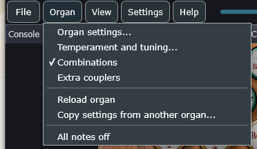
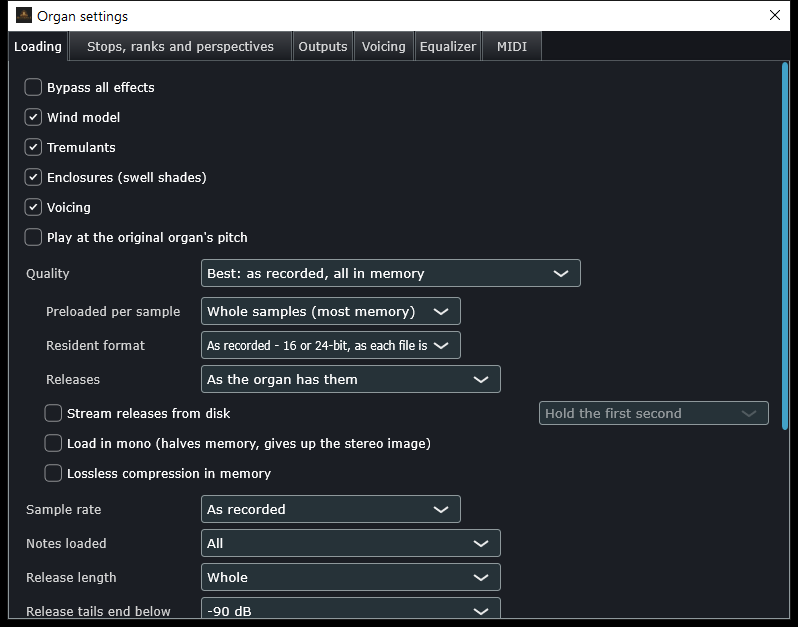
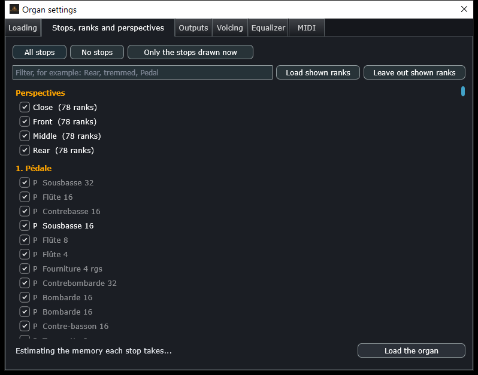
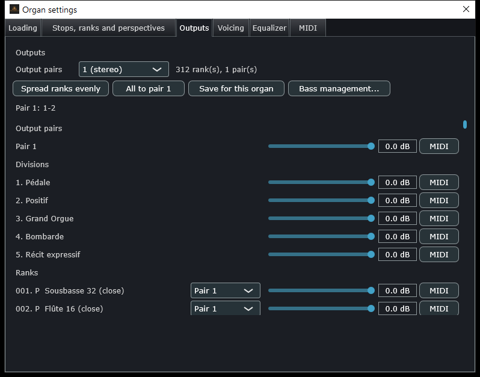
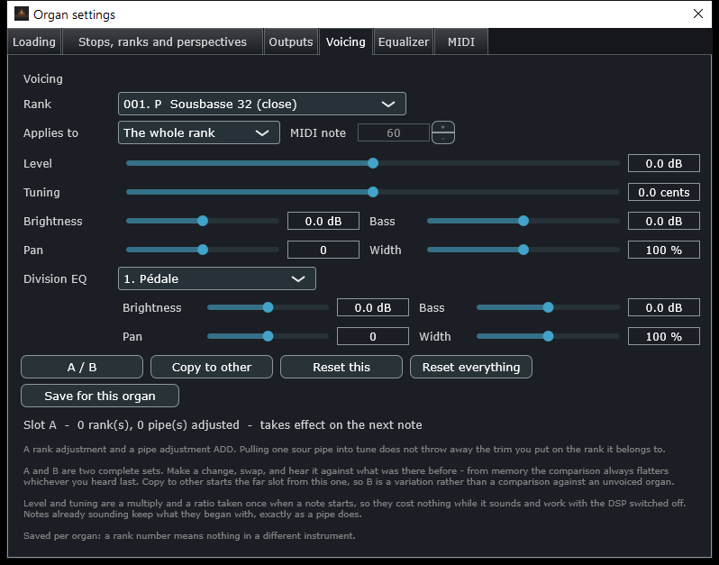
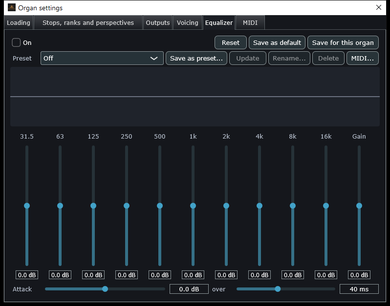
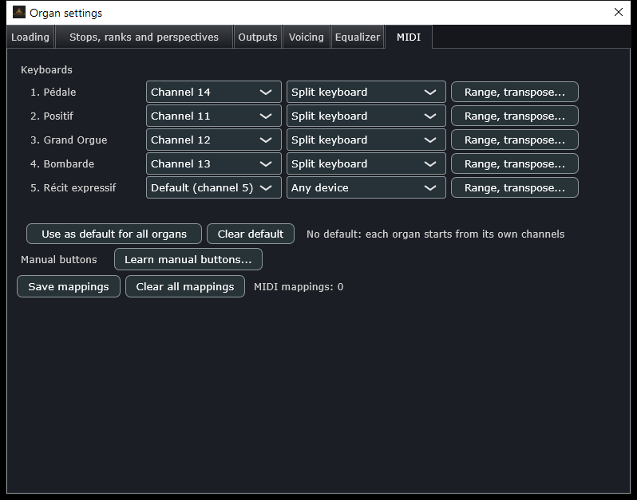

# Organ settings

**Organ > Organ settings...** opens the settings of the organ that is loaded: how its samples are held in memory, which stops, ranks and perspectives are loaded at all, the output pairs and live levels, the voicing of its ranks and pipes, an equaliser for the whole organ, and the MIDI channels of its keyboards. This page lists every control on every tab in the order the window shows them: what it does, its default, its range or options, when it takes effect and where it is stored. [Memory, loading and streaming](memory.md) explains the loading choices in depth, and [Small, medium and large organs](sizing.md) helps to pick them for a given computer. The settings of the program and of the player's console are in [Settings](general-settings.md).

<iframe src="https://www.youtube-nocookie.com/embed/1WAwPrh7YVM?list=PLEi774VY3MkM&rel=0" title="Video tutorial 08 Organ settings, tuning and voicing" loading="lazy" allow="accelerometer; encrypted-media; gyroscope; picture-in-picture; fullscreen" referrerpolicy="strict-origin-when-cross-origin" allowfullscreen></iframe>

## Opening the window

The entry **Organ settings...** in the **Organ** menu is available while an organ is loaded.

The window opens by itself the first time an organ is loaded, when no settings file exists for it yet. Masterpiece first reads the organ without its audio, so the console appears within seconds and the **Stops, ranks and perspectives** tab can show this organ's own stops with the memory each would take. Closing the window starts the load of the audio with the choices made. After that first time the window opens only from the menu.

The window is titled **Organ settings**, opens at 780 x 560 pixels and can be resized; the Esc key closes it. It has six tabs.

| Tab | Content |
|---|---|
| **Loading** | How the organ's samples are held in memory, the engine switches, the releases and the organ's folder. |
| **Stops, ranks and perspectives** | Which perspectives, stops and ranks are loaded. |
| **Outputs** | The output pairs, the rank routing, bass management and the live levels. |
| **Voicing** | Level, tuning, EQ, pan and width for each rank, pipe and division. |
| **Equalizer** | A ten-band equaliser for the whole organ, its presets, and the attack's emphasis. |
| **MIDI** | The channels and devices of the organ's keyboards. Present in the standalone application. |

In the VST3, LV2 and AU plugins the window has the five other tabs and no **MIDI**, because the host owns the MIDI ports.

**Display mode** on the **General** tab of [Settings](general-settings.md#display-mode) decides how much the Loading and MIDI tabs show. The tables below mark the rows that only **Advanced** shows.

## One organ, one set of settings

Settings belong to an organ definition. Many sample sets ship one organ as several definitions: a definition for each microphone perspective (near, far, surround), or a full and a light version. Each definition is an organ of its own with its own settings, MIDI mapping and combinations. **File > Open another version** lists the definitions beside the one loaded (in its package, or in its folder) and loads the one chosen. A package remembers which of its definitions was opened last.

Inside one definition, a set recorded from several microphone positions carries the whole organ once for each position, as separate ranks named for the position (for example `Principal 8 (close)` or `Principal 8 Rear`). The **Stops, ranks and perspectives** tab lists these positions as perspectives, and leaving one out removes its ranks from the load.

The settings file of an organ is named by the organ key: the organ's name reduced to letters and digits, a hyphen, and the unique organ identifier of the definition (`p` and a path hash when the definition has none). Two definitions with the same name and identifier share one file; renaming or moving a sample set keeps its file. [Settings](general-settings.md#where-settings-are-kept) gives the exact rules.

## Loading

The tab scrolls when the window is shorter than its contents. Changes here act on the engine as they are made, and nothing is written to disk until the player chooses. The footer holds the choices: [Footer](#footer). In **Simple** the tab shows **Quality**, the readout and the footer.

### Engine switches

Shown in **Advanced**.

| Control | What it does | Default | Range or options | Takes effect |
|---|---|---|---|---|
| **Bypass all effects** | Plays the samples with no wind model, tremulants, enclosures or voicing, for a slow computer. While it is on, the five switches below it are greyed out. | Off | On, off | At once |
| **Wind model** | Simulates the wind supply. Off uses the constant-volume fast path. | On | On, off | At once |
| **Tremulants** | Applies the organ's tremulants. | On | On, off | At once |
| **Enclosures (swell shades)** | Applies the organ's enclosures. | On | On, off | At once |
| **Voicing** | Applies the level and tuning of the [Voicing](#voicing) tab. With the box off the organ plays as recorded; the adjustments stay in the voicing sets and apply again when the box is ticked. | On | On, off | At once, for the notes that start afterwards |
| **Play at the original organ's pitch** | Plays each pipe at the pitch it had on the original instrument; with the box off, each pipe takes a tempered pitch derived from the keyboard. Pipes without that data always use the tempered pitch. | Off | On, off | At once, for the notes that start afterwards |

### Quality

**Quality** moves the settings indented under it together: **Resident format**, **Load in mono**, **Stream releases from disk**, **Lossless compression in memory** and **Releases**. Each preset also sets **Preloaded per sample** to whole samples. The box shows **Custom** whenever the settings match no preset. Shown in both modes; in **Simple**, **Custom** is greyed. It takes effect at the next organ load.

| Preset | Resident format | Mono | Streaming | Compression | Releases |
|---|---|---|---|---|---|
| **Best: as recorded, all in memory** (default) | As recorded | Off | Off | Off | As the organ has them |
| **High: as recorded, compressed, releases streamed** | As recorded | Off | On | On | As the organ has them |
| **Recommended: 16-bit, releases streamed** | 16-bit | Off | On | Off | As the organ has them |
| **Compact: 16-bit, compressed, releases streamed** | 16-bit | Off | On | On | As the organ has them |
| **Small: 16-bit mono, compressed, releases streamed** | 16-bit | On | On | On | As the organ has them |
| **Smallest: as Small, short releases only** | 16-bit | On | On | On | The shortest only |
| **Custom** | As set | As set | As set | As set | As set |

### Memory

Shown in **Advanced**.

| Control | What it does | Default | Range or options | Takes effect |
|---|---|---|---|---|
| **Preloaded per sample** | How much of each sample is held in memory. An attack is always held to the end of its sustain loop, which in an organ sample lies close to the end of the file. | **Whole samples (most memory)** | **Whole samples (most memory)**, **Up to the loop (less memory)**. A file written by an earlier version may show **Loop + 1 s (earlier choice)** or **Loop + 2 s (earlier choice)**, which stay as they are. A sample whose release is in the same file is always held whole. | Next load |
| **Resident format** | What a held frame costs in memory. **As recorded** keeps each file's 16 or 24 bits, so a 16-bit set is held at 16 bits. 16-bit scales each sample by its own peak first, so a quiet stop keeps the full sixteen bits. | **As recorded - 16 or 24-bit, as each file is** | **As recorded - 16 or 24-bit, as each file is**, **20-bit - a sixth less than the source**, **16-bit - two thirds of that, inaudible**, **32-bit float - larger than the source** | Next load |
| **Releases** | Which of each pipe's releases are loaded. Many organs record a short and a long release per pipe; keeping one uses less memory and loads faster. | **As the organ has them** | **As the organ has them**, **The longest only**, **The shortest only**, **None: notes fade when let go** | Next load |
| **Stream releases from disk** | Holds only the start of each release in memory and reads the rest from disk while it plays. Releases are the only samples worth streaming: they run several seconds and play once from the start, straight through. Needs a disk that keeps up. | Off | On, off | Next load |
| Stream box (beside the tick) | How much of each release stays in memory when streaming is on. A larger share gives a slow disk longer to catch up. Greyed out while streaming is off. | **Hold the first second** | **Hold the first second**, **Hold 25% of each release**, **Hold 50% of each release**, **Hold 75% of each release** | Next load |
| **Load in mono (halves memory, gives up the stereo image)** | Folds each stereo sample to one channel. | Off | On, off | Next load |
| **Lossless compression in memory** | Holds 16- and 24-bit samples in a lossless compressed form and decodes them as they play. The sound is identical; memory use is lower. Greyed for **20-bit** and **32-bit float**. | Off | On, off | Next load |
| **Sample rate** | Converts samples to this rate while loading. A 96 kHz set on a 48 kHz device is held at twice the size it needs otherwise. Only the two lower rates are offered. | **As recorded** | **As recorded**, **48 kHz**, **44.1 kHz** | Next load |
| **Notes loaded** | How many notes of a rank are loaded. A note that is not loaded plays the samples of its nearest loaded neighbour, retuned to its own pitch. A noise, a percussive rank, a rank recorded with a tremulant and a rank of fewer than eight pipes keep every note. | **All** | **All**, **Every second note**, **Every third note** | Next load |

A change to a setting that decides what the sample cache holds (resident format, mono, compression, streaming, preload, sample rate, notes loaded, releases, release length) rebuilds the cache at the next load. While such a change is pending the tab shows **The cache is rebuilt when this window closes. It can take several minutes.** The cache itself is set on the **General** tab of [Settings](general-settings.md#general).

### Releases

Shown in **Advanced**.

| Control | What it does | Default | Range or options | Takes effect |
|---|---|---|---|---|
| **Release length** | Each release is kept up to this length and fades out over its last quarter. A shortened release is always held in memory. Useful for an organ played in a room with its own reverberation or under an impulse response. The two shortest end a note quickly, as a tracker action does: for fast repeated notes. **Releases** set to **None: notes fade when let go** loads no release at all, for a player with an external reverb. | **Whole** | **Whole**, **Up to 0.15 s**, **Up to 0.3 s**, **Up to 0.5 s**, **Up to 1 s**, **Up to 1.5 s**, **Up to 2 s**, **Up to 3 s**, **Up to 4 s**; another length set in the file shows as itself | Next load |
| **Release tails end below** | A release tail stops once it has stayed below this level for a twentieth of a second. A fast passage on many stops leaves hundreds of tails sounding far below hearing, each costing as much as a note. Each tail is judged alone, so with many stops drawn -80 dB can end the last decay of a full chord audibly early. | **-90 dB** | **Never: every tail plays out**, **-80 dB**, **-90 dB**, **-100 dB** | At once; saved with the organ |
| **Release buffer** | How much of each streamed release a voice reads ahead of where it plays. **Automatic** times reads of the organ's own files at each load: a quarter of a second on an SSD, up to 2 s on a hard disk; with an organ loaded it reads **Automatic (N s)**. A longer buffer gives a busy disk more time and uses more memory per voice. Greyed while streaming is off. | **Automatic** | **Automatic**, **0.25 s**, **0.5 s**, **1 s**, **2 s** | Next load |

Each release starts where it joins the sustain, aligned by phase, and crosses over from the sustain at a length set by the pipe's pitch. This needs no setting.

### Organ

Shown in **Advanced**.

| Control | What it does | Default | Range or options | Takes effect |
|---|---|---|---|---|
| **Extra couplers** | Adds the program's own couplers to this organ. They appear in **View > Stop list**. The same switch is in the **Organ** menu. | Off | On, off | Next load, as **Load the organ** does it; the **Organ** menu item loads the organ again at once; organ file |
| **Keep a portable copy of this organ** | Keeps this organ's own sample cache, whatever the **Sample cache** setting says, and a copy of its definition and console pictures in the `Portable` folder, so the organ opens with the drive that holds its installation files unplugged. Made at the next complete load; costs the cache's size on this disk. Streamed release tails still come from the installation files: turn streaming off for an organ that must play without them. | Off | On, off | At the next complete load; organ file |
| **Organ folder** | The folder that holds this organ's `OrganInstallationPackages`. Normally derived from the definition's path. A set whose folders are linked in from another tree can leave that path pointing away from the audio, and then the folder is named here. | **From the definition (PATH)** | **Choose...** opens a folder chooser (the display then reads **PATH  -- loads next time**); **Default** returns to the derived folder | Next load; organ file |

### Readout

A line under the controls reads **Resident samples: N MB (N samples, FORMAT, mono or stereo, RATE)**. With compression it adds **N held compressed**. When releases stream it adds **N streamed, N MB left on disk**. If the disk could not keep up it adds **DISK TOO SLOW: N underrun(s)**. It ends with **Voice pool: N voices, N MB**. The line updates twice a second. Shown in both modes.

### Footer

| Button | What it does | Takes effect |
|---|---|---|
| **Revert changes** | Returns every control on the tab to its state when the tab opened. | At once |
| **Keep changes** | Closes the window and keeps the choices for this session. | At once |
| **Load the organ** | Appears while an organ is loaded. Reads **Load the organ to apply** and is highlighted when a loading choice has changed since the tab opened. Closes the window and loads the organ again with the choices. | At once |
| **Save for this organ** | Writes the organ's settings file. The button reads **Saved** for two seconds. | At once |
| **Save as default** | Writes the current choices into the global file, as the starting point of every organ that has no file of its own. | At once |

Closing the window by any route keeps the loading and engine-switch choices for the loads of this organ in this session; another organ's load drops them. If the window closes with a change that rebuilds the cache and the organ has not been loaded again, a question **Rebuild the sample cache?** offers **Rebuild and load again** and **Back to settings**.

The **Performance** tab of [Settings](general-settings.md#performance) holds the faster audio engine, the render threads, the polyphony limit and the memory limit, for every organ.

## Stops, ranks and perspectives

Chooses what the load reads. A perspective, stop or rank that is left out costs no memory and makes no sound. A stop left out keeps its drawstop and its place in pistons, dimmed on the console, so that it is not taken for a broken one. The choice is saved with the organ at once, and it takes effect when the organ is loaded again. A rank that a loaded stop shares, and noises and ranks wired to keys directly, are always loaded.

The list has up to four groups.

| Group | Content |
|---|---|
| **Perspectives** | One row for each microphone position, with the number of ranks. Shown when the set has at least two. For a GrandOrgue organ the heading is **Windchest groups**, which stand in for perspectives. Leaving one out takes every rank recorded from that position; the stops still play from the others. At least one position always stays. |
| Divisions | The drawn stops, under a heading for each division. Click a heading to select or clear every stop of that division. |
| **Effects and noises** | Stops that no drawstop reaches: key-action noises, coupler and tremulant effects. |
| **Ranks** | Every rank by name, the finest choice. A rank left out is left out whichever stop plays it. Each rank's tooltip names the stops that play it (**Played by ...**), or says **Played by no stop: a noise, or wired to a key directly**. |

Each row has a tick box and, at the right, the memory it takes. A stop whose ranks ship no pipes in the set is greyed out (**This stop's ranks ship no pipes in this sample set**). A rank shows unticked and greyed when something above it leaves it out, and its tooltip says why: **Left out with the NAME perspective**, **Left out with the NAME windchest group**, **Left out with its stop**, or **Left out with every stop that plays it**. The rank's own choice waits underneath.

| Control | What it does | Default | Takes effect |
|---|---|---|---|
| **All stops** | Ticks every stop, including the effects and noises. | | At once |
| **No stops** | Unticks every drawn stop. Effects and noises keep their state. | | At once |
| **Only the stops drawn now** | Loads only the stops drawn on the console at this moment. Effects and noises keep their state. | | At once |
| Filter box | Shows only the perspectives, stops and ranks whose name holds the text. The placeholder reads **Filter, for example: Rear, tremmed, Pedal**. Division headings are hidden while a filter is active. | Empty | At once |
| **Load shown ranks** | Ticks every rank in the filtered list. | | At once |
| **Leave out shown ranks** | Unticks every rank in the filtered list. | | At once |
| **Load the organ** | Loads the organ again with the choice. Highlighted when the choice differs from what is loaded. Closes the window. | | At once |
| Total line | **About N for this choice**, with **(the limit is N)** appended; red when the figure exceeds the limit. Reads **Estimating the memory each stop takes...** until the sample files have been measured. The figure is worked out as the load works it out, at the settings of the Loading tab: a sample a loaded rank shares counts once. When every single rank left out would leave nothing to play, it adds **The ranks left out would leave nothing to play, so they load**. | | Updated twice a second |

All stops are ticked by default. The keys work as follows: Space ticks or unticks the focused stop; Up and Down move to the previous and next stop shown; with Shift held, the arrows carry the focused stop's state onto each stop they reach. A press on a stop dragged across others gives them its new state.

**Stored.** In the organ file: `skipstop <stop id>`, `skipperspective <name>` and `skiprank <rank id>`, one line for each item left out. The file is written shortly after a change.

## Outputs

Routes each rank to a stereo pair of output channels, and holds a live level for each pair, division and rank. No sample set declares an audio routing, so the routing is the player's. A rank that is never touched plays through the first pair. Up to eight pairs can be set up. Each plays on its own device channels when the device has them, and the pairs are mixed to channels 1 and 2 on a stereo device. [Audio, room and mixer](audio.md#output-routing-and-the-mixer) explains the use of several pairs.

| Control | What it does | Default | Range or options | Takes effect |
|---|---|---|---|---|
| **Output pairs** | The number of stereo pairs. Pair N is assigned device channels 2N-1 and 2N, and plays on them when the device has them; otherwise on channels 1 and 2. | **1 (stereo)** | **1 (stereo)**, **2 pairs** to **8 pairs** | At once |
| Status line | Reads **N rank(s), N pair(s)**, and **N unrouted, N stale** when a rank has no pair or points at a pair that no longer exists. | | | |
| Outputs line | Each pair's device channels, such as **Pair 2: 3-4**, with **bass to N** for a pair whose lows go to a subwoofer, and **the device gives N outputs: the pairs past them play on 1-2** when the device has fewer channels. | | | |
| **Spread ranks evenly** | Assigns the ranks to the pairs in turn, so the routing is audible at once. | | | At once |
| **All to pair 1** | Sends every rank to the first pair. | | | At once |
| **Save for this organ** | Writes the organ's settings file, including the routing. | | | At once |
| **Bass management...** | One row per pair: the lows under a crossover go to a subwoofer channel of the device, and the rest to the pair. Several pairs can share one subwoofer. | **Off** | **Off**, **40 Hz**, **60 Hz**, **80 Hz**, **100 Hz**, **120 Hz**, **150 Hz**, **200 Hz**; **Subwoofer on 1** to **Subwoofer on N** (default 3) | At once |

Under them, three groups of level faders, headed **Output pairs**, **Divisions** and **Ranks**. Each rank row is labelled with the rank number and name, and holds a **Pair N** box, a fader and a **MIDI** button.

| Control | What it does | Default | Range or options | Takes effect |
|---|---|---|---|---|
| Pair box (each rank) | The pair the rank plays through. A rank that points at a pair removed by lowering **Output pairs** returns to **Pair 1**. | **Pair 1** | **Pair 1** to the chosen number of pairs | At once, for the notes that start afterwards |
| Level faders | A live level, heard at once on the pipes sounding. Full is the level as voiced; the steps are even in decibels over the lower 40 dB, and the bottom is silence. A division's fader acts on every rank in it. | Full | **Off** to 0 dB | At once |
| **MIDI** | Learns a knob or a pedal for that level. The menu shows the mapping, **Learn: move the knob or pedal** waits for a controller to move (a key played meanwhile plays), and **Clear mapping** removes it. | | | At once |

The level faders are a performance's balance and are not saved: every fader is full again when an organ loads. The knobs learned for them are kept with the organ's MIDI mapping; a pair's knob is kept for every organ. The control API reads and sets the same faders as `divisions`, `pairs` and `ranklevels`, and the web console shows the division and pair faders under **Levels**.

**Stored.** The number of pairs and their device channels are the key `buses` in the organ file, and in the global file when **Save as default** is used on the Loading tab. Bass management is the key `busbass <pair> <Hz> <channel>` beside `buses`, the channel counted from 0. The rank routes are the keys `route <rank> bus <n>` in the organ file; they are written by **Save for this organ**, and by any other change that makes Masterpiece rewrite the organ file.

## Voicing

The player's adjustments of level and tuning, for a whole rank or for one pipe, in the way a voicer goes round an organ. A rank adjustment and a pipe adjustment add. Level and tuning are applied when a note starts, so they cost nothing while it sounds, and they work with **Bypass all effects** on. Notes already sounding keep what they began with. The tab carries an equaliser, a pan and a width as well, for each rank and for each division. The **Voicing** box on the [Loading](#engine-switches) tab turns every level and tuning adjustment off while it is cleared; the organ then plays as recorded.

| Control | What it does | Default | Range or options | Takes effect |
|---|---|---|---|---|
| **Rank** | The rank to adjust, listed as its number and name. | The first rank | The ranks of the loaded organ | At once |
| **Applies to** | Whether the sliders adjust the whole rank or one pipe of it. | **The whole rank** | **The whole rank**, **One pipe** | At once |
| **MIDI note** | The pipe, chosen by its note. Active when **One pipe** is selected. A rank without a pipe at that note reports **This rank has no pipe at that note**. | 60 | 0 to 127 | At once |
| **Level** | The level change. | 0 dB | -12 to +12 dB in steps of 0.1; the control API reaches -24 dB | On the next note |
| **Tuning** | The pitch change. | 0 cents | -50 to +50 cents in steps of 0.1 | On the next note |
| **A / B** | Swaps between the two complete voicing sets A and B, so a change can be compared with what was there before. | Slot A | A, B | At once |
| **Copy to other** | Copies the live slot to the other, so that B starts as a variation of A. | | | At once |
| **Reset this** | Returns the selected rank or pipe to 0 dB and 0 cents. | | | On the next note |
| **Reset everything** | Clears every adjustment in the live slot. | | | On the next note |
| **Save for this organ** | Writes the organ's settings file. | | | At once |
| Status line | **Slot A  -  N rank(s), N pipe(s) adjusted  -  takes effect on the next note** | | | |

### EQ, pan and width

A shelf for the treble and one for the bass, for each rank and for each division. The treble acts above 3 kHz, the bass below 200 Hz, each from -12 to +12 dB. A rank's shelves are added to those of its division, so a division can shape every rank in it, and a rank can be shaped on its own. The pipes already sounding hear a change at once; a rank given its first shelf is heard with it from its next note. While no shelf is set anywhere, the organ sounds as recorded and the filters cost nothing. The same holds for pan and width: in the middle and at 100% nothing is processed. These need the effects: **Bypass all effects** switches them off.

| Control | What it does | Default | Range or options | Takes effect |
|---|---|---|---|---|
| **Brightness** | The treble shelf of the selected rank. Active when **Applies to** is **The whole rank**. | 0 dB | -12 to +12 dB in steps of 0.5 | At once |
| **Bass** | The bass shelf of the selected rank. Active when **Applies to** is **The whole rank**. | 0 dB | -12 to +12 dB in steps of 0.5 | At once |
| **Pan** | Where the selected rank stands, from full left to full right. Active when **Applies to** is **The whole rank**. | 0 | -100 to +100 | At once |
| **Width** | The selected rank's stereo width: 0% mono, 100% as recorded, 200% twice as wide. Active when **Applies to** is **The whole rank**. | 100% | 0 to 200% | At once |
| **Division EQ** | The division whose shelves, pan and width are set beside it. | The first division | The divisions of the loaded organ | At once |
| Division **Brightness** and **Bass** | The treble and bass shelves of the chosen division. Every rank in it hears them added to its own. | 0 dB | -12 to +12 dB in steps of 0.5 | At once |
| Division **Pan** and **Width** | Where the chosen division stands and its width. Every rank in it hears them: the pans add, held to full left and full right, and the widths multiply. | 0 and 100% | -100 to +100; 0 to 200% | At once |

**Stored.** In the organ file, as `voicingadj` lines for both slots, `voicingdiv` lines for the divisions and `voicingslot b` when slot B is live, written by **Save for this organ** and by any other change that makes Masterpiece rewrite the organ file. A rank number has no meaning in another instrument, so adjustments never carry across organs.

## Equalizer

A correction for the room and the speakers, applied to the whole organ. The organ as recorded is the reference, so the equaliser is off until it is turned on here. The curve in the upper part of the tab shows the combined response from 20 Hz to 20 kHz on a logarithmic scale; it is drawn orange while the equaliser is on and grey while it is off.

| Control | What it does | Default | Range or options | Takes effect |
|---|---|---|---|---|
| **On** | Switches the equaliser on. | Off | On, off | At once |
| **Preset** | Sets the EQ to a preset at once and turns it on: the program's ten under **Presets**, then the player's own under **Your presets**. Reads **Edited** when the sliders no longer match any preset, and **Off** while the equaliser is off. | | The ten below and the player's own | At once |
| **Save as preset...** | Keeps the EQ as it is now as a preset of the player's own, under a name, for every organ. | | | At once |
| **Update** | Stores the EQ as it is now in the player's preset last chosen. The program's ten cannot be changed. | | | At once |
| **Rename...**, **Delete** | Rename or delete the player's preset last chosen. A deleted preset's MIDI mapping goes with it. | | | At once |
| **MIDI...** | Maps a MIDI button to the preset chosen, or to **Voicing EQ: next preset** and **Voicing EQ: previous preset**, which go round the whole list. **Learn**, **MIDI window...** and **Clear mapping**, as on a piston. The mapping is the console's, the same on every organ. | | | At once |
| **Reset** | Brings the default EQ back, the one kept with **Save as default** (off and flat when none is kept), and forgets the EQ saved for this organ. The organ then starts from the default at its next load. | | | At once |
| **Save as default** | Keeps the EQ as it is now for every organ that has none of its own: a correction for the speakers and the room. Reads **Saved** or **Could not save** afterwards, and returns to its label at the next change. | | | At once |
| **Save for this organ** | Keeps the EQ as it is now with this organ, the **On** box included, for its next load. Reads **Saved** or **Could not save** afterwards, and returns to its label at the next change. | | | At once |
| Ten band sliders, labelled **31.5**, **63**, **125**, **250**, **500**, **1k**, **2k**, **4k**, **8k**, **16k** | One slider for each octave band, in Hz. The lowest and highest bands are shelves; the other eight are peaks (Q 1.4). A double-click returns a slider to 0. | 0 dB | -12 to +12 dB in steps of 0.5 | At once |
| **Gain** | The output gain, to make up for what the bands add or take. | 0 dB | -12 to +12 dB in steps of 0.5 | At once |
| **Attack** and **over** | The attack's emphasis: each pipe begins this much louder, or softer when negative, and comes to its own level over the time given. More or less chiff, on the pipes' own speech; noises and releases start as recorded. Applies whether the EQ is on or off. A double-click returns the level to 0. | 0 dB (off), 40 ms | -12 to +12 dB in steps of 0.5; 5 to 300 ms | From the next note |

Every organ starts from the default EQ, which is off and flat until **Save as default** keeps another. An organ gets an EQ of its own only from **Save for this organ**; other saves of the organ file leave it on the default. Changes on the tab are live and are kept only by these buttons. A preset changes the live EQ the same way: **Save for this organ** or **Save as default** keeps it.

### Presets

The program's ten presets, in dB for the bands from 31.5 Hz to 16 kHz:

| Preset | 31.5 | 63 | 125 | 250 | 500 | 1k | 2k | 4k | 8k | 16k | Gain | For |
|---|---|---|---|---|---|---|---|---|---|---|---|---|
| **Flat** | 0 | 0 | 0 | 0 | 0 | 0 | 0 | 0 | 0 | 0 | 0 | The organ as recorded |
| **Brighter** | 0 | 0 | 0 | 0 | 0 | 0 | +1 | +2 | +3 | +3 | -1 | Upper harmonics, for a set that sounds dull through the speakers |
| **Chiff** | 0 | 0 | 0 | 0 | 0 | +1 | +2 | +3 | +2 | +1 | -1.5 | The speaking attack of flue pipes |
| **Warm** | +1 | +2 | +2 | +1 | 0 | 0 | 0 | -1 | -2 | -3 | -1 | A fuller, rounder sound |
| **Less boom** | -3 | -3 | -2 | -1 | 0 | 0 | 0 | 0 | 0 | 0 | 0 | A room whose bass booms, or speakers close to a wall |
| **Small speakers** | +5 | +4 | +2 | 0 | 0 | 0 | 0 | 0 | 0 | 0 | -3 | Speakers that cannot reach the pedal's fundamentals |
| **Softer treble** | 0 | 0 | 0 | 0 | 0 | 0 | -1 | -2 | -3 | -3 | 0 | Mixtures and reeds that sound harsh in a small room |
| **Clarity** | 0 | 0 | -1 | -2 | -2 | 0 | +1 | +1 | 0 | 0 | 0 | Less of the low middle that makes a full registration muddy |
| **Quiet listening** | +5 | +4 | +2 | 0 | 0 | 0 | 0 | +1 | +2 | +3 | -3 | Playing at a low level, where the ear hears less bass and treble |
| **Headphones** | +1 | +1 | 0 | 0 | 0 | 0 | -1 | -1.5 | -1 | 0 | 0 | Headphones |

A preset of the player's own can start from any of them: choose it, move the sliders, then **Save as preset...**.

**MIDI.** A button learned for a preset recalls it, and **next preset** and **previous preset** step through the list; the status line names the preset recalled. The mapping is kept with the console mapping (`eq-preset <id>`, `eq-preset-next`, `eq-preset-prev` in the `.mpmidi` files), so the same buttons work on every organ.

**Stored.** The default is the key `defaulteq <on> <gain> <band 1> ... <band 10>` in the global file, written while the default is on or not flat. The organ's own EQ is the key `eq <on> <gain> <band 1> ... <band 10>` in the organ file, written whatever it is, off and flat included, once **Save for this organ** has been pressed. **Reset** removes the `eq` line from the organ file. The attack is the key `attack <dB> <ms>` in the organ file, absent while it is off. The player's presets are the keys `eqpreset <id> <gain> <band 1> ... <band 10> <name>` in the global file, one per preset, numbered from 101, and `eqpresetnext <id>`, the number the next one gets; a number is never given twice. The program's ten are numbered 1 to 10 and are not written.

## MIDI

The keyboards of the loaded organ. The console's inputs, output and learned actions are on the **MIDI** tab of [Settings](general-settings.md#midi). [MIDI and consoles](midi.md) explains the channel assignment in depth.

| Control | What it does | Default | Range or options | Takes effect and storage | Shown in |
|---|---|---|---|---|---|
| **Keyboards** heading, then one row for each playable keyboard of the loaded organ | The row holds the keyboard's name, a channel box, a device box and a button. | | | | Both |
| Channel box | The MIDI channel that plays this keyboard. The channel decides which division sounds, and couplers work from it. | **Default (channel N)**, the organ's own assignment | **Default (channel N)**, **Channel 1** to **Channel 16** | At once. Saved with the organ's MIDI mapping. | Both |
| Device box | Which console plays this keyboard, for the case of two consoles that send on the same channel. | **Any device** | **Any device**, or a device by its name | At once. Saved with the organ's MIDI mapping. | Both |
| **Range, transpose...** | Opens the dialog of one manual: key range, transposition, velocity window, tracker action, short octave and debounce. | | | The dialog's own controls; see [MIDI and consoles](midi.md). | Both |
| Shared line | When two keyboards answer one channel, a line **Shared -- Channel N: name, name** names them. One keyboard can play two divisions this way. When a keyboard's channel already plays another, a line says which channel to choose to play both. | Empty | | | Both |
| **Use as default for all organs** | Keeps the channel of each keyboard as the starting channels of every organ that has none saved. | | | At once. Written to the global file as `consolechannel <role> <channel>`. | Advanced |
| **Clear default** | Removes that default. The line beside the buttons returns to **No default: each organ starts from its own channels**. | | | At once | Advanced |
| **Manual buttons** | **Learn manual buttons...** opens a menu of the 16 channels, each with a submenu of the organ's manuals. Choosing a manual and then pressing a piston makes that piston send the keyboard on that channel to that manual. | | | At once. Saved with the organ's MIDI mapping. | Advanced |

When a default exists, the line beside the buttons reads **Default for organs with no channels saved:** followed by entries such as `Pedal 1; Manual 1 2`.

## Where the organ's settings are kept

The organ file is `organs/<organ key>.mporgan` in the data folder (see [Settings](general-settings.md#where-settings-are-kept) for the folder on each system). It is plain text; each line is a key, a space and a value, and lines that start with `#` are ignored. When Masterpiece loads an organ it reads the global file first and the organ file after it, so an organ file overrides the global defaults and a value given on the [command line](command-line.md) overrides both for that run.

**Save for this organ** on the Loading, Outputs, Voicing and Equalizer tabs writes the whole file from the live state. So do the automatic writes that follow a change to the stops and perspectives, the release tail cutoff, the reverb, the combinations window and a few other items. A change on the Loading tab that is only kept for the session can therefore reach the file with one of those writes. The stream share, the release tail cutoff and the organ folder write the file themselves.

| Key | Value | Set by |
|---|---|---|
| `storage` | `16`, `20`, `24` or `32` (32 is float) | **Resident format** |
| `mono` | `1` or `0` | **Load in mono** |
| `compress` | `1` or `0` | **Lossless compression in memory** |
| `releases` | `0` all, `1` longest, `2` shortest, `3` none | **Releases** |
| `releaselength` | Milliseconds, `0` for whole | **Release length** |
| `releasecutoff` | dB, `0` for never | **Release tails end below** |
| `releasebuffer` | The release buffer in seconds, two decimals: `0.00` for automatic, `0.25`, `0.50`, `1.00`, `2.00` | **Release buffer** |
| `reverb` | `<on> <wet> <path>` | The **Reverb** tab of Settings |
| `rate` | Hz, `0` as recorded | **Sample rate** |
| `sparse` | `1` every note, `2` every second note, `3` every third note; absent means every note | **Notes loaded** |
| `stream` | `1` or `0` | **Stream releases from disk** |
| `streamhead` | Frames of a release held when streaming | Set by Masterpiece |
| `streamheadpct` | `0`, `25`, `50` or `75` | The stream box |
| `preload` | `0` whole, `1` up to the loop, or a frame count from an earlier version | **Preloaded per sample** |
| `root` | A folder, written only when set | **Organ folder** |
| `simple`, `wind`, `tremulant`, `enclosure`, `voicing`, `originalpitch` | `1` or `0` | The six engine switches |
| `programcouplers` | `1` or `0` | **Extra couplers** |
| `gain` | The master gain (linear) | The volume slider in the top bar |
| `buses`, `busir`, `groups` | The output pairs, per-pair rooms and groups | The **Outputs** tab |
| `busbass` | `<pair> <Hz> <channel>`, the channel counted from 0 | **Bass management...** |
| `route <rank> bus <n>` | The pair of one rank | The **Outputs** tab |
| `voicingadj`, `voicingdiv`, `voicingslot` | The voicing sets A and B, the divisions and the live slot | The **Voicing** tab |
| `pipedetune`, `windsway` | The unevenness of the pipes' tuning and of the wind, in cents with one decimal; written only when above zero | **Unevenness** in the tuning panel |
| `attack` | The attack's emphasis in dB and its length in ms, as `attack 4.0 60`; absent while it is off | The **Equalizer** tab |
| `eq` | The organ's own equaliser, written whatever it is, off and flat included; absent while the organ plays the default EQ (`defaulteq` in the [global file](general-settings.md#the-global-file)) | **Save for this organ** on the **Equalizer** tab |
| `skipstop`, `skipperspective`, `skiprank` | One item left out | The **Stops, ranks and perspectives** tab |
| `portable` | `1` | **Keep a portable copy of this organ** |
| `combset` | The combination set in use | The **Combination sets** tab of Settings |
| `licenceconfirmed` | `1` | **Organ > Licence accepted** |
| `temperament`, `pitchhz`, `transpose` | The tuning chosen for this organ | The tuning controls |
| `combwindow`, `pagewindow` | The place of the combinations window and of console pages in windows of their own | The windows themselves |
| `control`, `switch`, `state`, `stopon` | Controls and switches the organ asks to remember, and the registration saved as the starting state | The console |

The key `cache` of an earlier version is ignored: the sample cache is a program setting. When the volume slider moves, only the `gain` line is rewritten, so the slider writes no other unsaved change to disk.

