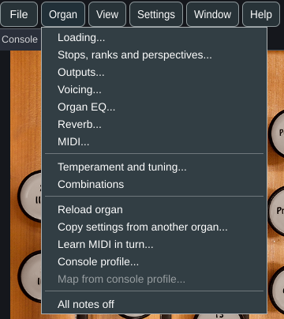
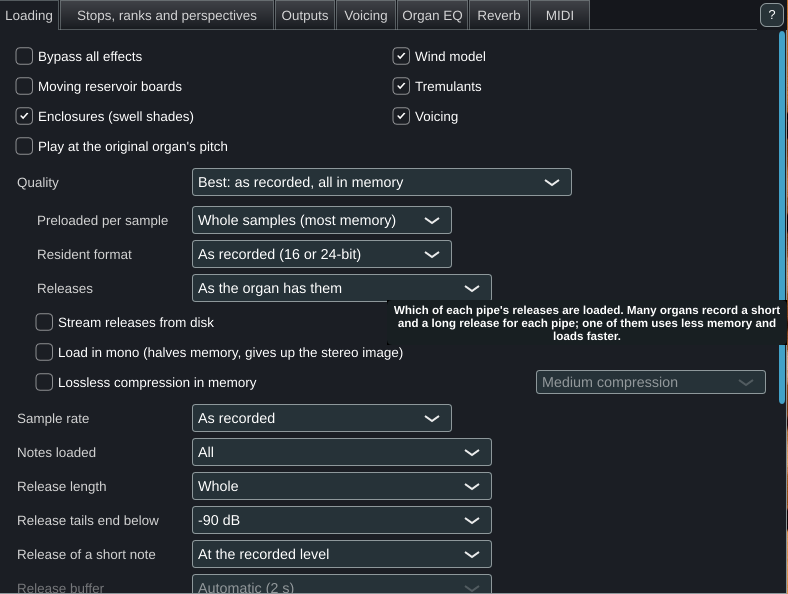
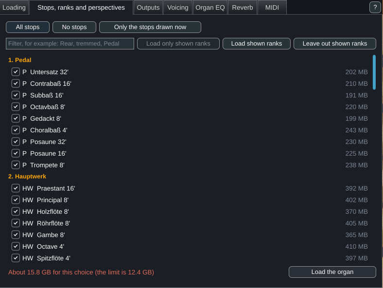
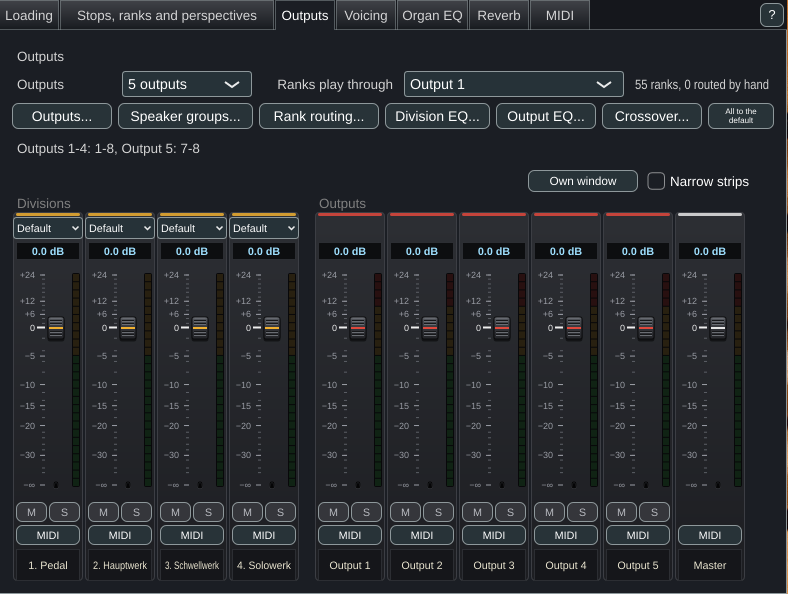
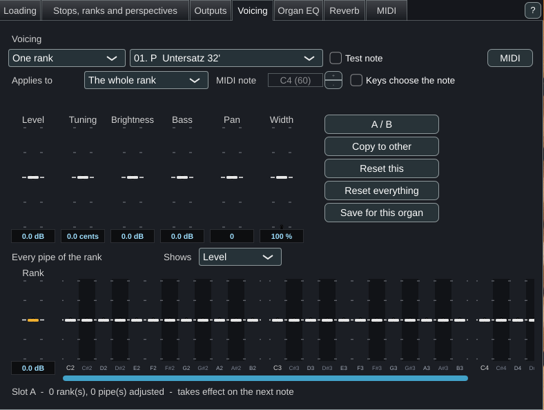
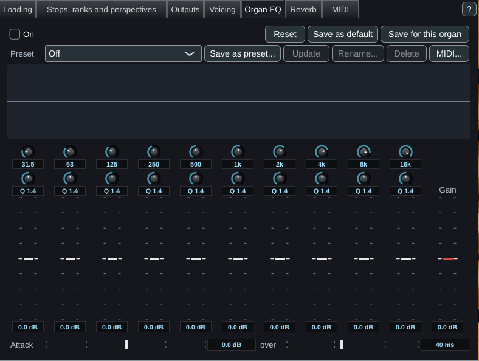
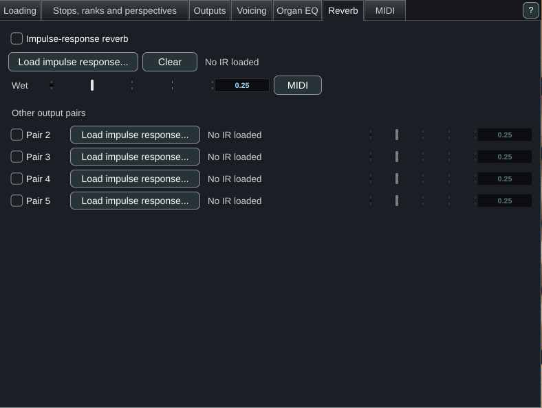
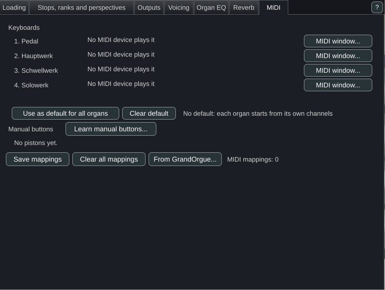

# Organ settings

The **Organ settings** window holds the settings of the organ that is loaded: how its samples are held in memory, which stops, ranks and perspectives are loaded at all, the outputs and the mixer, the voicing of its ranks and pipes, an equaliser for the whole organ, the room, and the MIDI of its keyboards. This page lists every control on every tab in the order the window shows them: what it does, its default, its range or options, when it takes effect and where it is stored. [Memory, loading and streaming](memory.md) explains the loading choices in depth, and [Small, medium and large organs](sizing.md) helps to pick them for a given computer. The settings of the program and of the player's console are in [Settings](general-settings.md).

<iframe src="https://www.youtube-nocookie.com/embed/1WAwPrh7YVM?list=PLEi774VY3MkM&rel=0" title="Video tutorial 08 Organ settings, tuning and voicing" loading="lazy" allow="accelerometer; encrypted-media; gyroscope; picture-in-picture; fullscreen" referrerpolicy="strict-origin-when-cross-origin" allowfullscreen></iframe>

## Opening the window

The **Organ** menu lists the window's tabs: **Loading...**, **Stops, ranks and perspectives...**, **Outputs...**, **Voicing...**, **Organ EQ...**, **Reverb...** and **MIDI...**. Each opens the window on that tab, and each is available while an organ is loaded.

The window opens by itself the first time an organ is loaded, when no settings file exists for it yet. Masterpiece first reads the organ without its audio, so the console appears within seconds and the **Stops, ranks and perspectives** tab can show this organ's own stops with the memory each would take. Closing the window starts the load of the audio with the choices made. After that first time the window opens only from the menu.

The window is titled **Organ settings**, opens at 780 x 560 pixels and can be resized; the Esc key closes it. The **?** button at the right end of the tab bar opens this manual at the section of the tab in front (the **Reverb** tab at [The room](audio.md#the-room)).

| Tab | Content |
|---|---|
| **Loading** | How the organ's samples are held in memory, the engine switches, the releases, the organ's sample cache and its folder. |
| **Stops, ranks and perspectives** | Which perspectives, stops and ranks are loaded. |
| **Outputs** | The outputs and their device channels, where the ranks play, the output EQ and crossover, the speaker groups, the division EQ, and the mixer's strips. |
| **Voicing** | Level, tuning, EQ, pan and width for each rank and pipe, and a desk with every pipe of the rank. |
| **Organ EQ** | A ten-band equaliser for the whole organ, its presets, and the attack's emphasis. |
| **Reverb** | The room: an impulse response and its wet level, and a room for each further output. |
| **MIDI** | What plays each keyboard of the organ, the manual buttons, and the import of GrandOrgue's settings. Present in the standalone application. |

In the VST3, LV2 and AU plugins the window has the six other tabs and no **MIDI**, because the host owns the MIDI ports.

**Display mode** on the **General** tab of [Settings](general-settings.md#display-mode) decides how much the Loading and MIDI tabs show. The tables below mark the rows that only **Advanced** shows.

## One organ, one set of settings

Settings belong to an organ definition. Many sample sets ship one organ as several definitions: a definition for each microphone perspective (near, far, surround), or a full and a light version. Each definition is an organ of its own with its own settings, MIDI mapping and combinations. **File > Other versions of this organ** lists the definitions beside the one loaded (in its package, or in its folder) and loads the one chosen. A package remembers which of its definitions was opened last.

Inside one definition, a set recorded from several microphone positions carries the whole organ once for each position, as separate ranks named for the position (for example `Principal 8 (close)` or `Principal 8 Rear`). The **Stops, ranks and perspectives** tab lists these positions as perspectives, and leaving one out removes its ranks from the load.

The settings file of an organ is named by the organ key: the organ's name reduced to letters and digits, a hyphen, and the unique organ identifier of the definition (`p` and a path hash when the definition has none). Two definitions with the same name and identifier share one file; renaming or moving a sample set keeps its file. [Settings](general-settings.md#where-settings-are-kept) gives the exact rules.

## Loading

The tab scrolls when the window is shorter than its contents. Changes here act on the engine as they are made, and nothing is written to disk until the player chooses. The footer holds the choices: [Footer](#footer). In **Simple** the tab shows **Quality**, the readout and the footer.

### Engine switches

Shown in **Advanced**.

| Control | What it does | Default | Range or options | Takes effect |
|---|---|---|---|---|
| **Bypass all effects** | Plays the samples with no wind model, tremulants, enclosures or voicing, for a slow computer. While it is on, the switches below it are greyed out. | Off | On, off | At once |
| **Wind model** | Simulates the wind supply. Off uses the constant-volume fast path. | On | On, off | At once |
| **Moving reservoir boards** | Treats the reservoir boards as moving bodies: the wind overshoots and wobbles when a chord lands. | Off | On, off | At the next load |
| **Tremulants** | Applies the organ's tremulants. | On | On, off | At once |
| **Enclosures (swell shades)** | Applies the organ's enclosures. | On | On, off | At once |
| **Voicing** | Applies the level and tuning of the [Voicing](#voicing) tab. With the box off the organ plays as recorded; the adjustments stay in the voicing sets and apply again when the box is ticked. | On | On, off | At once, for the notes that start afterwards |
| **Play at the original organ's pitch** | Plays each pipe at the pitch it had on the original instrument; with the box off, each pipe takes a tempered pitch derived from the keyboard. Pipes without that data always use the tempered pitch. | Off | On, off | At once, for the notes that start afterwards |
| **Tremulant pitch** | Adds a pitch swing to this organ's tremulants, in step with the level swing its definition sets. Shown for a GrandOrgue organ. | Off | On, off | At once; organ file `gotremulantpitch` |
| **Swell filter** | Darkens the tone of this organ's swell boxes as they close, on top of the level change its definition sets. Shown for a GrandOrgue organ. | Off | On, off | At once; organ file `goswellfilter` |

### Quality

**Quality** moves the settings indented under it together: **Resident format**, **Load in mono**, **Stream releases from disk**, **Lossless compression in memory** and **Releases**. Each preset also sets **Preloaded per sample** to whole samples. The box shows **Custom** whenever the settings match no preset. Shown in both modes; in **Simple**, **Custom** is greyed. It takes effect at the next organ load.

| Preset | Resident format | Mono | Streaming | Compression | Releases |
|---|---|---|---|---|---|
| **Best: as recorded, all in memory** (default) | As recorded | Off | Off | Off | As the organ has them |
| **High: as recorded, compressed, releases streamed** | As recorded | Off | On | On | As the organ has them |
| **Recommended: 16-bit, releases streamed** | 16-bit | Off | On | Off | As the organ has them |
| **Compact: 16-bit, compressed, releases streamed** | 16-bit | Off | On | On | As the organ has them |
| **Small: 16-bit mono, compressed, releases streamed** | 16-bit | On | On | On | As the organ has them |
| **Smallest: as Small, short releases only** | 16-bit | On | On | On | The shortest only |
| **Custom** | As set | As set | As set | As set | As set |

### Memory

Shown in **Advanced**.

| Control | What it does | Default | Range or options | Takes effect |
|---|---|---|---|---|
| **Preloaded per sample** | How much of each sample is held in memory. An attack is always held to the end of its sustain loop, which in an organ sample lies close to the end of the file. | **Whole samples (most memory)** | **Whole samples (most memory)**, **Up to the loop (less memory)**. A file written by an earlier version may show **Loop + 1 s (earlier choice)** or **Loop + 2 s (earlier choice)**, which stay as they are. A sample whose release is in the same file is always held whole. | Next load |
| **Resident format** | What a held frame costs in memory. **As recorded** keeps each file's 16 or 24 bits. **20-bit** holds a 16-bit file at its own sixteen bits. **16-bit** scales each sample by its own peak first, so a quiet stop keeps the full sixteen bits. | **As recorded (16 or 24-bit)** | **As recorded (16 or 24-bit)**, **20-bit**, **16-bit**, **32-bit float** | Next load |
| **Releases** | Which of each pipe's releases are loaded. Many organs record a short and a long release per pipe; keeping one uses less memory and loads faster. | **As the organ has them** | **As the organ has them**, **The longest only**, **The shortest only**, **None: notes fade when let go** | Next load |
| **Stream releases from disk** | Holds only the start of each release in memory and reads the rest from disk while it plays. Releases are the only samples worth streaming: they run several seconds and play once from the start, straight through. Needs a disk that keeps up. | Off | On, off | Next load |
| Stream box (beside the tick) | How much of each release stays in memory when streaming is on. A larger share gives a slow disk longer to catch up. Greyed out while streaming is off. | **Hold the first second** | **Hold the first second**, **Hold 25% of each release**, **Hold 50% of each release**, **Hold 75% of each release** | Next load |
| **Load in mono (halves memory, gives up the stereo image)** | Folds each stereo sample to one channel. | Off | On, off | Next load |
| **Lossless compression in memory** | Holds 16- and 24-bit samples in a lossless compressed form and decodes them as they play. The sound is identical; memory use is lower. Greyed for **20-bit** and **32-bit float**. | Off | On, off | Next load |
| Compression box (beside the tick) | How hard the samples are compressed. **Light compression** takes the least processor time per voice; **Medium compression** holds the samples in about a third of their memory; **High compression** and **Maximum compression** hold 16-bit samples in less memory for more processor time. A 24-bit sample is coded at medium. | **Medium compression** | **Light compression**, **Medium compression**, **High compression**, **Maximum compression** | Next load |
| **Sample rate** | Converts samples to this rate while loading. A 96 kHz set on a 48 kHz device is held at twice the size it needs otherwise. Only the two lower rates are offered. | **As recorded** | **As recorded**, **48 kHz**, **44.1 kHz** | Next load |
| **Notes loaded** | How many notes of a rank are loaded. A note that is not loaded plays the samples of its nearest loaded neighbour, retuned to its own pitch. **Half, by the sides of the organ** keeps C and C#, E and F, G# and A; each other note plays its neighbour a whole tone away, which stands on the same side of the chest, so the stereo image stays. A noise, a percussive rank, a rank recorded with a tremulant and a rank of fewer than eight pipes keep every note. | **All** | **All**, **Every second note**, **Every third note**, **Half, by the sides of the organ** | Next load |

A change to a setting that decides what the sample cache holds (resident format, mono, compression, streaming, preload, sample rate, notes loaded, releases, release length) rebuilds the cache at the next load. While such a change is pending the tab shows **The cache is rebuilt when this window closes. It can take several minutes.** The cache itself is set on the **General** tab of [Settings](general-settings.md#general).

### Releases

Shown in **Advanced**.

| Control | What it does | Default | Range or options | Takes effect |
|---|---|---|---|---|
| **Release length** | Each release is kept up to this length and fades out over its whole length. A shortened release is always held in memory. Useful for an organ played in a room with its own reverberation or under an impulse response. The two shortest end a note quickly, as a tracker action does: for fast repeated notes. **Releases** set to **None: notes fade when let go** loads no release at all, for a player with an external reverb. | **Whole** | **Whole**, **Up to 0.15 s**, **Up to 0.3 s**, **Up to 0.5 s**, **Up to 1 s**, **Up to 1.5 s**, **Up to 2 s**, **Up to 3 s**, **Up to 4 s**; another length set in the file shows as itself | Next load |
| **Release tails end below** | A release tail stops once it has stayed below this level for a twentieth of a second. A fast passage on many stops leaves hundreds of tails sounding far below hearing, each costing as much as a note. Each tail is judged alone, so with many stops drawn -80 dB can end the last decay of a full chord audibly early. | **-90 dB** | **Never: every tail plays out**, **-80 dB**, **-90 dB**, **-100 dB** | At once; saved with the organ |
| **Release of a short note** | A note let go during its attack has not reached the level its release was recorded from. **Scaled to the time held** starts the release lower, up to the recorded level at the end of the attack. | **At the recorded level** | **At the recorded level**, **Scaled to the time held** | At once; organ file `releaseshortgain 1` while scaled |
| **Release buffer** | How much of each streamed release a voice reads ahead of where it plays. **Automatic** times reads of the organ's own files at each load: a quarter of a second on an SSD, up to 2 s on a hard disk; with an organ loaded it reads **Automatic (N s)**. A longer buffer gives a busy disk more time and uses more memory per voice. Greyed while streaming is off. | **Automatic** | **Automatic**, **0.25 s**, **0.5 s**, **1 s**, **2 s** | Next load |

Each release starts where it joins the sustain, aligned by phase, and crosses over from the sustain at a length set by the pipe's pitch. This needs no setting.

### Organ

Shown in **Advanced**.

| Control | What it does | Default | Range or options | Takes effect |
|---|---|---|---|---|
| **Extra couplers** | Adds the program's own couplers to this organ. The same switch is in **Window > Couplers**. See [Extra couplers](playing.md#extra-couplers). | Off | On, off | Next load, as **Load the organ** does it; organ file |
| **Keep a portable copy of this organ** | Keeps this organ's own sample cache, whatever the **Sample cache** setting says, and a copy of its definition and console pictures in the `Portable` folder, so the organ opens with the drive that holds its installation files unplugged. Made at the next complete load; costs the cache's size on this disk. Streamed release tails still come from the installation files: turn streaming off for an organ that must play without them. | Off | On, off | At the next complete load; organ file |
| **Sample cache for this organ** | Whether this organ keeps a sample cache. **Its own cache** keeps one whatever the **Sample cache** setting of [Settings](general-settings.md#general) says, so its next load is quick. **No cache** loads the organ from its files every time and uses no disk for a cache. | **As in Settings** | **As in Settings**, **Its own cache**, **No cache** | Next load; organ file `organcache 1` or `organcache 0`, absent for **As in Settings** |
| **Delete this organ's cache** | Deletes this organ's sample cache. The organ reads its samples again at its next load. The tooltip gives the cache's size, or **No sample cache for this organ**. | | | At once |
| **Organ folder** | The folder that holds this organ's `OrganInstallationPackages`. Normally derived from the definition's path. A set whose folders are linked in from another tree can leave that path pointing away from the audio, and then the folder is named here. | **From the definition (PATH)** | **Choose...** opens a folder chooser (the display then reads **PATH  -- loads next time**); **Default** returns to the derived folder | Next load; organ file |

### Readout

A line under the controls reads **Resident samples: N MB (N samples, FORMAT, mono or stereo, RATE)**. With compression it adds **N held compressed**. When releases stream it adds **N streamed, N MB left on disk**. If the disk could not keep up it adds **DISK TOO SLOW: N underrun(s)**. It ends with **Voice pool: N voices, N MB**. The line updates twice a second. Shown in both modes.

### Footer

| Button | What it does | Takes effect |
|---|---|---|
| **Revert changes** | Returns every control on the tab to its state when the tab opened. | At once |
| **Keep changes** | Closes the window and keeps the choices for this session. | At once |
| **Load the organ** | Appears while an organ is loaded. Reads **Load the organ to apply** and is highlighted when a loading choice has changed since the tab opened. Closes the window and loads the organ again with the choices. | At once |
| **Save for this organ** | Writes the organ's settings file. The button reads **Saved** for two seconds. | At once |
| **Save as default** | Writes the current choices into the global file, as the starting point of every organ that has no file of its own. | At once |

Closing the window by any route keeps the loading and engine-switch choices for the loads of this organ in this session; another organ's load drops them. If the window closes with a change that rebuilds the cache and the organ has not been loaded again, a question **Rebuild the sample cache?** offers **Rebuild and load again** and **Back to settings**.

The **Performance** tab of [Settings](general-settings.md#performance) holds the faster audio engine, the render threads, the polyphony limit and the memory limit, for every organ.

## Stops, ranks and perspectives

Chooses what the load reads. A perspective, stop or rank that is left out costs no memory and makes no sound. A stop left out keeps its drawstop and its place in pistons, dimmed on the console, so that it is not taken for a broken one. The choice is saved with the organ at once, and it takes effect when the organ is loaded again. A rank that a loaded stop shares, and noises and ranks wired to keys directly, are always loaded.

The list has up to four groups.

| Group | Content |
|---|---|
| **Perspectives** | One row for each microphone position, with the number of ranks. Shown when the set has at least two. For a GrandOrgue organ the heading is **Windchest groups**, which stand in for perspectives. Leaving one out takes every rank recorded from that position; the stops still play from the others. At least one position always stays. |
| Divisions | The drawn stops, under a heading for each division. Click a heading to select or clear every stop of that division. |
| **Effects and noises** | Stops that no drawstop reaches: key-action noises, coupler and tremulant effects. |
| **Ranks** | Every rank by name, the finest choice. A rank left out is left out whichever stop plays it. Each rank's tooltip names the stops that play it (**Played by ...**), or says **Played by no stop: a noise, or wired to a key directly**. |

Each row has a tick box and, at the right, the memory it takes. A stop whose ranks ship no pipes in the set is greyed out (**This stop's ranks ship no pipes in this sample set**). A rank shows unticked and greyed when something above it leaves it out, and its tooltip says why: **Left out with the NAME perspective**, **Left out with the NAME windchest group**, **Left out with its stop**, or **Left out with every stop that plays it**. The rank's own choice waits underneath.

| Control | What it does | Default | Takes effect |
|---|---|---|---|
| **All stops** | Ticks every stop, including the effects and noises. | | At once |
| **No stops** | Unticks every drawn stop. Effects and noises keep their state. | | At once |
| **Only the stops drawn now** | Loads only the stops drawn on the console at this moment. Effects and noises keep their state. | | At once |
| Filter box | Shows only the perspectives, stops and ranks whose name holds the text. The placeholder reads **Filter, for example: Rear, tremmed, Pedal**. Division headings are hidden while a filter is active. | Empty | At once |
| **Load only shown ranks** | Ticks every rank in the filtered list and unticks every other rank: filter for `middle`, then this button, to load one perspective. | | At once |
| **Load shown ranks** | Ticks every rank in the filtered list; the other ranks keep their state. | | At once |
| **Leave out shown ranks** | Unticks every rank in the filtered list. | | At once |
| **Load the organ** | Loads the organ again with the choice. Highlighted when the choice differs from what is loaded. Closes the window. | | At once |
| Total line | **About N for this choice**, with **(the limit is N)** appended; red when the figure exceeds the limit. Reads **Estimating the memory each stop takes...** until the sample files have been measured. The figure is worked out as the load works it out, at the settings of the Loading tab: a sample a loaded rank shares counts once. When every single rank left out would leave nothing to play, it adds **The ranks left out would leave nothing to play, so they load**. | | Updated twice a second |

All stops are ticked by default. The keys work as follows: Space ticks or unticks the focused stop; Up and Down move to the previous and next stop shown; with Shift held, the arrows carry the focused stop's state onto each stop they reach. A press on a stop dragged across others gives them its new state.

**Stored.** In the organ file: `skipstop <stop id>`, `skipperspective <name>` and `skiprank <rank id>`, one line for each item left out. The file is written shortly after a change.

## Outputs

The outputs of the machine, where the ranks of this organ play, and a mixer with a strip for each output and each division, perspective or mix. No sample set declares an audio routing, so the routing is the player's. Up to 64 outputs can be set up, each stereo or mono, each on device channels of its own; an output can also play into other outputs through sends. The outputs belong to the machine and are the same for every organ; where the ranks play belongs to the organ. [Audio, room and mixer](audio.md#output-routing-and-the-mixer) explains how the parts fit together.

### The top of the tab

| Control | What it does | Default | Range or options | Takes effect |
|---|---|---|---|---|
| **Outputs** | The number of outputs. Lowering the count sends the ranks that played on a removed output to the default destination. | **1 output** | **1 output** to **64 outputs** | At once |
| **Ranks play through** | The default destination: where every rank with no route of its own plays, on every organ. | Output 1 | Each output, each speaker group | At once |
| **Outputs...** | Each output's name, stereo or mono, its device channels and the outputs it also plays into. See [Outputs...](#outputs-1). | | | At once |
| **Rank routing...** | The ranks in a list, each to an output or a speaker group, and the mixes. See [Rank routing...](#rank-routing). | | | At once |
| **Output EQ...** | Each output's own ten-band EQ, for the speaker on it. | Off | | At once |
| **Crossover...** | Each output's high-pass, low-pass, delay and polarity. | Off | | At once |
| **Division EQ...** | Each division's treble, bass, pan and width, which every rank of it hears. | 0 dB, centre, 100% | | At once |
| **Speaker groups...** | Outputs that share the pipes sent to them, note by note. | None | | At once |
| **All to the default** | Every rank loses its own route and plays through the default destination. | | | At once |
| **Narrow strips** | More strips in view: the scales keep their ticks, without numbers. | Off | On, off | At once; global file `narrowstrips 1` |
| **Save for this organ** | Writes the organ's settings file, the routes and mixes included. | | | At once |
| Status line | **N ranks, N routed by hand**, with **N stale** when a rank points at an output that no longer exists. | | | |
| Outputs line | Each output's device channels, such as **Output 2: 3-4**; a run of stereo outputs on consecutive channels as one entry, such as **Outputs 1-24: 1-48**; a mono, named or copied output by its name, with **(mono)** for a mono one. **the device gives N channels: the outputs past them play on 1-2** follows when the device has fewer channels than the outputs name. | | | |

### Outputs...

One row per output: a button **Output N** that picks it, a name (placeholder **Name, for example: Gallery left**; the name shows on its strip and in every list), and **Stereo** or **Mono**. The output picked shows its device channels and the other outputs as boxes to tick, under the list: **NAME plays on the device channels** and **NAME also plays into**. Stereo takes the channels two at a time: the first two are the output, the rest copies. Each send has its own level, from -60 to +12 dB in steps of 0.5; a double-click sets 0 dB. An output that already plays into the one picked, itself or through others, takes no send back, so no loop can be made: its box is greyed, with the tooltip **NAME already plays into NAME: a send back would make a loop**.

**All stereo, in order** and **All mono, in order** give every output its channels in turn from channel 1, two in stereo and one in mono, without copies.

### Rank routing...

A list of the ranks, each with a tick box and where it plays. A box at the top narrows the list to a division (**Every division** by default), and a filter box narrows it by name (**Filter, for example: Rear, tremmed**). **Tick the ranks on show** and **Untick all** set the boxes. **Send the ticked ranks to...** sends them to an output, a speaker group or the default. **Put the ticked ranks in a mix...** puts them in a mix: **A new mix**, an existing mix, or **Out of their mix**. A mix is a set of ranks with a fader of its own on the mixer; a rank is in one mix at most. The line under the heading reads **A rank with no route of its own plays through the default destination.**

A rank is routed when a note starts, so notes already sounding keep the output they began on. The output of a rank is independent of its enclosure: a Swell rank stays behind the Swell shades whichever output carries it.

### Output EQ...

One output's EQ at a time, chosen in the box at the top: the ten bands of the [Organ EQ](#equalizer), each with its frequency and width, and a gain. It is a correction for the speaker on that output. It acts after what the output sends to the other outputs, which have their own, and before its meter. The curve shows the output's crossover filters too. A fader moved turns the EQ on; **Flat** puts every band back to 0 dB at the frequency and width it came with. Off or flat, the output is not filtered.

### Crossover...

One row per output: **High-pass** and **Low-pass**, each **Off** or 20 Hz to 20 kHz, picked from its list or typed in Hz or kHz (`80`, `1.2k`), with its kind: **Butterworth 12 dB**, **Butterworth 24 dB**, **Linkwitz-Riley 12 dB** or **Linkwitz-Riley 24 dB**; a **Delay** of 0 to 100 ms; and **Invert** under **Polarity**. Butterworth is 3 dB down at its frequency, for keeping the lowest or highest notes from a speaker; Linkwitz-Riley is 6 dB down, so a low-pass and a high-pass at the same frequency add up flat. The delay sets drivers at different depths in time: 1 ms is 34 cm. The filters act after the output's EQ and before its meter. All off, the output is not touched. Nothing decides the bands: [A subwoofer, or a speaker of several ways](audio.md#a-subwoofer-or-a-speaker-of-several-ways) gives the steps.

### Division EQ...

One row per division with pipes: **Brightness** (a shelf above 3 kHz), **Bass** (a shelf below 200 Hz), each -12 to +12 dB, **Pan** and **Width**. Every rank in the division hears the shelves added to its own; the pans add, held to full left and full right, and the widths multiply. A division of noises alone (a blower, stop and key-action noises) has no row; its noises are voiced on the [Voicing](#voicing) tab. Heard at once and kept with the organ's voicing.

### Speaker groups...

A rank sent to a speaker group sounds on the group's outputs, note by note. **Add a speaker group** adds one; each group has a box per output to tick, a way to spread the notes, and **Remove**. A group with no output ticked plays on output 1.

| Spread | What it does |
|---|---|
| **Across the octave** (default) | Each note of an octave on the next output; each octave and each stop starts one further on. |
| **Chromatic** | Each note on the next output. |
| **By stop** | Each stop whole on one output, the stops taking the outputs in turn. |

A stop's perspectives, tremulant ranks and mixture ranks sound together on one output.

### The mixer

Under the buttons, the strips, side by side by kind, each kind under its title: **Outputs** (with the **Master** strip, the same as the top bar's volume), **Divisions**, **Perspectives** (**Windchest groups** for a GrandOrgue organ) and **Mixes**. A strip has a fader, a meter, **Mute**, **Solo** and a **MIDI** button. A narrow window shows the kinds as tabs, one at a time. A tab, or a right-click on it, opens that kind in a window of its own (**Own window**), to keep beside the console; closing the window puts it back. Phones and tablets have no such windows.

| Control | What it does | Default | Range | Takes effect |
|---|---|---|---|---|
| Fader | A live level, heard at once: 0 dB is the level as voiced. A division's fader acts on every rank in it. A double-click on the readout types a level in dB. | 0 dB | **Off**, -40 dB to +24 dB | At once |
| Meter | The strip's level. On the Master strip, the loudest output after the master volume; red near full scale. | | | Live |
| **Mute** | Silences the strip; the fader stays where it is. | Off | On, off | At once |
| **Solo** | On an output strip, only the soloed outputs sound; on another strip, only the ranks under a soloed strip sound. | Off | On, off | At once |
| **MIDI** | Learns a knob or a pedal for the level (**Learn: move the knob or pedal**), and buttons for mute and solo (**Learn: press the button**). **Clear mapping** removes it. | | | At once |

A double-click on a mix's name renames it; a right-click on its strip offers **Rename** and **Remove the mix**. The box on a strip sends every rank under it to one output or speaker group.

The faders are kept: an output's with the machine's outputs, for every organ, and the others (divisions, perspectives, mixes) with the organ, saved a moment after each move. Mute and solo are not kept. The knobs learned for them are kept with the organ's MIDI mapping; an output's knob is kept for every organ. The control API reads and sets the same faders as `divisions`, `pairs` and `ranklevels`, and the web console shows the division and output faders under **Levels**.

**Stored.** The outputs are the machine's, in the global file: `buses` (each output's number, `m` for mono, its device channels counted from 0, and its sends with their levels), `busname`, `defaultroute`, `busir` (the rooms), `buseq`, `busfilt`, `livepair` (the output faders not at 0 dB) and `groups` (the speaker groups). An organ file from an earlier version that still holds outputs gives them to the global file once, when the global file has none. The organ file holds `route <rank> bus <n>` or `route <rank> group <n>` for each rank routed by hand, `mix` lines and `livelevel` lines; the routes are written by **Save for this organ** and by any other change that makes Masterpiece rewrite the organ file.

## Voicing

The player's adjustments of level, tuning and tone, for a whole rank or for single pipes, in the way a voicer goes round an organ. A rank adjustment and a pipe adjustment add. Level and tuning are applied when a note starts, so they cost nothing while it sounds, and they work with **Bypass all effects** on. Notes already sounding keep what they began with. The **Voicing** box on the [Loading](#engine-switches) tab turns every level and tuning adjustment off while it is cleared; the organ then plays as recorded.

| Control | What it does | Default | Range or options | Takes effect |
|---|---|---|---|---|
| **Choose by** | Whether the next box picks one rank, or every rank of a stop, a division or a windchest at once. A change reaches each rank chosen; with **One pipe** it reaches the pipe at that note in each. **Ranks of a windchest** is offered on an organ with two windchests or more. | **One rank** | **One rank**, **Ranks of a stop**, **Ranks of a division**, **Ranks of a windchest** | At once |
| Rank box | The rank, stop, division or windchest, with the ranks it reaches. | The first | The items of the loaded organ | At once |
| **Test note** | A key plays what is chosen here alone; another key moves it there, and the same key again stops it. | Off | On, off | At once |
| **Keys choose the note** | A key played chooses its pipe, with the test note or without it. Off, the pipe chosen stays, and the test note plays its neighbours beside it. Cleared when **Applies to** leaves **One pipe**. | Off | On, off | At once |
| **MIDI** | Buttons on the console for level and tuning, acting on the rank or pipe chosen here: **Voicing: level -**, **Voicing: level +**, **Voicing: tuning -**, **Voicing: tuning +**, each with **Learn**, **MIDI window...** and **Clear mapping**. The mapping is the console's, the same on every organ. | | | At once |
| **Applies to** | Whether the sliders adjust the whole rank, one pipe of it, or the pipes on one side of the chest. | **The whole rank** | **The whole rank**, **One pipe**, **Pipes on the C side**, **Pipes on the C# side** | At once |
| **MIDI note** | The pipe, chosen by its note, shown with its name. Active when **One pipe** is selected. A rank without a pipe at that note reports **This rank has no pipe at that note**. | 60 | 0 to 127 | At once |
| **Level** | The level change of the rank or of the pipes chosen. | 0 dB | -12 to +12 dB in steps of 0.1; the control API reaches -24 dB | On the next note |
| **Tuning** | The pitch change. | 0 cents | -50 to +50 cents in steps of 0.1 | On the next note |
| **Brightness** | The treble shelf, above 3 kHz, of the rank or of the pipes chosen. A pipe's own shelf is on top of its rank's. | 0 dB | -12 to +12 dB in steps of 0.5 | At once for a rank, on the pipes sounding too; from the next note for a pipe |
| **Bass** | The bass shelf, below 200 Hz, as **Brightness**. | 0 dB | -12 to +12 dB in steps of 0.5 | As **Brightness** |
| **Pan** | Where the rank stands, from full left to full right. A rank's only. | 0 | -100 to +100 | At once |
| **Width** | The rank's stereo width: 0% mono, 100% as recorded, 200% twice as wide. A rank's only. | 100% | 0 to 200% | At once |
| **A / B** | Swaps between the two complete voicing sets A and B, so a change can be compared with what was there before. | Slot A | A, B | At once |
| **Copy to other** | Copies the live slot to the other, so that B starts as a variation of A. | | | At once |
| **Reset this** | Returns the selected rank or pipe to 0 dB and 0 cents. | | | On the next note |
| **Reset everything** | Clears every adjustment in the live slot. | | | On the next note |
| **Save for this organ** | Writes the organ's settings file. | | | At once |
| Status line | **Slot A  -  N rank(s), N pipe(s) adjusted  -  takes effect on the next note**, after **Changes N ranks** or **Changes N pipes** when a change reaches more than one, and **Plays FILE** for one pipe: the file it plays, which names the sound of a noise rank's pipe. | | | |

### Every pipe of the rank

Under the sliders, a desk of upright faders: the rank's own value at the left (**Rank**), then a fader per pipe, lowest note first, a gap between octaves, the sharps coloured as on a keyboard. **Shows** chooses what the desk shows and sets: **Level**, **Tuning**, **Brightness** or **Bass**. A click on a pipe's fader chooses that pipe above and sets it; a drag across the pipes draws them, each note on the straight line between the two values; a double-click puts one back; the wheel moves one a step. With several ranks chosen, a pipe's fader moves the pipe at that note in every rank chosen.

### EQ, pan and width

A shelf for the treble and one for the bass, for each rank, each division and each pipe. The treble acts above 3 kHz, the bass below 200 Hz, each from -12 to +12 dB. A rank's shelves are added to those of its division, and a pipe's own to its rank's, so a division can shape every rank in it, a rank can be shaped on its own, and a pipe that stands out from its neighbours can be brought back in line. While no shelf is set anywhere, the organ sounds as recorded and the filters cost nothing; a pipe without shelves of its own is never filtered on its own. The same holds for pan and width: in the middle and at 100% nothing is processed. These need the effects: **Bypass all effects** switches them off. A division's shelves, pan and width are set in **Division EQ...** on the [Outputs](#division-eq) tab.

**Stored.** In the organ file, as `voicingadj` lines for both slots, `voicingdiv` lines for the divisions and `voicingslot b` when slot B is live. The voicing is saved with the organ a moment after each change, and by **Save for this organ**. A rank number has no meaning in another instrument, so adjustments never carry across organs, except between versions of the same organ through **Organ > Copy settings from another organ...**.

## Equalizer

The **Organ EQ** tab.

A correction for the room and the speakers, applied to the whole organ. The organ as recorded is the reference, so the equaliser is off until it is turned on here. The curve in the upper part of the tab shows the combined response from 20 Hz to 20 kHz on a logarithmic scale, over the live spectrum of the organ; it is drawn orange while the equaliser is on and grey while it is off.

| Control | What it does | Default | Range or options | Takes effect |
|---|---|---|---|---|
| **On** | Switches the equaliser on. A band moved turns it on too. | Off | On, off | At once |
| **Preset** | Sets the EQ to a preset at once and turns it on: the program's ten under **Presets**, then the player's own under **Your presets**. Reads **Edited** when the sliders no longer match any preset, and **Off** while the equaliser is off. | | The ten below and the player's own | At once |
| **Save as preset...** | Keeps the EQ as it is now as a preset of the player's own, under a name, for every organ. | | | At once |
| **Update** | Stores the EQ as it is now in the player's preset last chosen. The program's ten cannot be changed. | | | At once |
| **Rename...**, **Delete** | Rename or delete the player's preset last chosen. A deleted preset's MIDI mapping goes with it. | | | At once |
| **MIDI...** | Maps a MIDI button to the preset chosen, or to **Voicing EQ: next preset** and **Voicing EQ: previous preset**, which go round the whole list. **Learn**, **MIDI window...** and **Clear mapping**, as on a piston. The mapping is the console's, the same on every organ. | | | At once |
| **Reset** | Brings the default EQ back, the one kept with **Save as default** (off and flat when none is kept), and forgets the EQ saved for this organ. The organ then starts from the default at its next load. | | | At once |
| **Save as default** | Keeps the EQ as it is now for every organ that has none of its own: a correction for the speakers and the room. Reads **Saved** or **Could not save** afterwards, and returns to its label at the next change. | | | At once |
| **Save for this organ** | Keeps the EQ as it is now with this organ, the **On** box included, for its next load. Reads **Saved** or **Could not save** afterwards. | | | At once |
| Ten band faders | One fader for each band, at 31.5, 63, 125, 250, 500 Hz, 1, 2, 4, 8 and 16 kHz as they come. The lowest and highest bands are shelves; the other eight are peaks. A double-click returns a fader to 0. | 0 dB | -12 to +12 dB in steps of 0.5 | At once |
| Frequency knob (under each band) | The band's frequency. A double-click returns it to the frequency it came with. A value can be typed, in Hz or with `k`. | As above | 20 Hz to 20 kHz | At once |
| Width knob (under each band) | For a peak, the width as a Q: more is narrower. For a shelf, the slope as a Q: 1.4 the steepest, less a gentler slope. A double-click returns it to 1.4. | Q 1.4 | Q 0.3 to 8 | At once |
| **Gain** | The output gain, to make up for what the bands add or take. | 0 dB | -12 to +12 dB in steps of 0.5 | At once |
| **Attack** and **over** | The attack's emphasis: each pipe begins this much louder, or softer when negative, and comes to its own level over the time given. More or less chiff, on the pipes' own speech; noises and releases start as recorded. Applies whether the EQ is on or off. A double-click returns the level to 0. | 0 dB (off), 40 ms | -12 to +12 dB in steps of 0.5; 5 to 300 ms | From the next note |

Every organ starts from the default EQ, which is off and flat until **Save as default** keeps another. An organ gets an EQ of its own only from **Save for this organ**; other saves of the organ file leave it on the default. Changes on the tab are live and are kept only by these buttons. A preset changes the live EQ the same way: **Save for this organ** or **Save as default** keeps it.

### Presets

The program's ten presets, in dB for the bands from 31.5 Hz to 16 kHz:

| Preset | 31.5 | 63 | 125 | 250 | 500 | 1k | 2k | 4k | 8k | 16k | Gain | For |
|---|---|---|---|---|---|---|---|---|---|---|---|---|
| **Flat** | 0 | 0 | 0 | 0 | 0 | 0 | 0 | 0 | 0 | 0 | 0 | The organ as recorded |
| **Brighter** | 0 | 0 | 0 | 0 | 0 | 0 | +1 | +2 | +3 | +3 | -1 | Upper harmonics, for a set that sounds dull through the speakers |
| **Chiff** | 0 | 0 | 0 | 0 | 0 | +1 | +2 | +3 | +2 | +1 | -1.5 | The speaking attack of flue pipes |
| **Warm** | +1 | +2 | +2 | +1 | 0 | 0 | 0 | -1 | -2 | -3 | -1 | A fuller, rounder sound |
| **Less boom** | -3 | -3 | -2 | -1 | 0 | 0 | 0 | 0 | 0 | 0 | 0 | A room whose bass booms, or speakers close to a wall |
| **Small speakers** | +5 | +4 | +2 | 0 | 0 | 0 | 0 | 0 | 0 | 0 | -3 | Speakers that cannot reach the pedal's fundamentals |
| **Softer treble** | 0 | 0 | 0 | 0 | 0 | 0 | -1 | -2 | -3 | -3 | 0 | Mixtures and reeds that sound harsh in a small room |
| **Clarity** | 0 | 0 | -1 | -2 | -2 | 0 | +1 | +1 | 0 | 0 | 0 | Less of the low middle that makes a full registration muddy |
| **Quiet listening** | +5 | +4 | +2 | 0 | 0 | 0 | 0 | +1 | +2 | +3 | -3 | Playing at a low level, where the ear hears less bass and treble |
| **Headphones** | +1 | +1 | 0 | 0 | 0 | 0 | -1 | -1.5 | -1 | 0 | 0 | Headphones |

A preset of the player's own can start from any of them: choose it, move the faders, then **Save as preset...**.

**MIDI.** A button learned for a preset recalls it, and **next preset** and **previous preset** step through the list; the status line names the preset recalled. The mapping is kept with the console mapping (`eq-preset <id>`, `eq-preset-next`, `eq-preset-prev` in the `.mpmidi` files), so the same buttons work on every organ.

**Stored.** The default is the key `defaulteq <on> <gain> <band 1> ... <band 10>` in the global file, written while the default is on or not flat. The organ's own EQ is the key `eq <on> <gain> <band 1> ... <band 10>` in the organ file, written whatever it is, off and flat included, once **Save for this organ** has been pressed. When a band's frequency or width has moved, both lines go on with the ten frequencies and the ten widths. **Reset** removes the `eq` line from the organ file. The attack is the key `attack <dB> <ms>` in the organ file, absent while it is off. The player's presets are the keys `eqpreset <id> <gain> <band 1> ... <band 10> <name>` in the global file, one per preset, numbered from 101, and `eqpresetnext <id>`, the number the next one gets; a number is never given twice. The program's ten are numbered 1 to 10 and are not written.

## Reverb

The room of this organ: an impulse response, its wet level, and a room of its own for each output past the first, under **Other output pairs**. [The room](audio.md#the-room) describes every control and how the response is used.

## MIDI

The keyboards of the loaded organ. The console's inputs, outputs and learned actions are on the **MIDI** and **Console MIDI** tabs of [Settings](general-settings.md#midi). [MIDI and consoles](midi.md) explains the channel assignment in depth.

| Control | What it does | Takes effect and storage | Shown in |
|---|---|---|---|
| **Keyboards** heading, then one row for each playable keyboard of the loaded organ | The keyboard's name, what plays it, one line per entry (`Any device  ch 2  keys C2 (36) to C7 (96)`), or **No MIDI device plays it**, and **MIDI window...**, which opens the [dialog for the manual](midi.md#the-dialog-for-one-manual). In a plugin a keyboard with no entry reads **Default (channel N)**. | | Both |
| Shared line | When two keyboards answer one channel, a line **Shared -- Channel N: name, name** names them. One keyboard can play two divisions this way. When a keyboard's channel already plays another, a line says which channel to choose to play both. | | Both |
| **Use as default for all organs** | Keeps the channel of each keyboard as the starting channels of every organ that has none saved. | At once. Written to the global file as `consolechannel <role> <channel>`. | Advanced |
| **Clear default** | Removes that default. The line beside the buttons returns to **No default: each organ starts from its own channels**. | At once | Advanced |
| **Manual buttons** | The controls that bring a manual to another keyboard, one line each, or **No pistons yet.** **Learn manual buttons...** lists the manuals; choosing one opens its dialog at the **Controls** tab. | At once. Saved with the organ's MIDI mapping. | Advanced |
| **Save mappings**, **Clear all mappings** | **Save mappings** writes the organ's mapping to disk. **Clear all mappings** removes every binding of the mapping in use. | At once | Advanced |
| **From GrandOrgue...** | Reads GrandOrgue's settings file for this organ and brings over its MIDI, registrations, voicing, swells and temperament. The organ must be loaded from its GrandOrgue `.organ` file. See [Bringing an organ over from GrandOrgue](midi.md#bringing-an-organ-over-from-grandorgue). | At once | Both |

When a default exists, the line beside the buttons reads **Default for organs with no channels saved:** followed by entries such as `Pedal 1; Manual 1 2`.

## Where the organ's settings are kept

The organ file is `organs/<organ key>.mporgan` in the data folder (see [Settings](general-settings.md#where-settings-are-kept) for the folder on each system). It is plain text; each line is a key, a space and a value, and lines that start with `#` are ignored. When Masterpiece loads an organ it reads the global file first and the organ file after it, so an organ file overrides the global defaults and a value given on the [command line](command-line.md) overrides both for that run.

**Save for this organ** on the Loading, Outputs, Voicing and Organ EQ tabs writes the whole file from the live state. So do the automatic writes that follow a change to the stops and perspectives, the voicing, the faders, the release tail cutoff, the reverb, the combinations window and a few other items. A change on the Loading tab that is only kept for the session can therefore reach the file with one of those writes. The stream share, the release tail cutoff and the organ folder write the file themselves.

| Key | Value | Set by |
|---|---|---|
| `storage` | `16`, `20`, `24` or `32` (32 is float) | **Resident format** |
| `mono` | `1` or `0` | **Load in mono** |
| `compress` | `0` off; `1` medium, `2` light, `3` high, `4` maximum | **Lossless compression in memory** and its box |
| `releases` | `0` all, `1` longest, `2` shortest, `3` none | **Releases** |
| `releaselength` | Milliseconds, `0` for whole | **Release length** |
| `releasecutoff` | dB, `0` for never | **Release tails end below** |
| `releaseshortgain` | `1` while scaled | **Release of a short note** |
| `releasebuffer` | The release buffer in seconds, two decimals: `0.00` for automatic, `0.25`, `0.50`, `1.00`, `2.00` | **Release buffer** |
| `reverb` | `<on> <wet> <path>` | The **Reverb** tab |
| `rate` | Hz, `0` as recorded | **Sample rate** |
| `sparse` | `2` every second note, `3` every third note, `4` half by the sides; absent means every note | **Notes loaded** |
| `stream` | `1` or `0` | **Stream releases from disk** |
| `streamhead` | Frames of a release held when streaming | Set by Masterpiece |
| `streamheadpct` | `0`, `25`, `50` or `75` | The stream box |
| `preload` | `0` whole, `1` up to the loop, or a frame count from an earlier version | **Preloaded per sample** |
| `root` | A folder, written only when set | **Organ folder** |
| `simple`, `wind`, `bellows`, `tremulant`, `enclosure`, `voicing`, `originalpitch` | `1` or `0` | The engine switches |
| `gotremulantpitch`, `goswellfilter` | `1`, written only while on | **Tremulant pitch**, **Swell filter** |
| `programcouplers` | `1` or `0` | **Extra couplers** |
| `basscouplers`, `bassrange`, `pedalmanual` | The bass and melody couplers, the top key of the bass, the manual the pedal divisional follows | **Window > Couplers**, the Combinations window |
| `gain` | The master gain (linear) | The volume slider in the top bar |
| `routing`, `route <rank> bus <n>`, `route <rank> group <n>` | Where a rank plays | **Rank routing...** on the **Outputs** tab |
| `mix` | A mix: its number, its ranks and its name | **Put the ticked ranks in a mix...** |
| `livelevel` | A fader not at 0 dB: `rank`, `division`, `group` or `mix`, its number and its value | The mixer's strips |
| `voicingadj`, `voicingdiv`, `voicingslot` | The voicing sets A and B, the divisions and the live slot | The **Voicing** tab, **Division EQ...** |
| `pipedetune`, `windsway` | The unevenness of the pipes' tuning and of the wind, in cents with one decimal; written only when above zero | **Unevenness** in the tuning panel |
| `attack` | The attack's emphasis in dB and its length in ms, as `attack 4.0 60`; absent while it is off | The **Organ EQ** tab |
| `eq` | The organ's own equaliser, written whatever it is, off and flat included; absent while the organ plays the default EQ (`defaulteq` in the [global file](general-settings.md#the-global-file)) | **Save for this organ** on the **Organ EQ** tab |
| `skipstop`, `skipperspective`, `skiprank` | One item left out | The **Stops, ranks and perspectives** tab |
| `portable` | `1` | **Keep a portable copy of this organ** |
| `organcache` | `1` its own cache, `0` no cache; absent for **As in Settings** | **Sample cache for this organ** |
| `combset` | The combination set in use | **Set in use** in the Combinations window |
| `licenceconfirmed` | `1` | **Organ > Licence accepted** |
| `temperament`, `pitchhz`, `transpose` | The tuning chosen for this organ | The tuning controls |
| `combwindow`, `pagewindow` | The place of the combinations window and of console pages in windows of their own | The windows themselves |
| `control`, `switch`, `state`, `stopon` | Controls and switches the organ asks to remember, and the registration saved as the starting state | The console |
| `organname`, `definition` | The organ's name and its definition file, for the player reading the file | Every write |

The outputs (`buses`, `busir`, `groups` and the other output keys) are kept in the [global file](general-settings.md#the-global-file). The key `cache` of an earlier version is ignored: the sample cache is a program setting. When the volume slider moves, only the `gain` line is rewritten, so the slider writes no other unsaved change to disk.
