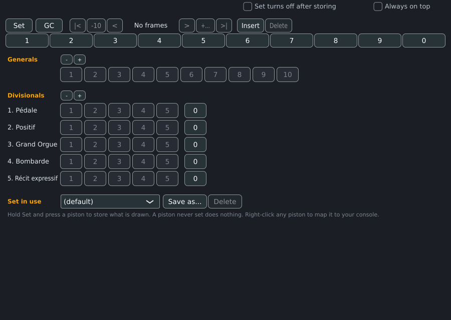
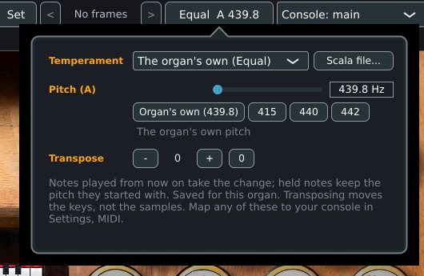
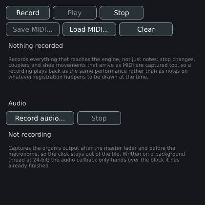

# Playing

This page covers what a player does at the console: drawing stops, couplers
and tremulants, the organ's own pistons, the player's own combinations and
sequencer, the crescendo and the swell boxes, the transposer, temperament and
pitch, the metronome, the recorder, and what Masterpiece remembers between
sessions. Each section says how the feature is reached. The window itself is
described on [A tour of the window](window.md).

## Drawing stops, couplers and tremulants

A stop, coupler or tremulant is drawn from any of these:

- its drawstop on the console, or its rectangle in a panel or tile in the stop
  list (see [A tour of the window](window.md));
- a MIDI message mapped to it, or a computer key assigned to it in its MIDI
  window (see [MIDI and consoles](midi.md));
- a piston, a general, a divisional, the crescendo or the sequencer.

Drawing goes through the organ's own wiring: the click moves the knob a player
would move, and the stops, couplers and noises that the wiring joins to the knob
follow it.

A key that is down answers to the registration as it changes. Drawing a stop
while a key is held makes that rank speak, and pushing it in silences it. A
coupler drawn or pushed in while keys are held reaches, or stops reaching, the
divisions it couples at once. A tremulant switch that swaps a stop's rank for
its alternate recording sounds the held notes again on the other rank.

A tremulant shakes the pipes only when the engine runs its detailed path. The
**Tremulants** box in **Settings > Organ settings...**, tab **Loading**, is on by
default, and the **No DSP** box in the top bar bypasses tremulants together with
the wind model, enclosure shading and voicing.

A stop that was left out of the load, and a locked stop of a demo set, are
described under [Stops that make no sound](window.md#stops-that-make-no-sound).

### Drawing every stop

The program has no button that draws every stop. The command line draws them for
a scripted take: `--draw-stops all`, described on
[Command line](command-line.md). The opposite is the general cancel, which
pushes in every stop, coupler and tremulant of the registration (see
[Generals and cancels](#generals-and-cancels)).

### Panic

**Panic** in the top bar releases every key on every channel, as a console's
cancel does. An organ pipe has no decay, so a note left down by a lost MIDI
note-off, or by a coupler changed in mid-chord, sounds until something releases
it.

## The organ's own pistons

An organ declares the pistons its builder put on the console, and the console
draws the ones the set draws. They work as follows.

- A piston fires on the press and lets itself out again, as a button does.
- Which combination a piston fires is declared by the organ, either directly or
  by a type code (101 for General 01, 100 for General cancel).
- The organ's setter is the switch with assignment code 12. While it is engaged,
  a press on any piston stores what is drawn into that piston, and recalls
  nothing. The setter of the organ and the **Set** button of the
  Combinations window follow each other: pressing either lights both.
- A capture reads the state that results from the wiring, which is what is seen
  and heard. A stop pulled by a coupler or by another piston is stored as drawn.
- A combination the organ marks as fixed does not capture. A cancel disengages
  and never engages; a combination marked so engages and never disengages.
- Stored combinations belong to the player. They are kept in the combination
  file described under [Combination sets](#combination-sets), and never in the
  sample set. A combination that was never captured recalls what the organ
  declares for it.
- A drawn **Set**, **GC** and cancels that are wired to the organ's real switches
  work from the drawn picture.
- The General cancel of GrandOrgue organs is the player's own general cancel.
- Option **General Cancel also puts the keyboards back on their own manuals**
  (**Settings > General settings > MIDI**, off by default): the cancel then also
  returns every keyboard moved by a manual button to the manual it started on.

## The player's own combinations

Every organ has generals, divisionals, cancels and a sequencer of the player's
own, whatever its file declares. They are the same on every organ, answer the
same setter as the organ's pistons, and are saved per organ in the player's data.

### What a registration holds

A registration holds the drawn state of stops, couplers and tremulants and
nothing else. The blower, noises, action sounds and page switches are not part
of it, so a general cancel never stops the blower. A stop whose name contains
`noise` or `blower`, a stop in a division with `noise` in its name, a stop that
sounds only noise ranks and a stop worked from a switch named `blower` are left
out.

On an organ with a drawn console, the registration holds what has a drawstop on
the console. An organ that draws no console offers every stop, coupler and
tremulant.

A **divisional** covers one division: its stops, the couplers that feed it
(counted to the division of the keyboard they are played from), and the
tremulant that shakes it. A coupler or tremulant whose division the file does
not make clear belongs to the generals only. The Combinations window lists the
divisions that hold at least one element, the pedal first and then by manual
number.

### The Combinations window

**View > Combinations** shows or hides the window. It is a window of its own,
resizable in height, with a close button that hides it. The first time an organ
opens, the window is closed; after that it opens as the player left it, at the
position and size saved with the organ. On the first showing it sits at the
bottom right of the main window.

| Control | What it does |
|---|---|
| **Always on top** | Keeps the window above every other program's windows. Off, the window stays above the console while Masterpiece is in front. Off by default; kept for every organ. On Linux the stacking is fixed when the window opens. |
| **Set turns off after storing** | After a piston clicked in this window has stored a combination, **Set** turns off, so the next click recalls it. Off by default; kept for every organ. A console's own Set stays down until pressed again. |
| **Set** | A toggle. While on, a piston stores what is drawn and recalls nothing. It is lit red while capture is on. |
| **GC** | The general cancel: pushes in every stop, coupler and tremulant of the registration. |
| **\|<**, **-10**, **<**, readout, **>**, **+10**, **>\|** | The sequencer: first frame, ten frames back, previous, the frame readout, next, ten frames on, last frame that holds anything. |
| **Insert**, **Delete** | Open an empty frame at the current frame, or take it out. |
| Digits **1** to **9**, **0** | Go to frame 1 to 9, and frame 10 for **0**. |
| **Generals** with **-** and **+** | One button per general, 10 to a row. **-** and **+** show 10 fewer or 10 more. |
| **Divisionals** with **-** and **+** | One row per division, with one button per divisional and a **0** at the end of the row that cancels the division. **-** and **+** show one fewer or one more on every division. |
| **Set in use**, **Save as...**, **Delete** | The combination sets. See [Combination sets](#combination-sets). |

| Quantity | Default | Range |
|---|---|---|
| Generals | 10 | 10 to 100, in steps of 10 |
| Divisionals per division | 5 | 1 to 20 |
| Frames of the sequencer | none stored | 1 to 999 |

The counts are saved with the combination set. A piston button is dim when it
was never set, lighter when it holds a registration, and amber when it is the one
whose registration is drawn now. Any hand-drawn change unlights every piston.
Recalling a general replaces every lit piston; recalling a divisional lights it
and unlights only the general.

### Capture

There are two ways to store a registration.

1. Turn **Set** on, then press the piston. Pressing a piston while **Set** is on
   stores what is drawn into it. **Set** stays on until it is turned off again,
   or turns off after the store when **Set turns off after storing** is ticked.
2. Press the piston, draw the stops, then press **Set** in the top bar. **Set**
   in the top bar is momentary. It stores what is drawn into the piston or the
   step chosen last, which is the last general, divisional or frame pressed or
   reached, and the status line reads **Stored in \<name\>**. With nothing chosen
   it reads **Choose a piston or a step first; then Set stores what is drawn into
   it**. When capture is on from the console or the Combinations window, **Set**
   lights, and a press on it lets capture go (**Set is off: pistons recall
   again**).

Names of targets read `General 3`, `Pedal divisional 2` (the division's name) and
`Step 12`.

### Recall

Pressing a general sets every element of the registration to its stored state.
Pressing a divisional sets the elements of its division. A registration stored
with nothing drawn recalls as a cancel. A piston that was never set does nothing
and clears nothing; pressing it chooses it as the target for **Set**.

### Generals and cancels

**GC** pushes in every element of the registration. Each division's **0** pushes
in the elements of that division. A cancel leaves the blower, noises and page
switches alone.

### The sequencer and its frames

The sequencer holds up to 999 frames, each a registration of the whole console.
It is walked with two pistons, previous and next, and is meant for the pistons
of a piece: one press, no looking.

- The frame readout in the top bar reads **Frame 3 / 12** and the one in the
  Combinations window **Frame 3 of 12**. The second number is the last frame
  that holds anything, or the current frame if that is higher. With no frame
  stored the readouts read **No frames**; the window shows **- of 12** with
  stored frames and frame 0.
- Stepping forward stops after the last frame that holds anything, and stepping
  back stops at frame 1. It never wraps. Stepping from frame 0 goes to frame 1.
- With **Set** on, stepping captures what is drawn into the frame it lands on,
  and may run past the last frame to frame 999. Keep **Set** on, walk forwards and
  set each frame as you go: that is how a sequence for a piece is built.
- **\|<** goes to frame 1, **>\|** to the last frame that holds anything, **-10**
  and **+10** move by ten frames and stop at the ends. The digit buttons go to a
  frame without leaving the keys; outside capture they stop at the last frame
  that holds anything.
- A click on the readout, in either place, asks for a frame number of up to 3
  digits (**Go to a frame**). A number past the last frame goes to the last
  frame, unless **Set** is on.
- **Insert** opens an empty frame at the current frame (frame 1 when none is
  current) and the frames after it move up one. It does nothing when frame 999
  holds a registration. **Delete** takes the current frame out and the frames
  after it move down one.
- A frame recalled by the sequencer behaves exactly as the same registration
  pressed by hand.
- The sequencer buttons in the top bar, **<** and **>**, step the same
  sequencer; **<** is disabled at frame 1 and **>** is disabled at the last
  frame unless **Set** is on.

### Combination sets

A combination set is a whole registration book: a recital's, a service's. An
organ has the default set and any number of named sets.

| Control | What it does |
|---|---|
| **Set in use** (**Settings > General settings > Combination sets**, **In use**) | Chooses the set. The set being left is saved first. The default set is listed as **(default)**. The choice is kept for the organ. |
| **Save as...** (**Save as new set...** in General settings) | Asks for a name (**A name for this registration set:**), writes a copy of the live registrations under it and switches to it. |
| **Delete** (**Delete set**) | Deletes the set in use and returns to the default set. The default set cannot be deleted. |

A set holds the organ's own pistons that were captured, the player's generals,
divisionals and frames, and the counts of generals and divisionals. A set that
defines fewer pistons than the last one leaves none of the last one behind.

The sets are files in the data folder, `combinations/<organ>.mpcomb` for the
default set and `combinations/<organ>.<name>.mpcomb` for a named set. The name
becomes part of the file name; the characters `/ \ : * ? " < > |` and control
characters become `_`, and trailing dots and spaces are dropped. The file holds
the organ's own pistons first, then the player's lines, each starting with
`player`. Elements are stored as `s<stop>` and `w<switch>`, so a file survives
an organ update that adds or reorders stops; an element the organ no longer has
is dropped when the file is read. To copy a set to another computer, copy the
file.

A capture is written within a quarter of a second, and at once when the
program closes. Switching a set writes the set being left.

### Mapping the pistons to a console

A right-click on **Set**, **GC**, a general, a divisional, a **0**, or any
sequencer button opens a menu: the current mappings, **Learn** (for **Set**,
**Learn: held while pressed** and **Learn: toggles**), **MIDI window...** and
**Clear mapping**. Press the control on the console after **Learn**; a second
right-click cancels. **Settings > General settings > MIDI** has the buttons
**Learn sequencer +** and **Learn sequencer -**. The mappings of the sequencer,
generals, setter and the page and tuning buttons are kept for every organ in
`midi/console.mpmidi`. See [MIDI and consoles](midi.md).

## Crescendo and swell boxes

### Swell boxes

A swell box is an enclosure. Its shoe is a continuous control with values from
0 to 127. The shoe is worked in these ways:

- the organ's drawn shoe, dragged on the console;
- a fader of **View > Swell faders**, one for each shoe;
- a fader in the **Expression** section of a panel;
- a pedal or fader mapped to it (right-click the shoe, see
  [MIDI and consoles](midi.md)).

Every shoe starts open, at 127, when an organ loads, and is forgotten at the next load. The
effect of the box on the sound is the **Enclosures (swell shades)** box in
**Settings > Organ settings...**, tab **Loading**; it is on by default, and the
**No DSP** box bypasses it.

When a pedal does not send the whole of 0 to 127, put the pedal in the closed
position, right-click the shoe and choose **Closed position: where the pedal is
now**; do the same for **Open position: where the pedal is now**. **Use the
pedal's whole travel** restores 0 to 127.

### Crescendo

A crescendo is one continuous control with a row for each step. Each row names
the switch that fires that step's registration. The same mechanism starts the
blower and fires enclosure noises, so a shoe that drives switches may do more
than one thing.

- Moving the control fires every threshold it sweeps past, in the order it
  passes them. A drag from nothing to full fires each step in turn and the top
  one lands last; a drag back fires them in reverse, so the registration that
  stays is the one that belongs to where the control stopped.
- The steps are alternatives. A new step disengages the previous one, so the
  shoe can fire it again.
- A step is a threshold crossing, which lets an organ give a switch hysteresis:
  a blower can start at 120 on the way up and stop at 126 on the way down.
- The crescendo is the organ's drawn control, or the **Crescendo** fader in a
  panel's **Expression** section, which is present when the organ has a staged
  control with at least 3 steps; the control with the most steps is taken. It is
  mapped to a pedal like a shoe.
- The control that a player moves can differ from the control that carries the
  steps; Masterpiece follows the organ's linkages up to the control that nothing
  feeds and moves that one.

The player's generals and the sequencer do not hold the crescendo.

## Transposer, temperament and pitch

The tuning button in the top bar shows what is in force, for example `Equal  A
440.0  +2`: the temperament, the pitch of A in Hz, and the transposition when it
is not zero. A click opens the tuning panel next to the button.

Each setting applies to notes played after it changes. A held note keeps the
pitch it started with. The three settings are saved with the organ.

### Temperament

The **Temperament** selector lists **The organ's own** (followed by the name of
that temperament, or `Equal` when the organ declares none), the eight
temperaments below, and a loaded Scala file as **Scala: \<name\>**. The offsets
are cents against equal temperament, for the pitch classes C to B; the offset
applies to the sounding pitch class, which is the key played plus the
transposition.

| Name | Definition |
|---|---|
| Equal | Every offset is zero. |
| Werckmeister III | Werckmeister, 1691. The fifths C-G, G-D, D-A and B-F# are each narrowed by a quarter Pythagorean comma. |
| Kirnberger III | Kirnberger, 1779. C-G, G-D, D-A and A-E are each narrowed by a quarter syntonic comma. |
| Vallotti | Vallotti, 1754. The six natural fifths F-C-G-D-A-E-B are each narrowed by a sixth of a Pythagorean comma; the other six stay pure. |
| Young II | Young, 1799, second temperament. Vallotti shifted by one fifth, so that C-G through B-F# carry the sixth-comma tempering. |
| Meantone 1/4 comma | Every fifth narrowed by a quarter syntonic comma: pure major thirds and the wolf on G#-Eb. |
| Pythagorean | Pure fifths throughout; the Pythagorean comma lies on G#-Eb. |
| Silbermann 1/6 comma | Every fifth narrowed by a sixth of a syntonic comma. |

| Name | C | C# | D | D# | E | F | F# | G | G# | A | A# | B |
|---|---|---|---|---|---|---|---|---|---|---|---|---|
| Equal | 0.000 | 0.000 | 0.000 | 0.000 | 0.000 | 0.000 | 0.000 | 0.000 | 0.000 | 0.000 | 0.000 | 0.000 |
| Werckmeister III | 0.000 | -9.775 | -7.820 | -5.865 | -9.775 | -1.955 | -11.730 | -3.910 | -7.820 | -11.730 | -3.910 | -7.820 |
| Kirnberger III | 0.000 | -9.775 | -6.843 | -5.865 | -13.686 | -1.955 | -9.776 | -3.422 | -7.820 | -10.265 | -3.910 | -11.731 |
| Vallotti | 0.000 | -5.865 | -3.910 | -1.955 | -7.820 | 1.955 | -7.820 | -1.955 | -3.910 | -5.865 | 0.000 | -9.775 |
| Young II | 0.000 | -9.775 | -3.910 | -5.865 | -7.820 | -1.955 | -11.730 | -1.955 | -7.820 | -5.865 | -3.910 | -9.775 |
| Meantone 1/4 comma | 0.000 | -23.951 | -6.843 | 10.265 | -13.686 | 3.422 | -20.529 | -3.422 | -27.373 | -10.265 | 6.843 | -17.108 |
| Pythagorean | 0.000 | 13.685 | 3.910 | -5.865 | 7.820 | -1.955 | 11.730 | 1.955 | 15.640 | 5.865 | -3.910 | 9.775 |
| Silbermann 1/6 comma | 0.000 | -11.406 | -3.259 | 4.888 | -6.518 | 1.629 | -9.776 | -1.629 | -13.035 | -4.888 | 3.259 | -8.147 |

**Scala file...** opens a file dialog for a `.scl` file. The scale must have
twelve notes after the description and note count, and its last note must be
1200 cents (the octave) to within 0.5 cent. Notes are given in cents (with a
decimal point) or as ratios (`3/2`, or a whole number). On a note line, text after the first word is a comment. The scale's first note is applied to C# and the
scale is measured from C. The description line becomes the name. A file that
cannot be used leaves the previous temperament in force, and the panel reports
`<file> was not loaded` with one of: the file is empty; no note count; a
keyboard temperament has 12 notes; the scale lists fewer than 12 notes; cannot
read the note; the scale does not repeat at the octave; the Scala file is
missing. The dialog opens in the folder last used for Scala files.

A temperament piston on a console steps through **The organ's own** and the
eight temperaments in this order and wraps round. A loaded Scala file is not a
step of the cycle. Learn the pistons with **Learn temperament -** and **Learn
temperament +** in **Settings > General settings > MIDI**.

### Pitch (A)

| Control | What it does |
|---|---|
| **Pitch (A)** slider | Sets the pitch of A in Hz, from 0.75 to 1.34 times the organ's own pitch, in steps of 0.1 Hz. A double-click returns to the organ's own pitch. |
| **Organ's own (440.0)** | Returns to the pitch the organ declares; the figure is that pitch. An organ that declares none is taken as 440 Hz. |
| **415**, **440**, **442** | Set A to that frequency, clamped to the slider's range. |

A pitch within 0.05 Hz of the organ's own is stored as "the organ's own", so a
later organ with another pitch does not inherit a number. The line under the
buttons reads **The organ's own pitch**, or the distance in cents (`-31.8 cents
from the organ's own`).

### Transpose

**Transpose** has **-** and **+** buttons, a readout and **0**. The range is -12
to +12 semitones; the buttons are disabled at the ends. Transposing moves the keys: +2 plays the pipes two keys up, and the samples keep their pitch. Learn console pistons
with **Learn transpose -** and **Learn transpose +**.

The temperament, pitch and transposition are saved per organ and apply again
when the organ is next opened.

### Unevenness

Two sliders under **Unevenness** make an organ sound less exact, as pipes and
wind do. Both are off by default, saved per organ, and cost nothing while off.

| Control | What it does | Range |
|---|---|---|
| **Pipe detune** | Puts each pipe up to this many cents off true. A pipe keeps its own amount, sharp or flat, at every note and on every computer, so a chord beats the same way each time it is played. Heard from the next note. | Off to 10 cents |
| **Wind sway** | Moves the pitch of each division slowly, by up to this many cents, as an organ's wind does: two slow waves per division, between about one in ten seconds and one in three, so the divisions drift apart. Heard on the notes started while it is on. | Off to 10 cents |

The control API sets them as the program properties `pipeDetune` and
`windSway`, in tenths of a cent.

## Metronome

The metronome is a click generated inside the audio callback, so it keeps time
with what is heard. It is in **Settings > General settings**, tab **Metronome**.

| Control | What it does | Default | Range |
|---|---|---|---|
| **Metronome** | Switches the click on. | Off | |
| **Tempo** | Beats per minute. | 90 bpm | 20 to 300 |
| **Beats per bar** | The first beat of each bar is accented. 0 gives no accent. | 4 | 0 to 12 |
| **Level** | Loudness of the click. | 0.5 | 0 to 1 |

The click is a short decaying sine, 1000 Hz on an ordinary beat and 1500 Hz and
louder on the accented beat. The tab shows the beat as **Beat 2**. The click
comes after the master fader, so the fader leaves it at its level, and it is
absent from an audio recording. The settings apply at once. The tempo, the
beats per bar and the level are written to the global settings file as
`metronome <bpm> <beats> <level>` when the Metronome tab closes, and return at
the next start. The click itself starts silent at each start; the **Metronome**
box shows whether it is running each time the tab opens.

## Recorder

**File > Recorder...** shows the Recorder window, a small window of its own that
opens at the top right of the main window and leaves the console playable while
it records. Its close button hides it.

### MIDI recording

| Control | What it does |
|---|---|
| **Record** | Starts recording and discards the previous take. |
| **Play** | Plays the take from the start through the organ. Pressed again, it starts over. Disabled with an empty take. |
| **Stop** | Stops recording and playback. |
| **Save MIDI...** | Writes the take to a `.mid` file; asks before overwriting. Disabled with an empty take. |
| **Load MIDI...** | Reads a `.mid` or `.midi` file and replaces the take. The file's tempo events time the notes; meta events (tempo, names) are not kept in the take. |
| **Clear** | Discards the take. |

The status reads **Nothing recorded**, **Recording - 12.3 s, 450 events**,
**Playing - 4.1 / 12.3 s** or **450 events, 12.3 s**.

The recorder takes everything that reaches the engine: notes from the on-screen
keyboard, from the drawn manuals and from consoles, and the stop changes,
couplers and shoe movements that arrive as MIDI. A recording plays back as the
same performance with its registration changes.
A drawstop or piston clicked with the mouse sets a switch directly and sends no
MIDI message, so it is absent from the take.

Playback drives the same path as live input. When playback ends, or is stopped
or restarted with keys still down, they are released in the next block, and keys
that the player holds stay held. Playback stops at the end of the take and does
not loop.

A saved file is a single track with a time base of 960 ticks per quarter note.
Each event is stamped at 960 ticks per second of the take, and the file opens
with a tempo event of 60 bpm, one quarter note per second. A reader that follows
the tempo event, Masterpiece's own **Load MIDI...** included, reads the saved
take at its recorded length.

The take is kept in memory until it is saved or replaced. The folder of the last
file dialog is remembered for MIDI files.

### Audio recording

| Control | What it does |
|---|---|
| **Record audio...** | Asks for a `.wav` file (**Record the organ to**) and starts recording to it, replacing a file of that name. |
| **Stop** | Ends the recording and completes the file. |

The recording is a 24-bit WAV at the audio device's sample rate with one or two
channels, as many as the output has. It is taken after the master fader and
before the metronome, so the click stays out of the file. It is written on a
background thread. The status reads **Recording \<file\> - 12.3 s** or **Not
recording**, and **Could not open that file for writing** when the file cannot
be opened. A recording in progress when the program quits is completed. The
folder of the last file is remembered.

For scripted recordings with `--play-midi` and `--record-audio`, see
[Command line](command-line.md).

## Remembered between sessions

Masterpiece keeps the player's data in its data folder, never inside a sample
set. The folder and the files in it are described on
[Files and folders](files.md). The files are named from the organ's own
identity, so a set moved to another drive or renamed keeps its settings.

| What | Remembered | Kept in | Written |
|---|---|---|---|
| Stops, couplers and tremulants drawn | Only through **Save state** (below) | `organs/<organ>.mporgan` | When **Save state** is pressed |
| Levels, noise and audio-group balance, and switches such as a blower that starts on load, which the organ marks to be remembered | Yes, each organ's own marked ones, and only where they differ from the organ's default | `organs/<organ>.mporgan`, `control` and `switch` lines | One second after the last change, and at once on closing or before another organ loads |
| Swell shoes and the crescendo | No; shoes start open | | |
| Master volume | Yes, per organ | `organs/<organ>.mporgan` | While the fader is dragged |
| Temperament, pitch, transposition | Yes, per organ | `organs/<organ>.mporgan` | Within a quarter of a second of the change |
| Combination set in use, window place and state of the Combinations window, page windows | Yes, per organ | `organs/<organ>.mporgan` | When changed |
| Registrations, counts, frames | Yes, per set | `combinations/<organ>[.<set>].mpcomb` | When captured |
| Panels | Yes, per organ | `organs/<organ>.mppanels` | See [Panels](window.md#panels) |
| Show played keys, **Always on top**, **Set turns off after storing** | Yes, for every organ | The global settings file | When changed |
| Swell faders and on-screen keyboard shown | No; both are off at each start | | |
| Metronome tempo, beats per bar and level | Yes, for every organ | The global settings file, `metronome` line | When the Metronome tab closes |
| Metronome running, recorded take | No; the metronome starts silent | | |

### Save state

**Save state** in the top bar (the disk icon, between the layout selector and the
Panic button) saves
the organ's starting state. It records every latching switch that is not at its
default, and the stops drawn, and writes them to the organ's settings file. The
next time the organ loads, it comes up with those stops and switches drawn.
Each press replaces the state saved before. The press also writes the organ's
other per-organ settings as they stand, so the loading choices in force are saved
with it.

A locked stop of a demo set is pushed in again after the state is applied.
