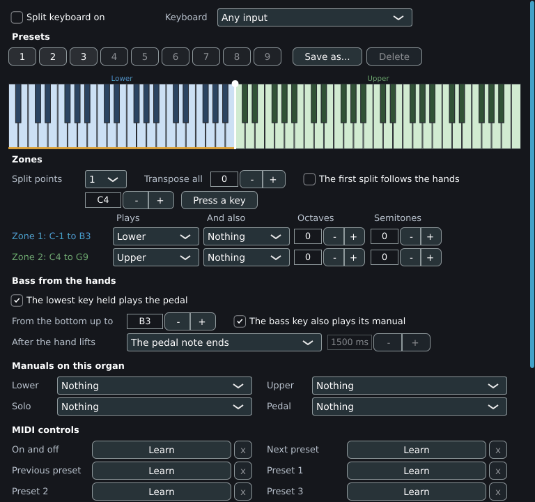

# Split keyboard

The split keyboard plays a whole organ from one keyboard. It divides the keyboard into up to four zones, sends each zone to a manual or the pedal, transposes each zone, can take a pedal bass from the lowest key the left hand holds, and can move the dividing point to follow the hands. This page covers the window, every field in it, the presets, the MIDI controls that switch the split and its presets, and the files that hold the settings.

Open the window with **View > Split keyboard**. The window can stay open or be closed; closing it hides it and the split carries on.



## How it works

The split sits between the MIDI inputs and the organ. It reads the notes of one keyboard (the **Keyboard** box) and sends them on as notes of its own MIDI input, `Split keyboard`, with one channel per role:

| Role | Channel on the `Split keyboard` input |
|---|---|
| Lower | 11 |
| Upper | 12 |
| Solo | 13 |
| Pedal | 14 |

The MIDI map sends each of those channels to a manual, as it does for any console. The **Manuals on this organ** rows of the window set the manual of each role. The split knows nothing about the organ beyond that; a role can be sent to any manual, including the pedal.

The split takes the notes of the chosen keyboard only. These pass through unsplit:

- Controllers, program changes and other messages from the keyboard (a sustain pedal, an expression pedal mapped to a shoe).
- Notes and messages from any other input.
- Messages from a plug-in host, from a MIDI file played back and from the on-screen keyboard.
- Notes on the `Split keyboard` input itself.

All Notes Off and All Sound Off (controllers 123 and 120) from the keyboard release everything the split sounds and then pass on. The **Panic** button of the main window releases it too.

## Switching it on and off

| Way | Effect |
|---|---|
| **Split keyboard on** tick box | Switches the split on or off. |
| A learned **On and off** control | Toggles the split from a key, button or pedal. It works while the split is off. See [MIDI controls](#midi-controls). |

The setting is the same for every organ and is saved at once in `split-keyboard.txt` (`on 1`), so the split comes back as it was left. Default: off. With the split off, the keyboard plays as the MIDI map says. A key pressed before the split came on is released the way it was pressed. Switching the split off releases every note it sounds.

The first time the split is on for an organ, each role that has no mapping receives one:

| Role | Manual proposed |
|---|---|
| Lower | The organ's first manual |
| Upper | The second manual; the first when the organ has only one |
| Solo | The third manual; the last manual when the organ has fewer than three |
| Pedal | The organ's pedal keyboard, found by its assignment code or a name that contains "pedal"; no mapping when the organ has none |

Manuals are taken in the organ's own order and only those a player can reach from a MIDI keyboard. The proposal is saved with the organ and can be changed in the **Manuals on this organ** rows.

## Window fields

Every change takes effect at once and is saved. The window's rows follow the panel from top to bottom.

### Keyboard and on/off

| Name | What it does | Default | Options |
|---|---|---|---|
| **Split keyboard on** | Switches the split on. | Off | On, off |
| **Keyboard** | The input whose notes are split. | **Any input** | **Any input** (every input except the split's own) and every input the mapping knows. Saved by name in `split-keyboard.txt` (`source`). Changing it while the split is on releases what the old keyboard holds. |

Choose a named input when more than one keyboard is connected and only one should be split.

### Presets

Nine slots shared by every organ. Slots 1 to 3 are factory layouts and cannot be changed. Slots 4 to 9 are the player's own and start empty.

| Slot | Name | Layout |
|---|---|---|
| 1 | Two manuals and pedal | Two split points, at F3 and C5. Below F3: pedal. F3 to B4: lower manual. C5 and above: upper manual, one octave down. Written for a 61-note keyboard that starts at C2. |
| 2 | Two manuals and bass | One split point at C4. Lower manual below, upper manual above. The lowest key held up to B3 also plays the pedal. |
| 3 | Two manuals | One split point at C4. Lower manual below, upper manual above. |

An organ with no saved layout starts from preset 2.

| Name | What it does |
|---|---|
| Buttons **1** to **9** | Recall the preset: its layout is copied into the organ's layout. A button is dimmed when its slot is empty, and highlighted when the layout is the preset last recalled and unchanged. The tooltip shows the preset's name. |
| **Save as...** | Opens a dialog titled **Save as a preset**: **Name** (default `My layout`) and **Slot** (4 to 9, with the name of any preset already there). The first free slot is offered, otherwise the preset recalled, otherwise slot 4. **Save** replaces the preset in the slot with the organ's current layout and marks it as the preset in use. **Cancel** leaves everything as it was. |
| **Delete** | Empties the slot of the preset in use. Enabled only when that preset is in slot 4 to 9. |

A preset holds the layout: split points, zones, **Transpose all**, the follow option and the bass settings. It leaves out the on/off state, the keyboard, the manual assignments and the MIDI controls. Recalling a preset copies it, so a later edit of the organ's layout leaves the preset as saved, and the preset highlight goes out. The presets are saved in `split-keyboard.txt`.

### The keyboard picture

The picture shows 88 keys, A0 to C8, whatever the real keyboard has. Each zone has a colour: blue, green, amber and purple for zones 1 to 4, grey for a zone that plays nothing. The role of each zone is written above it. A white handle with a round head marks each split point.

- **Drag a handle** to move a split point. A handle stops before the neighbouring split point.
- While the split is on, the keys that are held light in the colour of the zone they went to.
- With bass from the hands on, an amber line under the keys marks the bass range, and a black dot on a key marks the note the pedal is sounding.
- While the split is on, the first handle shows where the split point is at the moment, which differs from the set point when the first split follows the hands.

### Zones

| Name | What it does | Default | Range or options |
|---|---|---|---|
| **Split points** | The number of dividing points. N points make N + 1 zones; 0 points make one zone. Zone rows appear for the zones in use. | 1 (preset 2) | 0, 1, 2, 3 |
| Split point sliders | The first key of the next zone, shown as a note name (C4 is note 60). One slider per point. A point cannot pass its neighbour. | C4 (60) for the first | Notes 1 to 127 (C#-1 to G9) |
| **Press a key** | Sets the split point from the next key pressed on the keyboard. The button reads **Press a key now...** while it waits; press it again to cancel. The split has to be on. A key that falls outside the neighbouring points is ignored. | | |
| **Transpose all** | Moves every zone and the bass. | 0 | -12 to 12 semitones |
| **The first split follows the hands** | See [Following the hands](#following-the-hands). Dimmed with 0 split points. | Off | On, off |

Each zone has a row, headed `Zone N: <lowest note> to <highest note>`, with these fields:

| Name | What it does | Default | Range or options |
|---|---|---|---|
| **Plays** | The role the zone sends its keys to. | Lower for zone 1 and Upper for zone 2 (preset 2); **Nothing** for further zones | **Nothing**, **Lower**, **Upper**, **Solo**, **Pedal** |
| **And also** | A second role played by the same keys, to sound one key on two manuals. The same role as **Plays** is ignored. | **Nothing** | **Nothing**, **Lower**, **Upper**, **Solo**, **Pedal** |
| **Octaves** | Moves the zone by octaves. | 0 | -3 to 3 |
| **Semitones** | Moves the zone by semitones. | 0 | -12 to 12 |

The note sent is the key pressed plus **Semitones**, plus 12 times **Octaves**, plus **Transpose all**. A note outside 0 to 127 is dropped. A key keeps the zone it was pressed in until it is released, so the release goes where the press went. When two keys send the same note to one role (zones moved onto each other by octaves), one note-on goes out and the note ends with the last key.

A zone whose role is **Nothing** and whose second role is **Nothing** plays nothing: the keys are silent.

### Following the hands

With **The first split follows the hands** on, the split point between zone 1 and zone 2 moves to the gap between the hands. Masterpiece looks for the widest gap of more than an octave between two keys held next to each other; the split point moves to the middle of that gap, and never above the second split point minus 1. With keys in one hand only, the split point stays where it is. The moved point stays for 3 seconds after the last key is released and then returns to the set point. A key already down keeps its zone when the point moves; a key pressed in the gap goes to the zone the moved point gives it. Changing the layout puts the point back. Only the first split point follows.

### Bass from the hands

The lowest key held in the bass range plays the pedal as well, one pedal note at a time. The pedal note is the key plus **Transpose all**; the octave and semitone fields of zones do not apply to it. The note goes to the Pedal role (channel 14).

| Name | What it does | Default | Range or options |
|---|---|---|---|
| **The lowest key held plays the pedal** | Switches the bass on. | Off (on in preset 2) | On, off |
| **From the bottom up to** | The bass range runs from note 0 up to this key. | B3 (59) | 0 to 127, shown as a note name |
| **The bass key also plays its manual** | On: the bass key sounds on its manual and the pedal. Off: the bass key sounds on the pedal only. When the bass key is no longer the lowest and is still held, it plays its manual from then on. | On | On, off |
| **After the hand lifts** | What the pedal note does when no key in the range is held. | **The pedal note ends** | **The pedal note ends**; **It holds until the next bass note**; **It holds for a time** |
| Time box (ms) | The hold time for **It holds for a time**. Enabled with that choice only. | 1500 ms | 50 to 10000 ms in steps of 50 |

When the lowest key changes, the previous pedal note ends and the new one starts. When the lowest key is released while another key in the range is held, the pedal passes to the lowest key still held and is struck again. A bass held after the hand lifts ends with the next bass note.

The four bass fields are dimmed while the bass is off.

### Manuals on this organ

| Name | What it does | Default | Options |
|---|---|---|---|
| **Lower**, **Upper**, **Solo**, **Pedal** | The manual of this organ that each role plays. | The proposal described under [Switching it on and off](#switching-it-on-and-off) | **Nothing** and every manual of the organ that has keys and can be played from MIDI |

The choice is a mapping of the `Split keyboard` input and channel to the manual. It is saved in the organ's MIDI map (see [The MIDI map files](midi.md#the-midi-map-files)) and also appears in the **Keys** tab of the manual's dialog, with **Console** set to `Split keyboard`. A role set to **Nothing** plays nothing.

### MIDI controls

Twelve controls can be operated from any key, button or pedal on any MIDI input:

| Control | What it does |
|---|---|
| **On and off** | Toggles the split. It acts while the split is off. |
| **Next preset** | Recalls the next preset that holds a layout, skipping empty slots and wrapping from 9 to 1. With no preset recalled it starts at slot 1. |
| **Previous preset** | Recalls the previous one, wrapping from 1 to 9. |
| **Preset 1** to **Preset 9** | Recall that slot. An empty slot does nothing. |

Each control has a learn button and an **x** button:

- Click the learn button, then press the key or button (the button reads **Press it now...**). A note, a controller with a value above 0 or a program change is learned, from any input. The learned press plays nothing, and neither does its release.
- The button then shows the message: `Note C4, channel 1`, `Controller 64, channel 1` or `Program 3, channel 1`. Before a message is learned it reads **Learn**.
- **x** forgets the control.
- One message operates one control; learning it for a second control clears the first. The message is stored with the name of its input, so a control can be tied to one console.

A controller acts on a value above 0, a note on a note-on, and a program change on every arrival. The controls are saved in `split-keyboard.txt`.

## Exclusive input

The `Split keyboard` input is exclusive. Only mappings that name it take its notes. A manual mapped from **Any device** on any channel receives no notes from the split, and a control mapped from any input ignores the split's messages. A role that is mapped nowhere plays nothing. The rule keeps a manual that is mapped from every input from sounding the notes of all four roles.

A recording of the split made with the MIDI recorder holds the notes as the split sent them, on channels 11 to 14. On playback they are treated as the split's input again and reach the same manuals.

## Where the settings are saved

Two files in the data folder (see [The MIDI map files](midi.md#the-midi-map-files) for its location):

| File | Holds |
|---|---|
| `split/<organ>.mpsplit` | The organ's layout: split points, zones, **Transpose all**, the follow option, the bass settings and the preset the layout came from. Written at every change. |
| `split-keyboard.txt` | What every organ shares: on or off, the **Keyboard**, the learned controls and the player's presets (slots 4 to 9). |

`<organ>` is the organ's name followed by its unique organ id, as for the [MIDI map](midi.md#the-midi-map-files). The manual assignments of the roles are in the organ's `midi/<organ>.mpmidi`.

Both split files are plain text with one record per line. An organ's file looks like this:

```
splits 2 53 72 84
zone 0 pedal none 0 0
zone 1 lower none 0 0
zone 2 upper none -1 0
zone 3 none none 0 0
transpose 0
follow 0
bass 0 59 1 off 1500
preset 1
```

| Line | Fields |
|---|---|
| `splits` | The number of points, then the three points |
| `zone` | The zone (0 to 3), the role, the second role (`none`, `lower`, `upper`, `solo`, `pedal`), octaves, semitones |
| `transpose`, `follow` | **Transpose all**; 1 when the first split follows the hands |
| `bass` | On (1 or 0), top key, also on the manual (1 or 0), sustain (`off`, `next`, `timed`), time in ms |
| `preset` | The slot the layout was recalled from (1 to 9), when there is one |

A line the program does not know is skipped, and a value out of range is brought into range when the file is read: split points sorted and kept between notes 1 and 127, octaves between -3 and 3, semitones between -12 and 12, the hold time between 50 and 10000 ms.
