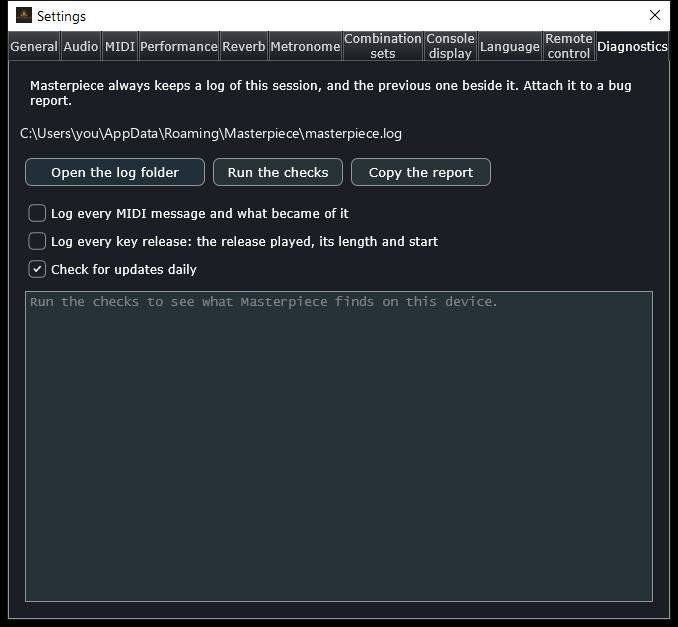
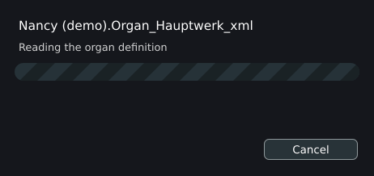

# Troubleshooting and caveats

This page lists symptoms with their causes and remedies, explains the log and the checks that Masterpiece offers, describes how to report a problem, and ends with the known limitations. Each symptom names the message or status text the program shows, so that a message on screen leads to its section.

## The log and the checks

Masterpiece writes a log of every session. It records the audio device, every stage of each load with its time, the files that could not be read, MIDI events when logging is on, and the reason for each failure. Most causes on this page can be read from it.

Open **Help > Diagnostics...**, the **Diagnostics** tab of the settings window.

| Control | What it does |
|---|---|
| Path of the log | The text at the top gives the full path of the current log. If no log is written, it says **No log is being written.** |
| **Open the log folder** | Shows the log in the system's file manager. Desktop systems only. |
| **Run the checks** | Writes a report of the folders, audio, MIDI inputs, organ and memory settings into the box below. |
| **Copy the report** | Copies the checks and the last 200 lines of the log to the clipboard, for a bug report. |
| **Send the report and the log** | Phones and tablets only. Shares a report file, the log and the previous log through the system's share sheet. |
| **Log every MIDI message and what became of it** | Same as `--log-midi`. Lasts until Masterpiece quits. |
| **Log every key release: the release played, its length and start** | Same as `--log-releases`. Lasts until Masterpiece quits. |
| **Check for updates daily** | The once-a-day update check (see [Files and folders](files.md#privacy)). **Help > Check for updates...** asks at once. |

The files are `masterpiece.log` and `masterpiece.previous.log` in the settings folder (see [Files and folders](files.md)). At each start the current log becomes the previous log and replaces the older one. After a crash, copy `masterpiece.previous.log` before starting Masterpiece again: a second start moves the log of the next session over it. The plugins write no log.

### What Run the checks reports

| Line | Meaning |
|---|---|
| Version, system, processors, memory | The program version, the operating system, the processor count and the memory in MB. |
| **Settings folder**, **Sample cache**, **Temporary folder** | Each folder's path, `can be written` or `CANNOT be written`, and the free space in GB. A folder that cannot be written is a cause of lost settings, a missing cache and failed unpacking. |
| Cache folder chosen cannot be used | The folder chosen in **Cache folder**, on the **General** tab of the settings window, cannot be created, so the usual folder is used. |
| Cache files | The number and total size of `.mpcache` files in the cache folder. |
| Organs unpacked from their archives | The number of folders under `Packaged`. |
| Log | The log's path and size, or `No log is being written`. |
| Audio | The device's sample rate and block size, or `Audio: not running`. |
| MIDI inputs | The names of the inputs the system lists. A keyboard missing here is not visible to the system. |
| Organ, the definition, the organ folder | The loaded organ's path, whether the file exists and can be read, and whether the folder that holds its samples exists. |
| Ranks, stops, console pages | The size of the loaded organ. |
| Samples kept as | The resident format, the memory limit and the number of stream underruns. |
| Impulse response | The loaded room impulse response, or `none`. |

Lines start with `ok` for a passed check, `FAILED` for a failed one, and blanks for facts.

## Reporting a problem on GitHub

Open an issue at [github.com/bonninr/masterpiece/issues](https://github.com/bonninr/masterpiece/issues). Include:

- The log, and `masterpiece.previous.log` after a crash. Use **Copy the report** for the checks and the end of the log.
- The name of the organ and where its sample set comes from.
- The Masterpiece version (the window title shows it, or `Masterpiece --version`; a test build shows its commit there) and the operating system.
- What was done, what happened and what was expected.

For a keyboard or piston that does nothing, start with `--log-midi` and send the log. For a click or noise at key release, use `--log-releases`. For a fault that cannot be repeated, `--record-midi` saves the performance (see [Command line](command-line.md)).

The log contains the organ's file name and the folders used, and leaves the computer only when it is attached to a report.

## No sound

Check these in order.

| Check | Cause and remedy |
|---|---|
| The status line says **No organ loaded.** | Open an organ with **File > Open organ...**. |
| The status line says **graphics only - no audio loaded**, or **Load cancelled - no organ is loaded** | A console-only load reads no audio. It also follows a Cancel or a memory stop before any sample was read. Reload the organ with **Organ > Reload organ** or open it again. |
| No stop is drawn | Draw a stop on a division that a manual plays. The stop list marks stops that cannot sound (see [A stop that does not sound](#a-stop-that-does-not-sound)). |
| The meters stay flat while keys sound on screen | The audio device. The log line `audio device:` names it. Pick another device or driver under **Settings > Audio...**. A saved setup that has no live output falls back to the defaults at the next start, and the log says so. |
| The volume slider is at the bottom | The slider covers -40 dB to +24 dB and -40 dB is silence. |
| Keys on a MIDI keyboard do nothing, the on-screen keyboard works | The input is switched off or the channel plays no manual. Tick the keyboard under **Settings > MIDI...** and check the manual's channel. Start with `--log-midi`: the log names the cause, for example `channel 2 plays no manual`. |
| A MIDI input shows **in use by another program; opened when it is free** | See [A MIDI input is held by another program](#a-midi-input-is-held-by-another-program). |
| The status line shows **N awaiting a licence** or **licensed samples not loaded** | The set needs its publisher's licence confirmed. Choose **Organ > Licence accepted** and answer **Load the samples**. |
| The dialog **This organ's samples are encrypted** appears | The samples are in the encrypted `.hbw` or `.hbx` form. Masterpiece skips them and cannot play them. |
| **N missing (named in the log)** | Sample files are absent. See [A package cannot be found](#a-package-cannot-be-found). |
| Only some pipes are silent | Samples are missing, unreadable, or left out. See [A stop that does not sound](#a-stop-that-does-not-sound). |
| The load is still running | The engine is silent during the load, and notes played meanwhile are dropped. |
| A battery speaker wakes late and swallows the first notes | Switch on **Keep portable speakers awake** in **Settings > Audio...**. It plays a 20 Hz tone at the chosen level, -80 dB to -40 dB. |
| Level or pitch sags as stops are drawn | The wind model lowers the pressure of a full registration, and pitch and level follow it. **Wind model** in **Organ settings > Loading** switches it off. |

## Dropouts and clicks

Masterpiece counts blocks that took longer to render than the audio they make. The status line shows **late blocks N**, and the log gains lines of the form `audio: N late block(s) of M; the slowest took X% of its time`. Late blocks are the dropouts.

| Cause | Remedy |
|---|---|
| Audio buffer too small | Raise the buffer under **Settings > Audio...**. The line **Note delay: %1 ms (buffer %2 ms, output %3 ms)** shows the delay it costs. A first start picks about 10 ms. |
| A sample rate below 44.1 kHz | The program moves such a device to 48 kHz, or 44.1 kHz, at startup and logs it. |
| Too many voices for the processor | Choose a lower **Performance** preset, or lower **Polyphony limit**, in **Settings > Performance...**. A new pipe takes the place of a dying one past the limit. |
| The engine setting | **Faster audio engine** is on by default and renders several samples at a time on AVX2 or NEON processors. Switch it off to test whether it is the cause. |
| Convolution reverb | **Impulse-response reverb** (**Settings > Reverb...**) is the most expensive stage of the audio callback. Switch it off, or tick **Bypass all effects** in **Organ settings > Loading**. |
| Release tails read from a slow disk | The status line shows **streamed releases fell behind Nx: turn off "Stream release tails" in Organ settings**. The box is **Stream releases from disk** on the **Loading** tab of Organ settings. Switch it off, choose a longer **Release buffer**, choose **Hold 50% of each release** or **Hold 75% of each release**, or move the samples to an SSD. Streaming needs SSD-class storage. |
| The cache is written while playing | With **Save the sample cache** set to **In silence, while it plays**, the write waits for silence. **Before the organ plays** moves it before playing. |
| Memory exhausted and the system swaps | Use a smaller **Quality** preset: 16-bit, compressed, streamed releases. See [Memory, loading and streaming](memory.md). |
| Windows shared audio mode | Shared mode adds delay. Use WASAPI exclusive or ASIO for low latency. |
| Linux drivers | The list holds ALSA and, when a JACK library is installed, JACK (including PipeWire's JACK). Try another type under **Audio**. |

Two more status-line items mark lost sound. **dropped N** counts note-ons that found no free voice. **no audio N** counts note starts whose audio was not in memory.

A click or noise when keys are released can come from the release samples. Start with `--log-releases` or switch on the release log, then play the passage; the log describes each release. **Release tails end below** (default **-90 dB**) ends a tail when it has stayed under that level for a twentieth of a second. A value of **-80 dB** can end the last decay of a large chord early.

## A stop that does not sound

A stop button has one of three looks.

| Look | Tooltip | Cause and remedy |
|---|---|---|
| Normal | None | The stop plays. If it makes no sound, check the manual's channel, the couplers and that the stop's division has pipes for the keys. |
| Disabled | **This stop's ranks ship no pipes in this sample set** | The ranks of the stop have no samples in this set. Demonstration sets ship only part of the organ. The same note appears on the **Stops, ranks and perspectives** tab of Organ settings. |
| Dimmed | **Not loaded: chosen in Organ settings, Stops** | The stop was left out of the load, by itself, with its perspective or its ranks, or by **Only the stops drawn now**. Tick it on the **Stops, ranks and perspectives** tab of Organ settings and load the organ again. |

Other causes:

- A perspective left out takes every rank recorded from that position. Check the perspectives list.
- With **Notes loaded** set to **Every second note** or **Every third note**, the keys between play their neighbour's samples, retuned.
- Files that are missing, unreadable, encrypted or awaiting a licence leave their pipes silent. The status line counts them, and the log names the first ones (`samples: missing`, `samples: unreadable`).
- A load started with `--preload-drawn` or `--preload-ranks` leaves every other stop silent for the session.
- A stop that is a noise (a key, stop or blower noise) sounds when its switch moves.
- An organ that declares no key flow plays every division on every key, and its couplers do nothing.

## A package cannot be found

Some organs, composites in particular, play packages that are not in their own folder. When Masterpiece cannot find one, the dialog **A package this organ plays is missing** names the package and its number. Choose:

| Button | Effect |
|---|---|
| **Choose an archive...** | Points to the `.rar` or `.orgue` file that holds the package. The choice is kept for this organ. |
| **Choose a folder...** | Points to the folder that holds the package, or the folder that holds its archives. |
| **Play without it** | Loads the organ with silent pipes for that package. |

Masterpiece looks in the organ's folder, in the folders directly in it, in the **Package folder** set on the **General** tab of the settings window, and in the sample libraries it knows. Folder and file names are found in any case, so a set made on Windows loads on Linux and macOS. The log lines begin `load: package`. The answers are saved in `package-folders.txt` and `joined-packages.txt` in the organ's folder.

The standard components of the format (package 1) come with no sample set. Masterpiece makes stand-ins for their key, stop and blower noises and does not ask for them.

If the samples are in a different place from the definition, set **Organ folder** on the **Loading** tab of Organ settings (or `--organ-root`) to the folder that holds `OrganInstallationPackages`.

## A RAR package does not open

Masterpiece opens `.rar` and `.orgue` packages in place. A failure shows a dialog **Could not open &lt;file&gt;** or **&lt;file&gt; is damaged**, with the text below, and the log lines begin `archive:`.

| Message | Cause and remedy |
|---|---|
| `is still downloading (<name>.crdownload is beside it)` | A partial-download file (`.crdownload`, `.part`, `.download` or `.opdownload`) is beside the archive. Open it when the download has finished. |
| `is one volume of a multi-volume set, and part N is not in the same folder` | A volume is missing. Put every volume of the set in one folder and open the first volume. |
| `looks like a download the browser renamed, adding a number` | A copy named like `Name (1).rar` or `Name.1.rar` replaces a volume. Rename it to the name without the number, or delete it when the original is there. |
| `is not the first volume of its set, and the first volume is not beside it` | Put the first volume beside it. |
| `does not follow <volume>` | The volumes come from different downloads. Download all volumes again from one source. |
| `is damaged from <N> MB on (
% of the file)` | That volume is cut short or corrupted. Download that volume again. |
| `is password-protected` | Masterpiece cannot open password-protected archives. Extract the archive with the password and open the organ definition inside. |
| `is a solid RAR 4 archive split into volumes` | Masterpiece cannot read this kind directly. Extract it with 7-Zip or WinRAR and open the definition (`OrganDefinitions/*.Organ_Hauptwerk_xml`). |
| `is not a RAR ... archive that Masterpiece can read` | The file is not a RAR archive, or is cut off at the start. |
| `the package needs another package, id N, which is not beside it` | A GrandOrgue `.orgue` names a second package. Put it in the same folder. |
| `no archive found at <path>` | The path is wrong. |
| `there is no organ definition file (.Organ_Hauptwerk_xml) in <file> or the packages beside it` | The archive holds samples only. Open it together with the package that holds the definition, in the same folder. |

A RAR 4 archive in a single file opens directly, solid or not. WavPack samples load whole, with their loop and release marker.

Parts of one set that carry numbered names (`01_`, `02_`, `03_`) or share a package join automatically when they sit in one folder.

A package that opens but loads with the dialog **Some samples could not be read** has damaged files. The text says that the pipes of those files are silent and that the organ plays without them. Test the archive in 7-Zip or WinRAR and download it again. A damaged unpack is not marked as finished, so the next open unpacks again.

Phones and tablets open `.rar` and `.orgue` packages only. On iPhone and iPad, a package picked on its own is lent without its folder; the dialog **The rest of &lt;file&gt;** asks for the folder that holds the other volumes.

## Slow loads

The dialog shows the phase (**Opening the archive**, **Reading the archive**, **Extracting definitions and artwork**, **Reading the organ definition**, **Building the wind model**, **Wiring the console**, **Finding the samples**, **Loading samples from the cache**, **Loading samples**, **Creating the sample cache**, **Preparing to play**, **Building the console**) and, for samples, the count and the time left. **Cancel** stops the load. During **Creating the sample cache** the button reads **Skip the cache** and opens the organ without the cache.

| Cause | Remedy |
|---|---|
| First load of an organ | Decoding the samples takes most of the time. The cache makes the next load a single read. |
| The cache is off or replaced | Under **Sample cache**, on the **General** tab of the settings window, use **One cache per organ (uses more disk)** when you alternate between organs. |
| Settings changed since the cache was written | Any change to the stored samples (storage, compression, mono, rate, releases, streaming, notes loaded, the ranks) rebuilds the cache. The dialog **Rebuild the sample cache?** appears when you close **Organ settings** after such a change. |
| First open of a package | Indexing and unpacking the archives takes minutes for a large set (**This may take a few minutes**). The result stays in `Packaged`, so the next open skips it. |
| Samples on a hard disk or a network drive | Move the set, and the cache folder, to an SSD. |
| Large release tails | **Stream releases from disk** skips reading the tails, which were 56% of the sample data on the measured set. |
| Quality preset | **Recommended: 16-bit, releases streamed** and the presets below it stream the releases, which shortens loads. |
| Cache write after loading | **Save the sample cache** set to **In silence, while it plays** opens the organ first. |

Follow the progress by ear with **Click at each 10% while loading**, on the **General** tab of the settings window.

On iPhone and iPad a load holds while Masterpiece is in the background and goes on when it is in front again.

## Memory is full

Masterpiece stops a load at the memory limit (default: 80% of the computer's memory, at least 512 MB; the voice pool counts against it), and before the system runs short of free memory, keeping the larger of 256 MB and a twentieth of the memory free. Two dialogs follow.

- **Not enough memory for this organ**: nothing loaded. The console shows silent so that **Organ > Organ settings...** can be opened.
- **Only part of this organ fits**: the samples read so far play, other stops or notes are silent, and the status line shows **INCOMPLETE (memory limit)** or **INCOMPLETE (memory low)**. At the limit the message ends by pointing to **Memory limit for samples**; for low memory it starts with closing other programs.

After a load, the voice pool is built in the memory left. When fewer voices fit than the polyphony asks for, the pool is smaller and the log says `voices: N of the M asked for: the memory free allows no more`.

Remedies, in the order of their effect:

1. **Stream releases from disk** (needs an SSD).
2. **Lossless compression in memory** (24-bit and 16-bit).
3. **Resident format**: 16-bit.
4. **Notes loaded**: **Every second note** or **Every third note**.
5. **Load in mono (halves memory, gives up the stereo image)**.
6. **Sample rate**: 48 kHz or 44.1 kHz for sets recorded at 96 kHz.
7. **Preloaded per sample**: **Up to the loop (less memory)**.
8. Leave out perspectives, stops or ranks on the **Stops, ranks and perspectives** tab of Organ settings. The tab shows the memory each choice takes.
9. **Releases** and **Release length**: keep one release, or shorter ones.
10. Raise **Memory limit for samples** (50% to 90% of memory), in **Settings > Performance...**, only when the computer has the memory to spare.

The **Quality** presets apply the first steps in order. Settings take effect at the next load; **Load the organ to apply** loads at once. See [Memory, loading and streaming](memory.md) and [Small, medium and large organs](sizing.md). Plugin instances each hold their own copy; see [Plugins in a DAW](plugins.md).

## A MIDI input is held by another program

Windows gives a MIDI port to one program at a time. When another program holds a keyboard, Masterpiece cannot open it. The list under **Settings > MIDI...** shows the input ticked with the text **in use by another program; opened when it is free**, and a box **&lt;name&gt; could not be opened** appears when you tick it. Masterpiece tries again every 3 seconds and opens the input when the other program lets it go. The log writes `midi: <name> could not be opened (another program may be using it); it is tried again every few seconds` and later `midi: <name> is free now and has been opened`.

Close the other program, or send its MIDI to Masterpiece through a loopback port such as loopMIDI. On macOS and Linux, `--virtual-midi` publishes a port for other programs to send to.

## A crash during a load (the crash guard)

Before a load, the standalone program writes the organ's path as `running` in `settings.mpglobal`. A clean exit removes it. A shutdown, logout or `SIGTERM` or `SIGHUP` on Linux and macOS counts as a clean exit. On a phone or tablet, going to the background counts as one.

If the entry is still there at the next start, the last session ended with that organ loading or loaded. The log records:

`start: the last session did not end cleanly while <file> was loaded`

and ends with `; reopened` when the same organ was opened again. The program shows no dialog.

**Reopen the last organ when Masterpiece starts** (on the **General** tab of the settings window) is off by default. When it is on, the last organ that loaded completely opens at start. A load that failed or crashed does not become the last organ.

To find the cause, send the log of the crashed session (`masterpiece.previous.log`) with the organ's name. A crash while loading is most often memory (see [Memory is full](#memory-is-full)) or a damaged sample file. To test whether the samples are the cause, open the organ with `--gui-only`.

## The display looks wrong

- **The console is cut off or too small.** The artwork is scaled to fit the window, so a smaller window shrinks it. Enlarge the window.
- **The wrong console layout.** Organs that ship several console sizes show **Console: main** and **Console: alt N** in a list in the top bar, with `(portrait)` marking tall ones. The program chooses a layout for the window's shape (wide or tall) and keeps a choice made by hand until the shape turns.
- **The window opens off screen or at a strange size.** The position is stored in `window.txt`. A window that no screen shows is moved onto a screen at startup. Close Masterpiece and delete `window.txt` to reset it. `dialogs.txt` holds the dialog sizes.
- **A touch screen does not react where it is tapped.** Start with `--log-touches`. The log names the component that took each press.

## Known limitations and caveats

Format and sample support:

- Encrypted samples (`.hbw`, `.hbx`) are skipped and listed in the load report.
- GrandOrgue divisional couplers are skipped on import.
- Password-protected archives cannot be opened.
- A solid RAR 4 set split into volumes is read after extracting it.
- `.rar` and `.orgue` are the package formats.
- A set that requires a publisher's licence loads its samples only after you confirm that you hold it. Masterpiece cannot check the licence.
- Demonstration sets ship only part of an organ; their other stops are disabled.

Loading and memory:

- Every rank loads, drawn or not, unless it is left out on the Stops, ranks and perspectives tab, so a full registration costs no more memory than one stop.
- All loading settings take effect at the next load.
- Streaming release tails needs a fast disk, such as an SSD.
- `--preload-drawn` and `--preload-ranks` leave every other stop silent.
- A load stopped at the memory limit, or when free memory runs low, keeps what fitted and plays incomplete, or shows the console without sound.
- One load runs at a time.
- The sample cache can reach several gigabytes.

Platforms:

- Windows needs version 10 1607 or later.
- Windows cannot publish a virtual MIDI port; use a loopback driver.
- Phones and tablets accept `.rar` and `.orgue` packages only.
- The macOS build is unsigned.
- The Flatpak and the Raspberry Pi packages carry no plugins.

Plugins:

- A host project stores the path of the organ the instance played and reopens it when the project opens. The stops drawn come from the files in the settings folder.
- In a plugin, the settings window opens without the **Audio**, **MIDI** and **Remote control** tabs and **Organ > Organ settings...** without its **MIDI** tab, because the host owns the audio device and the MIDI ports.
- The plugin has no MIDI output, no log and no crash guard.
- Each instance holds its own copy of the samples.

See [Plugins in a DAW](plugins.md) for the details.

Controls and files:

- Changing a loading setting does not affect the organ already loaded.
- Moving an organ that declares no identity starts it with fresh settings, because its files are named from the path.
- The player's combinations are files in the settings folder and are lost when those are deleted.
