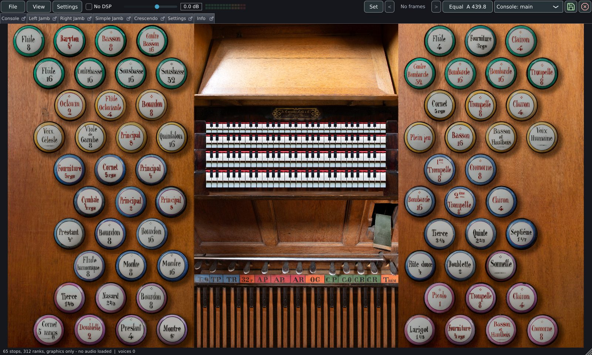
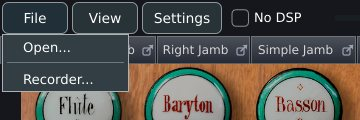
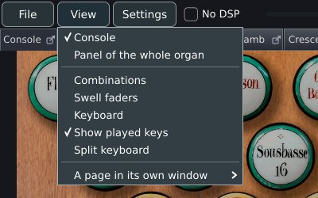
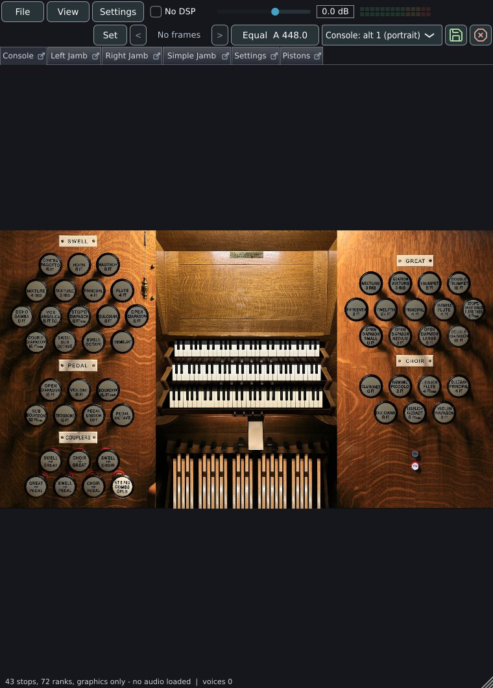
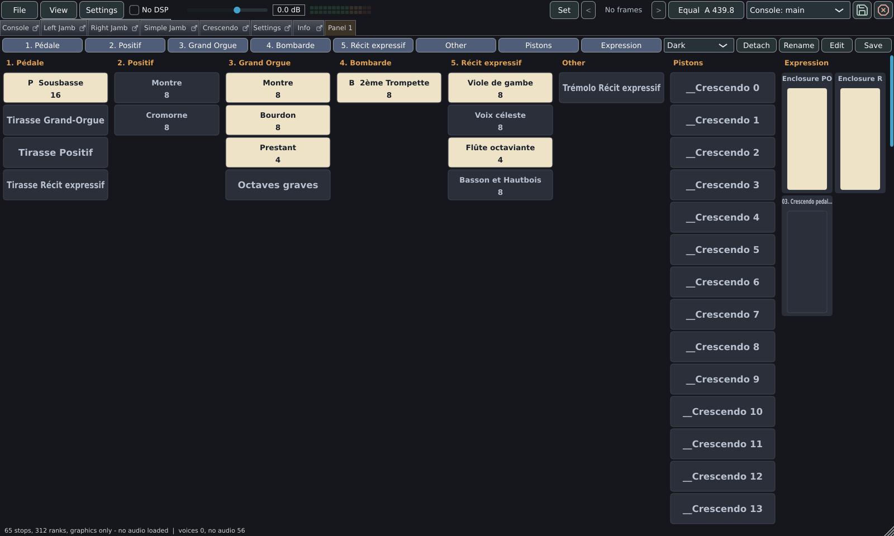
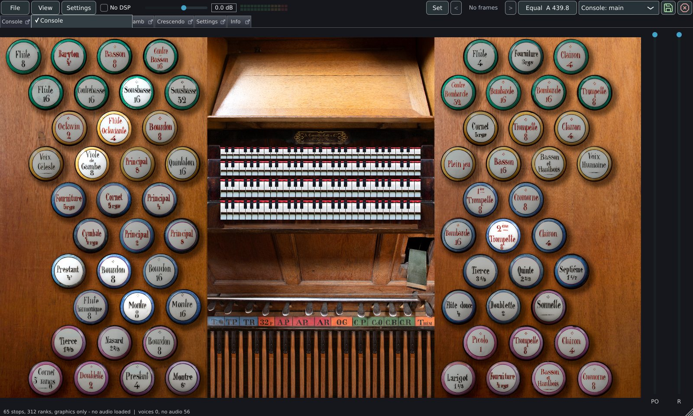
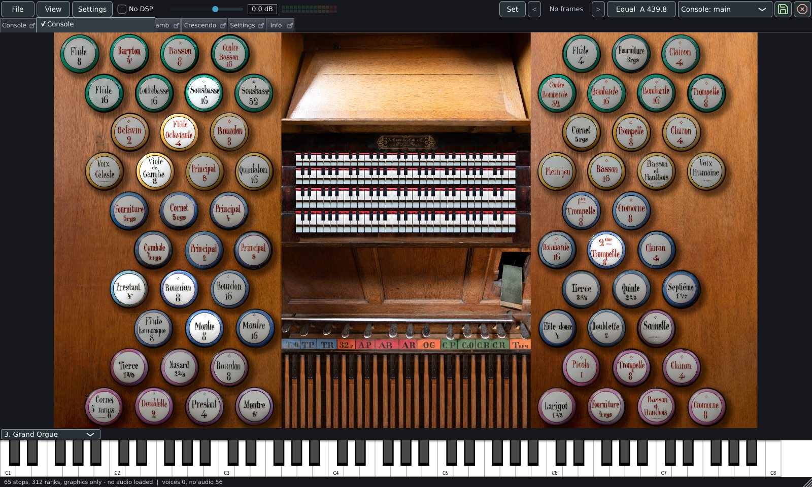

# A tour of the window

This page describes the main window from top to bottom: the three menus and
every control in the top bar, the console pages and how the mouse works on
them, pages in windows of their own, panels, the plain stop list, the swell
faders, the on-screen keyboard and the context menus. Registration, pistons,
tuning and recording are covered on [Playing](playing.md).

The window opens at 1280 x 760 pixels and can be resized freely. From top to
bottom it holds:

| Part | Height | Shown |
|---|---|---|
| Top bar | 36 px (a second row of 36 px in a narrow window) | Always |
| Page tabs | 28 px | When the console has more than one page, or a panel is shown as a tab |
| Console, panel or stop list | The rest | Always |
| Swell faders | 120 px wide, at the right | **View > Swell faders** |
| On-screen keyboard | 96 px, plus 24 px for the manual selector | **View > Keyboard** |
| Status line | 20 px | Always |

## The top bar

From left to right the bar holds the **File**, **View** and **Settings** menus;
the **No DSP** box; the volume slider with its dB readout; the level meter;
**Set**; the stepper (**<**, the frame readout and **>**); the tuning button,
which shows the temperament and the pitch of A; the layout selector, when the
organ offers a choice; the save button; and the Panic button, drawn as an
octagon with a cross.

### File

| Item | What it does |
|---|---|
| **Open...** | Opens the favourites window, which has a button for the file dialog. Until an organ has been added to the favourites, **Open...** goes straight to the file dialog. See [Opening an organ](opening.md). |
| **Other versions of this organ** | A submenu, shown when the loaded organ's package or folder holds more than one definition (a perspective each, or full and light). Each definition is listed by its file name without the extension. The loaded one is ticked and disabled; choosing another loads it. |
| **Recorder...** | Shows or hides the Recorder window. The item is ticked while the window is shown. See [Recorder](playing.md#recorder). |

### View

| Item | What it does |
|---|---|
| **Console** | Shows the organ's console pages. The item reads **Stop list** when the organ ships no console artwork. It is ticked while a panel is not shown; choosing it while a panel is shown returns to the console or the stop list. |
| **Stop list** | Shows the plain list of stops over the console, for a player who cannot see the console. The item is present when the organ ships console artwork, and is ticked while the list is shown. See [The plain stop list](#the-plain-stop-list). |
| One item per panel | The panel's name. Shows the panel's tab, or brings the panel's window to the front. Ticked while that panel is shown. |
| **Panel of the whole organ** | Shown while the organ has no panel. Makes the first panel. |
| **New panel** | Shown once the organ has a panel. Makes a panel; disabled when the organ already has two. |
| **Rename or delete a panel** | A submenu, shown when the organ has a panel, with **Rename \<name\>...** and **Delete \<name\>** for each. |
| **Combinations** | Shows or hides the Combinations window. Ticked while shown. See [The player's own combinations](playing.md#the-players-own-combinations). |
| **Swell faders** | Shows or hides the strip of swell faders. The item is present when the organ has at least one swell shoe. |
| **Keyboard** | Shows or hides the on-screen keyboard. |
| **Show played keys** | Lights the keys of the drawn manuals as they are played. Ticked by default. |
| **Split keyboard** | Shows or hides the Split keyboard window. See [Split keyboard](split-keyboard.md). |
| **A page in its own window** | A submenu with one item per console page, ticked while the page has a window. Present in the standalone application, while the console is shown. |

The **Swell faders**, **Keyboard** and window items are described in the
sections below. **Show played keys** is described under
[Show played keys](#show-played-keys).

### Settings

| Item | What it does |
|---|---|
| **Organ settings...** | Opens the settings of the loaded organ. Disabled until an organ is loaded. See [Organ settings](organ-settings.md). |
| **Licence confirmed for this organ** | Present when the organ's samples need the publisher's licence. Ticked once the licence is confirmed. Choosing it while ticked withdraws the confirmation and loads the organ again without the licensed samples; choosing it while unticked asks the licence question. |
| **General settings...** | Opens the program's settings. See [General settings](general-settings.md). |
| **Audio and MIDI...** | Opens the audio device and MIDI input selector. Present in the standalone application. See [Audio, room and mixer](audio.md). |

The standalone application supplies the three settings windows. In the VST3,
LV2 and AU plugins **General settings...** opens General settings without the
**Audio** and **MIDI** tabs, **Organ settings...** opens Organ settings without
its **MIDI** tab (the host owns the audio device and the MIDI ports), and
**Audio and MIDI...** is absent.

### Controls in the bar

| Control | What it does | Default and range |
|---|---|---|
| **No DSP** | Switches the engine to plain sample playback: the wind model, tremulants, enclosure shading, voicing and the room reverb are bypassed. The same switch is **Simple WAV only (bypass all DSP)** in Organ settings. | Off. Saved per organ. |
| Volume slider | The master volume, with a readout in dB to its right. The bottom of the slider, -40 dB, is silence. Each organ keeps its own volume. | 0 dB; -40 to +24 dB in steps of 0.1 dB |
| Level meter | Two rows of 14 lamps, left and right, showing the output level after the master fader. The scale starts at -48 dB; lamps 10 to 12 are amber and lamps 13 and 14 are red. The meter is hidden when less than 40 px remain for it. | |
| **Set** | Stores what is drawn into the piston or step chosen last. See [Capture](playing.md#capture). | |
| **<**, frame readout, **>** | The sequencer. The readout reads **Frame 3 / 12**, or **No frames**. A click on the readout asks for a frame number. | Frames 1 to 999 |
| Tuning button | Shows the temperament, the pitch of A and the transposition, for example `Equal  A 439.8`, or `Equal  A 440.0  +2` with a transposition. A click opens the tuning panel. See [Transposer, temperament and pitch](playing.md#transposer-temperament-and-pitch). | |
| Layout selector | Chooses the console layout. Shown when the console is on screen and the organ offers more than one layout. | See [Layouts](#layouts) |
| Save button (a disk icon; its name is **Save state**) | Records the stops as they are now as the organ's starting state. See [Remembered between sessions](playing.md#remembered-between-sessions). | |
| **Panic** (an octagon with a cross, last in the bar) | Releases every key on every channel and silences every note still sounding. | |

The bar shortens in a fixed order when the window narrows. The level meter
gives way first and the volume fader keeps at least 90 px. When the sequencer,
tuning and utility buttons leave less than 350 px for the menus, **No DSP** and
the fader, the buttons move to a second row of their own.

The sequencer buttons on a phone or tablet are 44 px wide and the **Panic** and
**Save state** buttons 46 px wide, as against 30 px and 38 px on a desktop.

### The status line

The strip along the bottom edge shows, from left to right and separated by
`|`:

1. The result of the last load: the number of stops and ranks, the samples
   loaded with their size in MB, and any of `N missing (named in the log)`,
   `N unreadable (named in the log)`, `N encrypted`, `N awaiting a licence` and
   `INCOMPLETE (memory limit)`. A load with no audio reads `graphics only - no
   audio loaded`.
2. `voices N`: the number of voices sounding now.
3. While the sample cache is being written, `saving the samples for the next
   load`, with a percentage and, after a few seconds, the time left.
4. When non-zero, each after a comma: `dropped N` (note starts that found no free voice), `no audio
   N` (starts whose samples were not in memory), `late blocks N` (audio blocks
   that took longer than the audio they produced) and, with streamed release
   tails, a warning that the disk fell behind.

After a load with no audio, the line reads `65 stops, 312 ranks, graphics only
- no audio loaded | voices 0, no audio 24`. The line is cut short in a narrow
window; the whole text appears as a tooltip. The window has no CPU readout.

## Page tabs

A console that ships more than one page shows one tab per page. A page is named
as the organ names it, or **Page 1**, **Page 2** and so on. Panels shown as
tabs follow the console pages. A click on a tab shows that page.

In the standalone application each console page tab carries a small button,
a square with an arrow. A click on it opens the page in its own window; the button is
filled while the window is open, and a click then closes the window and brings
the page back to its tab.

A right-click on a console page tab opens a menu:

| Item | Shown when |
|---|---|
| **Open in its own window** | The page has no window. |
| **Open in its own window, main layout**, **Open in its own window, alternate layout 1 (portrait)** and so on | The page has no window and the organ offers more than one layout. Opens the window in that layout. |
| **Bring its window to the front** | The page has a window. |
| **Close its window** | The page has a window. |

A right-click on a panel's tab offers **Rename \<name\>...**. In the plugins the
pages stay tabs and the icon and menu are absent.

## The console

Where an organ ships console artwork, the console is the organ's own: the
bitmaps of its drawstops, pistons, couplers, shoes, manuals and engraved
labels, placed as the set places them. A click on a drawstop moves the switch
the drawstop is bound to and changes its picture in one step.

### Scaling

The window shows a whole page at once, so the console has no scroll bars. The
page is scaled by one factor for both directions, and the factor is raised as
well as lowered: a console drawn smaller than the window is enlarged. The
factor is the largest at which the whole page fits. The page is centred and
the spare room is split evenly on both sides. The proportions are kept, so the
case and the keys keep their shape.

A page much smaller than the organ's first page (a settings panel a few
hundred pixels wide, for example) is shown at the scale of the first page,
which is smaller than the largest scale that fits. This applies when the first page is at least
twice as wide and twice as tall as the page shown. A page in its own window
always fits the window.

Clicks, drags and right-clicks land on the picture at any scale.

### Layouts

A set can draw its pages again for another screen shape, with up to three
alternate layouts beside the main one. A layout counts as portrait when its
console is taller than it is wide. The layout selector in the top bar lists
them as **Console: main**, **Console: alt 1**, **Console: alt 2 (portrait)**
and so on.

The window follows its own shape. When the area for the console turns taller
than it is wide, the first portrait layout is chosen; when it turns wider
again, the first landscape layout is chosen. A layout picked by hand holds
until the shape turns. A page that declares nothing for the chosen layout is
drawn in the main layout, whole.

### Clicking and dragging

| Object | Action |
|---|---|
| Drawstop, rocker, coupler, tremulant | A click toggles the switch. |
| Piston, setter, or any button the organ marks as momentary | The button is pressed while the mouse button is down and released with it. A piston fires on the press. |
| Drawn key of a drawn manual | A click plays the key, on the channel of the keyboard that the manual belongs to, through the same path as a MIDI key. The key sounds while the button is held. Sliding along the manual plays the keys under the pointer in turn; sliding from one manual onto another moves the note to the other manual. |
| Swell shoe, crescendo pedal, dial or slider | A press takes hold of the control and moves nothing. A drag then moves the value from where it was. |
| Stop with no pipes in the set | A click on it is refused while it is pushed in. See [Stops that make no sound](#stops-that-make-no-sound). |

A control is dragged up and down, with the pointer's movement scaled to half a
unit of the 0 to 127 range per pixel. A control drawn lying down, such as a
slider labelled from **Original** to **Silent**, is dragged sideways: right is
more, and the movement is scaled to the drawn width, between 0.3 and 1 unit per
pixel. The axis is whichever the pointer has moved further along from the press.
A control whose artwork says that clicking higher decreases the value is
reversed. The drag keeps working when the pointer leaves the picture, and the
value stops at the ends of its travel.

A drag of the crescendo pedal fires each step it crosses, in order. See
[Crescendo](playing.md#crescendo).

The console has no mouse-wheel handler: the wheel does not move a drawstop,
a piston, a shoe or the crescendo.

### Stops that make no sound

Two kinds of stop are drawn and move but make no sound. A tooltip names the
cause when the pointer rests on the drawstop for 700 ms.

| Cause | On the console | Tooltip |
|---|---|---|
| The stop was left out of the load in **Settings > Organ settings...**, tab **Stops and perspectives** | The drawstop is veiled: the picture is darkened by 55 % black, in the shape of the picture. The stop still draws and is stored in pistons; it makes no sound. Copies of the drawstop on other pages are veiled too. | **\<stop\> is not loaded: chosen in Organ settings, Stops** |
| The stop's ranks ship no pipes in this sample set (a demo set's locked stops) | The drawstop is drawn as the set draws it, with no veil. A click on it is refused. | **\<stop\> is not available** |

A stop with no pipes is also held in. A general, the crescendo, a tutti, a MIDI
message and the organ's own wiring leave it pushed in. A switch that also draws
a stop with pipes stays free to draw it, and so does a switch that the organ
starts engaged. A stop whose pipes are reached only through a pallet that a
key opens counts as having pipes. When none of the organ's stops has pipes, the
organ is not a demo and its stops are left as they are.

A stop that was left out of the load has to be loaded again to sound: change the
choice in Organ settings and load the organ again.

### Context menus

A right-click opens the menu of the object under the pointer. The mappings
themselves are described on [MIDI and consoles](midi.md).

| Object | Menu |
|---|---|
| Drawstop, coupler, piston | The object's name, then its current MIDI mappings (`Note 36 ch 1 (toggles)`, `CC 20 (held)`), **MIDI window...**, **Learn** (**Learn (held while pressed)** for a momentary button), a submenu **Learn another way** with **Toggle: each press draws or cancels**, **Held while pressed**, **Draws it only** and **Cancels it only**, and **Clear mapping**. |
| Swell shoe, crescendo, dial, slider; swell fader | The control's name, its mappings, **MIDI window...**, **Learn: move a pedal, knob or fader**, **Closed position: where the pedal is now**, **Open position: where the pedal is now**, **Use the pedal's whole travel** and **Clear mapping**. |
| Key of a drawn manual | The MIDI window of that manual: which keyboard plays it and the pistons that bring it to a keyboard. |
| Element of a panel | The MIDI window of the stop, coupler, piston or control. |
| Page tab, panel tab | See [Page tabs](#page-tabs). |
| Empty part of the console | Cancels a learn that is armed. |

## A page in its own window

A console surrounds the player: jambs to either side, the key desk in front, a
combination panel above. A set draws each on a page of its own, and each page
can open in a window of its own to spread the console over several screens. The
windows are available in the standalone application. A page is opened from the
icon on its tab, from the right-click menu of its tab, or from **View > A page
in its own window**.

A page window:

- has the title `<page name> - <organ name>`, a native title bar with minimise,
  maximise and close buttons, and can be resized;
- opens with the page's own size and shape, scaled down to fit 1600 x 1000
  pixels at most, and never above its own size; a page that draws nothing opens
  at 1000 x 700;
- opens on another display when there is one, and on a portrait display when
  its layout is portrait and one exists. With one display it opens beside the
  main window, offset 40 px down and across for each window already open;
- shows its page whole at the largest scale that fits, centred;
- opens in the layout chosen in the tab menu, or follows the shape of its own
  window as the main window does (a portrait layout when the window is taller
  than it is wide);
- passes the computer-keyboard shortcuts of the MIDI windows to the program;
- on close, returns the page to its tab in the main window.

The windows are remembered per organ: which pages are open, where, at what size
and in which layout. They close when another organ loads and reopen where they
were once the organ is in. A position that no display shows any longer is moved
onto a display that exists.

## Panels

A panel shows the organ as equal rectangles with the name in the middle, for a
touch screen or for a console that is hard to read at a distance. An organ has up to two
panels. Each panel is a tab beside the console pages, or a window of its own on
any screen. Every rectangle stands for something the organ already has, so its
MIDI mapping is the stop's, piston's or control's own.

**View > Panel of the whole organ** makes the first panel; **View > New
panel** makes the second. The panels are named **Panel 1** and **Panel 2**
until renamed.

### Sections

The panel is divided into columns, one per section, in this order:

| Section | Holds |
|---|---|
| One per division | The division's stops, then the couplers that feed it, then its tremulant. A stop that ships no pipes is left out. A stop with no ranks at all, which is a coupler or a tremulant, stays. |
| **Other** | Couplers and tremulants that cannot be placed in a division. |
| **Pistons** | The organ's own pistons that it draws on its console. An organ that draws none has all of its pistons listed. |
| **Expression** | One fader for each swell shoe, and a **Crescendo** fader when the organ has a control with at least 3 crescendo steps. |

A division's own prefix, repeated on its stops (`HW Principal`, `HW Flute`), is
dropped from the names in that column when most of the column's names carry it.
A footage at the end of a name (`8'`, `2 2/3'`, `IV`) is set on a line of its
own below the name.

### Using a panel

| Element | Action |
|---|---|
| Stop, coupler, tremulant | A click toggles it. The rectangle is lit while drawn. |
| Piston | Fires on the press and is released with the mouse button or the finger. |
| Fader | A press or a drag sets the value from the position in the track, 0 at the bottom and 127 at the top. |
| Any element, right-click | The MIDI window of the element. |

### The bar

The bar along the top of the panel holds, from left to right:

| Control | What it does |
|---|---|
| One button per section | Shows or hides that section's column. All sections are on in a new panel. |
| Colour selector | **Dark**, **Light**, **High contrast** or **By division**. The text contrasts with its rectangle, lit or not, in every scheme. |
| **Detach** | Moves the panel into a window of its own. The button then reads **Attach** and moves the panel back among the tabs. Absent on phones and tablets. |
| **Rename** | Asks for the panel's name, used on its tab and in its window's title. |
| **Edit** | Switches edit mode on and off. |
| **Save** | Keeps the sections, hidden elements, names, colours and window. The button reads **Save \*** while there are unsaved changes. |

In edit mode every element shows a tick box at its top-right corner. A click on
the tick box shows or hides the element; hidden elements are dimmed in edit
mode and absent otherwise. A click anywhere else on the element, or a
right-click, opens a dialog with the element's name. The dialog has **OK**,
**Organ's name**, which gives the organ's own name back, and **Cancel**. On a
fader the title bar names it and the rest of the fader shows or hides it.

A panel made, deleted or renamed through the View menu is written at once.
Other changes are written by **Save**. The panels of an organ are kept in
`organs/<organ>.mppanels`, in the data folder described on
[Files and folders](files.md). A panel window opens at the position and size
saved with the panel, or 1024 x 600 pixels centred.

New stops and sections that an organ update brings show by default. The file
lists only what was switched off.

## The plain stop list

An organ that ships no console artwork opens on the plain stop list. It shows
the organ's stops under a heading for each division, as tiles 190 px wide in as
many columns as fit, with a slim scroll bar. A drawn stop is ivory with dark
lettering; a pushed-in stop is dark. The list follows the engine, so a stop
drawn by a piston, a combination or MIDI shows drawn here too.

A stop that was left out of the load is dimmed and carries the tooltip **Not
loaded: chosen in Organ settings, Stops**. A stop whose ranks ship no pipes is
disabled and carries the tooltip **This stop's ranks ship no pipes in this
sample set**.

The list holds stops. Couplers, tremulants and pistons that the organ has as
switches alone are reached through a panel.

### The list without sight

**View > Stop list** shows the plain list over the console of an organ that
ships console artwork, and Ctrl with L (Cmd with L on a Mac) shows it and hides
it again. The keyboard focus goes to the first stop.

A screen reader reads each stop as a button that can be drawn or retired. The
name it reads is the stop's own name and the division it is in, **Principal 8,
Great**. A stop whose ranks ship no pipes reads as **not available**.

| Key | What it does |
|---|---|
| Tab | Moves to the next stop, and back with Shift and Tab. |
| Left and right arrows | Move one stop along the list. |
| Up and down arrows | Move a row of the grid, so the number of stops moved follows the width of the window. |
| Space or Enter | Draws the stop, or retires it. |

A stop that changes by a piston, a combination or MIDI is announced, with its
name and its new state. The announcement is made only while a screen reader is
listening.

## Swell faders

**View > Swell faders** shows a strip 120 px wide at the right of the window
with one vertical fader for each swell shoe of the organ. The item is present
when the organ has at least one shoe. The strip is off at every start.

- Each fader runs from 0 (closed) to 127 (open) in steps of 1. Every fader
  starts open, at 127, when an organ is loaded.
- The label under a fader is the shoe's name with the words `Enclosure`,
  `Swell box` or `Swell` taken off the front, so that two boxes called
  `Enclosure R` and `Enclosure PO` read `R` and `PO`. A shoe with no name left
  reads **Swell**. The organ's own full name appears as a tooltip.
- A shoe moved over MIDI moves its fader.
- Two enclosures worked by one shoe share one fader.
- A control that sets a level, and that the organ asks to remember, has no
  fader here; the organ draws it on a page of its own.
- The crescendo has a fader in the **Expression** section of a panel, or the
  organ's own drawn control.
- A right-click on a fader opens the menu of a continuous control described
  under [Context menus](#context-menus).

## On-screen keyboard

**View > Keyboard** shows a keyboard along the bottom of the window, 96 px
high. It spans MIDI notes 24 to 108 (C1 to C8, with middle C as C4), and the
key width follows the window width. A click plays the key through the same
path as a MIDI keyboard, so stops and couplers apply.

When the organ has more than one playable keyboard, a selector above the
keyboard names the manual that the keys play. It starts on the organ's
preferred manual, which is the widest compass when declared and otherwise the
unenclosed manual with the most pipework. The keys play on the channel assigned
to that manual in **Settings > General settings > MIDI**, and follow a change
of channel made there while the organ is loaded. The keyboard is off at every
start. The keys are played with the mouse.

## Show played keys

**View > Show played keys** is ticked by default. While it is on, a key of a
drawn manual lights when the key is down on that manual, whether it was pressed
on the screen, on a console or by a recorded performance. A key lights on the
manual it reached. Switching the item off stops the console from looking at the
keys and from drawing them; any key lit goes dark once. Drawing the keys is the
most costly part of repainting the window in a fast passage, so the item helps
on a slow machine. The choice is kept for every organ.

## Keyboard shortcuts

The window has one shortcut of its own: Ctrl with L (Cmd with L on a Mac)
shows the plain stop list over the console, and hides it again. Any stop,
coupler, piston, setter and other object that has a MIDI window can be given a
computer key there. The key then works from the main window, from page windows
and from the Combinations window, unless the control with the focus uses the
key itself. See [MIDI and consoles](midi.md).

## Tooltips

A tooltip appears after the pointer rests on a control for 700 ms.

| Where | Tooltip |
|---|---|
| Console drawstop with no sound | **\<stop\> is not available** or **\<stop\> is not loaded: chosen in Organ settings, Stops** |
| Plain stop list tile | **This stop's ranks ship no pipes in this sample set** or **Not loaded: chosen in Organ settings, Stops** |
| Tab icon | **Open this page in its own window, to move to another screen** or **Close this page's window and bring it back here** |
| **Set** | Names the target: **Set: store what is drawn into \<name\>**, or **Set: choose a piston or a step, draw the stops, then press Set to store them there** |
| Frame readout | **The sequencer's frame, out of the frames that hold a registration. Click to go to a frame by its number** |
| Tuning button | **Temperament, pitch and transposer for this organ** |
| **Panic** | **Panic: silence every note still sounding** |
| **Save state** | **Save the stops as they are now: the organ starts with them** |
| Swell fader | The organ's full name for the shoe |
| Status line | The whole text of the line |

## Where the plugins and phones differ

| Feature | VST3, LV2, AU | Phones and tablets |
|---|---|---|
| Pages in windows of their own | Absent; the pages stay tabs | Windows fill the screen; see [Phones and tablets](mobile.md) |
| **Audio and MIDI...** | Absent; the host owns the audio device | Present |
| Panel **Detach** | Present | Absent |
