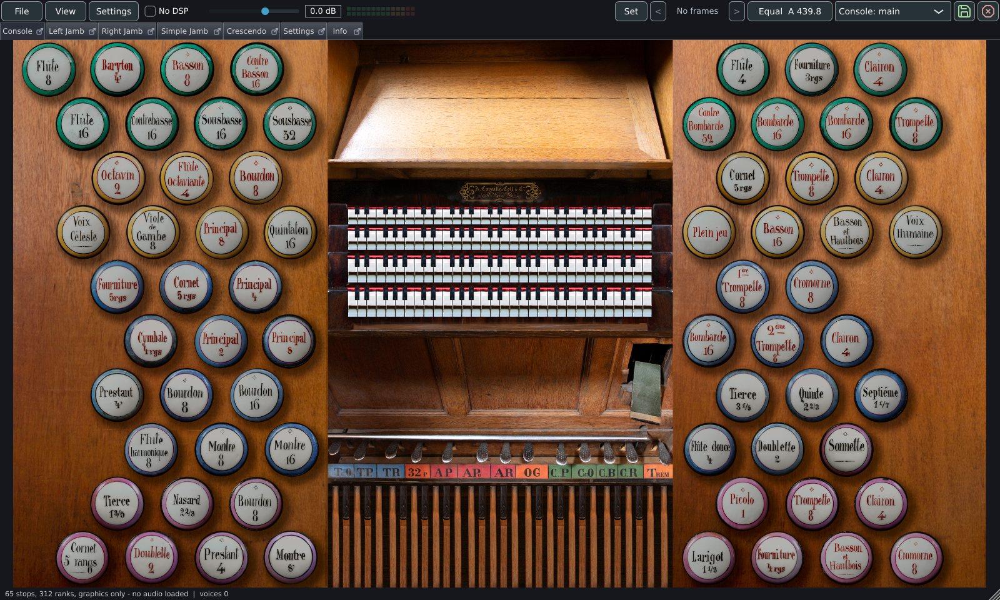

# Introduction

Masterpiece is a free, open-source pipe organ sample player. It plays
Hauptwerk-format sample sets and GrandOrgue organs, each with its own console,
wiring, wind and swell boxes, on Windows, macOS, Linux, Raspberry Pi, Android,
iPhone and iPad, as a standalone program and as VST3, LV2 and AU plugins. It is
part of [OpenPipes](https://openpipes.org), an open-source virtual pipe organ
platform, and is published under the GPL-3.0 licence.

<iframe src="https://www.youtube-nocookie.com/embed/fhQu_pgKQO0?list=PLEi774VY3MkM&rel=0" title="Video tutorial 01 Introduction" loading="lazy" allow="accelerometer; encrypted-media; gyroscope; picture-in-picture; fullscreen" referrerpolicy="strict-origin-when-cross-origin" allowfullscreen></iframe>

This manual has two parts. The **user guide** covers installing the program,
opening sample sets, playing, connecting a console, audio, and the memory and
loading choices that decide which organs a computer can hold, followed by a
complete reference of every setting. The **developer guide** covers building
Masterpiece from source, its architecture, its tests and its performance
figures.

| | |
|---|---|
| Sample set formats | Hauptwerk-format organs (full, compact and composite definitions), GrandOrgue organs (`.organ` definitions and `.orgue` packages) |
| Packages | Installed folders, or straight from `.rar` packages, including solid, multi-part and multi-volume sets; a solid RAR 4 set split into volumes is the exception |
| Samples | WAV and WavPack, at any sample rate |
| Systems | Windows, macOS (Apple silicon and Intel), Linux (x86-64, Flatpak, Debian packages), Raspberry Pi (64-bit and 32-bit), Android, iPhone and iPad |
| Plugins | VST3, LV2, AU |
| Engine | Custom AVX2, SSE2 and NEON vector code; 725 voices per processor thread by default, at least 1,536, up to 16,384 |
| Memory | Samples held as recorded, at 20 or 16 bits, or as 32-bit float; lossless compression in memory; folding to mono; release tails streamed from disk; a sample cache for fast loads |
| Voicing | Voicing EQ with ten presets, EQ per division and per rank, pan and width, pipe detune and wind sway, attack emphasis, release length, an output compressor and limiter, bass management |
| Control | A MIDI channel per manual, MIDI learn for every stop, piston and swell shoe (SysEx included), generals, divisionals and a 999-frame stepper, temperaments, pitch and a transposer |
| Remote control | A web console and a control API over HTTP on the local network, the same requests over OSC and over MIDI System Exclusive |
| Score and recording | A MusicXML score played through the organ with a following cursor; audio and MIDI recording |

## Where to start

- [Installing Masterpiece](guide/installing.md) for the download for your
  system.
- [Opening an organ](guide/opening.md) for sample sets in folders and in their
  packages.
- [MIDI and consoles](guide/midi.md) to connect keyboards, pistons and shoes.
- [Memory, loading and streaming](guide/memory.md) and
  [Small, medium and large organs](guide/sizing.md) before loading a large set.
- [Troubleshooting and caveats](guide/troubleshooting.md) when something does
  not sound as expected.

Questions and ideas are welcome in the
[discussions](https://github.com/bonninr/masterpiece/discussions), and
problems in the [issues](https://github.com/bonninr/masterpiece/issues) of the
repository on GitHub.
